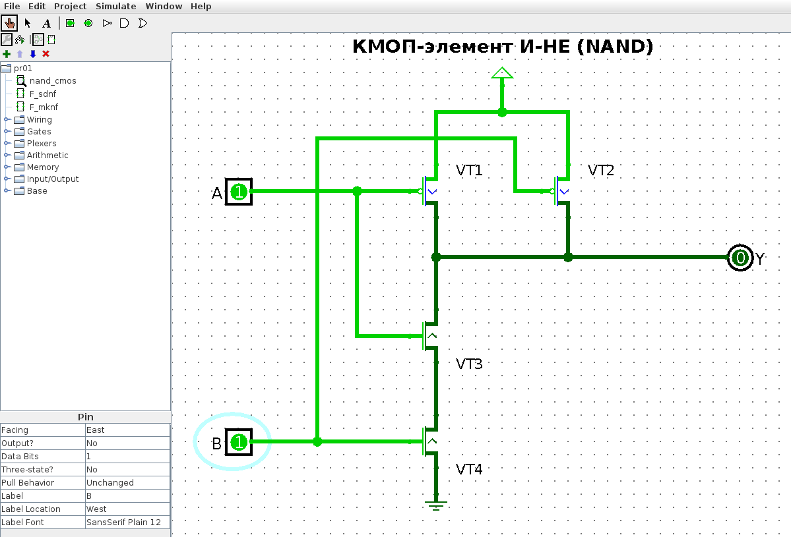
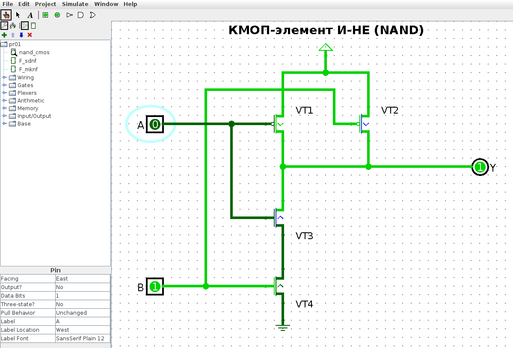
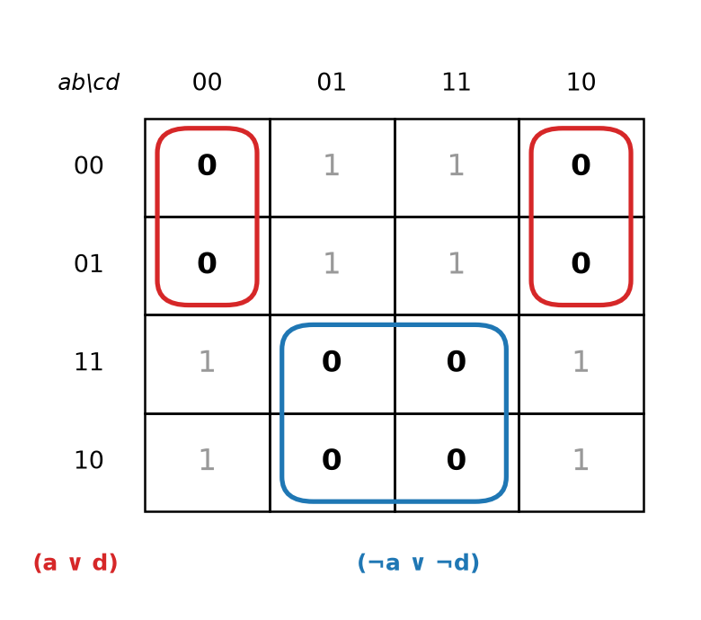
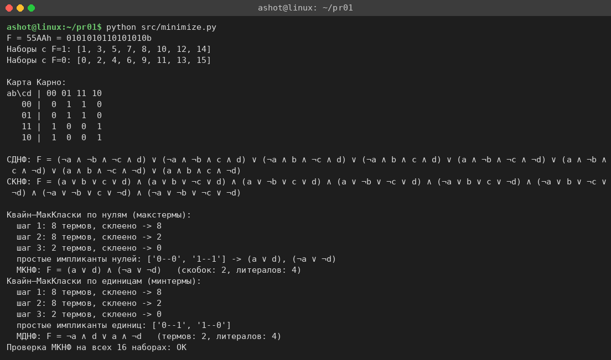
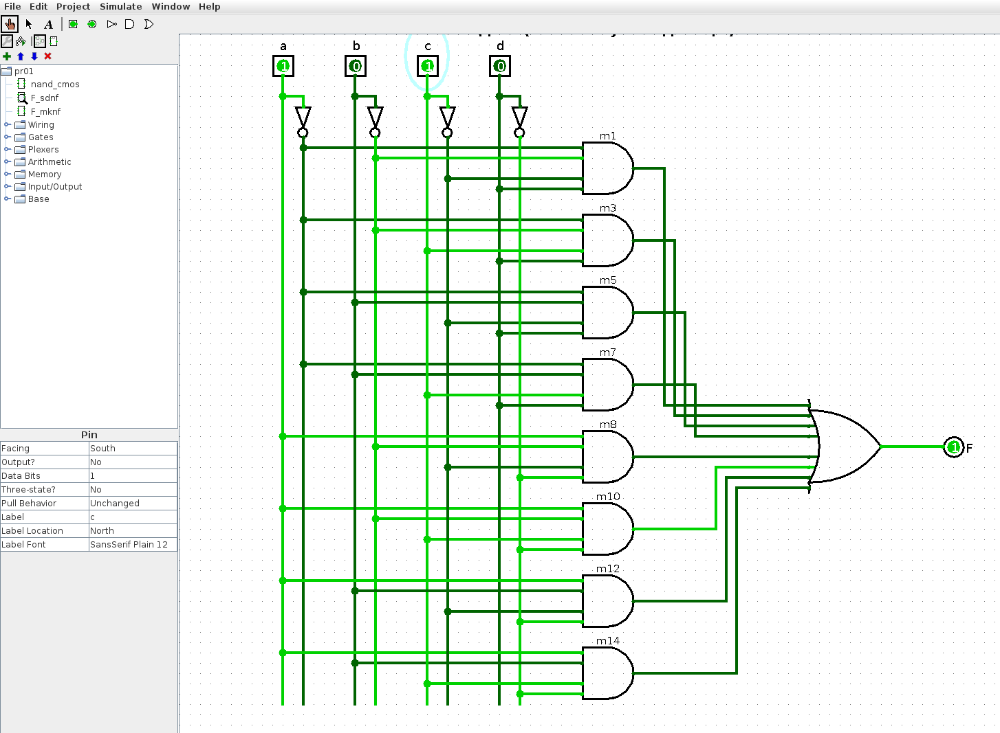
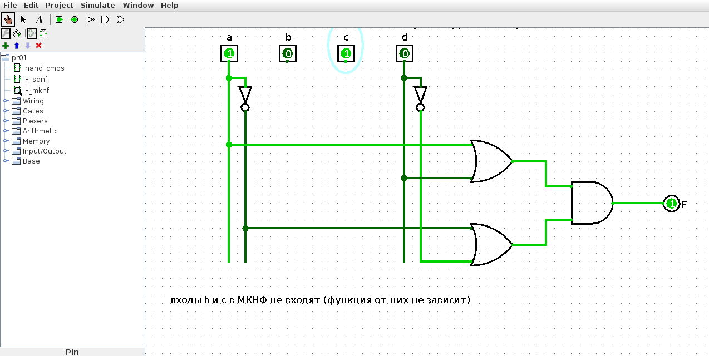
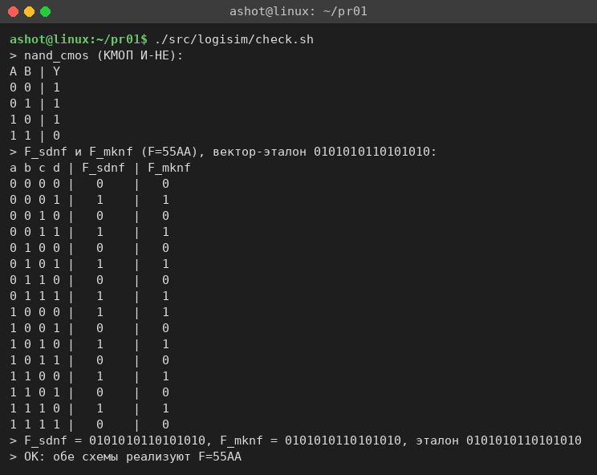

<!-- num: 1; title: Логические элементы, их построение на транзисторе. Синтез цифровых схем -->

# ЦЕЛЬ РАБОТЫ

Изучить принцип работы n- и p-канальных МОП-транзисторов и построение на них логических элементов по КМОП-технологии; освоить синтез логической функции по таблице истинности: построение совершенных нормальных форм (СДНФ, СКНФ) и минимизацию функции картами Карно и методом Квайна–МакКласки; собрать и проверить полученные схемы в среде Logisim.

# ЗАДАНИЕ

Вариант 14.

1. Построить элемент «И-НЕ» на транзисторах.
2. Построить СДНФ и МКНФ функции, заданной шестнадцатеричным вектором F=55AA.
3. Продемонстрировать результат (схемы в Logisim).

# ХОД РАБОТЫ

## 1 Элемент «И-НЕ» на КМОП-транзисторах

МОП-транзистор можно рассматривать как ключ, управляемый напряжением на затворе. n-канальный транзистор открыт, когда на затворе логическая «1», p-канальный — наоборот, когда на затворе «0». В КМОП-элементе каждый вход подаётся одновременно на затворы одного p- и одного n-транзистора, поэтому при любом наборе входов открыта только одна из двух цепей: либо выход подтянут к питанию через p-транзисторы (верхнее плечо), либо к земле через n-транзисторы (нижнее плечо). Сквозного тока между питанием и землёй в статике нет.

Для элемента «И-НЕ» с входами A и B (рис. 1.3 пособия):

- в верхнем плече два p-МОП транзистора VT1 (затвор A) и VT2 (затвор B) включены параллельно между питанием и выходом Y — достаточно одного нуля на входе, чтобы выход получил «1»;
- в нижнем плече два n-МОП транзистора VT3 (затвор A) и VT4 (затвор B) включены последовательно между выходом и землёй — выход соединяется с землёй, только когда открыты оба, то есть A=B=1.

Состояния транзисторов для всех входных наборов сведены в табл. 1. Верхнее и нижнее плечи всегда находятся в противоположных состояниях, а выход равен ¬(A ∧ B).

Таблица 1 – Состояния транзисторов КМОП-элемента «И-НЕ»

| A | B | VT1 (p) | VT2 (p) | VT3 (n) | VT4 (n) | Верхнее плечо | Нижнее плечо | Y |
|---|---|---|---|---|---|---|---|---|
| 0 | 0 | открыт | открыт | закрыт | закрыт | проводит | разомкнуто | 1 |
| 0 | 1 | открыт | закрыт | закрыт | открыт | проводит | разомкнуто | 1 |
| 1 | 0 | закрыт | открыт | открыт | закрыт | проводит | разомкнуто | 1 |
| 1 | 1 | закрыт | закрыт | открыт | открыт | разомкнуто | проводит | 0 |

Схема собрана в Logisim 2.7.1 (файл `src/logisim/pr01.circ`, подсхема `nand_cmos`) из компонентов библиотеки Wiring: Transistor (тип p или n), Power (питание) и Ground (земля). В Logisim транзистор передаёт сигнал от вывода «исток» к выводу «сток», поэтому у p-транзисторов исток подключён к питанию, а цепочка n-транзисторов начинается от земли. На рис. 1 показан режим A=B=1: оба p-транзистора закрыты, оба n-транзистора открыты, и на выход проходит «0» от земли. На рис. 2 — режим A=0, B=1: открыт VT1, выход подтянут к питанию, Y=1; закрытый VT3 при этом отключает выход от земли (узел между VT3 и VT4 имеет уровень «0», так как соединён с землёй через открытый VT4).

## 2 Таблица истинности функции F=55AA

Функция четырёх переменных a, b, c, d задана 16-разрядным вектором значений. Как и в примере пособия (табл. 1.7, F=ADEF), каждая шестнадцатеричная цифра даёт значения функции на четырёх наборах подряд, а старший бит вектора соответствует набору 0000:

$$ F = 55AA₁₆ = 0101 0101 1010 1010₂ $$

Цифра 5 (0101) задаёт наборы 0000–0011 и 0100–0111, цифра A (1010) — наборы 1000–1011 и 1100–1111. Получившаяся таблица истинности — табл. 2.

Таблица 2 – Таблица истинности функции F=55AA

| № | a | b | c | d | F | Цифра вектора |
|---|---|---|---|---|---|---|
| 0 | 0 | 0 | 0 | 0 | 0 | 5 |
| 1 | 0 | 0 | 0 | 1 | 1 | 5 |
| 2 | 0 | 0 | 1 | 0 | 0 | 5 |
| 3 | 0 | 0 | 1 | 1 | 1 | 5 |
| 4 | 0 | 1 | 0 | 0 | 0 | 5 |
| 5 | 0 | 1 | 0 | 1 | 1 | 5 |
| 6 | 0 | 1 | 1 | 0 | 0 | 5 |
| 7 | 0 | 1 | 1 | 1 | 1 | 5 |
| 8 | 1 | 0 | 0 | 0 | 1 | A |
| 9 | 1 | 0 | 0 | 1 | 0 | A |
| 10 | 1 | 0 | 1 | 0 | 1 | A |
| 11 | 1 | 0 | 1 | 1 | 0 | A |
| 12 | 1 | 1 | 0 | 0 | 1 | A |
| 13 | 1 | 1 | 0 | 1 | 0 | A |
| 14 | 1 | 1 | 1 | 0 | 1 | A |
| 15 | 1 | 1 | 1 | 1 | 0 | A |

Функция равна 1 на наборах 1, 3, 5, 7, 8, 10, 12, 14 и равна 0 на наборах 0, 2, 4, 6, 9, 11, 13, 15. Уже по таблице заметно, что значение F определяется только переменными a и d: при a=0 функция повторяет d, при a=1 — инвертирует его.

## 3 Построение СДНФ

СДНФ составляется по строкам, где F=1: каждой такой строке соответствует конъюнкция (конституента единицы), в которую входят все четыре переменные; переменная, равная в наборе 0, берётся с отрицанием, равная 1 — без отрицания. Например, для набора 1 (0001) получаем ¬a ∧ ¬b ∧ ¬c ∧ d, для набора 8 (1000) — a ∧ ¬b ∧ ¬c ∧ ¬d. Дизъюнкция восьми конституент даёт СДНФ (знак ∧ между буквами для краткости опущен):

$$ F(СДНФ) = ¬a¬b¬cd ∨ ¬a¬bcd ∨ ¬ab¬cd ∨ ¬abcd ∨ a¬b¬c¬d ∨ a¬bc¬d ∨ ab¬c¬d ∨ abc¬d $$

Для минимизации по нулям выпишем также СКНФ: по каждой строке с F=0 составляется дизъюнкция всех переменных, где переменная, равная в наборе 1, берётся с отрицанием, а равная 0 — без него:

$$ F(СКНФ) = (a∨b∨c∨d)(a∨b∨¬c∨d)(a∨¬b∨c∨d)(a∨¬b∨¬c∨d)(¬a∨b∨c∨¬d)(¬a∨b∨¬c∨¬d)(¬a∨¬b∨c∨¬d)(¬a∨¬b∨¬c∨¬d) $$

## 4 Минимизация по нулям: карта Карно и МКНФ

Перенесём таблицу истинности на карту Карно 4×4 (табл. 3). Строки карты соответствуют переменным ab, столбцы — cd; и строки, и столбцы идут в порядке кода Грея 00, 01, 11, 10, чтобы соседние клетки отличались значением ровно одной переменной (крайние строки и столбцы тоже соседние — карта «сворачивается» в тор).

Таблица 3 – Карта Карно функции F=55AA

| ab \ cd | 00 | 01 | 11 | 10 |
|---|---|---|---|---|
| 00 | 0 | 1 | 1 | 0 |
| 01 | 0 | 1 | 1 | 0 |
| 11 | 1 | 0 | 0 | 1 |
| 10 | 1 | 0 | 0 | 1 |

Для МКНФ объединяем в прямоугольные группы из 2ᵏ клеток нули функции (рис. 3):

- группа 1 — четыре нуля в строках ab=00, 01 и столбцах cd=00, 10. Столбцы 00 и 10 соседние через границу карты, поэтому это один прямоугольник 2×2. Внутри группы неизменны a=0 и d=0, а b и c меняются. По правилу для нулей переменная, равная 0, входит в дизъюнкцию без отрицания: получаем скобку (a ∨ d);
- группа 2 — четыре нуля в строках ab=11, 10 и столбцах cd=01, 11. Неизменны a=1 и d=1, поэтому скобка (¬a ∨ ¬d).

Обе группы максимальны (расширить их, не захватив единицу, нельзя), то есть являются простыми импликантами, и обе существенные: каждая содержит нули, не покрытые другой группой. Вместе они покрывают все восемь нулей, поэтому

$$ F(МКНФ) = (a ∨ d) ∧ (¬a ∨ ¬d) $$

Минимальность результата проверена программно скриптом `src/minimize.py`. Скрипт строит таблицу истинности по вектору, выписывает СДНФ и СКНФ, методом Квайна–МакКласки находит все простые импликанты для нулей функции и полным перебором подмножеств простых импликант выбирает покрытие с наименьшим числом скобок, а при равенстве — литералов. Склеивание по нулям идёт так:

- исходные макстермы, сгруппированные по числу единиц: {0000}, {0010, 0100}, {0110, 1001}, {1011, 1101}, {1111};
- первый шаг (склеиваются термы соседних групп, отличающиеся в одном разряде): 00-0, 0-00, 0-10, 01-0, 10-1, 1-01, 1-11, 11-1;
- второй шаг: 00-0 с 01-0 и 0-00 с 0-10 дают 0--0; 10-1 с 11-1 и 1-01 с 1-11 дают 1--1;
- на третьем шаге склеиваний нет, простые импликанты: 0--0 → (a ∨ d) и 1--1 → (¬a ∨ ¬d).

Результат скрипта совпадает с картой Карно (рис. 4): МКНФ содержит 2 скобки и 4 литерала. Меньше быть не может: одна скобка обращает функцию в 0 на одной грани четырёхмерного куба, а нули F=55AA лежат на двух непересекающихся гранях. Для сравнения скрипт нашёл и МДНФ: F = ¬a ∧ d ∨ a ∧ ¬d, то есть F = a ⊕ d, что согласуется с наблюдением из п. 2. Раскрыв скобки в МКНФ, получаем то же выражение: (a ∨ d)(¬a ∨ ¬d) = a¬d ∨ ¬ad.

## 5 Схемы функции в Logisim и проверка

По полученным формулам в том же файле `src/logisim/pr01.circ` собраны две схемы.

Подсхема `F_sdnf` (рис. 5) реализует СДНФ так, как это делается в пособии: от каждого входа идут две вертикальные шины — прямая и инвертированная (через элемент НЕ); восемь четырёхвходовых элементов И формируют конституенты единицы m1, m3, m5, m7, m8, m10, m12, m14, а восьмивходовый элемент ИЛИ объединяет их. На рисунке подан набор 1010 (№ 10): активна конституента m10, и F=1.

Подсхема `F_mknf` (рис. 6) реализует МКНФ: два двухвходовых элемента ИЛИ формируют скобки (a ∨ d) и (¬a ∨ ¬d), элемент И — их конъюнкцию. Входы b и c оставлены на схеме, но никуда не подключены, так как функция от них не зависит.

Схема по МКНФ состоит всего из 5 элементов (2 НЕ, 2 ИЛИ, 1 И) против 13 элементов (4 НЕ, 8 И на 4 входа, 1 ИЛИ на 8 входов) в схеме по СДНФ, что наглядно показывает смысл минимизации.

Корректность всех трёх подсхем проверена в симуляторе Logisim. Режим `-tty table` в версии 2.7.1 не перебирает входные наборы, а только печатает изменения выходов при тактировании, поэтому для перебора написан скрипт `src/logisim/logitool.js`. Он выполняется в Nashorn (`jjs` из JDK 8) с `logisim.jar` в classpath: загружает .circ-файл средствами Logisim, для каждого набора выставляет значения на входных контактах, запускает распространение сигналов (тот же механизм использует команда «Анализ схемы») и читает выходы. Скрипт `src/logisim/check.sh` строит таблицы для `nand_cmos`, `F_sdnf`, `F_mknf` и сравнивает столбцы F с вектором 55AA (рис. 7). Все таблицы совпали с табл. 1 и табл. 2.

Схемы в файле сгенерированы скриптом `src/logisim/gen_pr01.py` (модуль `circgen.py` расставляет компоненты на сетке и соединяет их проводами); файл открывается в Logisim 2.7.1 и редактируется в нём обычным образом.

# ВЫВОДЫ

В работе построен КМОП-элемент «И-НЕ» на четырёх МОП-транзисторах: два p-канальных транзистора включены параллельно в верхнем плече, два n-канальных — последовательно в нижнем. Таблица состояний транзисторов и моделирование в Logisim подтвердили, что выход равен 0 только при A=B=1 и что плечи никогда не открыты одновременно.

Для функции F=55AA по таблице истинности построены СДНФ (8 конституент единицы) и СКНФ (8 конституент нуля). Минимизация по нулям картой Карно дала МКНФ F = (a ∨ d)(¬a ∨ ¬d), её минимальность подтверждена методом Квайна–МакКласки с полным перебором покрытий. Функция оказалась «исключающим ИЛИ» переменных a и d и не зависит от b и c. Схемы по СДНФ и МКНФ собраны в Logisim; их таблицы истинности, полученные в симуляторе, совпадают с заданным вектором, а схема по МКНФ содержит в 2,6 раза меньше элементов.
