<!-- num: 2; title: Комбинационные схемы, элементы памяти, счётчики -->

# ЦЕЛЬ РАБОТЫ

Изучить устройство и работу комбинационных схем (на примере шифратора) и элементов памяти (на примере T-триггера), научиться синтезировать счётчик с произвольным порядком счёта по графу переходов: составлять таблицы состояний и переходов, получать функции возбуждения триггеров newQ и реализовывать счётчик на D-триггерах в среде Logisim.

# ЗАДАНИЕ

Вариант 14.

1. Разобрать шифратор с 2 входными сигналами и T-триггер, составить таблицу истинности.
2. Реализовать счётчик согласно варианту 15 табл. 2.11 (последовательность состояний 11 12 1 9 2 14 8 7 6 4 13 10 15 5 0 3, подставляемая в шаблон графа рис. 2.14).

Все схемы собраны в Logisim 2.7.1 (файлы в каталоге `src/logisim`).

# ХОД РАБОТЫ

## 1 Шифратор

Шифратор (Coder) — комбинационная схема, обратная дешифратору: у него 2ⁿ входов и n выходов, и номер активного входа преобразуется в n-разрядный двоичный код. Формулировка «шифратор с 2 входными сигналами» трактуется по аналогии с вариантами для дешифратора: в пособии УГО шифратора приведено именно для двухразрядного случая (рис. 2.2 «2-х разрядный шифратор», табл. 2.2 «шифратор 4-2»), то есть число 2 относится к разрядности кода. Буквальный шифратор с двумя входами I0, I1 вырождается в один провод (a0 = I1), поэтому разбирается шифратор 4→2: входы I0…I3, выходы a1 a0.

Неприоритетный шифратор допускает на входе только одну единицу; её номер и выдаётся на выход (табл. 1). Выход a0 должен быть равен 1 для входов с нечётными номерами (I1, I3), выход a1 — для входов с номерами 2 и 3:

$$ a0 = I1 ∨ I3,   a1 = I2 ∨ I3 $$

Вход I0 в формулы не входит: ему соответствует код 00, который получается сам собой, когда остальные входы равны нулю. Из-за этого шифратор не отличает «активен I0» от «нет ни одного сигнала» — на практике для этого добавляют отдельный выход признака активности.

Таблица 1 – Таблица истинности неприоритетного шифратора 4-2

| I3 | I2 | I1 | I0 | a1 | a0 |
|---|---|---|---|---|---|
| 0 | 0 | 0 | 1 | 0 | 0 |
| 0 | 0 | 1 | 0 | 0 | 1 |
| 0 | 1 | 0 | 0 | 1 | 0 |
| 1 | 0 | 0 | 0 | 1 | 1 |

Схема (подсхема `coder_4_2` в файле `coder.circ`) состоит из двух элементов ИЛИ (рис. 1). На рисунке активен вход I2, на выходе код 10.

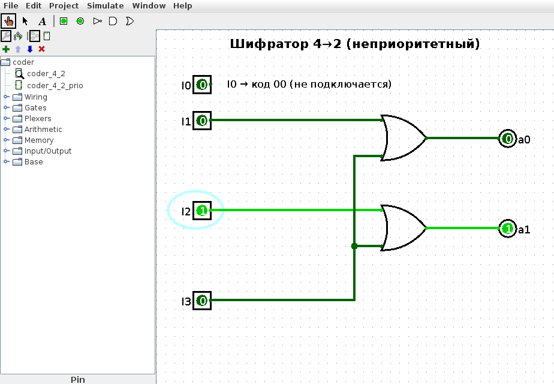

В пособии отдельно описан приоритетный шифратор: единиц на входах может быть несколько, и кодируется номер старшей из них. Его таблица истинности с безразличными значениями X приведена в табл. 2.

Таблица 2 – Таблица истинности приоритетного шифратора 4-2

| I3 | I2 | I1 | I0 | a1 | a0 |
|---|---|---|---|---|---|
| 0 | 0 | 0 | 1 | 0 | 0 |
| 0 | 0 | 1 | X | 0 | 1 |
| 0 | 1 | X | X | 1 | 0 |
| 1 | X | X | X | 1 | 1 |

Выход a1 равен 1, если активен I3 или I2, независимо от младших входов. Выход a0 равен 1, если активен I3, либо активен I1 и при этом не активен более приоритетный I2:

$$ a1 = I2 ∨ I3,   a0 = I3 ∨ I1 ∧ ¬I2 $$

Схема `coder_4_2_prio` показана на рис. 2: на входах одновременно I1=1 и I2=1, и шифратор выдаёт код 10 — побеждает старший вход I2, как в примере из пособия.

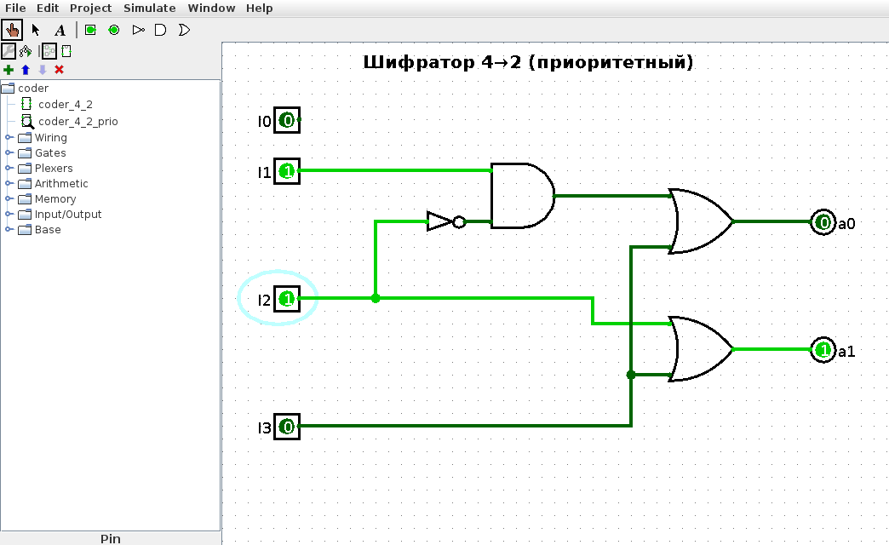

## 2 T-триггер

T-триггер (счётный триггер) меняет своё состояние на противоположное при каждом импульсе на входе T. В пособии (рис. 2.10) он построен на основе двухступенчатого RS-триггера на элементах И-НЕ с обратными связями с выхода на вход. По этой схеме собрана подсхема `t_trigger` (файл `t_trigger.circ`, рис. 3):

- G3, G4 — RS-защёлка ведущей (первой) ступени, G7, G8 — RS-защёлка ведомой (второй) ступени; у всех четырёх элементов есть третий вход для асинхронных сигналов установки nS и сброса nR (активный уровень — ноль);
- G1 = ¬(T ∧ ¬Q) и G2 = ¬(T ∧ Q) — входные элементы ведущей ступени; на них заведены обратные связи с выходов ¬Q и Q, поэтому при T=1 в ведущую ступень записывается значение ¬Q;
- G9 — элемент И-НЕ с объединёнными входами, работает как инвертор и даёт сигнал ¬T;
- G5, G6 — входные элементы ведомой ступени; они открыты при ¬T=1, то есть при T=0, и переписывают в ведомую ступень состояние ведущей.

Пока T=1, ведущая ступень принимает ¬Q, а ведомая заблокирована и хранит старое Q. При спаде T из 1 в 0 ведущая ступень блокируется, а ведомая открывается и копирует её состояние — выход Q меняется на противоположный. Благодаря двум ступеням выход не успевает «пробежать» несколько переключений за один импульс. Таблица переходов (в форме табл. 2.8 пособия) — табл. 3: T и T(t+1) — значения входа до и после очередного изменения, Q и Q(t+1) — состояние триггера.

Таблица 3 – Таблица переходов T-триггера

| T | T(t+1) | Q | Q(t+1) | Пояснение |
|---|---|---|---|---|
| 0 | 0 | 0 | 0 | вход не меняется — хранение |
| 0 | 0 | 1 | 1 | хранение |
| 1 | 1 | 0 | 0 | хранение |
| 1 | 1 | 1 | 1 | хранение |
| 0 | 1 | 0 | 0 | фронт: ¬Q записывается в ведущую ступень, выход не меняется |
| 0 | 1 | 1 | 1 | то же |
| 1 | 0 | 0 | 1 | спад: ведомая ступень переписывает ¬Q — переключение |
| 1 | 0 | 1 | 0 | переключение |

Асинхронные входы действуют независимо от T (табл. 4). Комбинация nS=nR=0 запрещена, как у RS-триггера: оба выхода становятся равными 1. После включения схемы в Logisim все входы равны 0, поэтому сначала нужно подать nS=1 (триггер сбросится в Q=0), а затем nR=1.

Таблица 4 – Действие асинхронных входов T-триггера

| nS | nR | Q | ¬Q | Режим |
|---|---|---|---|---|
| 0 | 1 | 1 | 0 | установка |
| 1 | 0 | 0 | 1 | сброс |
| 1 | 1 | Q | ¬Q | счётный режим по входу T |
| 0 | 0 | 1 | 1 | запрещённая комбинация |

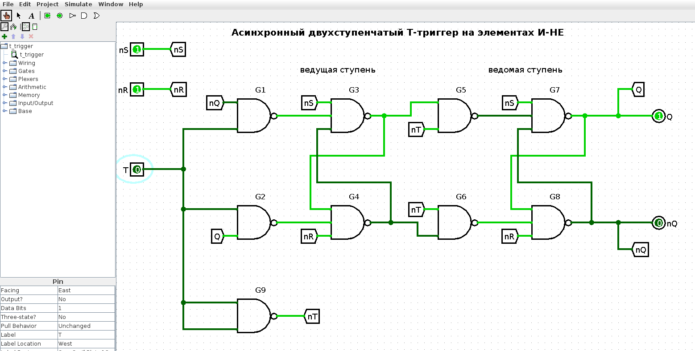

Работа триггера проверена симуляцией в Logisim (рис. 10): после сброса Q=0, по фронту T выход не меняется, а по каждому спаду T переключается 0 → 1 → 0 → 1, что совпадает с табл. 3.

## 3 Счётчик: граф состояний и таблица переходов

Счётчик имеет модуль 16 и строится на четырёх D-триггерах Q3…Q0. Порядок счёта задаётся шаблонным графом рис. 2.14: в нём 16 узлов (позиции 0…15) и три развилки, где следующее состояние зависит от внешних сигналов: после позиции 1 по переменной a, после позиций 3 и 10 — по переменной b. Как и в примере пособия, в узлы шаблона подставляются числа из строки варианта: для строки 15 табл. 2.11 в позицию 0 ставится 11, в позицию 1 — 12 и так далее (табл. 5). Получившийся граф переходов показан на рис. 4 (серым — номер позиции шаблона). Направление ветвей принято так, как подписано на рис. 2.14: при a=1 переход идёт по левой ветви, при a=0 — по правой, аналогично для b. В тексте пособия к примеру варианта 1 ветвь a=1 описана как правая; при такой трактовке достаточно поменять местами сигналы R1↔R2, R3↔R4 и R5↔R6 из п. 4, остальной синтез не меняется.

Таблица 5 – Таблица состояний счётчика (табл. 2.9 для варианта 15)

| № в шаблоне графа | Состояние из табл. 2.11 | Двоичный код Q3Q2Q1Q0 |
|---|---|---|
| 0 | 11 | 1011 |
| 1 | 12 | 1100 |
| 2 | 1 | 0001 |
| 3 | 9 | 1001 |
| 4 | 2 | 0010 |
| 5 | 14 | 1110 |
| 6 | 8 | 1000 |
| 7 | 7 | 0111 |
| 8 | 6 | 0110 |
| 9 | 4 | 0100 |
| 10 | 13 | 1101 |
| 11 | 10 | 1010 |
| 12 | 15 | 1111 |
| 13 | 5 | 0101 |
| 14 | 0 | 0000 |
| 15 | 3 | 0011 |

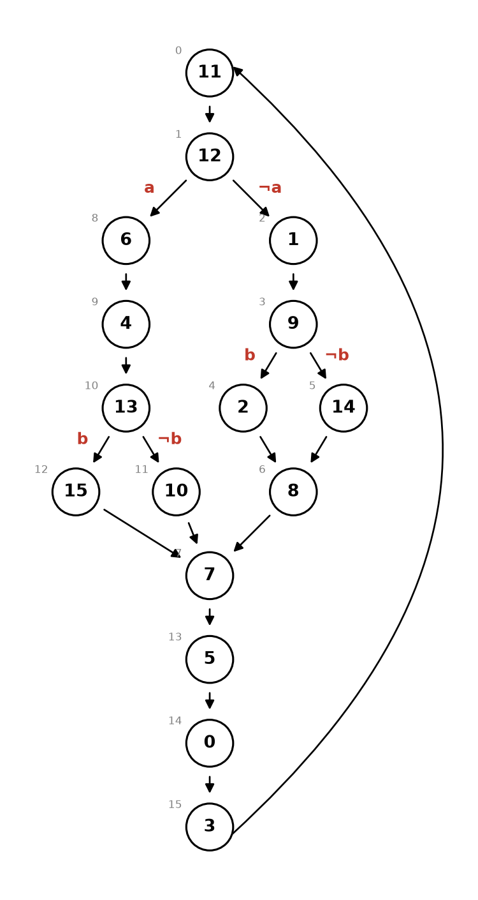

D-триггеры в Logisim после запуска находятся в состоянии 0, поэтому таблицу переходов, как и в пособии, начинаем с нуля: 0 → 3 → 11 → 12. Состояние 12 — развилка по a: в таблицу заносятся две строки со старым состоянием 12 и условиями a и ¬a (переходы в 6 и 1). Далее проходим левую ветвь 6 → 4 → 13 (развилка по b: 15 или 10), затем правую ветвь 1 → 9 (развилка по b: 2 или 14), и замыкаем граф: 15, 10, 2, 14, 8 → 7 → 5 → 0. Итоговая таблица переходов — табл. 6; в ней 16 состояний и 19 переходов (по две строки у трёх развилок).

Таблица 6 – Таблица переходов счётчика (табл. 2.10 для варианта 15)

| Старое № | Старый код | Условие | Новое № | Новый код |
|---|---|---|---|---|
| 0 | 0000 | – | 3 | 0011 |
| 3 | 0011 | – | 11 | 1011 |
| 11 | 1011 | – | 12 | 1100 |
| 12 | 1100 | a | 6 | 0110 |
| 12 | 1100 | ¬a | 1 | 0001 |
| 6 | 0110 | – | 4 | 0100 |
| 4 | 0100 | – | 13 | 1101 |
| 13 | 1101 | b | 15 | 1111 |
| 13 | 1101 | ¬b | 10 | 1010 |
| 15 | 1111 | – | 7 | 0111 |
| 10 | 1010 | – | 7 | 0111 |
| 1 | 0001 | – | 9 | 1001 |
| 9 | 1001 | b | 2 | 0010 |
| 9 | 1001 | ¬b | 14 | 1110 |
| 2 | 0010 | – | 8 | 1000 |
| 14 | 1110 | – | 8 | 1000 |
| 8 | 1000 | – | 7 | 0111 |
| 7 | 0111 | – | 5 | 0101 |
| 5 | 0101 | – | 0 | 0000 |

Счётчик проходит за один круг 10 состояний, а какие именно — определяют сигналы a и b: при a=1 цикл 0, 3, 11, 12, 6, 4, 13, {15 или 10}, 7, 5; при a=0 цикл 0, 3, 11, 12, 1, 9, {2 или 14}, 8, 7, 5. Все 16 состояний достижимы.

## 4 Функции возбуждения newQ по методу пособия

У D-триггера Q(t+1) = D, поэтому на вход D каждого разряда нужно подать значение этого разряда в следующем состоянии — функцию newQ. Следуя пособию, функции строятся в три шага.

1. Дешифратор текущего состояния: 16 четырёхвходовых элементов И формируют сигналы st0…st15, stₖ = 1 только в состоянии k (например, st12 = Q3 ∧ Q2 ∧ ¬Q1 ∧ ¬Q0).
2. Сигналы развилок (схема коррекции, рис. 2.18): R1 = A ∧ st12 (переход в 6), R2 = ¬A ∧ st12 (в 1), R3 = B ∧ st13 (в 15), R4 = ¬B ∧ st13 (в 10), R5 = B ∧ st9 (в 2), R6 = ¬B ∧ st9 (в 14).
3. Для каждого разряда k элемент ИЛИ собирает все переходы, после которых этот разряд равен 1: сигнал stₛ, если состояние s без развилки и в коде следующего состояния разряд k равен 1, и сигнал Rᵢ, если в коде состояния, куда ведёт соответствующая ветвь, разряд k равен 1.

Например, для newQ0 выбираем по табл. 6 переходы в нечётные состояния: 0→3, 1→9, 3→11, 4→13, 7→5, 8→7, 10→7, 15→7, а также ветви 12→1 (R2) и 13→15 (R3). Аналогично для остальных разрядов:

$$ newQ3 = st1 ∨ st2 ∨ st3 ∨ st4 ∨ st11 ∨ st14 ∨ R3 ∨ R4 ∨ R6 $$

$$ newQ2 = st4 ∨ st6 ∨ st7 ∨ st8 ∨ st10 ∨ st11 ∨ st15 ∨ R1 ∨ R3 ∨ R6 $$

$$ newQ1 = st0 ∨ st3 ∨ st8 ∨ st10 ∨ st15 ∨ R1 ∨ R3 ∨ R4 ∨ R5 ∨ R6 $$

$$ newQ0 = st0 ∨ st1 ∨ st3 ∨ st4 ∨ st7 ∨ st8 ∨ st10 ∨ st15 ∨ R2 ∨ R3 $$

В newQ3 и newQ1 входят обе ветви развилки в состоянии 13 (R3 ∨ R4 = st13), так как и 15, и 10 имеют единицу в этих разрядах; для единообразия со схемой пособия они оставлены в виде R3 и R4.

## 5 Минимизация функций newQ

Функции newQ3…newQ0 зависят от шести переменных: Q3, Q2, Q1, Q0, a, b. Полная таблица функций возбуждения (64 набора) компактно записана в табл. 7: строка — текущее состояние, столбец — значения входов a, b, в клетке — код следующего состояния Q3Q2Q1Q0, разряды которого и есть значения newQ3…newQ0. От a и b зависят только строки 9, 12 и 13.

Таблица 7 – Функции возбуждения newQ3 newQ2 newQ1 newQ0

| Q3Q2Q1Q0 | ab=00 | ab=01 | ab=10 | ab=11 |
|---|---|---|---|---|
| 0000 (0) | 0011 | 0011 | 0011 | 0011 |
| 0001 (1) | 1001 | 1001 | 1001 | 1001 |
| 0010 (2) | 1000 | 1000 | 1000 | 1000 |
| 0011 (3) | 1011 | 1011 | 1011 | 1011 |
| 0100 (4) | 1101 | 1101 | 1101 | 1101 |
| 0101 (5) | 0000 | 0000 | 0000 | 0000 |
| 0110 (6) | 0100 | 0100 | 0100 | 0100 |
| 0111 (7) | 0101 | 0101 | 0101 | 0101 |
| 1000 (8) | 0111 | 0111 | 0111 | 0111 |
| 1001 (9) | 1110 | 0010 | 1110 | 0010 |
| 1010 (10) | 0111 | 0111 | 0111 | 0111 |
| 1011 (11) | 1100 | 1100 | 1100 | 1100 |
| 1100 (12) | 0001 | 0001 | 0110 | 0110 |
| 1101 (13) | 1010 | 1111 | 1010 | 1111 |
| 1110 (14) | 1000 | 1000 | 1000 | 1000 |
| 1111 (15) | 0111 | 0111 | 0111 | 0111 |

Карта Карно на шесть переменных ненаглядна, поэтому минимизация выполнена методом Квайна–МакКласки скриптом `src/counter_model.py`: для каждого разряда минтермы склеиваются до получения простых импликант, выбираются существенные импликанты, а оставшиеся наборы покрываются полным перебором — так получается покрытие с минимальным числом термов, а среди них с минимальным числом литералов. Результат (рис. 5):

$$ newQ3 = ¬Q2Q1Q0 ∨ ¬Q3¬Q2Q0 ∨ ¬Q3¬Q2Q1 ∨ ¬Q3Q2¬Q1¬Q0 ∨ Q3Q2¬Q1Q0 ∨ Q3Q2Q1¬Q0 ∨ ¬Q2Q0¬b $$

$$ newQ2 = ¬Q3Q2¬Q0 ∨ Q3¬Q2¬b ∨ Q3¬Q2¬Q0 ∨ Q3Q2Q0b ∨ Q2¬Q1¬Q0a ∨ Q2Q1Q0 ∨ Q3Q1Q0 $$

$$ newQ1 = ¬Q2¬Q1¬Q0 ∨ ¬Q3¬Q2Q1Q0 ∨ Q3¬Q1a ∨ Q3¬Q2¬Q0 ∨ Q3Q2Q0 ∨ Q3¬Q1Q0 $$

$$ newQ0 = ¬Q1¬Q0¬a ∨ Q2Q1Q0 ∨ ¬Q3¬Q1¬Q0 ∨ Q3¬Q2¬Q0 ∨ Q3Q2Q0b ∨ ¬Q3¬Q2Q0 $$

Минимальные формы содержат 7, 7, 6 и 6 термов (24, 23, 19 и 19 литералов). Скрипт проверил, что на всех 64 наборах граф переходов, функции в форме пособия и МДНФ дают одинаковое следующее состояние, и прогнал счётчик по МДНФ при всех четырёх комбинациях a, b.

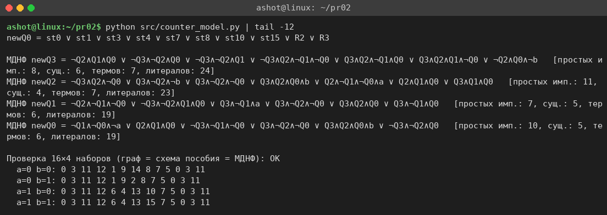

Для реализации выбран способ пособия (дешифратор + ИЛИ): он нагляднее связан с графом, и для изменения порядка счёта достаточно перекоммутировать входы элементов ИЛИ. Минимизированные функции собраны отдельной проверочной подсхемой.

## 6 Реализация счётчика в Logisim

Счётчик собран в файле `counter.circ`, подсхема `counter` (рис. 6–8). Как и в пособии, большая часть соединений выполнена через туннели с метками:

- верхний ряд (рис. 7): четыре D-триггера, по одному на разряд; на вход D разряда k подаётся туннель newQk, на вход синхронизации — общий тактовый сигнал clk от генератора Clock; прямые и инверсные выходы выведены в туннели Qk и nQk; входы A и B (переменные развилок) — контакты слева; состояние счётчика собирается разветвителем в 4-разрядную шину и показывается на шестнадцатеричном индикаторе и выходе Q;
- нижняя левая часть — дешифратор состояний st0…st15 (рис. 2.17 пособия): шины Q3, ¬Q3, …, Q0, ¬Q0 и 16 элементов И на 4 входа;
- в центре (рис. 8) — инверторы для ¬A, ¬B и элементы И, формирующие R1…R6;
- справа (рис. 8) — четыре элемента ИЛИ, реализующие формулы newQ0…newQ3 из п. 4, их выходы идут в туннели newQ0…newQ3, то есть обратно на входы D.

На рис. 6 счётчик показан после трёх тактов при A=1, B=1: пройдены состояния 0 → 3 → 11 → 12, индикатор показывает «C» (12).

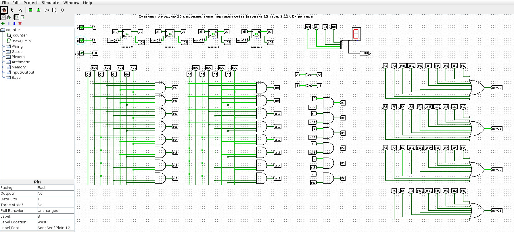

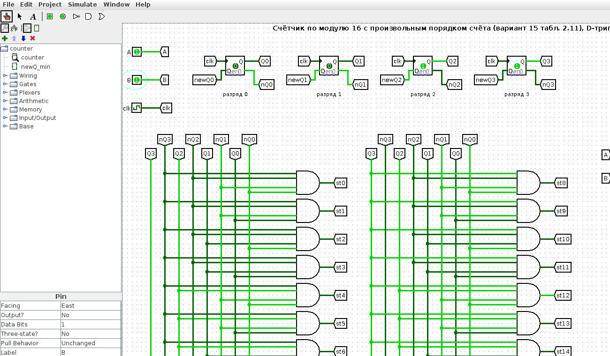

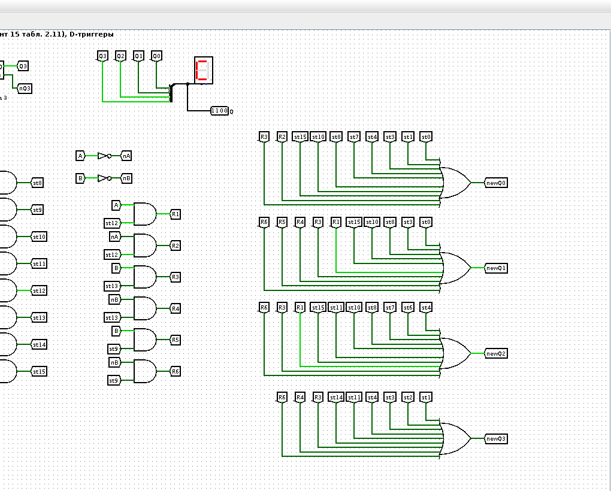

Подсхема `newQ_min` (рис. 9) реализует минимизированные функции из п. 5: шесть входов с прямыми и инверсными шинами, 26 элементов И и четыре элемента ИЛИ. На рисунке подано состояние 12 (1100) при a=1: на выходах newQ = 0110, то есть следующее состояние 6, как в табл. 6.

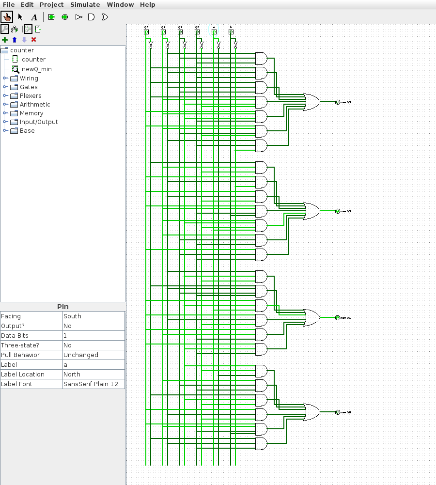

## 7 Проверка схем в симуляторе Logisim

Все схемы проверены в движке Logisim без ручного «прощёлкивания». Скрипт `src/logisim/logitool.js` (выполняется в Nashorn, `jjs` из JDK 8, с `logisim.jar` в classpath) загружает .circ-файл средствами Logisim, выставляет значения входных контактов, выполняет такты генератора и читает выходы. Скрипт `src/logisim/check_pr02.py` вызывает его и сравнивает результаты с моделью (рис. 10):

- для неприоритетного шифратора выводятся допустимые наборы — они совпадают с табл. 1; для приоритетного на всех 16 наборах на выходе номер старшей активной линии (табл. 2);
- для T-триггера после сброса выход переключается по каждому спаду T, что соответствует табл. 3;
- подсхема `newQ_min` совпадает с графом переходов на всех 64 наборах;
- счётчик `counter` при каждой из четырёх комбинаций A, B прогнан 12 тактов из состояния 0; последовательности совпали с моделью, и вместе они проходят все 19 переходов табл. 6 и все 16 состояний.

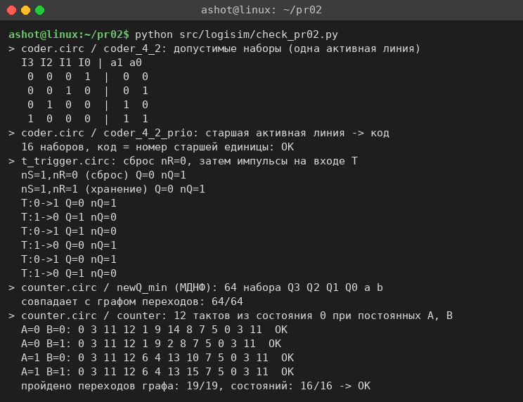

Дополнительно счётчик запущен штатным консольным режимом Logisim `-tty table`, в котором программа сама тактирует генератор и печатает выход Q при каждом изменении (рис. 11). Входы A и B при этом равны 0, и счётчик идёт по циклу 0, 3, 11, 12, 1, 9, 14, 8, 7, 5, 0, … — ветви ¬a и ¬b графа рис. 4.

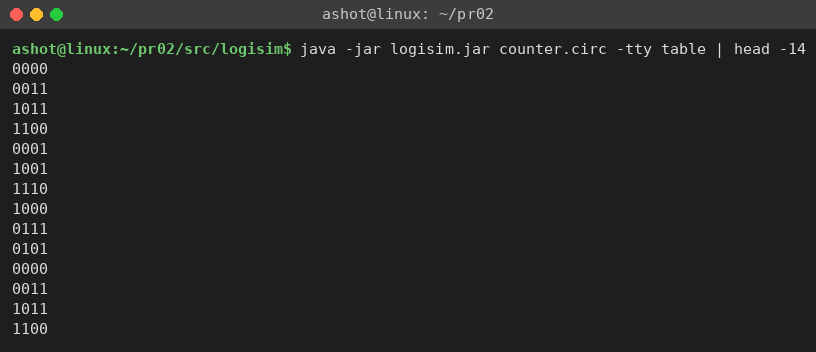

Схемы сгенерированы скриптом `src/logisim/gen_pr02.py` (список соединений берётся из модели `src/counter_model.py`), файлы открываются и редактируются в Logisim 2.7.1 обычным образом.

# ВЫВОДЫ

В работе разобран шифратор 4→2: для неприоритетного варианта выходы a0 = I1 ∨ I3, a1 = I2 ∨ I3, для приоритетного a0 = I3 ∨ I1¬I2, a1 = I2 ∨ I3; обе схемы собраны в Logisim и проверены по таблицам истинности. По схеме пособия собран асинхронный двухступенчатый T-триггер на девяти элементах И-НЕ; моделирование подтвердило, что он переключается по спаду входного сигнала T, а двухступенчатая структура исключает многократное переключение за один импульс.

Для счётчика по варианту 15 построены граф состояний, таблица состояний и таблица переходов с тремя развилками по сигналам a и b. Функции возбуждения newQ3…newQ0 получены по методу пособия (дешифратор состояний, сигналы развилок R1–R6, элементы ИЛИ) и дополнительно минимизированы методом Квайна–МакКласки до 6–7 термов на разряд. Счётчик на четырёх D-триггерах реализован в Logisim; прогон в симуляторе при всех комбинациях a, b прошёл все 19 переходов графа и совпал с моделью, как и подсхема с минимизированными функциями.
