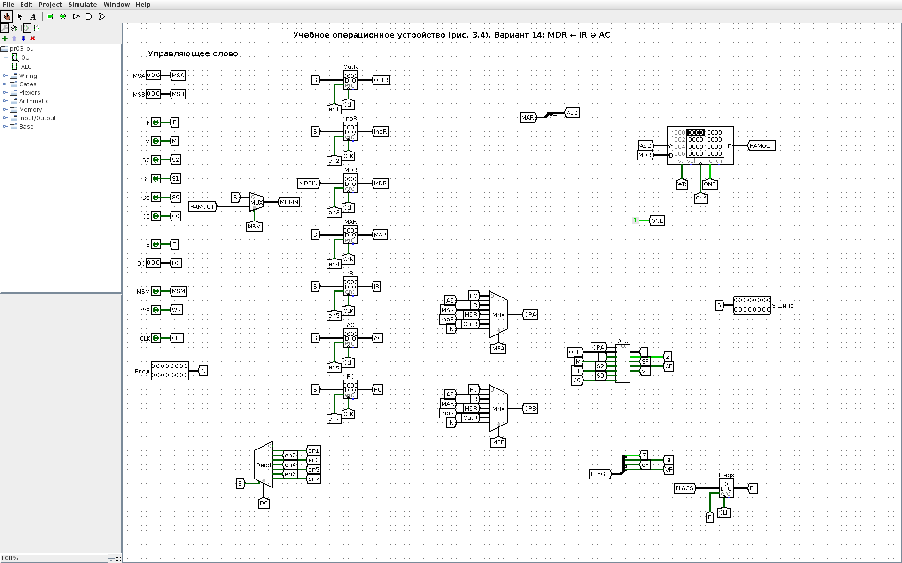
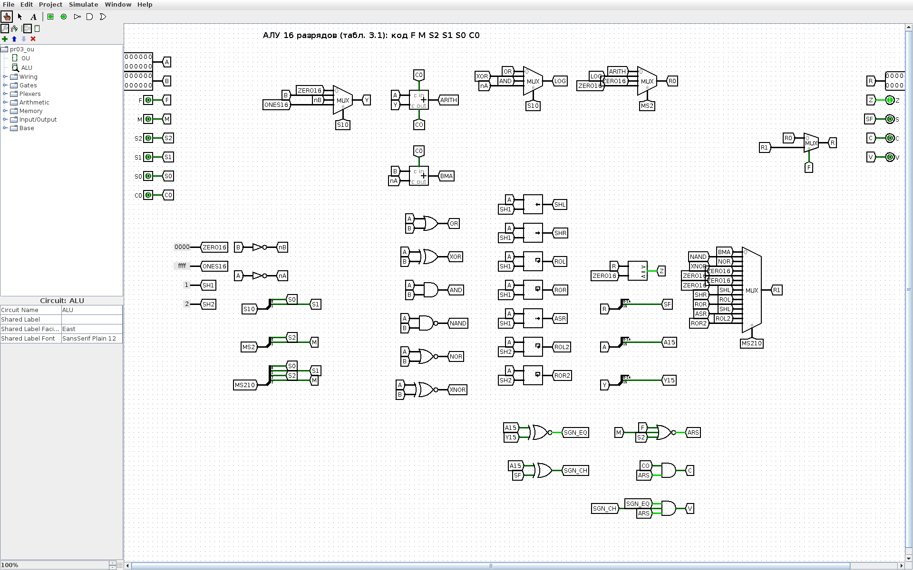
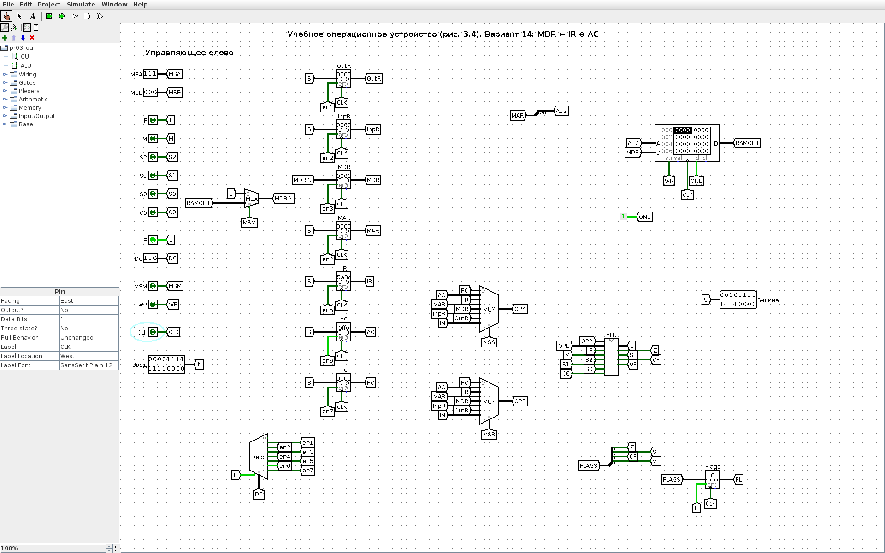
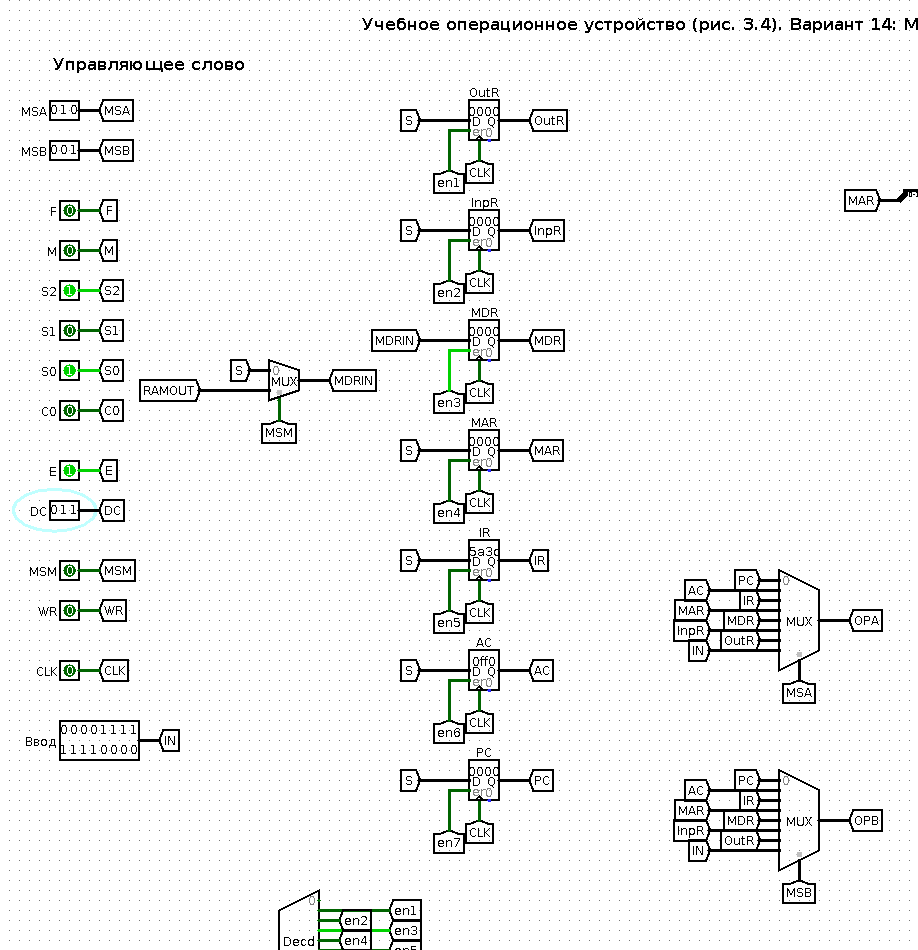
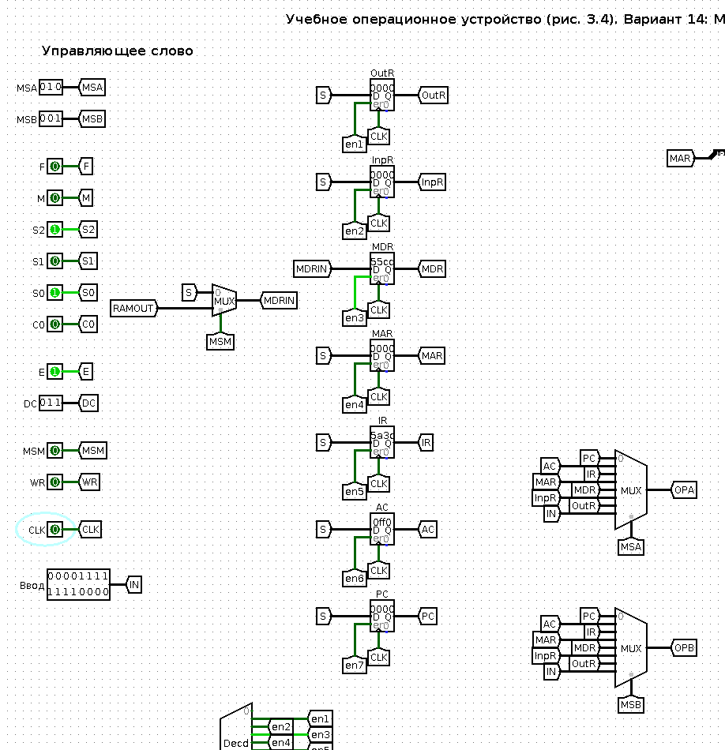
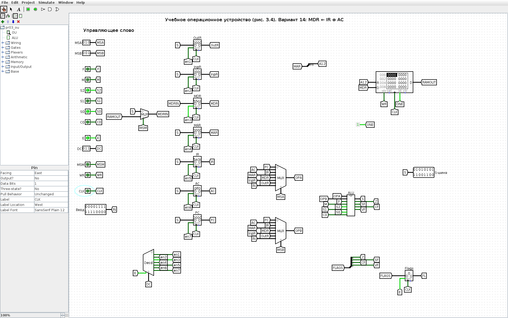
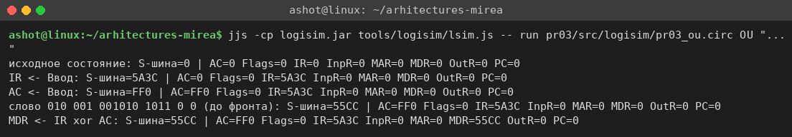

<!-- num: 3; title: Операционное устройство ЦП -->

# ЦЕЛЬ РАБОТЫ

Изучить устройство учебного операционного устройства (ОУ) центрального процессора: назначение регистров PC, IR, AC, MAR, MDR, InpR, OutR, работу арифметико-логического устройства и системы флагов, управление потоками данных с помощью мультиплексоров и дешифратора. Научиться записывать 18-разрядное управляющее слово ОУ для заданной микрооперации и проверить его на модели ОУ в Logisim.

# ЗАДАНИЕ

Вариант 14. Записать управляющее слово учебного ОУ (табл. 3.2) для микрооперации

$$ MDR ← IR ⊕ AC $$

и продемонстрировать её выполнение.

# ХОД РАБОТЫ

## 1 Смысл микрооперации

Микрооперация MDR ← IR ⊕ AC означает: содержимое регистра команд IR и аккумулятора AC подаётся на входы АЛУ, над ними выполняется побитовое исключающее ИЛИ, результат по S-шине записывается в регистр данных памяти MDR. Значения IR и AC при этом не меняются, обращения к памяти нет. Для формирования управляющего слова нужно определить пять полей (табл. 3.2): MS(A), MS(B), ALU, DC, MS(M) и WR.

## 2 Коды источников и приёмников

По схеме учебного ОУ (рис. 3.4 пособия) выходы регистров подключены к информационным входам мультиплексоров MS A и MS B, а выходы дешифратора DC — к входам разрешения записи регистров. Коды, снятые со схемы, сведены в табл. 1. Эти же коды используются в табл. 4.7 пособия (например, MAR ← PC: MS(A) = 000, DC = 1100; IR ← MDR: MS(A) = 100, DC = 1101) и в примере табл. 3.3 (MAR ← … : DC = 1100), поэтому они согласованы между собой.

Таблица 1 – Коды входов мультиплексоров MS A / MS B и выходов дешифратора DC (рис. 3.4)

| Код | Вход MS A / MS B | Выход DC (запись в регистр) |
|---|---|---|
| 000 | PC | — (не используется) |
| 001 | AC | OutR |
| 010 | IR | InpR |
| 011 | MAR | MDR |
| 100 | MDR | MAR |
| 101 | InpR | IR |
| 110 | OutR | AC |
| 111 | Ввод | PC |

Замечание: в текстовом примере п. 3.4 для IR и AC названы коды 101 и 110 — это номера выходов дешифратора DC, через которые эти регистры записываются. Для мультиплексоров по рис. 3.4 и табл. 4.7 IR имеет код 010, AC — 001; ими и пользуемся.

Для варианта 14: операнд A — IR, MS(A) = 010; операнд B — AC, MS(B) = 001; приёмник — MDR, DC: E = 1, x2 x1 x0 = 011.

## 3 Код операции АЛУ

Поле ALU состоит из битов F M S2 S1 S0 C (табл. 3.1). По описанию входов АЛУ: F = 0 — «арифметика и стандартные логические операции», M = 0 — обычные операции над регистрами A/B, S2 S1 S0 — код операции внутри группы, C — входной перенос. Первые строки табл. 3.1 при F = 0, M = 0 идут в порядке возрастания кода: при S2 = 0 — восемь арифметических операций (S1 S0 C), что подтверждается примером табл. 3.3, где «Сумма» A + B имеет код 000010; при S2 = 1 — четыре логические операции в порядке табл. 3.1 (∨, ⊕, ∧, инверсия A), бит C на них не влияет. Получаемые коды приведены в табл. 2.

Таблица 2 – Коды микроопераций АЛУ группы F = 0 (табл. 3.1)

| F M S2 S1 S0 C | Микрооперация | Наименование |
|---|---|---|
| 0 0 0 0 0 0 | A | Передача A |
| 0 0 0 0 0 1 | A + 1 | Инкремент A |
| 0 0 0 0 1 0 | A + B | Сумма |
| 0 0 0 0 1 1 | A + B + 1 | Сумма с переносом |
| 0 0 0 1 0 0 | A − B − 1 | Разность с заёмом |
| 0 0 0 1 0 1 | A − B | Разность |
| 0 0 0 1 1 0 | A − 1 | Декремент A |
| 0 0 0 1 1 1 | A | Передача A (альтерн.) |
| 0 0 1 0 0 x | A ∨ B | Логическое ИЛИ |
| **0 0 1 0 1 x** | **A ⊕ B** | **Исключающее ИЛИ** |
| 0 0 1 1 0 x | A ∧ B | Логическое И |
| 0 0 1 1 1 x | ¬A | Инверсия A |

Для исключающего ИЛИ: ALU = 0 0 1 0 1 x; неопределённый бит C в записи слова принимаем равным 0.

## 4 Поля MS(M) и WR

Мультиплексор MS(M) выбирает, что записывается в MDR: 0 — результат АЛУ с S-шины, 1 — данные из ОЗУ. Здесь в MDR пишется результат АЛУ, поэтому MS(M) = 0. Запись в память не выполняется: WR = 0 (в примере пособия это поле может оставаться x).

## 5 Управляющее слово

Таблица 3 – Машинное слово ОУ для микрооперации MDR ← IR ⊕ AC. Верхняя строка шапки показывает, к какому полю относится каждый столбец: MS A — a2 a1 a0; MS B — a2 a1 a0; ALU — F M S2 S1 S0 C; DC — E x2 x1 x0; MS M — a0; WR — wr.

| MS A | < | < | MS B | < | < | ALU | < | < | < | < | < | DC | < | < | < | MS M | WR |
|---|---|---|---|---|---|---|---|---|---|---|---|---|---|---|---|---|---|
| a2 | a1 | a0 | a2 | a1 | a0 | F | M | S2 | S1 | S0 | C | E | x2 | x1 | x0 | a0 | wr |
| 0 | 1 | 0 | 0 | 0 | 1 | 0 | 0 | 1 | 0 | 1 | 0 | 1 | 0 | 1 | 1 | 0 | 0 |

Итоговое слово: 010 | 001 | 001010 | 1011 | 0 | 0, то есть 010001001010101100₂ = 112AC₁₆. Таблица также приведена в файле `pr03/Практика_3_вариант_14.xlsx`.

## 6 Проверка на модели ОУ в Logisim

Для проверки по схеме рис. 3.4 собрана модель учебного ОУ в Logisim (`pr03/src/logisim/pr03_ou.circ`, схема генерируется скриптом `gen_pr03.py`). Модель 16-разрядная и содержит:

- регистры OutR, InpR, MDR, MAR, IR, AC, PC (запись по фронту CLK при разрешении от DC);
- мультиплексоры MS A и MS B (8 входов, коды по табл. 1, вход 7 — внешний «Ввод»);
- подсхему ALU — полное 16-разрядное АЛУ по табл. 3.1 (сумматор по схеме Мано A + Y + C, логический блок, сдвигатели, мультиплексоры выбора результата, флаги Z, S, C, V);
- дешифратор DC с входом разрешения E, мультиплексор MS M, ОЗУ 4K × 16 с адресом из MAR и регистр флагов.

Поля управляющего слова задаются входными пинами слева, в том же порядке, что и в табл. 3. Общий вид модели в начальном состоянии показан на рис. 1, подсхема АЛУ — на рис. 2.

Чтобы микрооперации было над чем работать, сначала в IR и AC заносятся произвольные значения через вход «Ввод» (две вспомогательные микрооперации IR ← Ввод и AC ← Ввод: MS(A) = 111, ALU = 000000 «передача A», DC = 1101 и 1110). В IR записано 5A3C₁₆, в AC — 0FF0₁₆ (рис. 3).

Затем на пины выставляется управляющее слово варианта: MSA = 010, MSB = 001, F M S2 S1 S0 C = 001010, E = 1, DC = 011, MSM = 0, WR = 0. До тактового фронта результат уже присутствует на S-шине (55CC₁₆), дешифратор открывает только выход en3 — запись в MDR, но MDR ещё хранит 0000 (рис. 4).

После фронта CLK (0 → 1 → 0) в MDR записывается 55CC₁₆, остальные регистры не изменились (рис. 5, 6).

Проверка вручную приведена в табл. 4.

Таблица 4 – Проверка результата

| Регистр | HEX | Двоичный код |
|---|---|---|
| IR | 5A3C | 0101 1010 0011 1100 |
| AC | 0FF0 | 0000 1111 1111 0000 |
| IR ⊕ AC | 55CC | 0101 0101 1100 1100 |

Та же последовательность была прогнана в движке Logisim из командной строки (скрипт `tools/logisim/lsim.js`), результаты совпадают с GUI (рис. 7).

## 7 Как показать преподавателю

1. Открыть `pr03/src/logisim/pr03_ou.circ`, схема OU, инструмент «Палец» (Poke).
2. Ввод = 5A3C, MSA = 111, E = 1, DC = 101, щёлкнуть CLK дважды (0 → 1 → 0) — IR = 5A3C. Ввод = 0FF0, DC = 110, ещё такт — AC = 0FF0.
3. Выставить слово варианта: MSA = 010, MSB = 001, S2 = 1, S0 = 1 (остальные биты АЛУ 0), DC = 011, MSM = 0, WR = 0 — на S-шине 55CC.
4. Такт CLK — в MDR записывается 55CC, IR и AC не меняются.

# ВЫВОДЫ

В ходе работы изучено учебное операционное устройство ЦП: регистры, мультиплексоры выбора операндов, дешифратор выбора приёмника, АЛУ с флагами. Для микрооперации MDR ← IR ⊕ AC составлено управляющее слово 010 | 001 | 001010 | 1011 | 0 | 0 (112AC₁₆): операнд A — IR (010), операнд B — AC (001), операция АЛУ «исключающее ИЛИ» (F = 0, M = 0, S2 S1 S0 = 101), запись в MDR (E = 1, 011), источник для MDR — АЛУ (MS(M) = 0), запись в память отсутствует (WR = 0).

Слово проверено на 16-разрядной модели ОУ в Logisim, построенной по рис. 3.4: при IR = 5A3C и AC = 0FF0 после такта в MDR получено 55CC, что совпадает с ручным расчётом. Модель показывает главное свойство микропрограммного управления: одно и то же «железо» выполняет разные микрооперации только за счёт разных управляющих слов.
