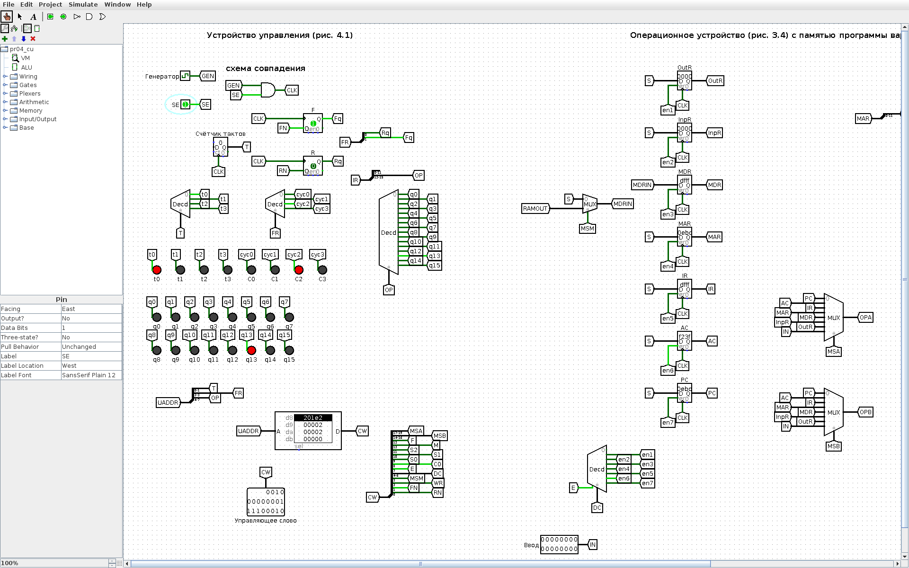
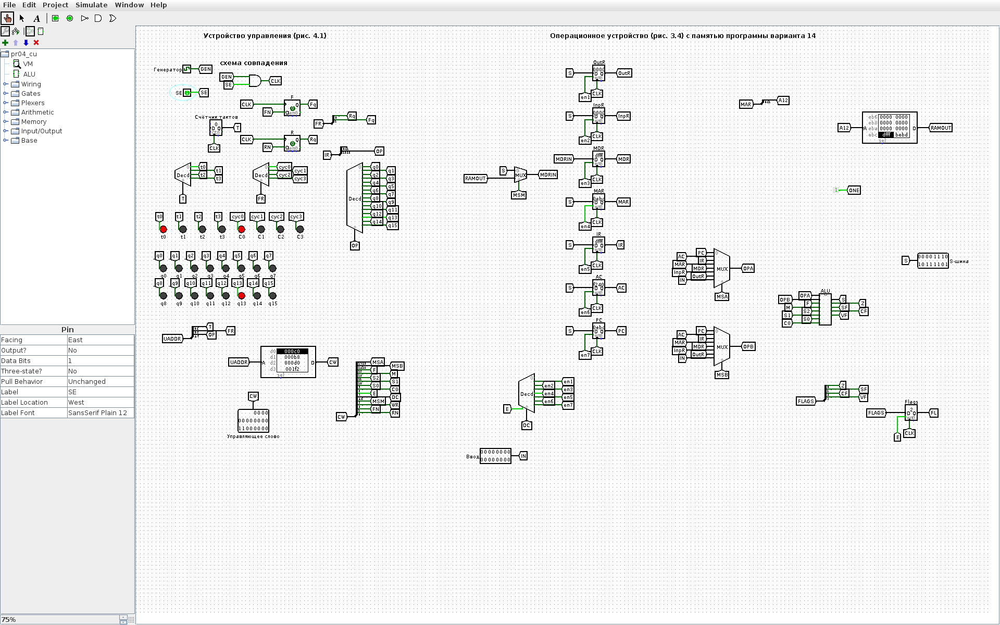

<!-- num: 4; title: Устройство управления ЦП учебного ОУ -->

# ЦЕЛЬ РАБОТЫ

Изучить микропрограммное устройство управления (УУ) учебной вычислительной машины: формирование управляющих слов, циклы выборки, дешифрации, выполнения и завершения, роль счётчика тактов и триггеров циклов F, R. Записать микропрограмму выполнения команды по персональному варианту, заполнить таблицы «Управляющее слово» (табл. 4.9) и «Состояние регистров» (табл. 4.10) и проверить их на модели ВМ в Logisim.

# ЗАДАНИЕ

Вариант 14. Записать микрооперации цикла выборки и выполнения команды INCA. По адресу EBC записана команда INCA с адресом FFF. По этому адресу записан операнд FFFD. В регистре-аккумуляторе — операнд F23F. Определить информацию, которая будет записана в регистрах PC, MAR, MDR, IR, AC после выполнения этой команды. Показать процесс выполнения команды.

# ХОД РАБОТЫ

## 1 Исходные данные и формат команды

Команда INCA (q13 в табл. 4.1) — увеличение аккумулятора на единицу: AC ← AC + 1. Операнд из памяти ей не нужен, поэтому в поле адреса записано FFF (все единицы), как требует пособие для команд q12–q15. Код операции q13 = 1101₂ = D₁₆, следовательно, машинное слово команды по адресу EBC — DFFF₁₆ (4 бита КОП + 12 бит адреса). Содержимое ячейки FFF (FFFD) командой не используется.

Исходное состояние: PC = EBC, AC = F23F; значения MAR, IR, MDR, INPR, OUTR не заданы.

## 2 Коды полей управляющего слова

Управляющее слово УУ состоит из полей MS(A), MS(B), ALU, DC, MS(M), WR и FR. Коды входов мультиплексоров и выходов дешифратора берутся по схеме ОУ (рис. 3.4) так же, как в табл. 4.7 пособия: MS(A)/MS(B): PC = 000, AC = 001, IR = 010, MDR = 100; DC (E x2 x1 x0): MDR = 1011, MAR = 1100, IR = 1101, AC = 1110, PC = 1111, запрет записи — 0xxx. Коды АЛУ (F M S2 S1 S0 C, табл. 3.1): передача A — 000000, инкремент A — 000001. Поле MS(M) = 1 подаёт в MDR данные из памяти. FR — значения триггеров циклов F, R для следующего такта (табл. 4.2): 00 — C0 (выборка), 10 — C2 (выполнение).

Поскольку в учебной ВМ используется прямая адресация, цикл дешифрации C1 пропускается: на такте C0t3 устанавливается F, R ← 1, 0 и управление сразу переходит к циклу выполнения C2 (п. 4.3 пособия). Шаблоны табл. 4.9 и 4.10 содержат именно циклы C0 и C2.

## 3 Микропрограмма команды INCA

Цикл выборки (одинаков для всех команд, табл. 4.3): C0t0 — MAR ← PC; C0t1 — MDR ← M[MAR]; C0t2 — IR ← MDR; C0t3 — PC ← PC + 1, F, R ← 1, 0. Цикл выполнения INCA (табл. 4.6): C2t0 — AC ← AC + 1; C2t1 и C2t2 — NOP; C2t3 — F, R ← 0, 0 (возврат к выборке следующей команды).

Таблица 1 – Управляющее слово (табл. 4.9) для команды INCA

| К,Ц,Т | Микрокоманда | MS(A) | MS(B) | АЛУ | DC | MS(M) | WR | FR |
|---|---|---|---|---|---|---|---|---|
| q13C0t0 | MAR ← PC | 000 | xxx | 000000 | 1100 | x | 0 | 00 |
| q13C0t1 | MDR ← M[MAR] | xxx | xxx | xxxxxx | 1011 | 1 | 0 | 00 |
| q13C0t2 | IR ← MDR | 100 | xxx | 000000 | 1101 | x | 0 | 00 |
| q13C0t3 | PC ← PC + 1; F,R ← 1,0 | 000 | xxx | 000001 | 1111 | x | 0 | 10 |
| q13C2t0 | AC ← AC + 1 | 001 | xxx | 000001 | 1110 | x | 0 | 10 |
| q13C2t1 | NOP | xxx | xxx | xxxxxx | 0xxx | x | 0 | 10 |
| q13C2t2 | NOP | xxx | xxx | xxxxxx | 0xxx | x | 0 | 10 |
| q13C2t3 | F,R ← 0,0 | xxx | xxx | xxxxxx | 0xxx | x | 0 | 00 |

Каждая строка таблицы 4.10 показывает состояние регистров после выполнения соответствующей микрокоманды; если регистр на такте не записывается, его значение повторяется, «—» означает, что значение не задано.

Таблица 2 – Состояние регистров (табл. 4.10) при выполнении INCA

| К,Ц,Т | Микрокоманда | PC | MAR | IR | MDR | AC | INPR | OUTR |
|---|---|---|---|---|---|---|---|---|
| Исходное состояние | — | EBC | — | — | — | F23F | — | — |
| q13C0t0 | MAR ← PC | EBC | EBC | — | — | F23F | — | — |
| q13C0t1 | MDR ← M[MAR] | EBC | EBC | — | DFFF | F23F | — | — |
| q13C0t2 | IR ← MDR | EBC | EBC | DFFF | DFFF | F23F | — | — |
| q13C0t3 | PC ← PC + 1; F,R ← 1,0 | EBD | EBC | DFFF | DFFF | F23F | — | — |
| q13C2t0 | AC ← AC + 1 | EBD | EBC | DFFF | DFFF | F240 | — | — |
| q13C2t1 | NOP | EBD | EBC | DFFF | DFFF | F240 | — | — |
| q13C2t2 | NOP | EBD | EBC | DFFF | DFFF | F240 | — | — |
| q13C2t3 | F,R ← 0,0 | EBD | EBC | DFFF | DFFF | F240 | — | — |

Вычисление в АЛУ: F23F₁₆ + 1 = F240₁₆ (младшая тетрада F + 1 = 0 с переносом, 3 + 1 = 4). Результат отрицателен в дополнительном коде (старший бит 1), поэтому после такта C2t0 в регистре флагов установлен флаг S.

Ответ: после выполнения команды PC = EBD, MAR = EBC, IR = DFFF, MDR = DFFF, AC = F240; INPR и OUTR не изменились. Обращения к ячейке FFF (операнд FFFD) не было, так как INCA работает только с аккумулятором.

## 4 Модель ВМ в Logisim

Для демонстрации собрана модель учебной ВМ (`pr04/src/logisim/pr04_cu.circ`, генерируется скриптом `gen_pr04.py`): устройство управления по рис. 4.1 подключено к модели ОУ из практической работы 3. УУ содержит:

- генератор тактовых импульсов и схему совпадения с сигналом SE (при SE = 0 импульсы не проходят и ВМ стоит);
- двухразрядный счётчик тактов t и дешифратор тактов t0–t3;
- триггеры циклов F и R с дешифратором циклов C0–C3;
- дешифратор команд по старшим четырём разрядам IR (q0–q15);
- ПЗУ микрокоманд 256 × 20: адрес = КОП (4 бита) · F R (2 бита) · t (2 бита), слово = MS(A) MS(B) АЛУ DC MS(M) WR FR — ровно поля табл. 4.9; выходы ПЗУ разводятся на управляющие входы ОУ, а поле FR подаётся на D-входы триггеров F и R.

В ПЗУ записан цикл выборки для всех кодов операций и циклы выполнения команд табл. 4.1 (для варианта важна q13 — INCA). Память команд и данных ОУ в модели — ПЗУ с программой варианта: EBC: DFFF (INCA FFF), EBD: BEBD (JMP EBD — «останов» на месте), FFF: FFFD.

Перед запуском в регистры PC и AC инструментом Poke введены исходные значения EBC и F23F, затем SE = 1 (рис. 1). Каждый такт ВМ — полный период генератора (два нажатия Ctrl+T).


![Рисунок 2 – После C0t0: MAR = EBC; на ПЗУ слово C0t1 (MDR ← M[MAR])](img/logisim_vm_C0t0.png)





Значения регистров на всех рисунках совпадают с табл. 2. Общий вид модели (УУ слева, ОУ справа) — на рис. 8.



Та же последовательность тактов была прогнана в движке Logisim из командной строки; протокол приведён в листинге 1.

Листинг 1 – Протокол моделирования (lsim.js, по одному такту ВМ на строку)

```
исх:  Управляющее слово=C0     | AC=F23F IR=0    MAR=0   MDR=0    PC=EBC
C0t0: Управляющее слово=B8     | AC=F23F IR=0    MAR=EBC MDR=0    PC=EBC
C0t1: Управляющее слово=800D0  | AC=F23F IR=0    MAR=EBC MDR=DFFF PC=EBC
C0t2: Управляющее слово=1F2    | AC=F23F IR=DFFF MAR=EBC MDR=DFFF PC=EBC
C0t3: Управляющее слово=201E2  | AC=F23F IR=DFFF MAR=EBC MDR=DFFF PC=EBD
C2t0: Управляющее слово=2      | AC=F240 IR=DFFF MAR=EBC MDR=DFFF PC=EBD
C2t1: Управляющее слово=2      | AC=F240 IR=DFFF MAR=EBC MDR=DFFF PC=EBD
C2t2: Управляющее слово=0      | AC=F240 IR=DFFF MAR=EBC MDR=DFFF PC=EBD
C2t3: Управляющее слово=C0     | AC=F240 IR=DFFF MAR=EBC MDR=DFFF PC=EBD
```

В каждой строке показано слово, которое ПЗУ выдаёт на следующий такт (например, 201E2 = 001 000 000001 1110 0 0 10 — слово C2t0 «AC ← AC + 1»).

## 5 Как показать преподавателю

1. Открыть `pr04/Практика_4_вариант_14.xlsx` — табл. 4.9 и 4.10.
2. Открыть `pr04/src/logisim/pr04_cu.circ`, схема VM. Инструментом Poke щёлкнуть по регистру PC и набрать EBC, по регистру AC — F23F. Установить SE = 1.
3. Нажимать Ctrl+T по два раза (один такт) и сверять регистры со строками табл. 4.10; на выходе ПЗУ видно управляющее слово очередной строки табл. 4.9, на индикаторах — текущие t и C, после C0t2 загорается q13.

# ВЫВОДЫ

Изучена работа микропрограммного устройства управления учебной ВМ: УУ по счётчику тактов, триггерам циклов F, R и коду операции из IR выбирает из ПЗУ управляющее слово, которое задаёт мультиплексоры, АЛУ, дешифратор записи и обращение к памяти. Составлены микропрограмма и управляющие слова (табл. 4.9) для команды INCA, заполнена таблица состояний регистров (табл. 4.10).

После выполнения команды INCA, записанной по адресу EBC, регистры содержат: PC = EBD (адрес следующей команды), MAR = EBC (адрес выбранной команды), IR = DFFF и MDR = DFFF (сама команда: КОП D = q13, адрес FFF), AC = F240 (F23F + 1). Операнд FFFD по адресу FFF не используется. Результат подтверждён пошаговым выполнением на модели ВМ (УУ + ОУ) в Logisim.
