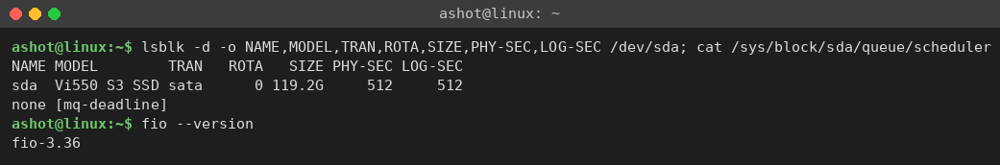
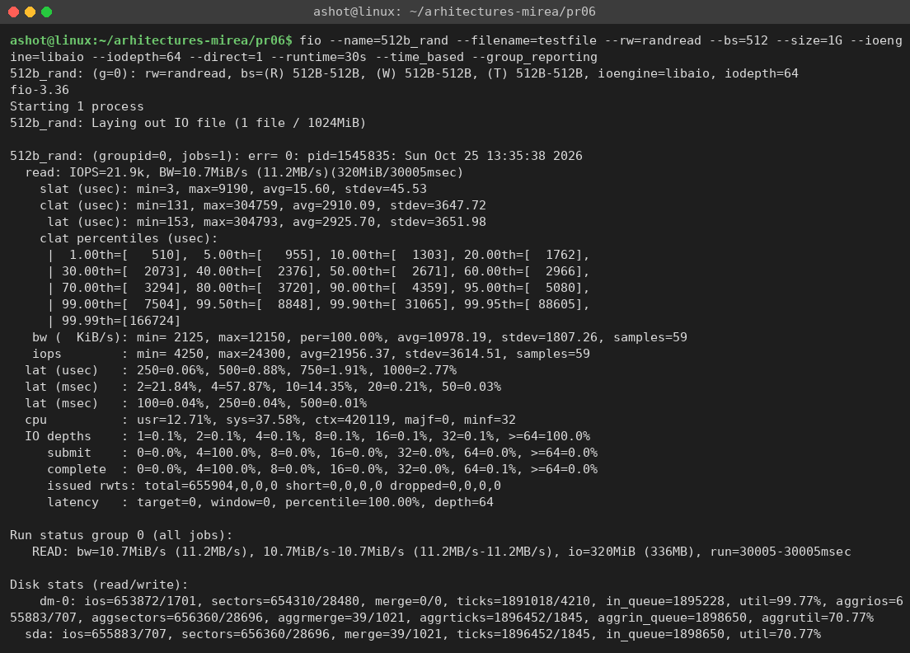
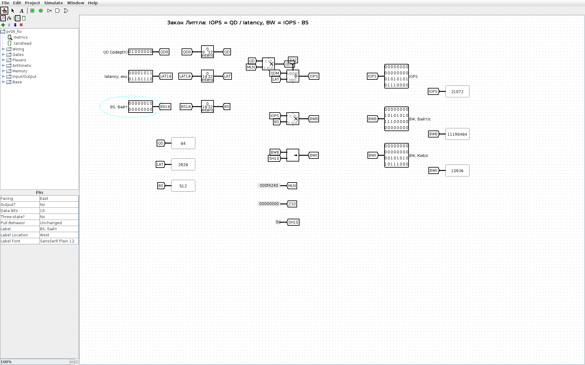
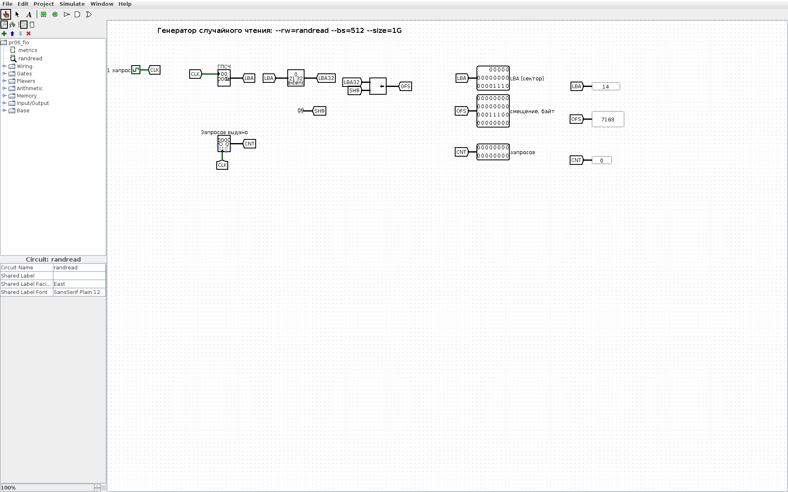

<!-- num: 6; title: Внешняя память -->

# ЦЕЛЬ РАБОТЫ

Изучить устройство и характеристики внешних запоминающих устройств (HDD, SSD), показатели их производительности (IOPS, пропускная способность, задержка) и способы их измерения. Провести безопасный тест FIO по персональному варианту, проанализировать результаты и сделать выводы о производительности накопителя.

# ЗАДАНИЕ

Вариант 14. «Чтение маленьких блоков»:

```
fio.exe --name=512b_rand --filename=testfile --rw=randread --bs=512 --size=1G
    --ioengine=windowsaio --iodepth=64 --direct=1 --runtime=30s --time_based --group_reporting
```

Выполнить тестирование, на основании результатов сделать выводы о производительности диска, расписать полученные результаты.

# ХОД РАБОТЫ

## 1 Тестовый стенд

Тест выполнялся на компьютере под Ubuntu 24.04. Накопитель — SATA SSD Verbatim Vi550 S3 объёмом 128 ГБ (119,2 ГиБ), на нём через LVM размещена корневая файловая система; размер логического и физического сектора 512 Б, планировщик ввода-вывода mq-deadline (рис. 1). Утилита fio версии 3.36.



Команда варианта написана для Windows (`fio.exe`, `--ioengine=windowsaio`). В Linux вместо механизма асинхронного ввода-вывода Windows используется его аналог `libaio` (Linux Asynchronous I/O, как в листинге 6.1 пособия); все остальные параметры оставлены без изменений:

Листинг 1 – Команда теста в Linux

```
fio --name=512b_rand --filename=testfile --rw=randread --bs=512 --size=1G --ioengine=libaio
    --iodepth=64 --direct=1 --runtime=30s --time_based --group_reporting
```

Таблица 1 – Параметры теста варианта 14

| Параметр | Значение | Смысл |
|---|---|---|
| --rw=randread | случайное чтение | чтение из случайных мест файла |
| --bs=512 | 512 Б | размер одного запроса — один сектор |
| --size=1G | 1 ГиБ | тестовый файл testfile (2 097 152 сектора) |
| --iodepth=64 | 64 | до 64 запросов одновременно в очереди |
| --direct=1 | O_DIRECT | в обход кэша ОС — измеряется сам диск |
| --runtime=30s, --time_based | 30 с | тест идёт ровно 30 секунд |

Тест безопасен: fio создаёт и читает только собственный файл testfile, после теста файл был удалён.

## 2 Результаты теста

Полный вывод fio приведён на рис. 2.



Таблица 2 – Основные результаты

| Показатель | Значение |
|---|---|
| IOPS (среднее) | 21,9 тыс. операций/с (21 956) |
| Пропускная способность BW | 10,7 МиБ/с (11,2 МБ/с) |
| Прочитано за 30 с | 320 МиБ, 655 904 операции |
| slat — задержка постановки в очередь | 15,6 мкс (среднее) |
| clat — время выполнения запроса | 2 910 мкс (среднее), медиана 2 671 мкс |
| lat — полная задержка | 2 926 мкс (среднее), min 153 мкс, max 305 мс |
| Перцентили clat 90 / 99 / 99,9 % | 4,4 / 7,5 / 31,1 мс |
| Загрузка CPU | usr 12,7 %, sys 37,6 %, 420 тыс. переключений контекста |
| Глубина очереди | ≥ 64 — 100 % времени |
| Загрузка устройства | sda 70,8 %, dm-0 (LVM) 99,8 % |

## 3 Анализ результатов

**IOPS.** Диск выполнил около 22 тыс. операций случайного чтения в секунду. По ориентирам пособия (HDD — 100–200 IOPS, SATA SSD — 80–100 тыс. для блоков 4 КБ, NVMe — 700 тыс. и более) результат в сотню раз лучше любого HDD, но заметно ниже типичного SATA SSD. Причины: накопитель бюджетный (без собственного DRAM-кэша таблицы трансляции адресов), блок 512 Б меньше страницы NAND и страницы отображения контроллера (4 КБ и более) — чтобы отдать 512 Б, контроллер всё равно читает целую страницу, то есть количество работы на одну операцию почти такое же, как для 4 КБ. Кроме того, это системный диск, заполненный на 97 %, поверх него работает слой LVM, а во время замера на компьютере выполнялись другие задачи.

**Пропускная способность.** BW = IOPS × размер блока = 21 956 × 512 Б ≈ 11,2 МБ/с = 10,7 МиБ/с. Для мелких блоков скорость в МБ/с почти ничего не говорит о диске — она мала просто потому, что каждый запрос переносит всего 512 байт; главный показатель здесь — IOPS.

**Задержка и закон Литтла.** Средняя задержка 2,9 мс кажется большой для SSD, но она определяется глубиной очереди. По закону Литтла число запросов в системе равно произведению интенсивности на время пребывания: QD = IOPS × latency, откуда

$$ IOPS = QD / latency = 64 / 2,926 мс ≈ 21 873 операции/с $$

что совпадает с измеренным значением. То есть каждый запрос примерно 2,9 мс стоит в очереди из 64 запросов, а «чистое» время обслуживания одного запроса диском около 1 / 21 956 с ≈ 46 мкс. Минимальная задержка 153 мкс близка ко времени одиночного чтения SSD без очереди.

**Разброс задержек.** Медиана 2,7 мс, 99 % запросов укладываются в 7,5 мс, но 99,9-й перцентиль — 31 мс, а максимум — 305 мс. Такие «хвосты» характерны для SSD при фоновых операциях контроллера (сборка мусора, перенос данных из SLC-кэша), которые усиливаются при почти заполненном диске, и для общей нагрузки системы.

**Нагрузка на процессор.** Ядро ОС тратит заметное время на обслуживание 22 тыс. прерываний и запросов в секунду (sys 37,6 %). Чем мельче блок, тем больше накладные расходы ОС на каждый переданный байт.

## 4 Модель в Logisim

Для наглядности в Logisim построены две схемы (`pr06/src/logisim/pr06_fio.circ`, генератор `gen_pr06.py`).

Схема «metrics» проверяет результаты теста законом Литтла: по входам QD = 64, средней задержке 2926 мкс и размеру блока 512 Б умножитель и делитель вычисляют IOPS = QD · 10⁶ / latency = 21 872, BW = IOPS · BS = 11 198 464 Б/с и BW = 10 936 КиБ/с (≈ 10,7 МиБ/с) — те же величины, что выдал fio (рис. 3).



Схема «randread» моделирует генератор нагрузки теста `--rw=randread --bs=512 --size=1G`: на каждый такт генератор псевдослучайных чисел выдаёт номер сектора LBA в пределах файла 1 ГиБ (21 бит), сдвигатель вычисляет смещение в байтах LBA · 512, счётчик считает выданные запросы (рис. 4, 5).




## 5 Как показать преподавателю

1. Показать команду и вывод fio (рис. 2), назвать IOPS ≈ 21,9 тыс., BW ≈ 10,7 МиБ/с, среднюю задержку ≈ 2,9 мс.
2. Открыть `pr06/src/logisim/pr06_fio.circ`, схема metrics: QD = 64, latency = 2926, BS = 512 — на пробниках 21872 и 10936.
3. Схема randread: Ctrl+T — появляются новые случайные номера секторов.

# ВЫВОДЫ

Тест случайного чтения блоков по 512 Б с глубиной очереди 64 на SATA SSD Verbatim Vi550 S3 показал около 21,9 тыс. IOPS, пропускную способность 10,7 МиБ/с и среднюю задержку 2,9 мс. Для мелких блоков определяющий показатель — IOPS: пропускная способность в МБ/с мала из-за размера запроса, а задержка определяется длиной очереди (закон Литтла: 64 / 2,9 мс ≈ 22 тыс. IOPS).

Накопитель на порядки быстрее жёсткого диска на случайном доступе, но уступает типичным значениям SATA SSD: сказываются бюджетный контроллер без DRAM, блок меньше страницы флеш-памяти, заполненность системного диска на 97 % и фоновая нагрузка, что видно по «хвостам» задержки до сотен миллисекунд. Для приложений с мелкими случайными чтениями (базы данных, индексы) целесообразно увеличивать размер запроса до 4 КБ и держать на SSD запас свободного места.
