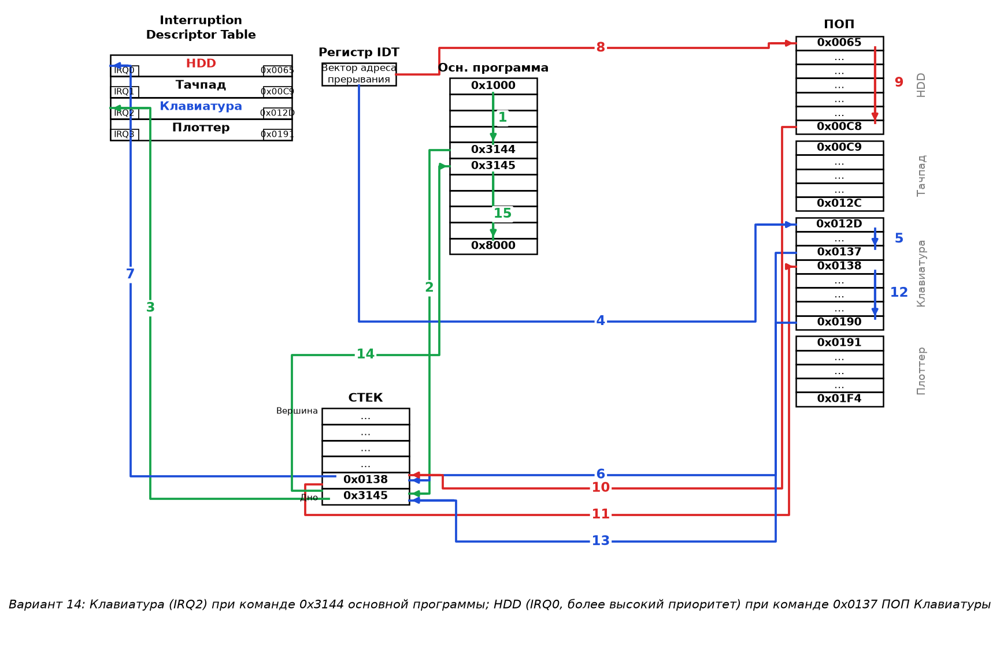
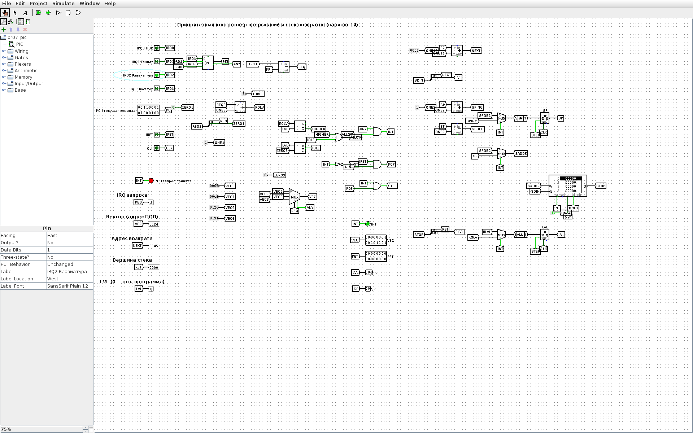
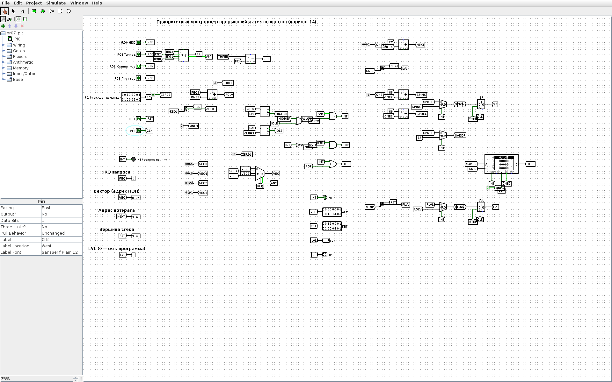
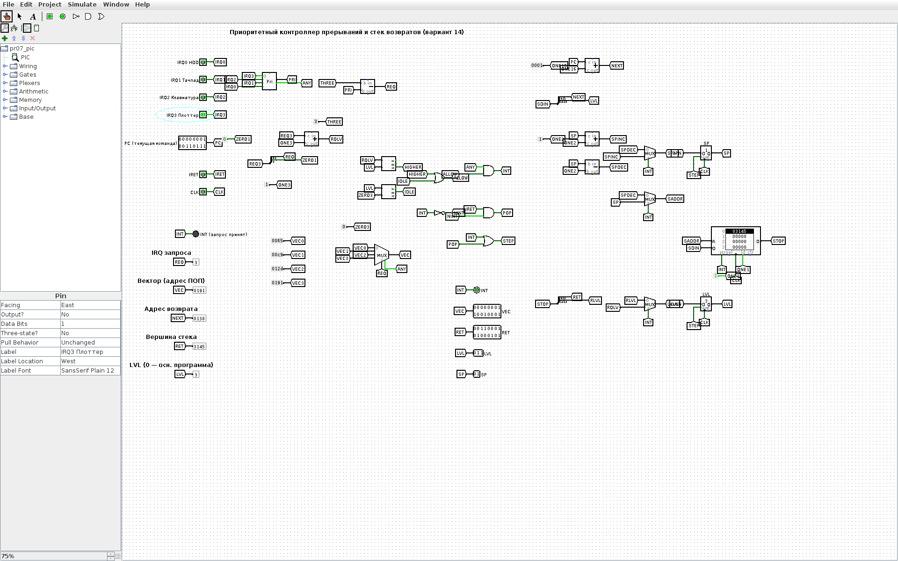
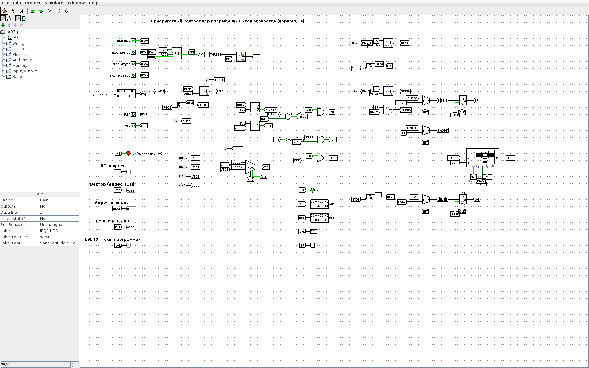
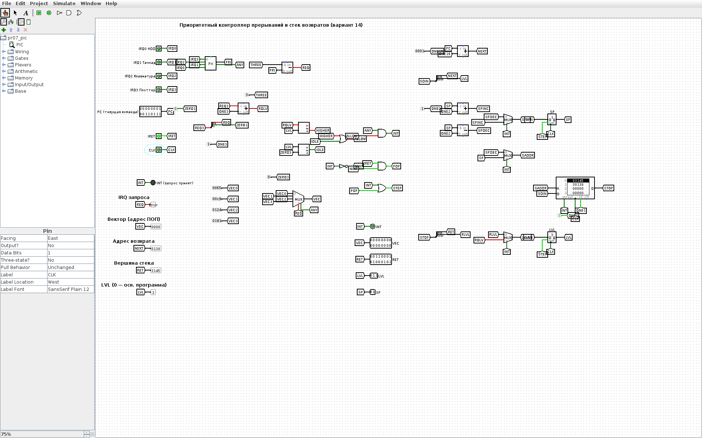
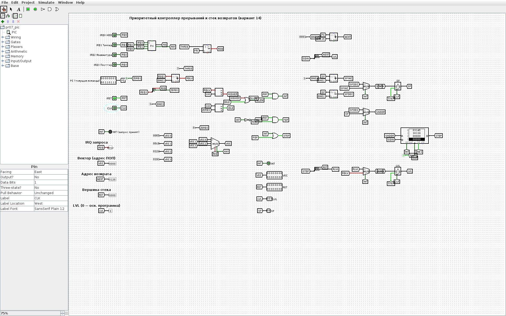

<!-- num: 7; title: Общая организация прерываний -->

# ЦЕЛЬ РАБОТЫ

Изучить механизм прерываний: виды прерываний (аппаратные, программные, исключения), роль контроллера прерываний и таблицы векторов IDT, порядок сохранения и восстановления контекста через стек, обработку вложенных прерываний с учётом приоритетов. Изобразить ход вычислительного процесса при обработке прерываний по персональному варианту и смоделировать работу приоритетного контроллера прерываний в Logisim.

# ЗАДАНИЕ

Вариант 14. Периферийные устройства: HDD; Тачпад; Клавиатура; Плоттер. При выполнении команды 0x3144 прикладной программы пришло прерывание от Клавиатуры. Далее, при выполнении команды 0x0137 ПОП Клавиатуры пришло прерывание от HDD. Используя шаблон схемы (рис. 7.1), изобразить на рисунке ход выполнения вычислительного процесса.

# ХОД РАБОТЫ

## 1 Распределение линий IRQ, приоритетов и памяти

По аналогии с примером п. 7.6 устройствам назначены линии IRQ в порядке их перечисления в варианте; чем меньше номер линии, тем выше приоритет. Программы обработки прерываний (ПОП) находятся в служебной области ОЗУ 0x0065–0x01F4, по 100 ячеек на устройство, основная программа — в области 0x1000–0x8000.

Таблица 1 – Линии прерываний и адреса ПОП (вариант 14)

| Линия | Устройство | Приоритет | Область ПОП | Вектор в IDT |
|---|---|---|---|---|
| IRQ0 | HDD | 0 (высший) | 0x0065–0x00C8 | 0x0065 |
| IRQ1 | Тачпад | 1 | 0x00C9–0x012C | 0x00C9 |
| IRQ2 | Клавиатура | 2 | 0x012D–0x0190 | 0x012D |
| IRQ3 | Плоттер | 3 (низший) | 0x0191–0x01F4 | 0x0191 |

## 2 Последовательность обработки

Порядок действий при каждом прерывании (п. 7.5): завершить текущую команду, вычислить адрес следующей команды и сохранить контекст в стек, получить из IDT через регистр IDT вектор — адрес ПОП, выполнить ПОП, восстановить контекст из стека и продолжить прерванную программу. По условию состояние регистров не учитывается, в стеке отражаются только адреса возврата.

Таблица 2 – Ход вычислительного процесса (номера соответствуют стрелкам на рис. 1)

| № | Действие | Стек (дно → вершина) |
|---|---|---|
| 1 | Основная программа выполняется с 0x1000 до команды 0x3144 | пуст |
| 2 | Приходит запрос Клавиатуры; команда 0x3144 завершается, адрес следующей команды 0x3145 заносится в стек | 0x3145 |
| 3 | Запрос IRQ2 поступает на контроллер, выбирается строка IDT «Клавиатура» | 0x3145 |
| 4 | В регистре IDT сформирован вектор 0x012D — переход в ПОП Клавиатуры | 0x3145 |
| 5 | ПОП Клавиатуры выполняется с 0x012D до команды 0x0137 | 0x3145 |
| 6 | Приходит запрос HDD; его приоритет (0) выше обслуживаемого (2), поэтому прерывание принимается: команда 0x0137 завершается, адрес 0x0138 заносится в стек | 0x3145, 0x0138 |
| 7 | Запрос IRQ0 поступает на контроллер, выбирается строка IDT «HDD» | 0x3145, 0x0138 |
| 8 | Вектор 0x0065 — переход в ПОП HDD | 0x3145, 0x0138 |
| 9 | ПОП HDD выполняется полностью, 0x0065–0x00C8 | 0x3145, 0x0138 |
| 10 | Возврат из прерывания: из вершины стека извлекается адрес 0x0138 | 0x3145 |
| 11 | Переход по адресу 0x0138 | 0x3145 |
| 12 | ПОП Клавиатуры выполняется до конца, 0x0138–0x0190 | 0x3145 |
| 13 | Возврат из прерывания: из стека извлекается 0x3145 | пуст |
| 14 | Переход по адресу 0x3145 | пуст |
| 15 | Основная программа выполняется с 0x3145 до 0x8000 | пуст |

Схема хода вычислительного процесса, выполненная по шаблону рис. 7.1, приведена на рис. 1. Зелёным показаны действия, связанные с прерыванием основной программы, синим — с ПОП Клавиатуры, красным — с вложенным прерыванием от HDD.



Если бы в ПОП Клавиатуры пришёл запрос от Плоттера (IRQ3, приоритет ниже), контроллер не прервал бы обработчик: запрос ждал бы завершения ПОП Клавиатуры и был бы обслужен после возврата.

## 3 Модель контроллера прерываний в Logisim

В Logisim построена модель приоритетного контроллера прерываний со стеком возвратов (`pr07/src/logisim/pr07_pic.circ`, генератор `gen_pr07.py`). Её узлы:

- входы IRQ0–IRQ3 (HDD, Тачпад, Клавиатура, Плоттер), адрес текущей команды PC, сигнал возврата IRET и тактовый вход CLK;
- приоритетный шифратор выбирает запрос с наименьшим номером линии (линии поданы в обратном порядке, т. к. шифратор Logisim отдаёт старший вход);
- регистр LVL хранит уровень обслуживаемого прерывания (0 — основная программа, k + 1 — выполняется ПОП IRQk); компараторы разрешают прерывание (INT = 1), только если LVL = 0 или уровень запроса выше текущего — так реализуется маскирование по приоритету;
- таблица векторов IDT — мультиплексор с константами 0x0065, 0x00C9, 0x012D, 0x0191;
- стек возвратов — ОЗУ 4 × 19 бит и указатель стека SP; по фронту CLK при INT = 1 в стек записывается {LVL, PC + 1}, LVL принимает уровень запроса; при IRET = 1 из вершины стека восстанавливаются адрес возврата и прежний уровень.

Сценарий варианта воспроизведён в GUI Logisim (рис. 2–8).














Протокол прогона того же сценария в движке Logisim приведён в листинге 1 (RET — вершина стека, LVL — уровень обслуживания, SP — указатель стека).

Листинг 1 – Проверка модели контроллера прерываний (lsim.js)

```
start:                          INT=0 LVL=0 RET=0    SP=0 VEC=0
IRQ2 при 0x3144:                INT=1 LVL=0 RET=0    SP=0 VEC=12D
вход в ПОП клавиатуры:          INT=0 LVL=3 RET=3145 SP=1 VEC=12D
IRQ3 при ПОП клав. (не принят): INT=0 LVL=3 RET=3145 SP=1 VEC=191
IRQ0 при 0x0137:                INT=1 LVL=3 RET=0    SP=1 VEC=65
вход в ПОП HDD:                 INT=0 LVL=1 RET=138  SP=2 VEC=65
возврат из ПОП HDD:             INT=0 LVL=3 RET=3145 SP=1 VEC=0
возврат из ПОП клавиатуры:      INT=0 LVL=0 RET=0    SP=0 VEC=0
```

## 4 Как показать преподавателю

1. Показать рис. 1 и пройти стрелки 1–15 по табл. 2.
2. Открыть `pr07/src/logisim/pr07_pic.circ`: PC = 3144, IRQ2 = 1, такт CLK (0 → 1 → 0) — LVL = 3, в стеке 3145.
3. IRQ2 = 0, PC = 0137, IRQ3 = 1 — INT не загорается (низкий приоритет); IRQ3 = 0, IRQ0 = 1, такт — LVL = 1, в стеке 0138.
4. IRQ0 = 0, IRET = 1, два такта — возврат в ПОП Клавиатуры, затем в основную программу.

# ВЫВОДЫ

Для варианта 14 построена схема хода вычислительного процесса при вложенных прерываниях: прерывание Клавиатуры (IRQ2) на команде 0x3144 сохраняет в стек адрес 0x3145 и передаёт управление ПОП по вектору 0x012D; прерывание HDD (IRQ0) имеет более высокий приоритет, поэтому прерывает ПОП Клавиатуры на команде 0x0137 — в стек заносится 0x0138, выполняется ПОП HDD (0x0065–0x00C8). Возвраты идут в обратном порядке по принципу стека: сначала к 0x0138 (дозавершение ПОП Клавиатуры до 0x0190), затем к 0x3145 (основная программа до 0x8000).

Модель контроллера в Logisim показала аппаратную сторону механизма: приоритетный выбор запроса, маскирование запросов не выше текущего уровня, выдачу вектора из IDT и стек адресов возврата. Работа модели совпала со схемой рис. 1.
