<!-- num: 8; title: Архитектура RISC-V -->

# ЦЕЛЬ РАБОТЫ

Изучить принципы архитектуры набора команд RISC-V, настроить среду для разработки и запуска программ под RISC-V, написать, собрать и скомпоновать простую программу на языке ассемблера RISC-V, освоить средства автоматизации сборки (GNU Make, CMake) и пошаговую отладку программы в отладчике GDB с анализом содержимого регистров и памяти.

# ЗАДАНИЕ

Вариант 14.

1. Настроить среду для дальнейшей разработки под RISC-V.
2. Изменить текстовую строку в примере программы из п. 8.4 в формате <ФИО_номер группы_номер в списке группы>, т.е. «Мирзоян А.О._ИКБО-41-25_14».
3. Собрать и скомпоновать программу, написанную в предыдущем пункте.
4. Изменить исходный код программы так, чтобы в качестве точки входа и глобального определения использовать «main_app» вместо «_start», а код выхода заменить инструкцией «j main_app». Скомпоновать и выполнить в пошаговом режиме с демонстрацией содержимого регистров.
5. Создать makefile под каждую из двух версий программы с поддержкой релизной (финальной) и отладочной версий.
6. Отразить результат выполнения каждого шага в отчёте.
7. Дополнительно: построить в Logisim схему дешифратора полей инструкции RISC-V с сумматором, выполняющим команду addi, и подать на неё машинные коды собственной программы.

# ХОД РАБОТЫ

## 1 Настройка среды разработки

В пособии (п. 8.3.2) предлагается запускать полноценную систему Ubuntu Server для RISC-V в эмуляторе qemu-system-riscv64 с загрузчиками OpenSBI и U-Boot. Я работал на компьютере с Ubuntu 24.04 (x86_64) без прав администратора, поэтому выбрал другой, тоже распространённый в Linux вариант: кросс-компиляцию на хосте и запуск программ в эмуляторе QEMU в пользовательском режиме (user-mode). Для этого используются:

- кросс-binutils и кросс-компилятор `riscv64-linux-gnu-as`, `riscv64-linux-gnu-ld`, `riscv64-linux-gnu-gcc` (binutils 2.42, GCC 13.3) — собирают ELF-файлы для RV64GC на x86_64-машине;
- `qemu-riscv64` 8.2.2 — эмулятор пользовательского режима: он покомандно транслирует инструкции RISC-V, а системные вызовы Linux (`ecall`) передаёт ядру хоста. Отдельная виртуальная машина с ядром и диском при этом не нужна;
- `gdb-multiarch` 15.1 — отладчик, понимающий архитектуру RISC-V; подключается к встроенному в QEMU gdb-серверу (`qemu-riscv64 -g <порт>`);
- sysroot `riscv64-linux-gnu` (glibc и динамический загрузчик для RISC-V), на который указывает переменная `QEMU_LD_PREFIX` — он нужен программам, скомпонованным с библиотекой C (в этой работе программы статические, а в практике 9 он понадобится);
- GNU Make 4.3 и CMake 3.28.

Пакеты распакованы в локальный каталог `.tools/root`, а переменные окружения (`PATH`, `QEMU_LD_PREFIX`) задаются скриптом `.tools/env.sh`. Версии инструментов показаны на рис. 1. Поскольку сборка ведётся кросс-инструментами, вместо команд `as`, `ld`, `gdb` из пособия используются их аналоги с префиксом (табл. 1).

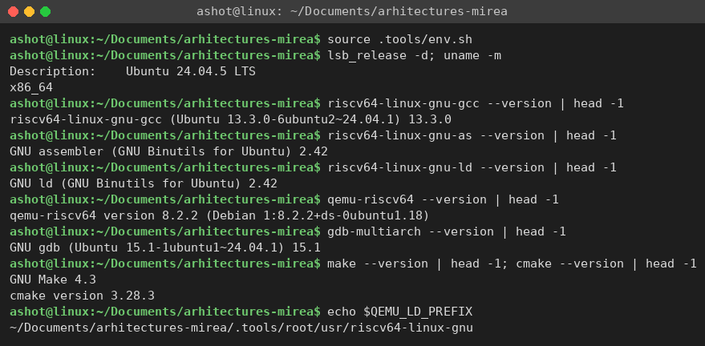

Таблица 1 – Соответствие команд пособия и команд, использованных в работе

| В пособии (внутри ВМ RISC-V) | В работе (хост x86_64) |
|---|---|
| `as` | `riscv64-linux-gnu-as` |
| `ld` | `riscv64-linux-gnu-ld` |
| `gcc` | `riscv64-linux-gnu-gcc` |
| `./hello_world` | `qemu-riscv64 ./hello_world` |
| `gdb hello_world` | `qemu-riscv64 -g 1234 ./hello_world` + `gdb-multiarch` |

## 2 Изменение строки в программе

За основу взята программа из листинга 8.4. Строка «Hello RISC-V World!» заменена на «Мирзоян А.О._ИКБО-41-25_14». Важный момент — длина строки, которая передаётся системному вызову `write` в регистре a2. Она задаётся в байтах, а не в символах. Исходный файл сохранён в кодировке UTF-8, в которой каждая буква кириллицы занимает 2 байта, а символы ASCII — 1 байт. В строке 13 кириллических букв (26 байт) и 14 однобайтовых символов (пробел, две точки, два подчёркивания, «-41-25», «14» и перевод строки), итого 40 байт. Поэтому в коде записано `addi a2, x0, 40`; если указать число символов (27), строка будет обрезана посередине. Получившийся исходный текст приведён в листинге 1.

Листинг 1 – Программа hello_world.S с изменённой строкой

```asm
.global _start               # точка входа программы для компоновщика
# Настраиваем параметры для вывода строки
# и вызываем системный вызов Linux.
_start: addi a0, x0, 1       # a0 = 1 - стандартный вывод (stdout)
        la   a1, helloworld  # a1 = адрес строки
        addi a2, x0, 40      # a2 = длина строки в байтах UTF-8 (40)
        addi a7, x0, 64      # a7 = 64 – системный вызов write
        ecall                # выполняем системный вызов (печать строки)
# Настраиваем параметры для завершения программы
# и вызываем системный вызов Linux.
        addi a0, x0, 0       # a0 = 0 – код возврата (успешное завершение)
        addi a7, x0, 93      # a7 = 93 – системный вызов exit
        ecall                # выполняем системный вызов (выход из программы)
.data
helloworld: .ascii "Мирзоян А.О._ИКБО-41-25_14\n" # строка для вывода (40 байт)
```

## 3 Сборка и компоновка программы

Сборка выполняется скриптом `build.sh` (аналог листинга 8.5): ассемблер переводит исходный текст в объектный файл `hello_world.o`, компоновщик формирует исполняемый файл `hello_world`. Результат сборки и запуска показан на рис. 2. Команда `file` подтверждает, что получен 64-битный ELF для архитектуры RISC-V, программа выводит строку и завершается с кодом 0, а `wc -c` показывает, что выведено ровно 40 байт.

Листинг 2 – Скрипт сборки build.sh

```bash
#!/bin/bash
riscv64-linux-gnu-as -o hello_world.o hello_world.S
riscv64-linux-gnu-ld -o hello_world hello_world.o
```

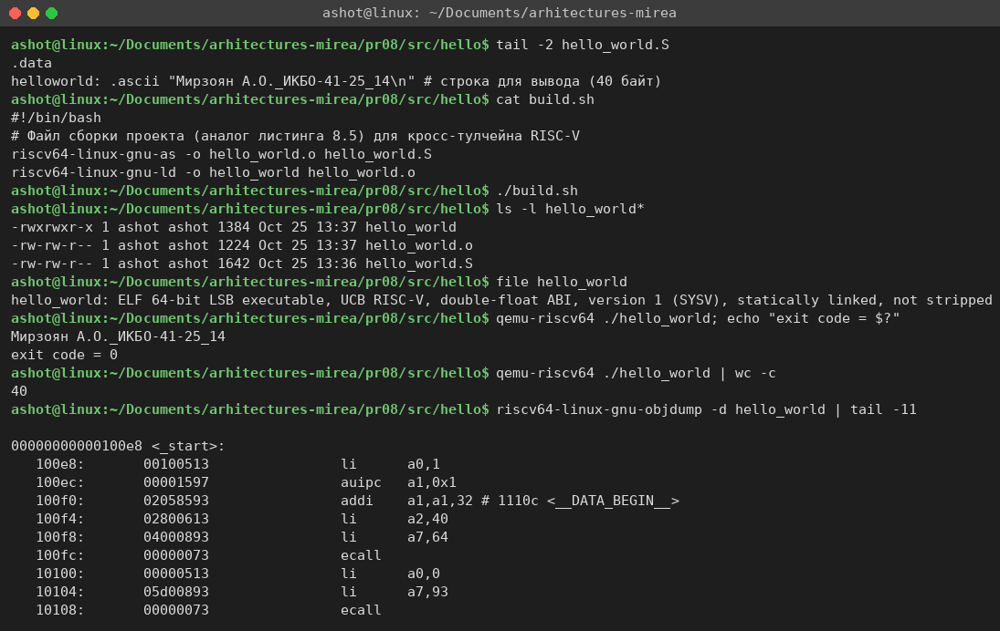

В дизассемблированном коде видно, что псевдоинструкция `la a1, helloworld` превратилась в пару `auipc a1, 0x1` + `addi a1, a1, 32`: адрес строки вычисляется относительно текущего значения pc, так как произвольный 32-битный адрес нельзя уместить в одну инструкцию фиксированной длины. Инструкции вида `addi a0, x0, 1` дизассемблер показывает как псевдоинструкцию `li a0, 1`.

## 4 Программа с точкой входа main_app и пошаговая отладка

Во второй версии программы метка `_start` заменена на `main_app`, и она же объявлена глобальной (`.global main_app`). Код завершения (вызов exit) удалён и заменён безусловным переходом `j main_app` (листинг 3). В результате программа после вывода строки снова переходит в начало и выводит строку бесконечно — так и должно быть по заданию.

Листинг 3 – Программа main_app.S

```asm
.global main_app             # точка входа программы для компоновщика
main_app:
        addi a0, x0, 1       # a0 = 1 - стандартный вывод (stdout)
        la   a1, helloworld  # a1 = адрес строки
        addi a2, x0, 40      # a2 = длина строки в байтах UTF-8 (40)
        addi a7, x0, 64      # a7 = 64 – системный вызов write
        ecall                # выполняем системный вызов (печать строки)
        j    main_app        # вместо exit – переход в начало программы
.data
helloworld: .ascii "Мирзоян А.О._ИКБО-41-25_14\n" # строка для вывода (40 байт)
```

По умолчанию компоновщик ищет точку входа с именем `_start`. Если её не указать, `ld` выдаёт предупреждение «cannot find entry symbol _start» и берёт в качестве точки входа начало секции .text (здесь оно случайно совпадает с main_app, но полагаться на это нельзя). Поэтому точка входа задаётся явно ключом `-e main_app`. Сборка релизной и отладочной версий через makefile (см. п. 5) и запуск показаны на рис. 3: в заголовке ELF точка входа равна 0x100e8 — адресу символа `main_app`. Так как программа зациклена, при запуске вывод ограничен первыми пятью строками (`timeout` и `head`).

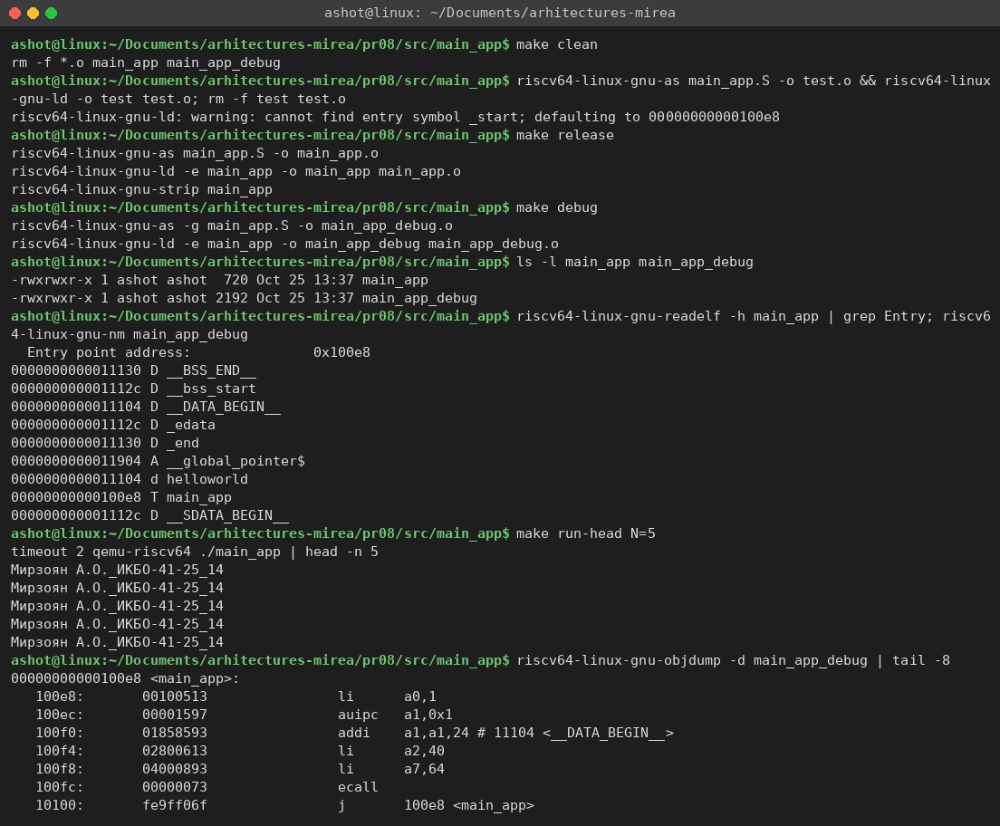

Для пошаговой отладки отладочная версия `main_app_debug` (собрана с `-g`) запускается в QEMU с gdb-сервером на порту 1234, после чего к нему подключается `gdb-multiarch` командой `target remote :1234`. Команды отладчика я записал в файл `gdb_session.gdb` и выполнил его в пакетном режиме, чтобы сохранить полный протокол сессии (`set trace-commands on` печатает каждую команду; в логе они показаны с приглашением «(gdb)»). Предупреждение BFD о «corrupt string table index» относится к служебному vDSO, который подставляет QEMU, и на отладку не влияет.

Сразу после подключения процессор остановлен на первой инструкции, pc = 0x100e8 = `main_app`. На рис. 4 показаны установка точки останова на `main_app`, дизассемблированный код функции и полный вывод `info registers`: все регистры общего назначения равны нулю, кроме указателя стека sp, который QEMU настроил при загрузке программы.

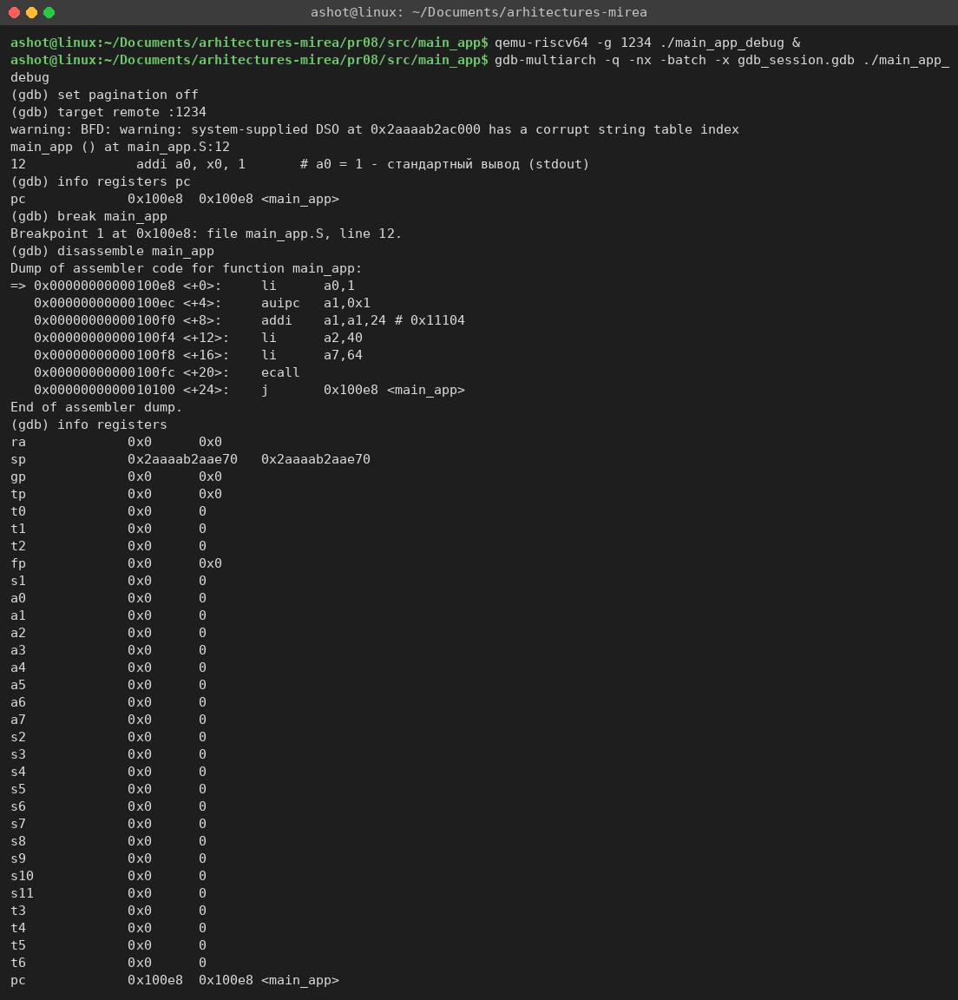

Далее программа выполняется по одной инструкции командой `stepi`, после каждого шага выводятся изменившиеся регистры (рис. 5). Изменение регистров сведено в табл. 2. Команда `x/s $a1` показывает строку по адресу из a1. В конце видны лишние символы «A6»: директива `.ascii` не добавляет завершающий нулевой байт, и gdb читает память дальше, до первого нуля — для `write` это не важно, потому что длина передаётся явно. Команда `x/8xb $a1` показывает первые байты строки: `0xd0 0x9c` — это буква «М» в UTF-8, `0xd0 0xb8` — «и», то есть каждая кириллическая буква действительно занимает 2 байта. Команда `x/4xg $sp` выводит вершину стека: первое слово равно 1 — это argc, затем идёт указатель на argv[0].

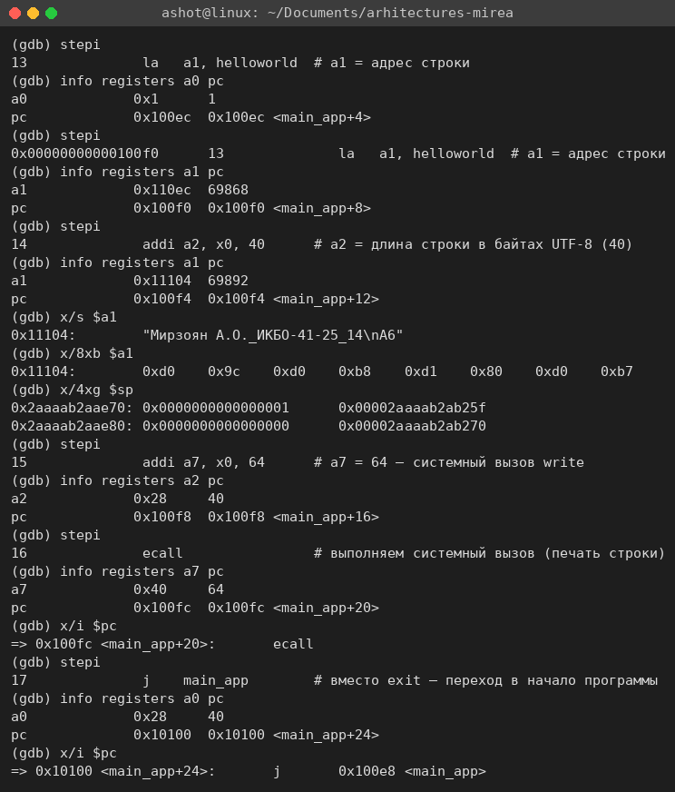

Таблица 2 – Изменение регистров при пошаговом выполнении

| pc до шага | Инструкция | Изменившиеся регистры |
|---|---|---|
| 0x100e8 | `li a0, 1` | a0 = 1, pc = 0x100ec |
| 0x100ec | `auipc a1, 0x1` | a1 = 0x110ec, pc = 0x100f0 |
| 0x100f0 | `addi a1, a1, 24` | a1 = 0x11104 (адрес строки), pc = 0x100f4 |
| 0x100f4 | `li a2, 40` | a2 = 0x28 = 40, pc = 0x100f8 |
| 0x100f8 | `li a7, 64` | a7 = 0x40 = 64, pc = 0x100fc |
| 0x100fc | `ecall` | a0 = 40 (write вернул число записанных байт), pc = 0x10100 |
| 0x10100 | `j main_app` | pc = 0x100e8 (возврат в начало) |

Инструкция `auipc a1, 0x1` прибавляет к адресу самой инструкции (0x100ec) число 0x1 << 12 = 0x1000, получая 0x110ec, а следующая `addi` добавляет смещение 24 и даёт точный адрес строки 0x11104. После выполнения `ecall` в a0 оказывается результат системного вызова — 40, т.е. записаны все 40 байт. Следующий `stepi` выполняет `j 0x100e8 <main_app>`, и pc снова становится равным 0x100e8; gdb сообщает о попадании в точку останова 1 (рис. 6). Затем команда `continue` выполняет ещё один полный проход цикла и снова останавливается на `main_app`: регистры a1, a2, a7 сохранили значения с прошлой итерации, а a0 = 40 — результат второго вызова write. `info breakpoints` подтверждает, что точка останова сработала два раза.

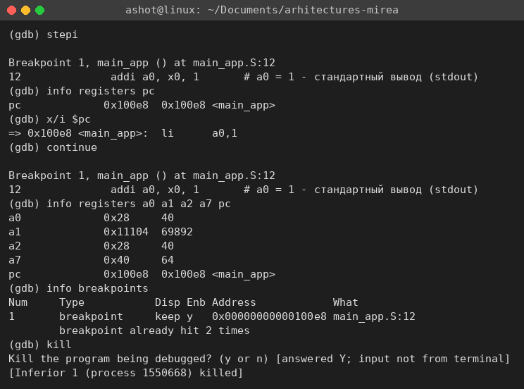

В терминале, где запущен QEMU, за время сессии появились две строки — по одной на каждое выполнение `ecall` (рис. 7). После команды `kill` в gdb эмулятор завершился.

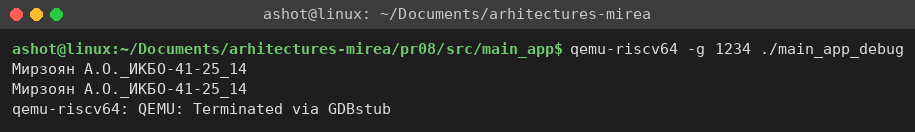

## 5 Makefile для релизной и отладочной версий

Для каждой из двух программ создан свой makefile (каталоги `src/hello` и `src/main_app`). Он развивает идеи листингов 8.7, 8.8 и 8.12 пособия: шаблонные правила, переменные для имён инструментов и программы, а вместо переменной `DEBUG` — отдельные цели:

- `release` (цель по умолчанию) — ассемблирование без отладочной информации, компоновка и удаление таблицы символов утилитой `strip`;
- `debug` — ассемблирование с ключом `-g` (в файл добавляются секции .debug_info, .debug_line и др., по которым gdb сопоставляет адреса со строками исходника), без strip; результат получает суффикс `_debug`, поэтому обе версии могут существовать одновременно;
- `run`, `run-debug` — запуск соответствующей версии в qemu-riscv64;
- `clean` — удаление объектных и исполняемых файлов.

Листинг 4 – makefile для программы hello_world

```make
CROSS  ?= riscv64-linux-gnu-
AS      = $(CROSS)as
LD      = $(CROSS)ld
STRIP   = $(CROSS)strip
QEMU   ?= qemu-riscv64

PROG    = hello_world
SRC     = $(PROG).S

.PHONY: all release debug run run-debug clean

all: release

release: $(PROG)
debug:   $(PROG)_debug

# релизная сборка: объектный файл без -g, исполняемый файл после strip
$(PROG).o: $(SRC)
	$(AS) $< -o $@
$(PROG): $(PROG).o
	$(LD) -o $@ $<
	$(STRIP) $@

# отладочная сборка: -g добавляет секции .debug_*
$(PROG)_debug.o: $(SRC)
	$(AS) -g $< -o $@
$(PROG)_debug: $(PROG)_debug.o
	$(LD) -o $@ $<

run: $(PROG)
	$(QEMU) ./$(PROG)
run-debug: $(PROG)_debug
	$(QEMU) ./$(PROG)_debug

clean:
	rm -f *.o $(PROG) $(PROG)_debug
```

Makefile для второй версии отличается именем программы (`PROG = main_app`), ключом `-e main_app` в команде компоновки и двумя дополнительными целями: `run-head` (запуск зацикленной программы с выводом первых N строк) и `gdbserver` (запуск отладочной версии под gdb-сервером QEMU).

Листинг 5 – Отличия makefile для программы main_app

```make
PROG    = main_app
...
$(PROG): $(PROG).o
	$(LD) -e main_app -o $@ $<
	$(STRIP) $@
...
$(PROG)_debug: $(PROG)_debug.o
	$(LD) -e main_app -o $@ $<

# программа зациклена (j main_app), поэтому показываем только первые N строк
run-head: $(PROG)
	timeout 2 $(QEMU) ./$(PROG) | head -n $(N)

# запуск отладочной версии под gdb-сервером qemu
gdbserver: $(PROG)_debug
	$(QEMU) -g $(GDBPORT) ./$(PROG)_debug
```

Работа makefile первой программы показана на рис. 8. Релизная версия занимает 728 байт и помечена как «stripped», отладочная — 2200 байт и содержит отладочную информацию («with debug_info»), что видно и по списку секций .debug_* в выводе `readelf -S`. Обе версии выводят одинаковую строку. Повторный вызов `make` ничего не делает, так как исполняемый файл новее исходного. Для второй программы аналогичный результат был показан на рис. 3 (720 и 2192 байт соответственно).

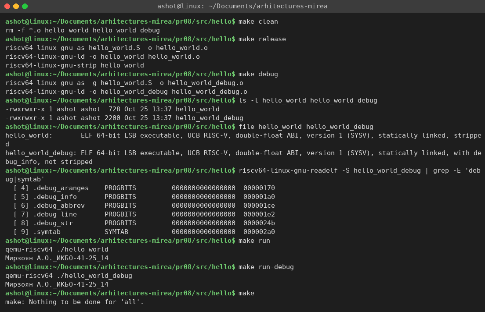

Дополнительно я проверил сборку той же программы с помощью CMake (п. 8.5.2 пособия). В CMakeLists.txt (листинг 6) в качестве компилятора ассемблера указан `riscv64-linux-gnu-gcc`, а стандартные стартовые файлы и библиотека C отключены (`-nostartfiles -nostdlib`), поскольку программа сама определяет `_start`. Тип сборки выбирается параметром `CMAKE_BUILD_TYPE`: Release собирается без отладочной информации и со strip (`-s`), Debug — с `-g`. Результат показан на рис. 9.

Листинг 6 – CMakeLists.txt для программы hello_world

```cmake
cmake_minimum_required(VERSION 3.16)
set(CMAKE_SYSTEM_NAME Linux)
set(CMAKE_SYSTEM_PROCESSOR riscv64)
set(CMAKE_ASM_COMPILER riscv64-linux-gnu-gcc)
project(hello_world ASM)
add_executable(hello_world hello_world.S)
target_link_options(hello_world PRIVATE -nostartfiles -nostdlib -static)
set(CMAKE_ASM_FLAGS_DEBUG "-g")
set(CMAKE_ASM_FLAGS_RELEASE "")
set(CMAKE_EXE_LINKER_FLAGS_RELEASE "-s")
```

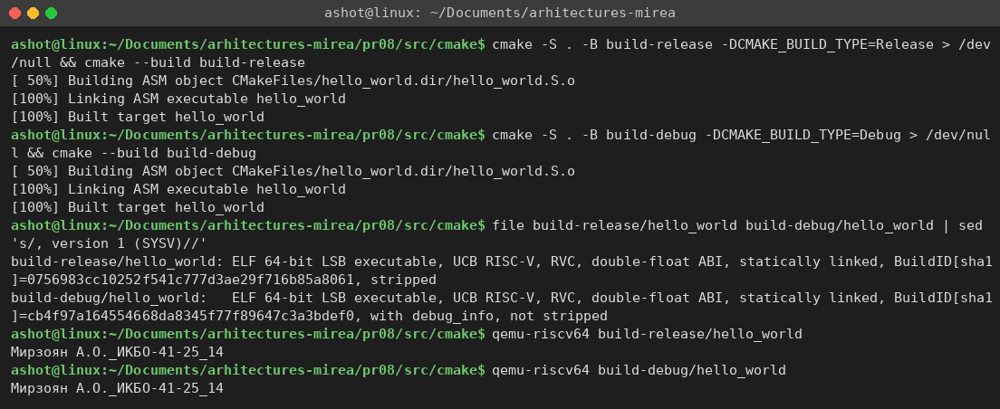

## 6 Схема дешифратора инструкций RISC-V в Logisim

Чтобы связать программную часть с аппаратной, я построил в Logisim 2.7.1 схему, которая разбирает 32-битное слово инструкции RISC-V на поля и выполняет команду addi (файл `src/logisim/riscv_decoder.circ`). Схема генерируется скриптом `gen_riscv_decoder.py`, чтобы координаты всех элементов и проводов были точными.

Схема состоит из трёх частей:

- «память программы» — восемь констант с настоящими машинными кодами из вывода objdump (семь инструкций main_app и `li a7,93` из hello_world) и мультиплексор 8:1; вход `sel` выбирает номер инструкции, а на выходе получается 32-битная шина `instr`;
- дешифратор полей — разветвители (Splitter) выделяют из шины поля opcode = instr[6:0], rd = instr[11:7], funct3 = instr[14:12], rs1 = instr[19:15], rs2 = instr[24:20], funct7 = instr[31:25] и непосредственное значение I-типа imm[11:0] = instr[31:20]. Поля сразу видны на выходных пинах в двоичном виде;
- исполнительный блок addi — два компаратора проверяют opcode = 0010011 (группа OP-IMM) и funct3 = 000, элемент И формирует признак `is_addi`; расширитель знака (Bit Extender) превращает 12-битный imm в 32-битное число, а сумматор складывает его со значением регистра-источника `rs1_val` (32-битный вход). Результат `result` — то, что команда addi записала бы в регистр rd.

Поскольку у всех команд RISC-V поля opcode, rd, funct3 и rs1 стоят на одних и тех же местах, дешифратор получается очень простым: это просто «проводка» битов, без какой-либо логики. Именно это свойство фиксированных форматов команд упоминается в п. 8.2 пособия. Для команды `li a0,1` (это `addi a0,x0,1`) схема показывает opcode = 0010011, rd = 01010 (x10 = a0), rs1 = 0, imm = 1 и результат 1 (рис. 10).

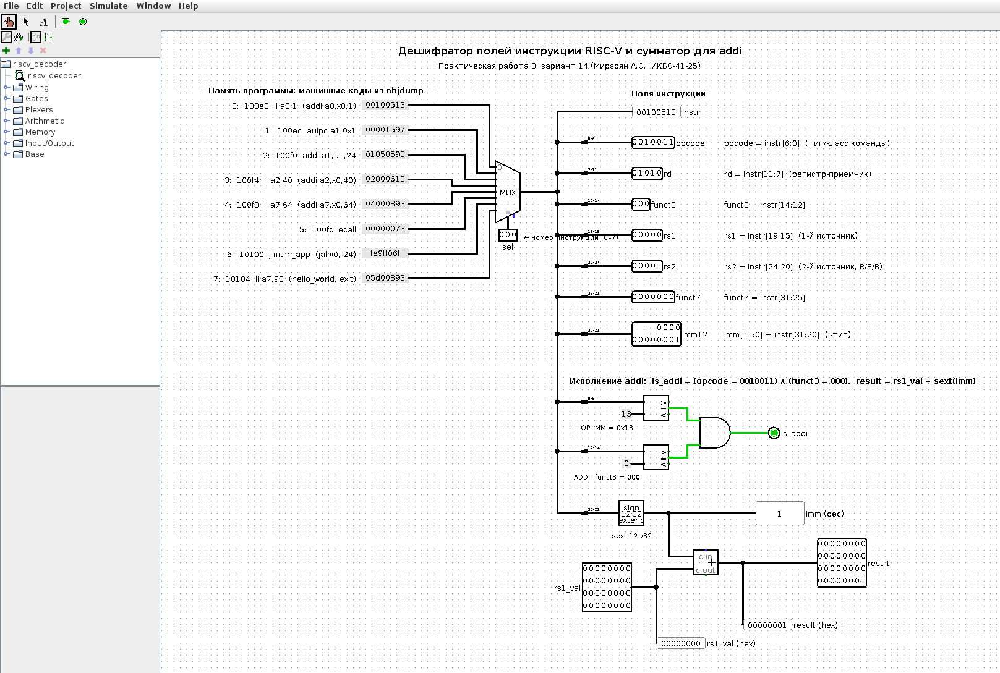

Для команды `addi a1,a1,24` (0x01858593) на вход `rs1_val` подано значение 0x110EC — именно оно было в регистре a1 после `auipc` в отладчике (табл. 2). Схема выделяет rd = rs1 = 01011 (x11 = a1), imm = 24 и вычисляет 0x110EC + 24 = 0x11104, то есть тот же адрес строки, который gdb показал в регистре a1 после выполнения этой инструкции (рис. 11).

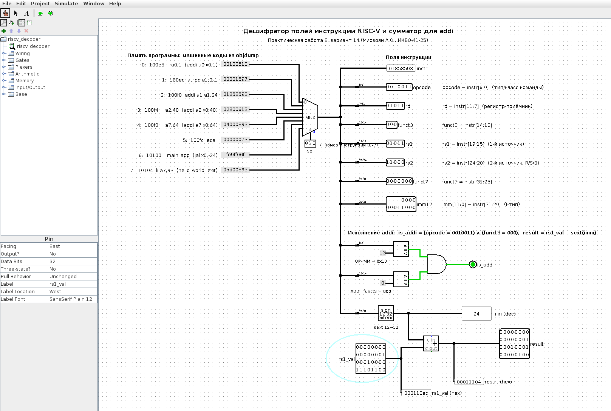

Для инструкции `j main_app` (0xFE9FF06F, на самом деле `jal x0,-24`) opcode равен 1101111 — это формат J, а не OP-IMM, поэтому `is_addi` = 0 и результат сумматора не используется (рис. 12). Поля rs1, rs2 и imm[11:0] для J-типа смысла не имеют: в этих битах закодировано 20-битное смещение перехода.

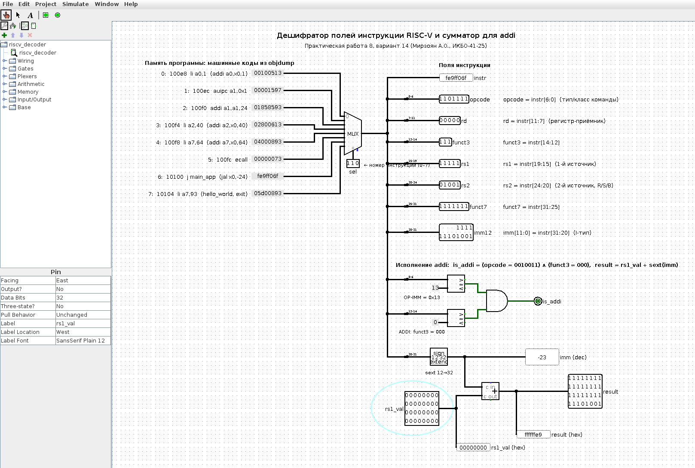

Кроме ручной проверки в редакторе, схема проверена автоматически: скрипт `check.js` (выполняется движком JavaScript из Java 8 — `jjs`, с классами Logisim из logisim.jar) загружает .circ, для каждого набора входов выставляет значения на входные пины, запускает моделирование и печатает значения выходов. Команда `java -jar logisim.jar riscv_decoder.circ -tty stats` дополнительно подтверждает, что файл корректно открывается самим Logisim. Результат для всех восьми инструкций показан на рис. 13 и сведён в табл. 3 — значения полей совпадают с разбором objdump.

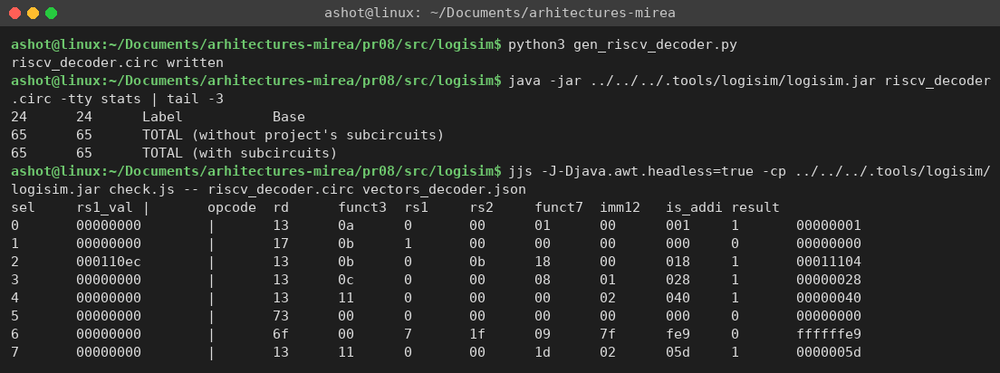

Таблица 3 – Разбор машинных кодов программы схемой (значения в шестнадцатеричном виде)

| sel | Инструкция | opcode | rd | funct3 | rs1 | imm[11:0] | is_addi | result |
|---|---|---|---|---|---|---|---|---|
| 0 | `li a0,1` | 13 | 0a (a0) | 0 | 00 | 001 | 1 | 00000001 |
| 1 | `auipc a1,0x1` | 17 | 0b (a1) | 1 | 00 | 000 | 0 | – |
| 2 | `addi a1,a1,24` (a1 = 0x110ec) | 13 | 0b (a1) | 0 | 0b (a1) | 018 | 1 | 00011104 |
| 3 | `li a2,40` | 13 | 0c (a2) | 0 | 00 | 028 | 1 | 00000028 |
| 4 | `li a7,64` | 13 | 11 (a7) | 0 | 00 | 040 | 1 | 00000040 |
| 5 | `ecall` | 73 | 00 | 0 | 00 | 000 | 0 | – |
| 6 | `j main_app` | 6f | 00 | 7 | 1f | fe9 | 0 | – |
| 7 | `li a7,93` | 13 | 11 (a7) | 0 | 00 | 05d | 1 | 0000005d |

У команды `auipc` (sel = 1) поле rd = a1 тоже выделяется правильно, но opcode 0010111 — это формат U, поэтому is_addi = 0. «funct3» = 1 у неё — это просто младшие биты 20-битной константы 0x00001: в формате U биты [31:12] целиком занимает непосредственное значение.

# ВЫВОДЫ

В ходе работы была настроена среда разработки под RISC-V на хосте x86_64: кросс-тулчейн riscv64-linux-gnu, эмулятор пользовательского режима qemu-riscv64 и отладчик gdb-multiarch. Такой вариант не требует установки полной гостевой системы и позволяет собирать, запускать и отлаживать программы для RISC-V прямо в терминале основной системы.

Программа из листинга 8.4 изменена так, чтобы выводить строку «Мирзоян А.О._ИКБО-41-25_14». При этом выяснилось, что длину строки для `write` нужно указывать в байтах UTF-8 (40), а не в символах (27). Программа собрана, скомпонована и корректно выполняется.

Во второй версии точка входа переименована в `main_app` и задана компоновщику ключом `-e`, а выход заменён переходом `j main_app`, из-за чего программа выводит строку бесконечно. Пошаговое выполнение в gdb показало, как каждая инструкция меняет регистры: псевдоинструкция `la` раскладывается на `auipc` и `addi`, после `ecall` в a0 возвращается число записанных байт, а после `j main_app` счётчик команд возвращается к адресу 0x100e8.

Для обеих версий написаны makefile с целями release (без отладочной информации, со strip), debug (с `-g`), run и clean; также показана сборка через CMake. Отладочная версия примерно в три раза больше релизной за счёт секций .debug_* и таблицы символов, зато позволяет отладчику показывать строки исходного текста.

Схема в Logisim показала, как выглядит декодирование команд RISC-V «в железе»: благодаря фиксированным позициям полей дешифратор сводится к разветвлению проводов, а выполнение addi — к знаковому расширению imm и одному сумматору. Результаты схемы на реальных машинных кодах программы совпали с разбором objdump и со значениями регистров, полученными в gdb.
