<!-- num: 9; title: Взаимодействие ассемблера и высокоуровневых языков -->

# ЦЕЛЬ РАБОТЫ

Освоить совместное использование ассемблера RISC-V и языков высокого уровня: вызов функции на ассемблере из программы на C по стандартному соглашению о вызовах, оформление ассемблерного кода в виде статической и динамической библиотек, встраивание ассемблерных вставок в код на C и вызов ассемблерной функции из Python через модуль ctypes.

# ЗАДАНИЕ

Вариант 14.

Строковый литерал в программах заменить на строку по шаблону «<ФИО>_<номер группы>_вариант_<номер варианта>» в нижнем регистре: «мирзоян_а_о_икбо_41_25_вариант_14».

1. Используя листинги 9.8, 9.14 – 9.15, собрать и выполнить программу преобразования строкового литерала.
2. Используя листинги 9.8, 9.14, 9.17, собрать статическую библиотеку и выполнить программу преобразования строкового литерала.
3. Используя листинг 9.19, собрать динамическую библиотеку и выполнить программу преобразования строкового литерала из листинга 9.22 с использованием вызова функции ассемблера в языке C. Для сборки программы использовать «gcc -o uppertst4 uppertst4.c».
4. Используя динамическую библиотеку из задания 3 и листинг 9.23, выполнить программу преобразования строкового литерала с вызовом функции ассемблера из Python.

Дополнительно: реализовать перевод в верхний регистр с поддержкой кириллицы в UTF-8 и построить в Logisim аппаратный аналог функции toupper.

# ХОД РАБОТЫ

## 1 Среда выполнения

Работа выполнялась в той же среде, что и практика 8: хост Ubuntu 24.04 (x86_64), кросс-компилятор `riscv64-linux-gnu-gcc` 13.3 и эмулятор пользовательского режима `qemu-riscv64` 8.2.2. В отличие от прошлой работы, здесь программы компонуются со стандартной библиотекой C (glibc) и являются динамически скомпонованными: им нужен загрузчик `/lib/ld-linux-riscv64-lp64d.so.1` и `libc.so.6` для RISC-V. Эти файлы лежат в sysroot кросс-тулчейна, а переменная окружения `QEMU_LD_PREFIX` указывает QEMU, что пути вида `/lib/...` нужно сначала искать внутри sysroot. Поэтому везде, где в пособии программа запускается как `./uppertst`, у меня используется `qemu-riscv64 ./uppertst`, а вместо `gcc`, `as`, `ar` — их кросс-версии с префиксом `riscv64-linux-gnu-`. Прав администратора на компьютере нет, поэтому общая библиотека устанавливается не в `/usr/local/lib`, а в локальный каталог (см. п. 4).

Строка варианта «мирзоян_а_о_икбо_41_25_вариант_14» состоит из 33 символов, но в UTF-8 занимает 53 байта: 24 кириллические буквы по 2 байта и 9 однобайтовых символов (подчёркивания и цифры). Это важно для понимания результатов ниже.

## 2 Задание 1: вызов функции на ассемблере из C

Функция `mytoupper` взята из листинга 9.8. Она получает в a0 адрес входной строки, в a1 — адрес выходного буфера, по одному байту копирует строку, заменяя строчные латинские буквы на заглавные (вычитание 0x20), и возвращает в a0 длину результата вместе с завершающим нулём. Функция соблюдает соглашение о вызовах: сохраняет в стеке ra и s0, которые использует, и восстанавливает их перед `ret`.

При сборке по листингу без изменений компоновщик выдал ошибку «undefined reference to `mytoupper'» (рис. 1): в листинге 9.8 глобальным объявлен символ `mytoupper`, а сама метка функции называется `toupper`, так что символ `mytoupper` нигде не определён. Я переименовал метку в `mytoupper` (листинг 1) — исходный вариант сохранён в `src/task1/upper_listing.S`.

Листинг 1 – Функция mytoupper (upper.S, исправленный листинг 9.8)

```asm
.global mytoupper            # Allow other files to call this routine

mytoupper:
      addi sp, sp, -16     # allocate 16 bytes on stack
      sd   ra, 8(sp)       # push return address
      sd   s0, 0(sp)       # push s0 register
      mv   s0, a1          # save original outstr for len calc
# The loop is until null (zero) character is encountered.
loop: lb   t2, 0(a0)       # load character
      addi a0, a0, 1       # increment buffer pointer
      li   t3, 'z'         # load 'z' for comparison
      bgt  t2, t3, cont    # branch if letter > 'z'?
      li   t3, 'a'         # load 'a' for comparison
      blt  t2, t3, cont    # goto to end if not lowercase
      addi t2, t2, ('A'-'a')
cont: sb   t2, 0(a1)       # store character to output str
      addi a1, a1, 1       # increment buffer for next char
      li   t3, 0           # load 0 char for comparison
      bne  t2, t3, loop    # loop if character isn't null
      sub  a0, a1, s0      # get the len by sub'ing the pointers
      ld   s0, 0(sp)       # pop s0
      ld   ra, 8(sp)       # pop ra
      addi sp, sp, 16      # deallocate stack space
      ret                  # Return to caller
```

Программа на C (листинг 9.14) объявляет прототип `extern int mytoupper(const char *in, char *out);` и вызывает функцию как обычную C-функцию: компилятор сам кладёт аргументы в a0 и a1 и забирает результат из a0. В программе изменена только строка (листинг 2). Makefile повторяет листинг 9.15, но с кросс-компилятором (листинг 3).

Листинг 2 – Программа uppertst.c (листинг 9.14 со строкой варианта)

```c
#include <stdio.h>

#define MAX_BUFFSIZE 255

extern int mytoupper(const char *in, char *out);

int main()
{
    char *str = "мирзоян_а_о_икбо_41_25_вариант_14";
    char outBuf[MAX_BUFFSIZE];
    int len;

    len = mytoupper( str, outBuf );
    printf("Before str: %s\n", str);
    printf("After str: %s\n", outBuf);
    printf("Str len = %d\n", len);
    return(0);
}
```

Листинг 3 – makefile задания 1

```make
CC   = riscv64-linux-gnu-gcc
QEMU = qemu-riscv64

uppertst: uppertst.c upper.S
	$(CC) -o uppertst uppertst.c upper.S

run: uppertst
	$(QEMU) ./uppertst
```

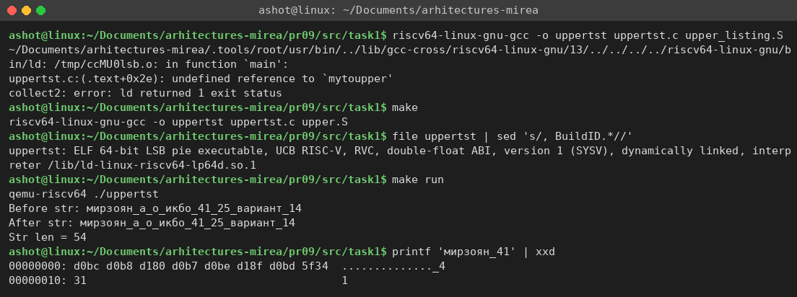

Программа собралась и выполнилась (рис. 1), но строка после преобразования не изменилась, а длина равна 54 (53 байта строки плюс завершающий ноль — как и в пособии, где для «This is a test.» выводится 16). Это ожидаемый результат: функция из пособия умеет переводить в верхний регистр только латинские буквы a–z из таблицы ASCII. Цифры и подчёркивания и так не имеют регистра, а кириллица в UTF-8 кодируется двумя байтами: первый байт 0xD0 или 0xD1, второй — из диапазона 0x80–0xBF (это видно в дампе `xxd` на рис. 1: «м» = d0 bc, «и» = d0 b8, «р» = d1 80). Все эти байты больше 0x7F, то есть не являются символами ASCII и не попадают в диапазон 'a' (0x61) – 'z' (0x7A).

Как именно функция пропускает такие байты, видно в отладчике (рис. 2). Инструкция `lb` загружает байт со знаковым расширением, поэтому байт 0xD0 превращается в регистре t2 в 0xFFFFFFFFFFFFFFD0 = −48. Проверка `bgt t2, t3` ('z') не срабатывает, а `blt t2, t3` ('a') срабатывает, так как −48 < 97, и выполнение переходит на метку `cont` — байт записывается в выходную строку без изменений. Если бы использовалась `lbu`, байт 0xD0 = 208 оказался бы больше 'z', и результат был бы тем же. Перевести кириллицу в верхний регистр побайтовым вычитанием 0x20 нельзя в принципе: например, «р» = D1 80, а «Р» = D0 A0, то есть меняются оба байта. Улучшенная версия функции приведена в п. 6.

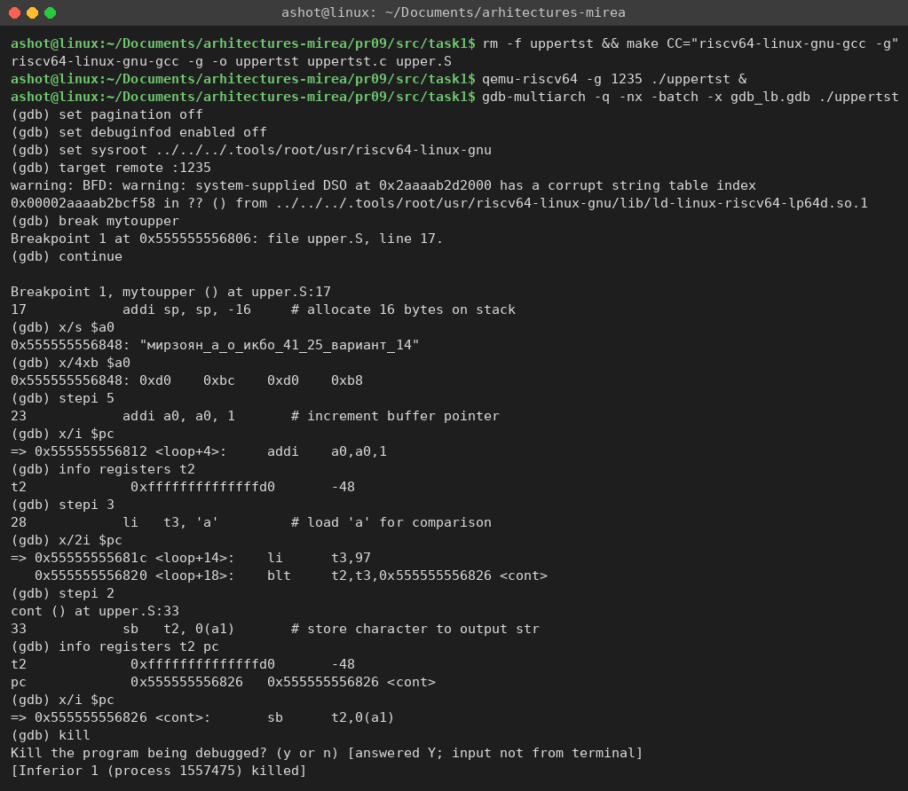

## 3 Задание 2: статическая библиотека

По листингу 9.17 объектный файл `upper.o` помещается утилитой `ar` в статическую библиотеку `libupper.a`, а программа компонуется с ней (листинг 4). При статической компоновке код функции копируется из библиотеки прямо в исполняемый файл.

Листинг 4 – makefile задания 2 (листинг 9.17)

```make
AS   = riscv64-linux-gnu-as
AR   = riscv64-linux-gnu-ar
CC   = riscv64-linux-gnu-gcc
LIBOBJS = upper.o

all: uppertst2

%.o : %.S
	$(AS) $(DEBUGFLGS) $< -o $@

libupper.a: $(LIBOBJS)
	$(AR) -cvq libupper.a upper.o

uppertst2: uppertst.c libupper.a
	$(CC) -o uppertst2 uppertst.c libupper.a
```

Результат показан на рис. 3. Команда `ar -t` показывает, что библиотека содержит один модуль upper.o, `nm` — что в нём определён глобальный символ `mytoupper` (T) и локальные метки loop и cont (t). В исполняемом файле `uppertst2` символ `mytoupper` присутствует с собственным адресом, а среди требуемых динамических библиотек (NEEDED) есть только libc и загрузчик — функция вошла в программу целиком. Здесь файл .S можно ассемблировать напрямую `as`, без препроцессора C, так как в upper.S нет директив `#include`/`#define`.

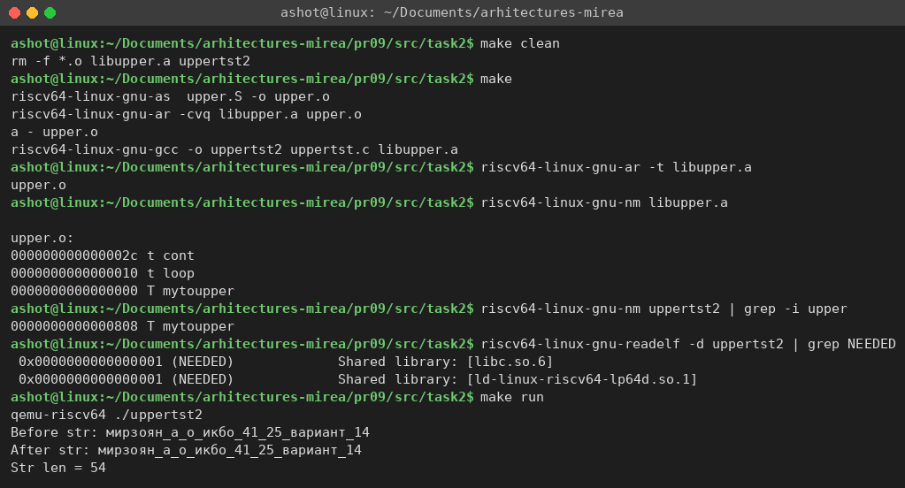

## 4 Задание 3: динамическая библиотека и ассемблерная вставка в C

По листингу 9.19 из `upper.o` собирается общая библиотека `libup.so.1.0` с внутренним именем (soname) `libup.so.1`, и на неё создаются символические ссылки `libup.so.1` и `libup.so`. В пособии библиотека переносится командой `sudo` в `/usr/local/lib` и регистрируется через `ldconfig`. Прав root у меня нет, поэтому библиотека «устанавливается» в каталог `lib/` рядом с программой, а путь к нему записывается в исполняемый файл ключом компоновщика `-Wl,-rpath,'$ORIGIN/lib'` ($ORIGIN — каталог, где лежит сама программа). Код функции не использует абсолютных адресов, поэтому объектный файл подходит для общей библиотеки без перекомпиляции с `-fPIC`.

Листинг 5 – makefile задания 3 (на основе листинга 9.19)

```make
AS     = riscv64-linux-gnu-as
CC     = riscv64-linux-gnu-gcc
LIBDIR = lib
LIBOBJS = upper.o

all: uppertst3 uppertst4

%.o : %.S
	$(AS) $(DEBUGFLGS) $< -o $@

libup.so.1.0: $(LIBOBJS)
	$(CC) -shared -Wl,-soname,libup.so.1 -o libup.so.1.0 $(LIBOBJS)
	mkdir -p $(LIBDIR)
	mv libup.so.1.0 $(LIBDIR)
	ln -sf libup.so.1.0 $(LIBDIR)/libup.so.1
	ln -sf libup.so.1.0 $(LIBDIR)/libup.so

uppertst3: libup.so.1.0
	$(CC) -o uppertst3 uppertst.c -L$(LIBDIR) -lup -Wl,-rpath,'$$ORIGIN/lib'

uppertst4: uppertst4.c
	$(CC) -o uppertst4 uppertst4.c
```

Сборка и проверка библиотеки показаны на рис. 4. `file` определяет `libup.so.1.0` как «shared object» для RISC-V, `readelf -d` показывает soname `libup.so.1`, а `nm -D` — что `mytoupper` экспортируется в динамической таблице символов. Программа `uppertst3` теперь зависит от `libup.so.1` (строка NEEDED) и содержит RUNPATH `$ORIGIN/lib`, поэтому запускается и из своего каталога, и из соседнего.

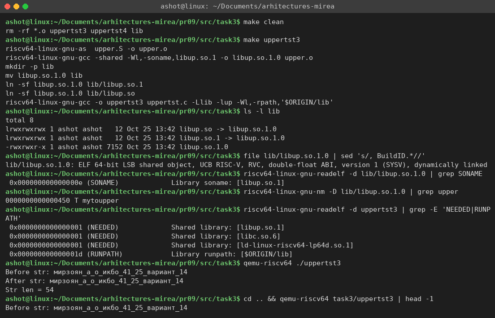

Как и в листинге 9.21, в дизассемблере `uppertst3` вместо кода функции видна заглушка `mytoupper@plt` из таблицы PLT (рис. 5): `auipc` + `ld` загружают адрес функции из таблицы GOT, который динамический загрузчик заполняет при запуске, а `jalr` выполняет переход. Вызов из main идёт именно на эту заглушку (`jal 6e0 <mytoupper@plt>`). Если убрать каталог с библиотекой, загрузчик сообщает «cannot open shared object file» и программа не запускается (код 127); с переменной `LD_LIBRARY_PATH`, указывающей на каталог библиотеки, она снова работает. Это наглядно показывает, что код функции загружается отдельно от программы, во время запуска.

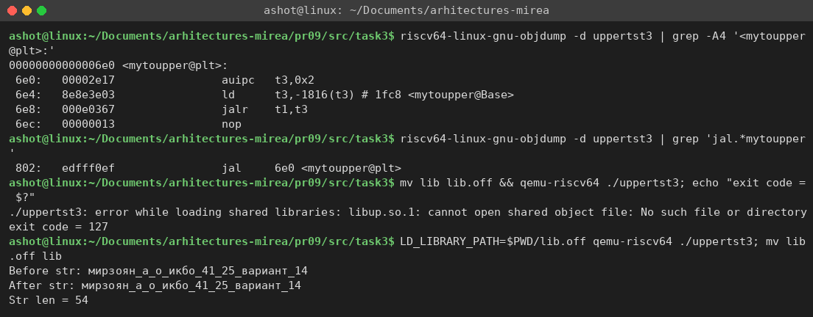

Программа из листинга 9.22 (`uppertst4.c`) реализует тот же алгоритм ассемблерной вставкой `asm(...)` прямо в функции main. В шаблоне `%0`, `%1`, `%2` заменяются регистрами, которые компилятор выделил под `len`, `str` и `outBuf`, а список t2, t3, t4, a0, a1 сообщает компилятору, какие регистры вставка портит (листинг 6). Программа собрана командой из задания `riscv64-linux-gnu-gcc -o uppertst4 uppertst4.c` (рис. 6); в дизассемблере видно, что компилятор подставил вместо `%1` и `%2` регистры a5 и a4, а метки loop и cont попали в код как есть.

Листинг 6 – Ассемблерная вставка из uppertst4.c (листинг 9.22)

```c
    char *str = "мирзоян_а_о_икбо_41_25_вариант_14";
    ...
    asm (
        "mv t4, %2\n"
        "loop:     lb    t2, 0(%1)\n"
        "addi %1, %1, 1\n"
        "li t3, 'z'\n"
        "bgt t2, t3, cont\n"
        "li t3, 'a'\n"
        "blt t2, t3, cont\n"
        "addi t2, t2, ('A'-'a')\n"
        "cont:     sb    t2, 0(%2)\n"
        "addi %2, %2, 1\n"
        "li t3, 0 \n"
        "bne t2, t3, loop\n"
        "sub %0, %2, t4\n"
        : "=r" (len)
        : "r" (str), "r" (outBuf)
        : "t2", "t3", "t4", "a0", "a1"
    );
```

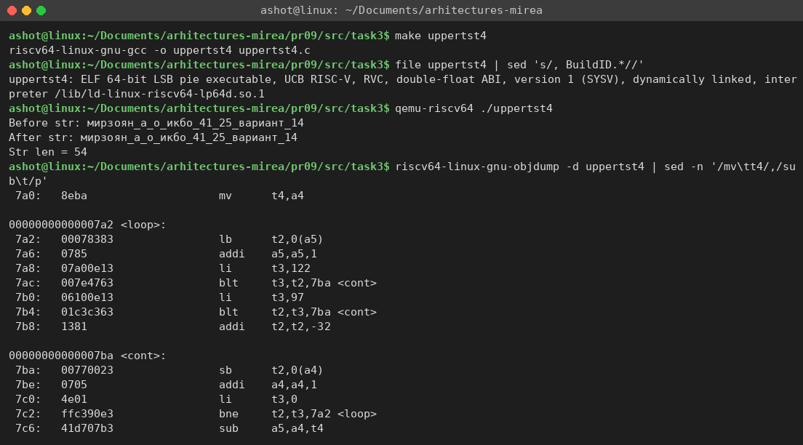

Результат всех трёх вариантов (функция в объектном файле, в статической и в динамической библиотеке, ассемблерная вставка) одинаков: строка не меняется, длина 54. Замечу, что вставка из листинга 9.22 изменяет регистры `%1` и `%2`, объявленные только входными операндами, — формально правильнее было бы описать их как `"+r"`. Без оптимизации (как в задании) это работает, но при `-O2` компилятор вправе считать, что эти регистры после вставки не изменились.

## 5 Задание 4: вызов функции из Python

Модуль ctypes загружает общую библиотеку в адресное пространство самого интерпретатора, поэтому архитектура интерпретатора и библиотеки должна совпадать. Python на хосте собран для x86_64 и RISC-V-библиотеку загрузить не может: на рис. 8 видно, что при попытке выполнить скрипт обычным `python3` вызов `CDLL` завершается ошибкой OSError, хотя файл существует (`file` подтверждает, что это объект RISC-V): загрузчик glibc отбрасывает ELF-файл чужой архитектуры и сообщает, что подходящий файл не найден. Поэтому скрипт нужно выполнять интерпретатором Python, собранным для RISC-V, под тем же qemu-riscv64.

Готовую сборку Python 3.12 для riscv64 я взял из архива пакетов Ubuntu 24.04 (ports.ubuntu.com). Без root-прав `apt` для чужой архитектуры не работает, поэтому скрипт `get_python_rv64.sh` скачивает нужные .deb-пакеты напрямую (python3.12-minimal, libpython3.12-minimal, libpython3.12-stdlib с модулем `_ctypes`, а также libffi8, zlib1g, libexpat1 — всего около 5 МБ) и распаковывает их командой `dpkg-deb -x` в каталог `.tools/pyrv`. Скрипт `run_python_rv64.sh` запускает этот интерпретатор в qemu-riscv64 (листинг 7): glibc берётся из sysroot через `QEMU_LD_PREFIX`, а libffi и остальные библиотеки — через `LD_LIBRARY_PATH` гостевой программы (ключ `-E` у QEMU). Проверка (рис. 7) показывает, что интерпретатор — 64-битный ELF для RISC-V, а `platform.machine()` внутри него возвращает `riscv64`.

Листинг 7 – Скрипт запуска RISC-V-интерпретатора run_python_rv64.sh

```bash
#!/bin/bash
ROOT=$(cd "$(dirname "$0")/../../.." && pwd)
PY=$ROOT/.tools/pyrv/root
exec qemu-riscv64 -E LD_LIBRARY_PATH=$PY/usr/lib/riscv64-linux-gnu \
     $PY/usr/bin/python3.12 "$@"
```

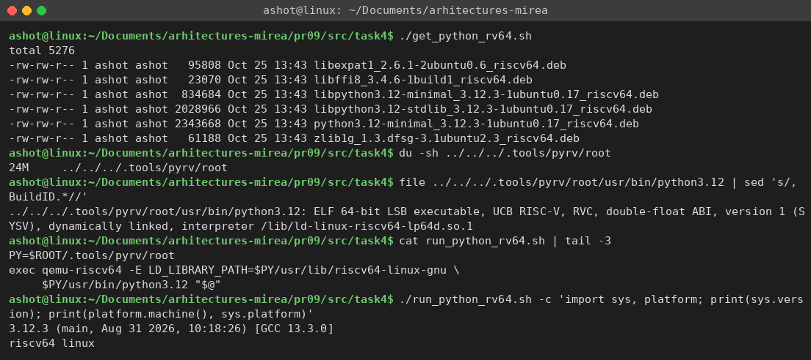

Программа на Python повторяет листинг 9.23 (листинг 8) с двумя изменениями. Во-первых, путь к библиотеке — `../task3/lib/libup.so` вместо `/usr/local/lib/libup.so`. Во-вторых, строковый литерал вида `b"..."` в Python может содержать только символы ASCII, поэтому строка варианта сначала кодируется в байты UTF-8 методом `encode`. Через `argtypes` и `restype` для функции задаются типы аргументов (`c_char_p`) и результата (`c_int`), а `create_string_buffer` создаёт изменяемые буферы в памяти, адреса которых передаются в регистрах a0 и a1.

Листинг 8 – Программа uppertst.py (листинг 9.23)

```python
import os
from ctypes import *

LIB = os.path.join(os.path.dirname(os.path.abspath(__file__)), "..", "task3", "lib", "libup.so")
libupper = CDLL(LIB)

libupper.mytoupper.argtypes = [c_char_p, c_char_p]
libupper.mytoupper.restype = c_int

inStr = create_string_buffer("мирзоян_а_о_икбо_41_25_вариант_14".encode("utf-8"))
outStr = create_string_buffer(250)

length = libupper.mytoupper(inStr, outStr)

print(inStr.value.decode())
print(outStr.value.decode())
print(length)
```

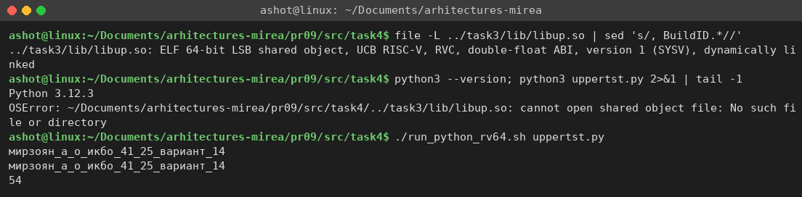

Под RISC-V-интерпретатором скрипт успешно загрузил `libup.so` и вызвал ассемблерную функцию (рис. 8). Результат совпадает с программами на C: строка без изменений и длина 54.

## 6 Дополнительно: перевод кириллицы UTF-8 в верхний регистр

Чтобы строка варианта всё-таки переводилась в верхний регистр, я написал функцию `mytoupper_utf8` (файл `src/extra/upper_utf8.S`) с тем же интерфейсом, что и `mytoupper`. Она читает байты командой `lbu` (без знакового расширения) и разбирает три случая:

- байт ASCII 'a'–'z' — вычитается 0x20, как в исходной функции;
- первый байт 0xD0, второй 0xB0–0xBF (буквы а–п) — второй байт уменьшается на 0x20 (а = D0 B0 → А = D0 90);
- первый байт 0xD1, второй 0x80–0x8F (буквы р–я) — первый байт становится 0xD0, а второй увеличивается на 0x20 (р = D1 80 → Р = D0 A0); отдельно обрабатывается ё = D1 91 → Ё = D0 81.

Остальные байты копируются без изменений. Длина строки при таком преобразовании не меняется, поскольку заглавные буквы кириллицы тоже занимают по 2 байта.

Листинг 9 – Фрагмент функции mytoupper_utf8 (обработка букв р–я и ё)

```asm
lead_d1:                         # D1 xx: р..я (80..8F) и ё (91)
        lbu  t4, 0(a0)
        li   t3, 0x91
        beq  t4, t3, yo
        li   t3, 0x80
        bltu t4, t3, store
        li   t3, 0x8F
        bgtu t4, t3, store
        addi t4, t4, 0x20        # 80..8F -> A0..AF
        li   t2, 0xD0            # первый байт заглавных Р..Я – D0
        j    store2
yo:     li   t2, 0xD0            # ё (D1 91) -> Ё (D0 81)
        li   t4, 0x81
store2:                          # записать двухбайтовую букву
        sb   t2, 0(a1)
        sb   t4, 1(a1)
        addi a1, a1, 2
        addi a0, a0, 1           # второй байт входа уже обработан
        j    next
```

Обе функции собраны в общую библиотеку `libup8.so`. Тестовая программа на C сравнивает их на строке варианта, на строке из пособия и на строке с буквой ё и знаками препинания, а скрипт на Python вызывает `mytoupper_utf8` под RISC-V-интерпретатором (рис. 9). Новая функция переводит строку варианта в «МИРЗОЯН_А_О_ИКБО_41_25_ВАРИАНТ_14», а с латиницей работает так же, как исходная.

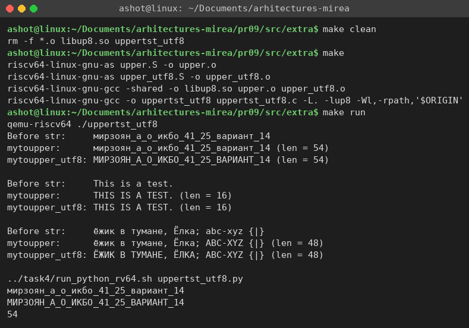

## 7 Схема toupper в Logisim

Чтобы показать, как та же логика выглядит на уровне аппаратуры, я построил в Logisim 2.7.1 схему, которая выполняет одну итерацию цикла `mytoupper` для одного символа (файл `src/logisim/toupper.circ`, генерируется скриптом `gen_toupper.py`). Соответствие схемы и кода:

- 8-битный вход `c` — байт, который функция загружает в t2 инструкцией `lb`;
- два компаратора сравнивают c с константами 'a' = 0x61 и 'z' = 0x7A; используются выходы «c < 'a'» и «c > 'z'» — это условия переходов `blt` и `bgt` на метку `cont`. Сравнение в компараторах знаковое (в дополнительном коде), так как `lb` знаково расширяет байт;
- элемент ИЛИ-НЕ формирует признак `is_lower`: символ — строчная буква, если не выполнено ни одно из условий перехода;
- вычитатель вычисляет c − 0x20 (инструкция `addi t2, t2, 'A'-'a'`);
- мультиплексор 2:1, управляемый `is_lower`, выбирает c − 0x20 или исходный c — то есть делает то же, что пара «переход на cont / выполнение addi».

Для строчной буквы 'm' (0x6D) оба условия ложны, `is_lower` = 1 и на выходе получается 'M' = 0x4D (рис. 10). Для символа '{' = 0x7B, который идёт в таблице ASCII сразу после 'z', срабатывает компаратор «c > 'z'», и символ проходит без изменений (рис. 11). Для байта 0xD0 (первый байт букв «а»–«п») при знаковом сравнении 0xD0 = −48 < 'a', поэтому срабатывает условие «c < 'a'» — точно так же, как `blt` в отладчике на рис. 2, и байт не меняется (рис. 12).


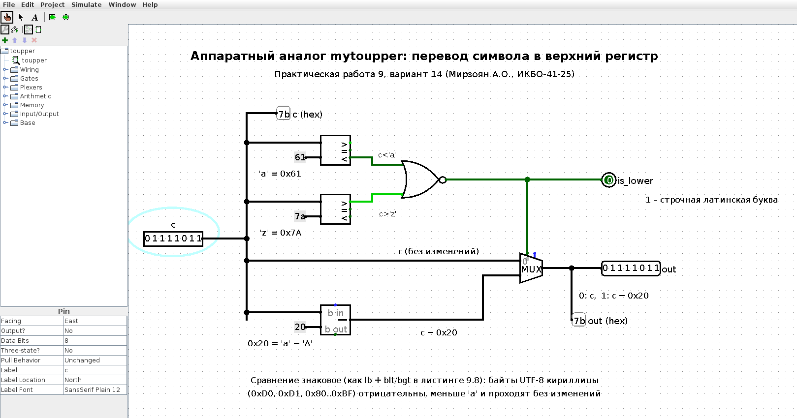


Схема проверена автоматически скриптом `check.js` (движок JavaScript `jjs` из Java 8 с классами Logisim): он выставляет значения на вход `c`, запускает моделирование и печатает выходы. Проверены граничные значения ('a', 'z', '`', '{', 'A', цифра, байты UTF-8), а также все байты строки «This is a test.» и строки варианта: первая превращается в «THIS IS A TEST.», во второй не меняется ни один из 53 байт — так же, как у ассемблерной функции (рис. 13).

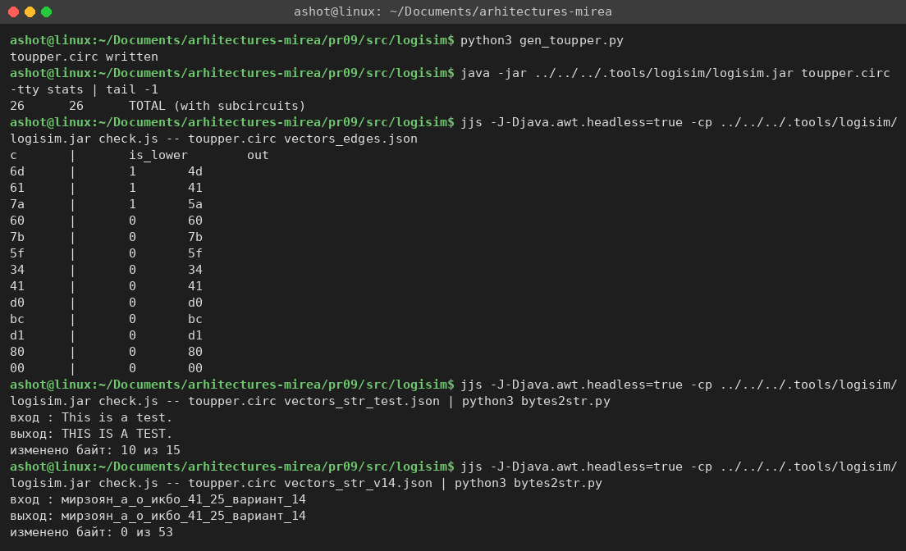

# ВЫВОДЫ

В ходе работы функция перевода строки в верхний регистр, написанная на ассемблере RISC-V, была вызвана из C четырьмя способами: в виде отдельного объектного файла, из статической библиотеки libupper.a, из динамической библиотеки libup.so и в виде ассемблерной вставки `asm` в коде на C. Во всех случаях соблюдение стандартного соглашения о вызовах (аргументы в a0–a1, результат в a0, сохранение ra и s0) позволяет C-коду вызывать ассемблерную функцию так же, как обычную. На примере `objdump` видно главное отличие динамической компоновки: программа вызывает функцию через заглушку PLT, а адрес подставляет загрузчик при запуске.

Та же динамическая библиотека была вызвана из Python через модуль ctypes. Для этого понадобился интерпретатор Python, собранный под RISC-V: он был получен из архива пакетов Ubuntu и запущен в эмуляторе qemu-riscv64, поскольку ctypes может загружать только библиотеки той же архитектуры, что и сам интерпретатор.

В процессе работы были найдены и исправлены неточности в листингах пособия: несовпадение имени метки и глобального символа в листинге 9.8, использование `sudo` и `/usr/local/lib` (заменено локальным каталогом и rpath), а также кириллица в байтовом литерале Python.

Функция из пособия корректно работает только с латиницей: строка варианта, записанная кириллицей в UTF-8, не изменяется, потому что её байты (0xD0, 0xD1, 0x80–0xBF) лежат вне диапазона 'a'–'z', а после знакового расширения командой `lb` они вообще отрицательны. Написанная дополнительно функция `mytoupper_utf8` учитывает двухбайтовую структуру кириллицы и переводит строку в «МИРЗОЯН_А_О_ИКБО_41_25_ВАРИАНТ_14». Схема в Logisim показала, что логика toupper в аппаратуре сводится к двум компараторам, элементу ИЛИ-НЕ, вычитателю и мультиплексору, и ведёт себя на байтах кириллицы так же, как ассемблерная функция.
