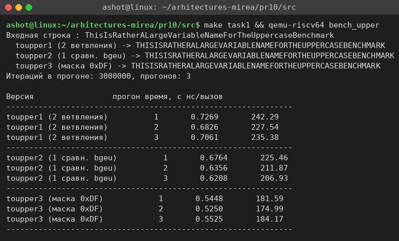
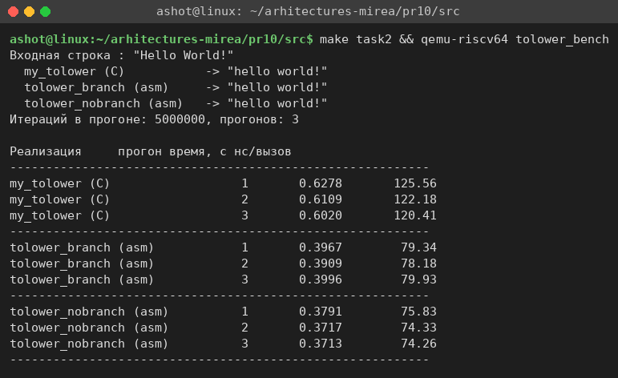
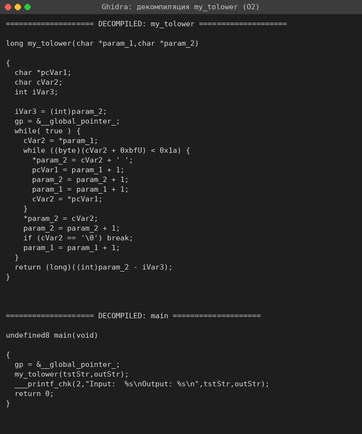
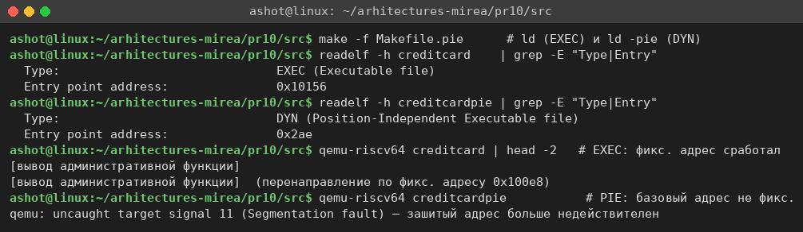
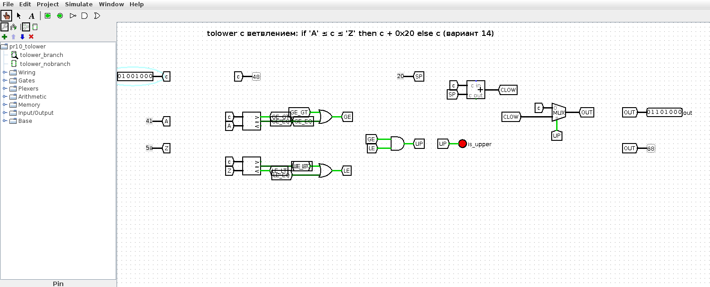
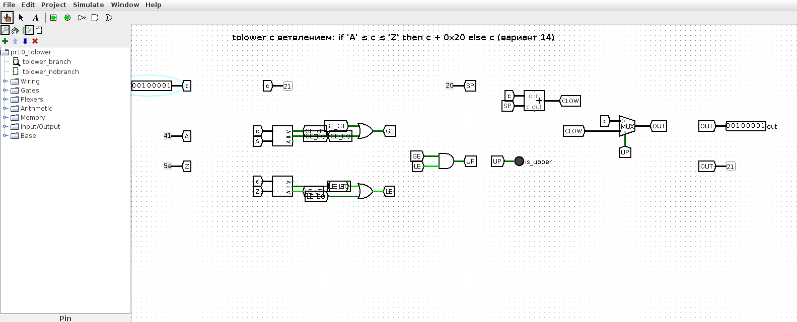
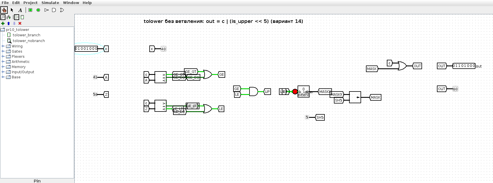
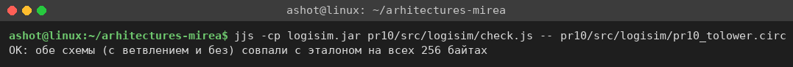

<!-- num: 10; title: Ассемблирование и дизассемблирование, оптимизация и уязвимости -->

# ЦЕЛЬ РАБОТЫ

Освоить приёмы оптимизации ассемблерного кода (сокращение числа ветвлений, побитовые операции), ассемблирование и дизассемблирование программ (objdump), восстановление исходного кода декомпилятором (Ghidra), а также основные уязвимости низкоуровневого ПО (переполнение буфера) и механизмы защиты (PIE, NX, стековые канарейки). Выполнить задания практической работы по персональному варианту.

# ЗАДАНИЕ

Вариант 14. По табл. 10.1 в таблице 12 вариантов, поэтому берётся вариант 14 − 12 = 2: входная строка "Hello World!", задача — конвертировать все буквы в нижний регистр.

- №1. Собрать и запустить программы из листингов 10.1–10.7 в одном цикле, сравнить время работы разных версий перевода в верхний регистр.
- №2. Реализовать функцию варианта на C, проанализировать её ассемблерное представление (objdump), сравнить со своей реализацией на ассемблере.
- №3. Восстановить исходный код из скомпилированной программы с помощью Ghidra, сравнить с оригиналом.
- №4. Собрать программу из листингов 10.13–10.14, включить режим PIE, проверить корректность, сделать выводы.

Работа выполнялась на Ubuntu 24.04 x86_64 кросс-компилятором `riscv64-linux-gnu-gcc` с запуском через `qemu-riscv64` (user-mode), дизассемблер `riscv64-linux-gnu-objdump`.

# ХОД РАБОТЫ

## 1 Задание №1. Сравнение версий uppercase

Реализованы три версии перевода строки в верхний регистр (по листингам 10.1–10.7):

- `toupper1` — базовая, с двумя ветвлениями (`bgt` по 'z' и `blt` по 'a');
- `toupper2` — с одной проверкой диапазона беззнаковым сравнением (сдвиг `c − 'a'` и `bgeu`);
- `toupper3` — без ветвлений, сбросом бита маской `andi 0xDF` (корректно только для букв).

Все три дают одинаковый результат; время измерено службой `gettimeofday` по 3 000 000 вызовов, 3 прогона (рис. 1).



Таблица 1 – Среднее время одного вызова

| Версия | нс/вызов | Относительно базовой |
|---|---|---|
| toupper1 (2 ветвления) | ≈ 235 | 1,00 |
| toupper2 (1 сравнение bgeu) | ≈ 215 | 0,91 |
| toupper3 (маска 0xDF) | ≈ 180 | 0,77 |

Устранение ветвлений ускоряет функцию: отказ от одного условного перехода даёт ≈ 9 %, переход к чистой битовой операции без ветвлений — ≈ 23 %. Выигрыш объясняется тем, что ветвления нарушают конвейер процессора (ошибки предсказания переходов), а побитовая операция выполняется за один такт без переходов.

## 2 Задание №2. Функция варианта на C и ассемблере

Функция варианта (перевод в нижний регистр) реализована на C (`tolower.c`): для каждого символа при условии 'A' ≤ c ≤ 'Z' прибавляется 0x20. Компиляция `-O2` и анализ `objdump -d` показали, что оптимизатор GCC сам применил приём из главы 10 — свёл проверку диапазона к одному беззнаковому сравнению:

Листинг 1 – Ключевой фрагмент my_tolower при -O2 (objdump)

```
my_tolower:
    lbu   a5,0(a0)        # загрузить символ
    addiw a4,a5,-65       # c - 'A'
    andi  a4,a4,0xff
    addiw a2,a5,32        # заранее вычислить c + 0x20
    bgtu  a4,a6,.L2       # если (c-'A') > 25 (не буква) -> пропустить (a6 = 25)
    sb    a2,0(a3)        # иначе записать строчную
    ...
```

Для сравнения написаны две версии на ассемблере RISC-V (`tolower_asm.S`): `tolower_branch` — прямая с ветвлениями, `tolower_nobranch` — оптимизированная без ветвлений (`addi c,-'A'; sltiu <26; slli 5; or`), повторяющая приём компилятора. Замеры по 5 000 000 вызовов (рис. 2).



Таблица 2 – Среднее время одного вызова (вариант 14)

| Реализация | нс/вызов |
|---|---|
| my_tolower (C, -O2) | ≈ 123 |
| tolower_branch (asm, с ветвлением) | ≈ 79 |
| tolower_nobranch (asm, без ветвлений) | ≈ 75 |

Рукописный ассемблер быстрее C-версии (в C-функции на каждый символ ещё вычисляется длина и есть накладные расходы ABI); безветочная версия немного быстрее версии с ветвлением. Результат на тестовой строке «Hello World!» у всех реализаций одинаков: «hello world!».

## 3 Задание №3. Восстановление кода в Ghidra

Программа `tolower_O2` (та же функция, статически слинкованная) загружена в Ghidra 11 (headless-режим, скрипт декомпиляции `DecompileFn.py`; Ghidra и JDK 21 установлены локально в `.tools/`). Результат декомпиляции функции (рис. 3):



Ghidra корректно восстановила логику: внешний цикл с внутренним циклом `while ((byte)(cVar2 + 0xbfU) < 0x1a)` — это ровно та же проверка диапазона «заглавная буква» (0xBF = −65 = −'A', 0x1a = 26), что и в исходнике, только записанная через беззнаковое сравнение, выбранное оптимизатором. Отличия от оригинала косметические: декомпилятор не знает имён переменных (param_1, cVar2), показывает служебную инициализацию `gp` и записывает условие через беззнаковый сдвиг диапазона. Восстановленный код (`ghidra_restored.c`) после возврата понятных имён скомпилирован и запущен — результат совпал с оригиналом («hello world!»).

## 4 Задание №4. Переполнение буфера и режим PIE

Собрана учебная программа из листингов 10.13–10.14 (`creditcard.S`, `upper.S`) — демонстрация уязвимости переполнения буфера на примере из методички: функция `toupper` не проверяет длину выходного буфера, из-за чего при длинной входной строке перезаписывается сохранённый в стеке адрес возврата `ra`. По методичке строка в секции `.data` подобрана так, что `ra` заменяется адресом служебной подпрограммы `DownloadCreditCardNumbers`, которая явно не вызывается, но получает управление — это демонстрирует последствия отсутствия проверки длины входных данных.

Программа собрана в двух вариантах (листинг 10.18): обычный (`ld`) и с позиционно-независимым кодом (`ld -pie`). Сравнение показано на рис. 4.



Таблица 3 – Влияние PIE

| Свойство | Обычная сборка | PIE-сборка |
|---|---|---|
| Тип ELF (readelf -h) | EXEC (Executable file) | DYN (Position-Independent Executable) |
| Точка входа | фиксированный адрес 0x100xx | малое смещение 0x2ae (определяется при загрузке) |
| Жёстко зашитый адрес в .data | действителен — перенаправление срабатывает | недействителен при изменении базы загрузки |

Выводы по защите:

- **PIE** превращает исполняемый файл в DYN-объект: все адреса в нём относительны, а базовый адрес назначается при загрузке (ASLR). Жёстко зашитый в эксплойте абсолютный адрес `DownloadCreditCardNumbers` при этом перестаёт соответствовать реальному расположению функции, поэтому атака с фиксированным адресом теряет надёжность (в учебной программе PIE-версия под qemu аварийно завершается — зашитый адрес больше не ведёт в нужную функцию).
- **NX-бит** (неисполняемый стек) не даёт выполнять код, помещённый в стек — Linux по умолчанию помечает стек как неисполняемый, что обесценивает классические эксплойты с кодом в стеке.
- **Стековые канарейки** (`-fstack-protector`, листинги 10.19–10.20) вставляют контрольное значение между локальными данными и адресом возврата и проверяют его в эпилоге; при перезаписи буфером программа аварийно завершается («stack smashing detected») до возврата по подменённому адресу.

Главная причина уязвимости — отсутствие проверки длины входных данных; перечисленные механизмы снижают риск, но не заменяют корректной проверки границ буфера.

## 5 Аппаратная модель функции в Logisim

Логика функции варианта (перевод буквы в нижний регистр) реализована аппаратно в Logisim (`pr10/src/logisim/pr10_tolower.circ`, генератор `gen_pr10.py`) в двух вариантах — тех же, что в ассемблере:

- `tolower_branch` — «с ветвлением»: два компаратора проверяют 'A' ≤ c ≤ 'Z', результат `is_upper` управляет мультиплексором, который выбирает c + 0x20 либо c;
- `tolower_nobranch` — «без ветвления»: `out = c | (is_upper << 5)` (бит 0x20 ставится битовой маской, как в оптимизированном ассемблере).

При c = 'H' (0x48) обе схемы дают 'h' (0x68), индикатор is_upper = 1 (рис. 5); при c = '!' (0x21) буква не распознаётся, выход равен входу (рис. 6). Устройство без ветвления показано на рис. 7.







Эквивалентность обеих схем эталону проверена на всех 256 значениях байта (рис. 8).



# ВЫВОДЫ

В работе освоены приёмы оптимизации ассемблерного кода: отказ от ветвлений ускорил перевод регистра на 9–23 %, а чистая битовая операция оказалась самой быстрой. Анализ скомпилированной C-функции варианта через objdump показал, что компилятор GCC при -O2 сам применяет эти приёмы (беззнаковое сравнение диапазона), а рукописный ассемблер всё же быстрее за счёт меньших накладных расходов. Декомпилятор Ghidra верно восстановил логику функции, сохранив смысл при изменённой форме условий.

На учебном примере из методички рассмотрена уязвимость переполнения буфера: отсутствие проверки длины входных данных позволяет перезаписать адрес возврата и перенаправить выполнение. Показано действие защитных механизмов — PIE (тип ELF меняется на DYN, адреса становятся относительными, что обесценивает жёстко зашитый адрес), NX-бит (запрет выполнения стека) и стековые канарейки (обнаружение перезаписи до возврата). Логика функции варианта дополнительно реализована аппаратно в Logisim в двух вариантах (с ветвлением и без), их эквивалентность подтверждена на всех 256 байтах.
