<!-- num: 11; title: Организация параллельных вычислений -->

# ЦЕЛЬ РАБОТЫ

Изучить способы организации параллельных вычислений в системах с общей и распределённой памятью, освоить основные метрики эффективности параллельных программ (ускорение, эффективность, избыточность, стоимость) и законы масштабируемости Амдала, Густафсона и Сана–Ная. На примере численного интегрирования методом трапеций сравнить последовательную программу, многопроцессную реализацию в модели fork-join (аналог OpenMP) и MPI-реализацию, оценить полученное ускорение и объяснить его.

# ЗАДАНИЕ

Вариант 14.

1. Собрать демонстрационный проект (листинги 11.1–11.9 методического пособия) и установить все зависимости.
2. Запустить демонстрационный вариант (параметры листинга 11.10), ознакомиться с результатами запуска.
3. Заменить интегрируемую функцию в модуле function_to_integrate.py функцией персонального варианта из табл. 11.2, провести оценку эффективности и объяснить результат запуска.

Параметры варианта 14 приведены в таблице 1.

Таблица 1 – Параметры варианта 14

| Функция f(x) | k | a | b | n | Потоки/процессы |
|---|---|---|---|---|---|
| k·x² | 1.5 | 1 | 10 | 12 000 000 | [2, 4, 6] |

Дополнительно: построить в Logisim 2.7.1 схему, иллюстрирующую параллельное суммирование – последовательный накопитель против P параллельных накопителей с деревом сумматоров (редукция частичных сумм), – и показать, что результат одинаков, а число тактов уменьшается примерно в P раз.

# ХОД РАБОТЫ

## 1 Краткие теоретические сведения

Пусть T₁ – время последовательной программы, Tₚ – время параллельной программы на p процессорах (потоках, процессах). Основные метрики вычисляются так:

$$ S(p) = T₁ / Tₚ – ускорение $$

$$ E(p) = S(p) / p = T₁ / (p·Tₚ) – эффективность $$

$$ O(p) = p·Tₚ − T₁ – избыточность (суммарные потери времени) $$

$$ C(p) = p·Tₚ – стоимость $$

Идеальный параллельный алгоритм имеет S(p) = p, E(p) = 1, O(p) = 0 и C(p) = T₁. Ограничения на ускорение описываются законами масштабируемости (α – доля последовательной части, β – коэффициент коммуникационных издержек):

$$ Амдал: S(p) = 1 / (α + (1 − α)/p),  S_max = 1/α $$

$$ Густафсон: S(p) = p − α·(p − 1) $$

$$ Сан–Най: S(p) = p / (1 + α·(p − 1) + β·√p) $$

Закон Амдала описывает сильную масштабируемость (размер задачи фиксирован), закон Густафсона – слабую (задача растёт вместе с числом процессоров), модель Сана–Ная дополнительно учитывает рост коммуникационных издержек. Долю последовательной части по измеренному ускорению можно оценить обращением закона Амдала (метрика Карпа–Флэтта); именно так её считает функция estimate_sequential_fraction() из main.py:

$$ α(p) = (1/S − 1/p) / (1 − 1/p) $$

Метод трапеций: при h = (b − a)/n и xᵢ = a + i·h

$$ I ≈ h · ( f(x₀)/2 + f(x₁) + … + f(xₙ₋₁) + f(xₙ)/2 ) $$

Значения функции в разных узлах независимы, поэтому сумма легко делится между процессами: каждый считает частичную сумму на своём участке, затем частичные суммы складываются (операция редукции).

## 2 Сборка проекта и установка зависимостей (Задание №1)

Листинги 11.1–11.9 были перенесены из текста пособия в пакет src. При переносе пришлось исправить артефакты вёрстки PDF: убрать номера страниц и строки «Продолжение листинга», склеить строки, разорванные переносом (в том числе внутри f-строк), восстановить отступы. Кроме того, в листингах найдены и исправлены следующие места:

- в листинге 11.7 (sequential_integration.py) тело функции в пособии отсутствует (после «Описание метода:» сразу идёт окончание `integral *= h`); тело восстановлено по формуле трапеций – граничные значения с весом 1/2, цикл по внутренним узлам i = 1…n−1;
- в листинге 11.6 строка `print(f" status} …")` содержит потерянную скобку – исправлено на `print(f"  {status} …")`; повторённые на стыке страниц строки удалены (такой же дубль строки `plt.plot(…speedup_sunni…)` убран в листинге 11.5);
- в листинге 11.8 восстановлены вложенность цикла раскраски заголовка таблицы и потерянная на стыке страниц подпись оси `ax4.set_ylabel(…)`;
- функция function_to_integrate(), которая в пособии продублирована в четырёх файлах, вынесена в отдельный модуль src/function_to_integrate.py (этого требует Задание №3), остальные модули её импортируют;
- в main.py включён неинтерактивный бэкенд matplotlib (Agg): на машине есть X-дисплей, и вызовы `plt.show()` иначе открывали бы окна и останавливали программу; графики, как и задумано, сохраняются в каталог results.

Структура проекта приведена в листинге 1.

Листинг 1 – Структура проекта pr11

```
pr11/
  pyproject.toml              – описание проекта (листинг 11.9)
  README.md
  src/                        – пакет, запуск: python -m src.main
    __init__.py
    main.py                   – параметры варианта, замеры, метрики, графики
    function_to_integrate.py  – интегрируемая функция (вынесена отдельно)
    sequential_integration.py – последовательная версия
    parallel_integration_openmp.py – fork-join версия на multiprocessing.Pool
    parallel_integration_mpi.py    – MPI-версия (mpi4py)
    calculate_metrics.py, print_metrics_table.py
    visualize_results.py, plot_scaling_laws.py
    measure_overhead.py       – замер накладных расходов Pool (добавлен)
    check_mpi_fix.py, parallel_integration_mpi_listing.py – проверка исправления MPI
    logisim/                  – схема Logisim и скрипты к ней
  results/                    – графики, которые строит программа
  logs/                       – полный вывод всех запусков
```

Вместо менеджера uv использовалось готовое виртуальное окружение репозитория (.tools/venv, Python 3.12.3), в котором уже есть numpy 2.5.4, matplotlib 3.11.2 и mpi4py 4.1.2 вместе с MPICH 5.0.2 (mpiexec лежит в .tools/venv/bin). Проект установлен в это окружение в режиме разработки командой `pip install -e .` – это аналог шага «uv pip install -e .» из пособия: pip собрал проект через hatchling по pyproject.toml, проверил зависимости и зарегистрировал команду parallel-integration (рис. 1). Программа запускается из каталога pr11 командой `python -m src.main` при активированном окружении (`source .tools/venv/bin/activate`).

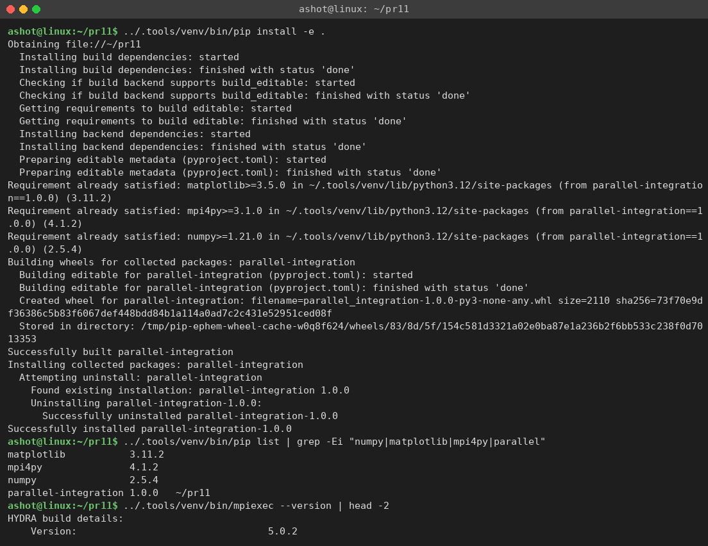

Вычислительная машина: Intel Xeon E5-2697 v3 (14 физических ядер, 28 потоков, базовая частота 2.6 ГГц, Turbo Boost до 3.6 ГГц), 62 ГБ ОЗУ, Ubuntu 24.04. Во время замеров машина не простаивала: параллельно работали другие процессы (средняя загрузка по uptime 3–6), поэтому замеры повторялись несколько раз.

## 3 Запуск демонстрационного варианта (Задание №2)

Демонстрационный вариант запущен с параметрами листинга 11.10 (k = 10, a = 4, b = π, n = 10 000 000, потоки [2, 4, 8]) и кодом листингов без изменений. Начало вывода программы показано на рис. 2 и 3, полный вывод трёх запусков сохранён в logs/demo_run1–3.txt.

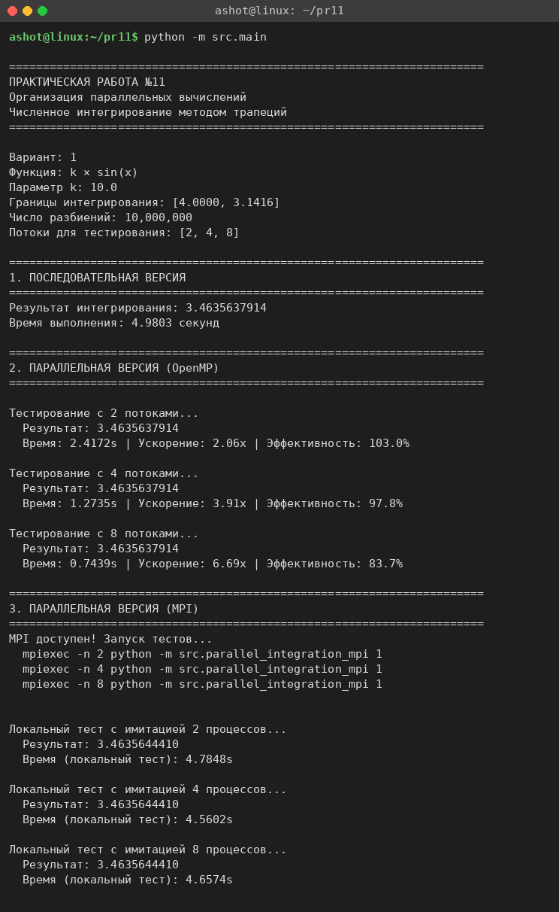

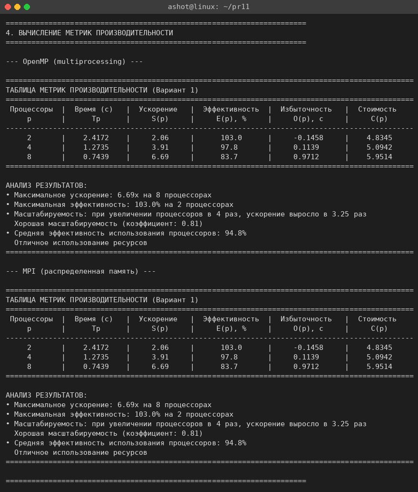

Результат интегрирования 3.4635637914 совпал с листингом 11.11 до последнего знака и с аналитическим значением 10·(cos 4 − cos π) = 10·(1 + cos 4) ≈ 3.46356. В демонстрационной конфигурации a = 4 > b = π, то есть интеграл берётся «справа налево» и шаг h отрицателен – программа это допускает.

Время последовательной версии составило 4.70–4.98 с, ускорение «OpenMP»-версии в трёх запусках: 1.99–2.06 на 2 процессах, 3.74–3.91 на 4 и 6.47–6.74 на 8 (эффективность 81–84 %). Это заметно лучше, чем в пособии (1.49, 2.03 и 1.16): на 14-ядерном процессоре 8 процессов получают по собственному физическому ядру, а у автора пособия, судя по провалу на 8 потоках, ядер было меньше. Эффективность 103 % на двух процессах в первом запуске – не настоящая сверхлинейность, а разброс замеров: последовательное время в разных запусках отличалось на 6 %.

Графики, которые строит программа для OpenMP-версии, приведены на рис. 4–6.

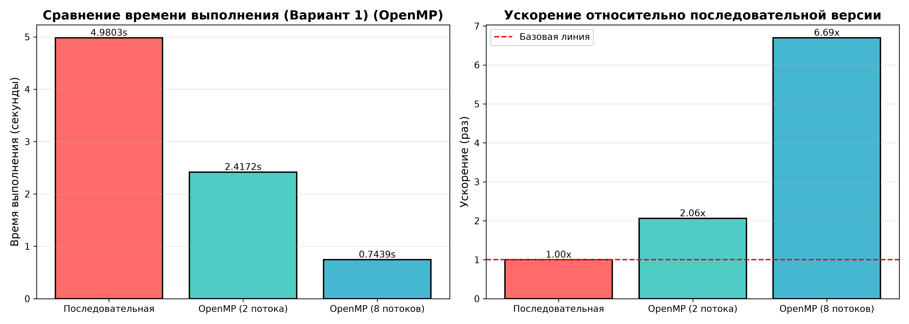

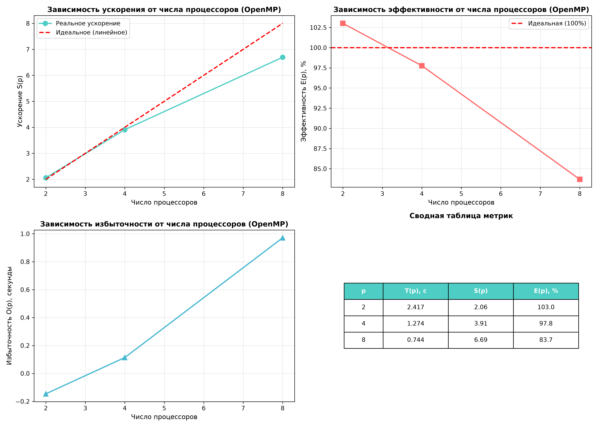

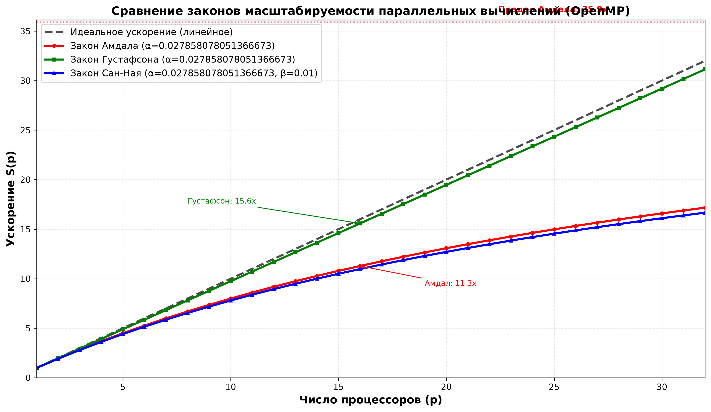

При разборе результатов выяснилось два важных обстоятельства.

Во-первых, раздел «MPI» демонстрационной программы на самом деле MPI не запускает. main.py только печатает команды `mpiexec -n …`, а затем трижды вызывает parallel_integration_mpi() в своём же единственном процессе (size = 1), поэтому «локальный тест» длится столько же, сколько последовательная версия (4.56–4.78 с). В таблицу метрик MPI при этом подставляются времена OpenMP-версии (`time_mpi_approx = times_openmp[…]`), и таблицы и графики MPI получаются копией OpenMP – это видно и в листинге 11.11 пособия. Поэтому графики MPI демонстрационного варианта в отчёт не включены.

Во-вторых, результат MPI-версии (3.4635644410) отличается от последовательного на 6.5·10⁻⁷. Это ошибка алгоритма в листинге 11.3: процесс 0 суммирует узлы, начиная с i = 0, и затем ещё раз добавляет 0.5·f(a), то есть f(a) входит в сумму с весом 1.5 вместо 0.5. Ошибка равна ровно h·f(a) = ((π − 4)/10⁷)·10·sin 4 ≈ 6.50·10⁻⁷, что и наблюдается. Кроме того, при n, не кратном числу процессов, последние n mod size узлов теряются. Обе проблемы исправлены в Задании №3.

## 4 Персональный вариант (Задание №3)

Для варианта 14 функция k·x² уже реализована в модуле function_to_integrate.py (тип 'x2'), поэтому в main.py изменены параметры варианта (листинг 2); сам модуль приведён в листинге 3.

Листинг 2 – Параметры варианта 14 в src/main.py

```python
# ========== ПАРАМЕТРЫ ВАРИАНТА (ИЗМЕНЯЕМАЯ ЧАСТЬ) ==========
VARIANT_NUM = 14                   # Номер варианта (1-30)
FUNCTION_TYPE = 'x2'               # Тип функции: 'sin', 'x2', 'exp'
FUNCTION_NAME = 'k × x²'           # Название функции для вывода
K = 1.5                            # Параметр функции
A = 1.0                            # Нижняя граница интегрирования
B = 10.0                           # Верхняя граница интегрирования
N = 12_000_000                     # Число разбиений
THREADS_LIST = [2, 4, 6]           # Потоки/процессы для теста
OUTPUT_DIR = 'results'             # Директория для результатов
REPEATS = 5                        # Число повторов каждого замера (берётся медиана)
# ============================================================
```

Листинг 3 – Модуль src/function_to_integrate.py (без docstring)

```python
import numpy as np


def function_to_integrate(x, k, function_type='sin'):
    if function_type == 'sin':
        return k * np.sin(x)
    elif function_type == 'x2':        # вариант 14: f(x) = k·x², k = 1.5
        return k * x * x
    elif function_type == 'exp':
        return k * np.exp(-x)
    else:
        raise ValueError(f"Неизвестный тип функции: {function_type}")
```

Чтобы оценка эффективности была честной, программа доработана:

- каждый замер повторяется REPEATS = 5 раз, в расчёт метрик идёт медиана; выводятся все замеры, а также аналитическое значение интеграла и погрешность каждой версии;
- MPI-версия запускается по-настоящему: main.py для каждого p вызывает через subprocess `mpiexec -n p python -m src.parallel_integration_mpi …`, причём mpiexec берётся из того же окружения, что и интерпретатор (листинг 4); в parallel_integration_mpi.py добавлена точка входа, которая синхронизирует процессы барьером, замеряет время счёта и редукции через MPI.Wtime() (максимум по процессам) и печатает результат на процессе 0;
- для сравнения отдельно фиксируется полное время работы mpiexec, включая запуск интерпретаторов Python;
- исправлена обработка границ в MPI-версии (листинг 5);
- в функции оценки α выводится сравнение измеренного ускорения с прогнозом трёх законов при найденных α и β.

Листинг 4 – Запуск MPI-версии из src/main.py

```python
def find_mpiexec():
    """mpiexec из того же окружения, что и интерпретатор (venv с MPICH), иначе из PATH."""
    candidate = Path(sys.executable).parent / 'mpiexec'
    if candidate.exists():
        return str(candidate)
    return shutil.which('mpiexec')


def run_mpi(mpiexec, num_proc):
    cmd = [mpiexec, '-n', str(num_proc), sys.executable, '-m', 'src.parallel_integration_mpi',
           str(VARIANT_NUM), repr(A), repr(B), str(N), repr(K), FUNCTION_TYPE]
    start = time.time()
    out = subprocess.run(cmd, capture_output=True, text=True, check=True,
                         cwd=Path(__file__).resolve().parent.parent).stdout
    wall = time.time() - start
    line = [s for s in out.splitlines() if s.startswith('MPI variant=')][-1]
    fields = dict(item.split('=') for item in line.split()[1:])
    return float(fields['result']), float(fields['time']), wall
```

Листинг 5 – Исправленный фрагмент src/parallel_integration_mpi.py

```python
    local_n = n // size
    local_a = a + rank * local_n * h
    # процесс 0 пропускает x₀ = a (она добавляется ниже с весом 1/2),
    # последний процесс забирает остаток n % size разбиений
    start_i = 1 if rank == 0 else 0
    end_i = local_n if rank < size - 1 else n - rank * local_n

    local_integral = 0.0
    for i in range(start_i, end_i):
        x = local_a + i * h
        local_integral += function_to_integrate(x, k, function_type)
```

Результат проверки исправления показан на рис. 7: исходный листинг 11.3 даёт ошибку +1.125·10⁻⁶ = h·f(a) = 7.5·10⁻⁷·1.5, а при n = 12 000 001 (не делится на 6) – уже −1.1·10⁻⁴ из-за потерянного узла; исправленная версия в обоих случаях ошибается лишь на 10⁻¹¹.

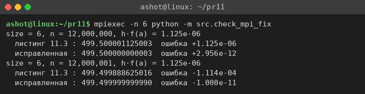

## 5 Результаты запуска варианта 14

Программа была запущена четыре раза (logs/var14_run1–4.txt). Вывод последнего запуска приведён на рис. 8–10, графики этого запуска – на рис. 11–14.

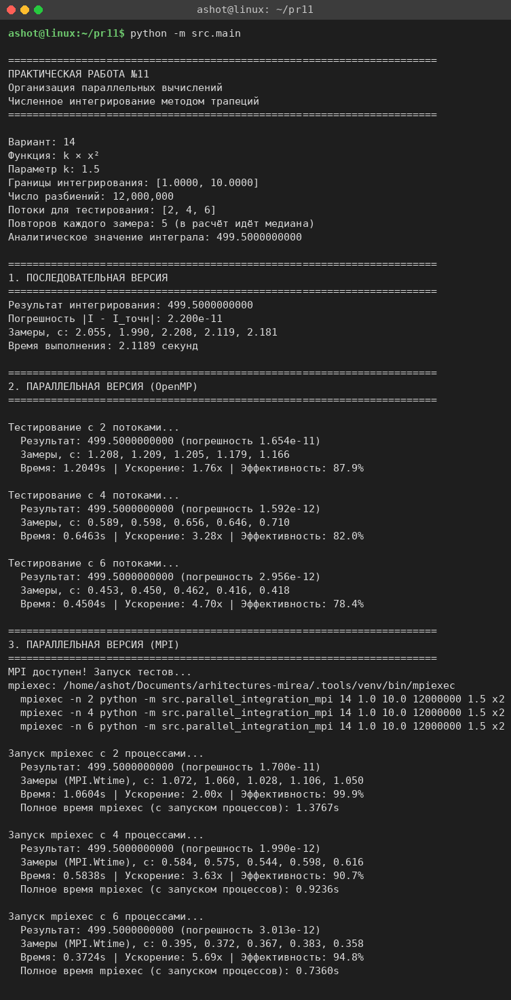

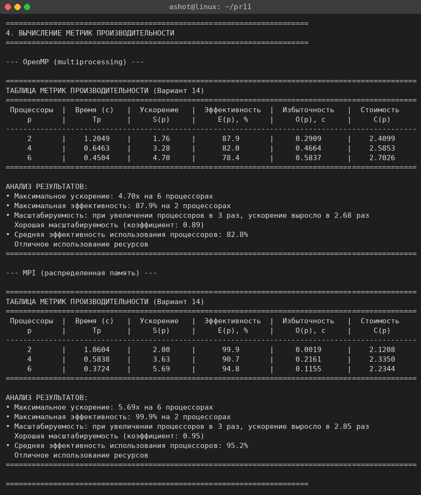

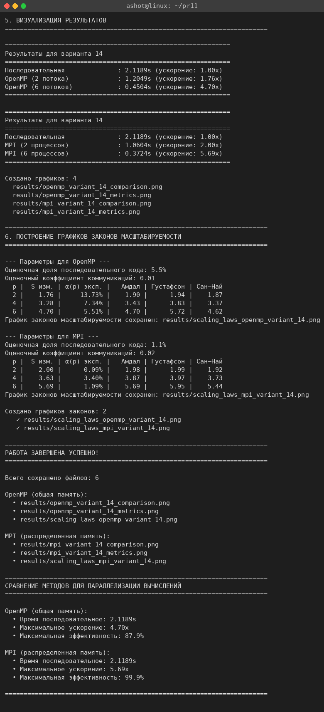


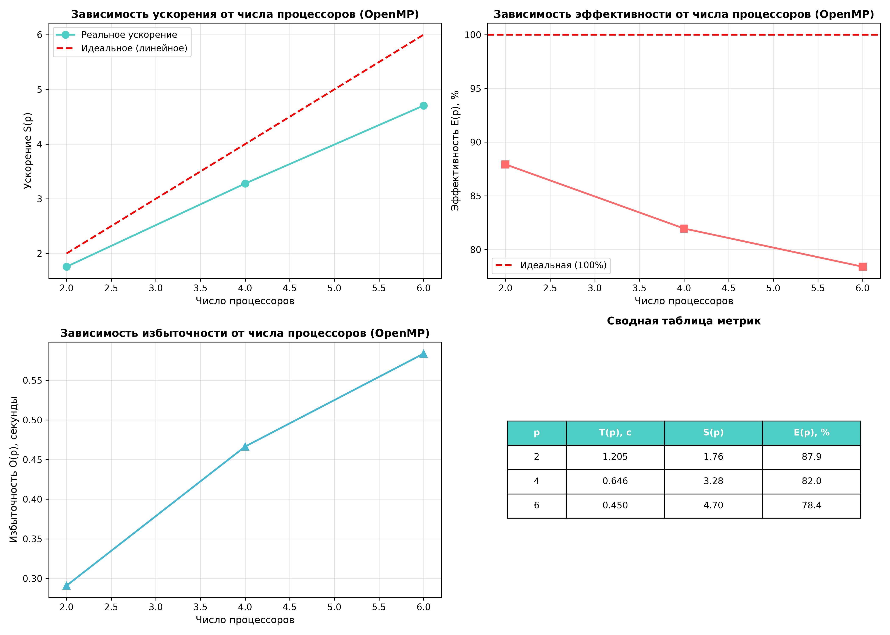

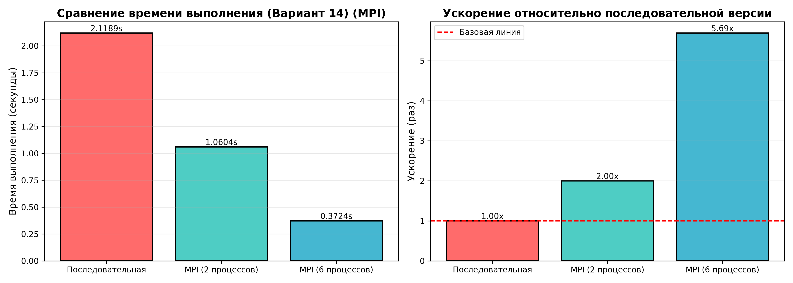

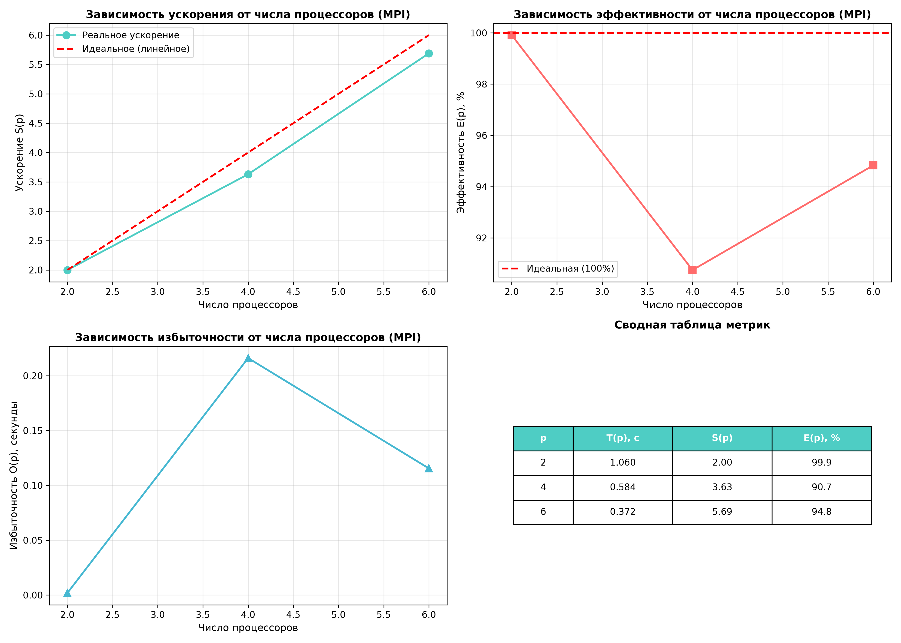

Таблица 2 – Метрики последнего запуска (T₁ = 2.119 с, медиана из 5 замеров)

| Версия | p | Tₚ, с | S(p) | E(p), % | O(p), с | C(p), с |
|---|---|---|---|---|---|---|
| OpenMP (Pool) | 2 | 1.205 | 1.76 | 87.9 | 0.291 | 2.410 |
| OpenMP (Pool) | 4 | 0.646 | 3.28 | 82.0 | 0.466 | 2.585 |
| OpenMP (Pool) | 6 | 0.450 | 4.70 | 78.4 | 0.584 | 2.703 |
| MPI | 2 | 1.060 | 2.00 | 99.9 | 0.002 | 2.121 |
| MPI | 4 | 0.584 | 3.63 | 90.7 | 0.216 | 2.335 |
| MPI | 6 | 0.372 | 5.69 | 94.8 | 0.116 | 2.234 |

Чтобы сгладить влияние фоновой нагрузки, метрики пересчитаны по среднему времени четырёх запусков (таблица 3). Последовательное время T₁ = 2.055 ± 0.083 с; разброс ускорения между запусками указан в скобках.

Таблица 3 – Метрики по среднему из четырёх запусков (T₁ = 2.055 с)

| Версия | p | Tₚ, с | S(p) | E(p), % | O(p), с | C(p), с | α(p), % |
|---|---|---|---|---|---|---|---|
| OpenMP (Pool) | 2 | 1.145 | 1.79 (1.72–1.92) | 89.7 | 0.236 | 2.291 | 11.5 |
| OpenMP (Pool) | 4 | 0.638 | 3.22 (3.09–3.33) | 80.5 | 0.497 | 2.551 | 8.1 |
| OpenMP (Pool) | 6 | 0.456 | 4.51 (4.19–4.70) | 75.2 | 0.679 | 2.733 | 6.6 |
| MPI, счёт (MPI.Wtime) | 2 | 1.062 | 1.94 (1.86–2.00) | 96.8 | 0.069 | 2.123 | 3.3 |
| MPI, счёт (MPI.Wtime) | 4 | 0.574 | 3.58 (3.53–3.64) | 89.6 | 0.240 | 2.294 | 3.9 |
| MPI, счёт (MPI.Wtime) | 6 | 0.382 | 5.38 (5.14–5.69) | 89.7 | 0.236 | 2.290 | 2.3 |
| MPI, весь mpiexec | 2 | 1.385 | 1.48 | 74.2 | 0.715 | 2.769 | 34.8 |
| MPI, весь mpiexec | 4 | 0.920 | 2.23 | 55.8 | 1.627 | 3.682 | 26.4 |
| MPI, весь mpiexec | 6 | 0.745 | 2.76 | 45.9 | 2.418 | 4.472 | 23.5 |

## 6 Точность вычислений

Аналитическое значение интеграла:

$$ ∫₁¹⁰ 1.5·x² dx = 0.5·(10³ − 1³) = 0.5·999 = 499.5 $$

Таблица 4 – Погрешность численного интегрирования (n = 12 000 000)

| Версия | Результат | Абсолютная погрешность | Относительная погрешность |
|---|---|---|---|
| Последовательная | 499.5000000000 | 2.2·10⁻¹¹ | 4.4·10⁻¹⁴ |
| OpenMP, p = 2 / 4 / 6 | 499.5000000000 | 1.7·10⁻¹¹ / 1.6·10⁻¹² / 3.0·10⁻¹² | не более 3.3·10⁻¹⁴ |
| MPI, p = 2 / 4 / 6 | 499.5000000000 | 1.7·10⁻¹¹ / 2.0·10⁻¹² / 3.0·10⁻¹² | не более 3.4·10⁻¹⁴ |
| MPI по листингу 11.3, p = 6 | 499.500001125 | 1.1·10⁻⁶ | 2.3·10⁻⁹ |

Методическая погрешность формулы трапеций для f(x) = 1.5x² равна (b − a)·h²·f''/12 = 9·(7.5·10⁻⁷)²·3/12 ≈ 1.3·10⁻¹², то есть при таком n она уже меньше ошибки округления. Наблюдаемая погрешность порядка 10⁻¹¹ – это накопленная ошибка округления при 12 миллионах последовательных сложений чисел double: сумма растёт до ~6.7·10⁸, и каждое добавление теряет младшие разряды. Параллельные версии складывают сначала частичные суммы меньшей величины, а затем p частичных сумм между собой, поэтому их ошибка округления даже меньше (1.6–3.0·10⁻¹² при p = 4 и 6). Это наглядно показывает, что в арифметике с плавающей точкой сложение не ассоциативно: распараллеливание меняет порядок суммирования и, как следствие, последние разряды результата.

## 7 Анализ эффективности

Для объяснения потерь эффективности написан модуль measure_overhead.py: он замеряет время создания пула и обработки пустых задач, а также раскладывает один вызов parallel_integration_openmp() на запуск воркеров, их счёт и сбор результата (рис. 15).

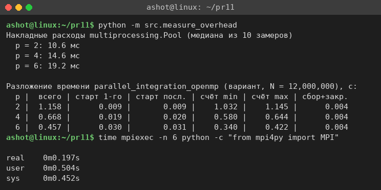

Создание пула и раздача задач занимают 10–20 мс (в замере с полезной нагрузкой первый воркер начинает счёт через 10–30 мс), сбор результатов и закрытие пула – около 4 мс; при p = 6 это 5–7 % от времени 0.43–0.46 с. Ещё большую часть потерь даёт разброс времени счёта одинаковых по объёму кусков: при p = 6 самый быстрый воркер считает 0.34 с, самый медленный – 0.42 с, а в модели fork-join общее время определяется самым медленным. Причины разброса – вытеснение процессов другими задачами, запущенными на машине, попадание двух процессов на логические потоки одного физического ядра (Hyper-Threading) и снижение тактовой частоты Turbo Boost при росте числа загруженных ядер: последовательная версия работает на одном ядре с частотой до 3.6 ГГц, а при шести загруженных ядрах частота каждого ниже.

Сама «OpenMP»-версия на Python реализована не потоками, а процессами multiprocessing.Pool. Причина – глобальная блокировка интерпретатора (GIL): потоки CPython не могут одновременно исполнять байт-код, и вычислительный цикл на потоках не ускорился бы вовсе. Процессы обходят GIL, но это уже не настоящая общая память, как в OpenMP: каждый воркер – отдельный процесс (создаётся через fork), параметры задач и частичные суммы сериализуются (pickle) и передаются через каналы, после map() пул нужно закрыть. Модель fork-join сохраняется, но цена «fork» и «join» здесь – системные вызовы и межпроцессный обмен, а не создание лёгких потоков.

MPI-версия по времени счёта оказалась эффективнее: E = 89.7 % против 75.2 % при p = 6. Замер MPI.Wtime() начинается после общего барьера, когда все процессы уже запущены, и включает только счёт и одну операцию reduce с передачей одного числа от каждого процесса; запуск процессов в него не входит, а в замер Pool – входит. Обмен данными в этой задаче минимален (каждый процесс сам вычисляет свои узлы, передаётся лишь одно число), поэтому коммуникационные издержки MPI на одной машине пренебрежимо малы.

Если же учесть полное время работы mpiexec, картина меняется: запуск шести интерпретаторов Python, импорт numpy и mpi4py и инициализация MPI занимают около 0.35 с, и при p = 6 полное время 0.75 с хуже, чем у Pool (0.46 с), – эффективность падает до 46 %. Для задачи, которая последовательно считается всего 2 с, стартовые расходы MPI сравнимы с самим счётом. MPI выгоден, когда вычисления длительные (запуск окупается) или когда нужно выйти за пределы одной машины – на кластер с распределённой памятью, где Pool неприменим.

Действительно последовательная часть программы – вычисление f(a), f(b), сложение p частичных сумм и умножение на h – это десятки операций против 12 миллионов итераций цикла, её доля порядка 10⁻⁶. Однако оценка α(p) по измеренному ускорению (таблица 3) даёт 2–4 % для MPI и 7–12 % для Pool. Значит, ускорение ограничивают не последовательные участки кода, а накладные расходы параллелизма: запуск процессов, обмен, дисбаланс нагрузки и неравные условия работы ядер. Признак этого – α(p) не постоянна и меняется с p, хотя по закону Амдала доля последовательной части от p не зависит.

Программа оценивает α по последней точке (p = 6) и строит графики законов масштабируемости (рис. 16, 17): для OpenMP-версии α = 5.5 %, β = 0.01, для MPI α = 1.1 %, β = 0.02. Сравнение прогноза с измерениями последнего запуска приведено в таблице 5.

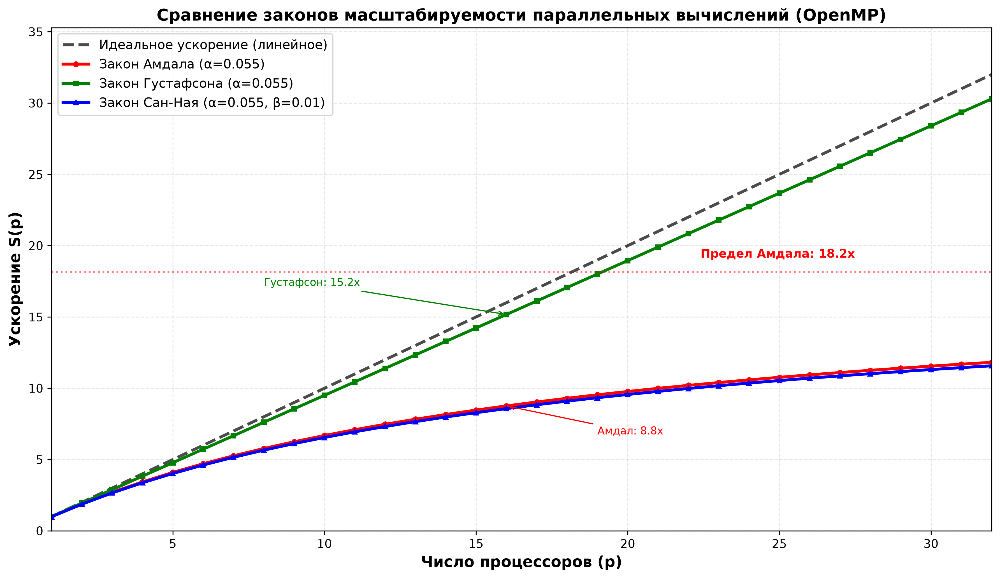

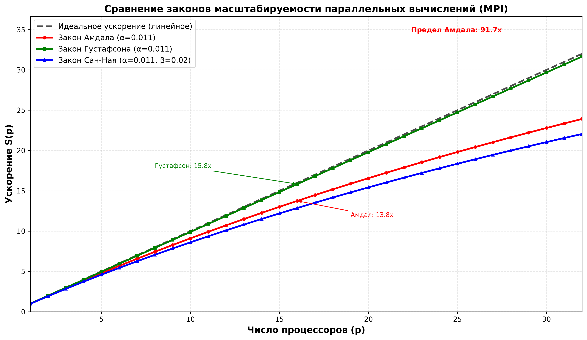

Таблица 5 – Измеренное ускорение и прогноз законов масштабируемости

| Версия | p | S изм. | Амдал | Густафсон | Сан–Най |
|---|---|---|---|---|---|
| OpenMP, α = 5.5 %, β = 0.01 | 2 | 1.76 | 1.90 | 1.94 | 1.87 |
| OpenMP, α = 5.5 %, β = 0.01 | 4 | 3.28 | 3.43 | 3.83 | 3.37 |
| OpenMP, α = 5.5 %, β = 0.01 | 6 | 4.70 | 4.70 | 5.72 | 4.62 |
| MPI, α = 1.1 %, β = 0.02 | 2 | 2.00 | 1.98 | 1.99 | 1.92 |
| MPI, α = 1.1 %, β = 0.02 | 4 | 3.63 | 3.87 | 3.97 | 3.73 |
| MPI, α = 1.1 %, β = 0.02 | 6 | 5.69 | 5.69 | 5.95 | 5.44 |

При p = 6 закон Амдала совпадает с измерением по построению (α получена именно из этой точки). На промежуточных p ближе всего к измерениям модель Сана–Ная: она учитывает рост издержек с числом процессов. Закон Густафсона даёт заметно завышенный прогноз (5.72 против 4.70 для OpenMP), и это ожидаемо: он описывает слабую масштабируемость, когда объём работы растёт пропорционально p, а в эксперименте n фиксировано, то есть исследовалась сильная масштабируемость. Если увеличивать n вместе с p, фиксированные накладные расходы распределялись бы на больший объём счёта, и ускорение приближалось бы к оценке Густафсона. Предел Амдала при найденных α – около 18 для OpenMP-версии и около 90 для MPI; для такой маленькой задачи реальный предел наступит раньше, так как с ростом p растут и накладные расходы.

Стоимость C(p) в обоих случаях больше T₁ и растёт с p (для Pool – с 2.29 до 2.73 с), то есть алгоритм не стоимостно-оптимален: при увеличении числа процессов часть процессорного времени уходит на организацию параллельной работы. Тем не менее задача хорошо распараллеливается: на 6 процессах получено ускорение 4.5–4.7 для Pool и 5.4–5.7 для MPI при практически неизменном результате.

## 8 Моделирование параллельного суммирования в Logisim

Основная работа метода трапеций – накопление суммы Σ f(xᵢ), поэтому в Logisim 2.7.1 построена схема, которая сравнивает последовательное и параллельное суммирование на целых числах. Значения взяты из функции варианта: узлы xᵢ = 1…16, yᵢ = 2·f(xᵢ) = 3·xᵢ² (удвоение делает значения целыми), точная сумма Σ yᵢ = 3·1496 = 4488. Файл src/logisim/pr11.circ генерируется скриптом gen_pr11.py и содержит три схемы:

- seq – последовательный накопитель: счётчик тактов t (останавливается на 16) задаёт адрес ROM с шестнадцатью значениями yᵢ, сумматор и регистр ACC выполняют ACC ← ACC + ROM[t]; это аналог цикла `for i in range(…)` последовательной версии; результат готов через 16 тактов;
- par – P = 4 параллельных элемента ПЭ0…ПЭ3; каждый ПЭ имеет свой ROM с блоком из четырёх значений (ПЭj обрабатывает x = 4j+1…4j+4 – так же, как MPI-процесс с рангом j получает свой участок [local_a, local_b]) и свой накопитель Sj (аналог local_integral или partial_sum); за 4 такта все частичные суммы готовы, затем дерево сумматоров (S0 + S1) + (S2 + S3) – аналог comm.reduce(op=MPI.SUM) и sum(partial_sums) – вычисляет итог, который на 5-м такте (компаратор t = 4 разрешает запись) защёлкивается в регистр RES;
- main – обе схемы с общим тактированием; выходы SUM, T (число тактов) и DONE каждой схемы и выход halt = DONE_SEQ ∧ DONE_PAR, по которому останавливается прогон в режиме `-tty`.

Схемы последовательного и параллельного накопителей показаны на рис. 18–20, сравнение – на рис. 21 и 22.

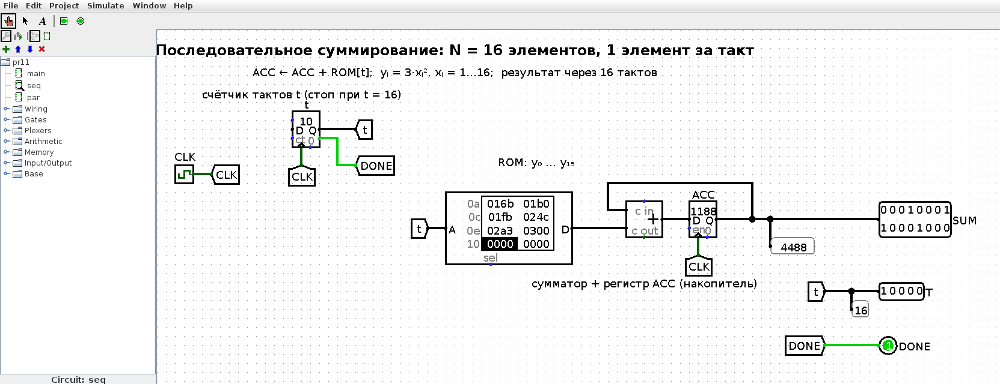

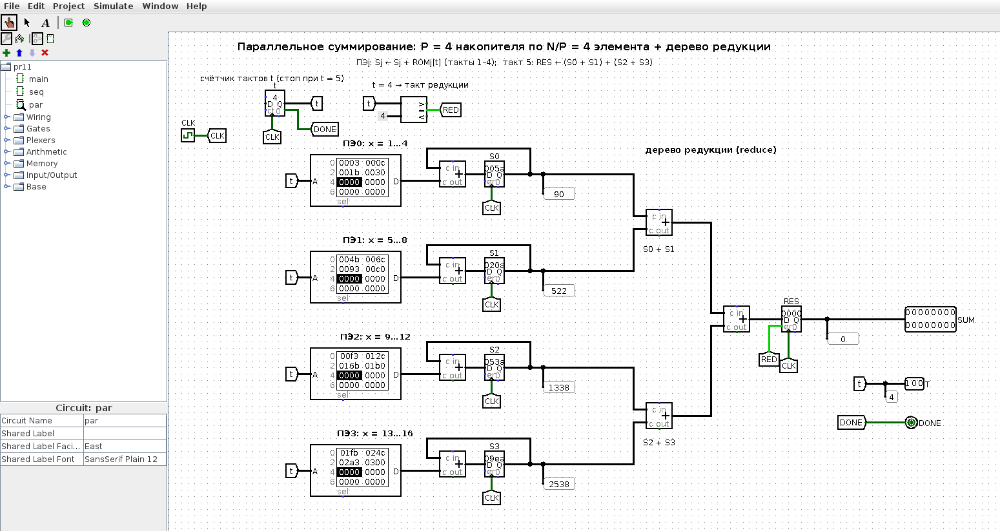

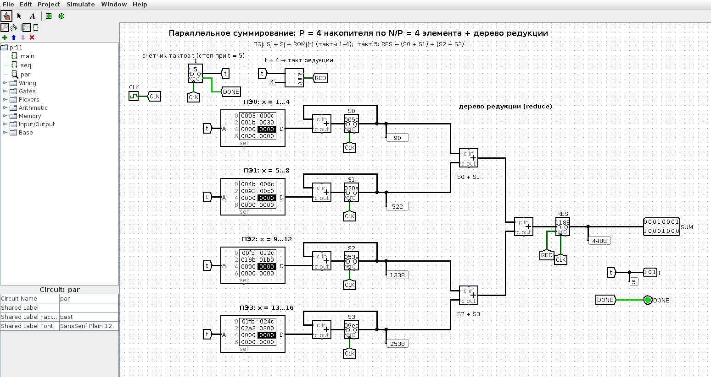

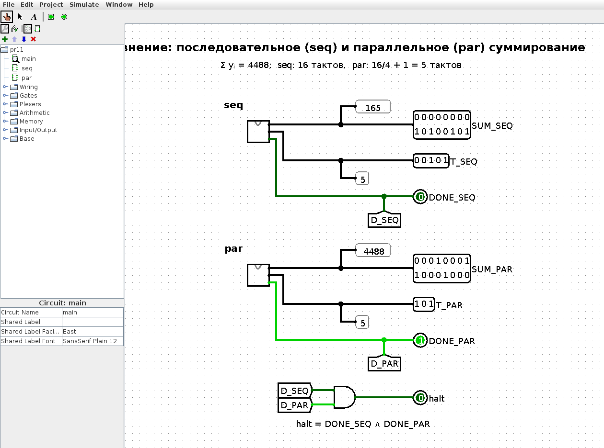

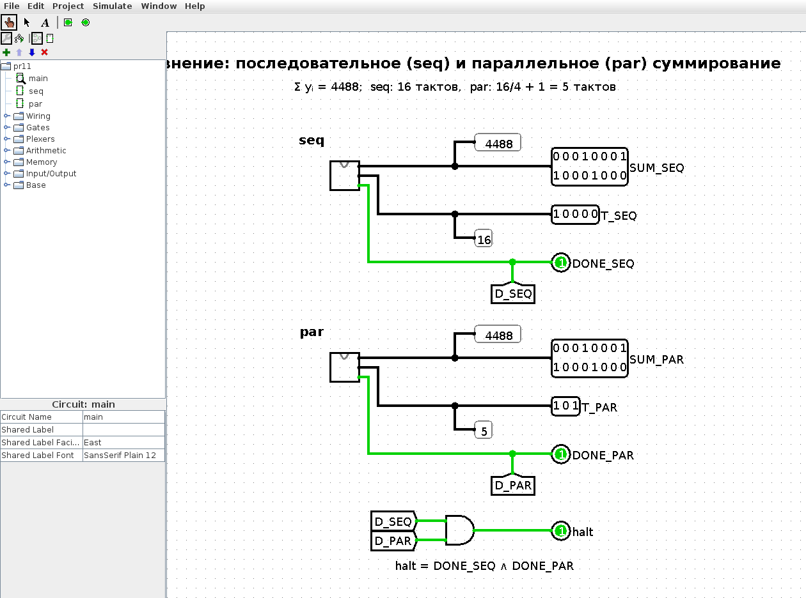

Работа схемы проверена без графического интерфейса двумя способами: штатным режимом Logisim `-tty table,halt` (рис. 23, значения выходов в двоичном виде, строка печатается при каждом изменении выходов) и скриптом sim.js, который выводит значения выходов и регистров в десятичном виде после каждого такта (рис. 24).

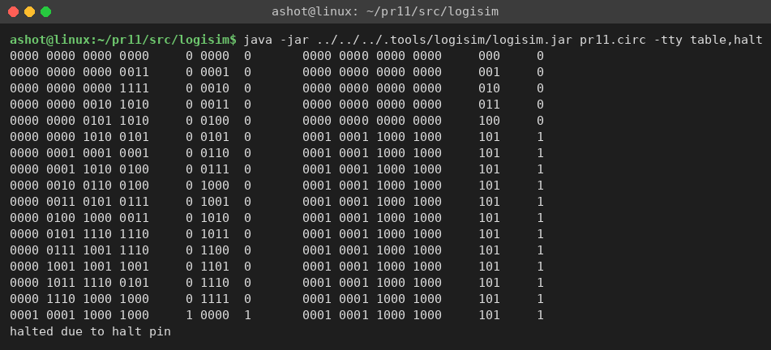

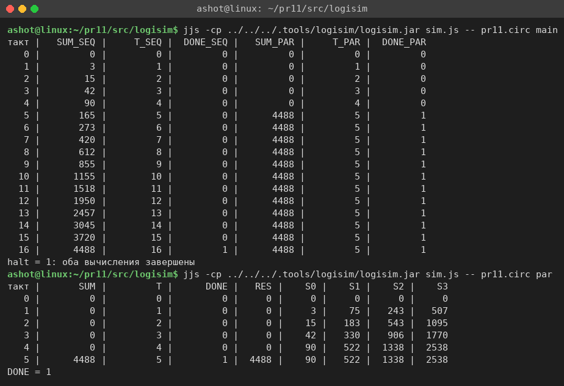

Таблица 6 – Сравнение последовательной и параллельной схем

| Схема | Тактов | Результат | Частичные суммы |
|---|---|---|---|
| seq (1 накопитель) | 16 | 4488 (0x1188) | – |
| par (4 накопителя + дерево) | 4 + 1 = 5 | 4488 (0x1188) | S0 = 90, S1 = 522, S2 = 1338, S3 = 2538 |

Обе схемы дают одинаковый результат 4488: целочисленное сложение ассоциативно, поэтому порядок суммирования, в отличие от вычислений с плавающей точкой из раздела 6, на результат не влияет. Число тактов уменьшилось с N = 16 до N/P + 1 = 5, то есть в P раз плюс такт редукции. Ускорение S = 16/5 = 3.2, эффективность E = 3.2/4 = 80 %, а оценка доли последовательной части по формуле Карпа–Флэтта α = (1/3.2 − 1/4)/(1 − 1/4) ≈ 8.3 % – это и есть вклад такта редукции, который не распараллеливается. Чем больше элементов приходится на каждый накопитель, тем меньше вклад этого такта: при N = 12 000 000 он был бы ничтожен, так же как время comm.reduce в MPI-версии. При большом P дерево сумматоров потребовало бы log₂P уровней, и время редукции росло бы логарифмически, а не линейно, как при последовательном сложении частичных сумм.

# ВЫВОДЫ

В ходе работы был собран демонстрационный проект параллельного интегрирования методом трапеций: листинги 11.1–11.9 перенесены в пакет src, исправлены артефакты вёрстки и ошибки листингов (отсутствующее тело последовательной функции, синтаксические ошибки, неправильный учёт левой границы и остатка разбиений в MPI-версии), функция вынесена в модуль function_to_integrate.py, проект установлен в виртуальное окружение командой pip install -e.

Демонстрационный вариант воспроизвёл результат пособия (3.4635637914), а на 14-ядерном Xeon дал ускорение до 6.7 на 8 процессах. При этом выяснилось, что демонстрационная программа MPI фактически не запускает и подставляет в метрики MPI время OpenMP-версии, поэтому для варианта 14 был добавлен настоящий запуск через mpiexec.

Для варианта 14 (f(x) = 1.5x², [1; 10], n = 12 000 000) все версии дали 499.5 с погрешностью не более 2.2·10⁻¹¹ (относительная 4.4·10⁻¹⁴); она определяется ошибками округления, а не методом. Последовательная версия считала около 2.06 с. На 2, 4 и 6 процессах многопроцессная fork-join версия (аналог OpenMP) дала ускорение 1.79 / 3.22 / 4.51 при эффективности 90 / 81 / 75 %, MPI-версия по времени счёта – 1.94 / 3.58 / 5.38 при эффективности 97 / 90 / 90 %. С учётом запуска процессов MPI ускоряет программу лишь в 2.76 раза: для короткой задачи накладные расходы на запуск интерпретаторов съедают выигрыш.

Оценённая по ускорению доля последовательной части (2–4 % для MPI, 7–12 % для Pool) на порядки больше доли действительно последовательного кода. Значит, ускорение ограничено накладными расходами параллелизма: созданием процессов, сериализацией и обменом, дисбалансом нагрузки из-за фоновых задач, Hyper-Threading и снижением частоты Turbo Boost. Для эксперимента с фиксированным размером задачи (сильная масштабируемость) измерения лучше всего описываются законами Амдала и Сана–Ная, а закон Густафсона завышает ускорение, так как рассчитан на рост задачи вместе с числом процессоров. Python-аналог OpenMP вынужденно использует процессы вместо потоков из-за GIL и поэтому теряет главное преимущество OpenMP – дешёвые потоки над общей памятью.

Схема в Logisim наглядно показала тот же принцип на уровне аппаратуры: четыре параллельных накопителя с деревом сумматоров получают ту же сумму 4488 за 5 тактов вместо 16 – в P раз быстрее плюс один нераспараллеливаемый такт редукции, который и ограничивает эффективность (80 %) по закону Амдала.
