<!-- num: 12; title: Графический процессор -->

# ЦЕЛЬ РАБОТЫ

Изучить устройство современного графического процессора и принципы массово-параллельных вычислений на GPU; освоить стенд WebGPU, в котором одна и та же задача генерации изображения решается последовательно на CPU (JavaScript) и параллельно на GPU (шейдер на языке WGSL); сравнить время расчёта и ускорение для разных разрешений и объяснить расхождения результатов, вызванные вычислениями с плавающей точкой.

# ЗАДАНИЕ

Вариант 14.

1. Восстановить проект стенда по листингам 12.1 (index.html) и 12.2 (start_server.py), запустить локальный сервер и открыть стенд в браузере с поддержкой WebGPU.
2. Написать код для CPU-канала (JavaScript) и GPU-канала (WGSL), генерирующий изображение по своему варианту из табл. 12.3.
3. Запустить расчёт, получить время CPU и GPU, ускорение и метрики различия Mean diff и Max diff.
4. Исследовать влияние разрешения изображения на время расчёта и ускорение.
5. Объяснить расхождения результатов CPU и GPU.
6. Дополнительно: построить в Logisim модель SIMT-исполнения — несколько одинаковых вычислительных линий, которые по общей команде выполняют итерацию z ← z² + k для разных пикселей.

В PDF-версии методички текст строки 14 табл. 12.3 не сохранился, поэтому параметры варианта приняты такими: множество Жюлиа, 1920×1080, k = −0,8 + 0,156i, zoom = 1,0, offsetX = 0, offsetY = 0, maxIter = 300, гладкая окраска (табл. 1).

Таблица 1 – Параметры варианта 14

| Параметр | Значение |
|---|---|
| Режим | множество Жюлиа (формула 12.3), гладкая окраска |
| Разрешение | 1920×1080 |
| Константа k | −0,8 + 0,156i |
| zoom; offsetX; offsetY | 1,0; 0; 0 |
| maxIter | 300 |
| Условие ухода | модуль z в квадрате больше 4 |

# ХОД РАБОТЫ

## 1 Используемая видеокарта

Работа выполнялась на компьютере с Ubuntu 24.04, процессором Intel Xeon E5-2697 v3 (14 ядер / 28 потоков, Haswell-EP, до 3,6 ГГц) и двумя видеокартами NVIDIA GeForce RTX 3060 12 ГБ (драйвер 580.173.02). Данные о карте получены через `nvidia-smi` (рис. 1).

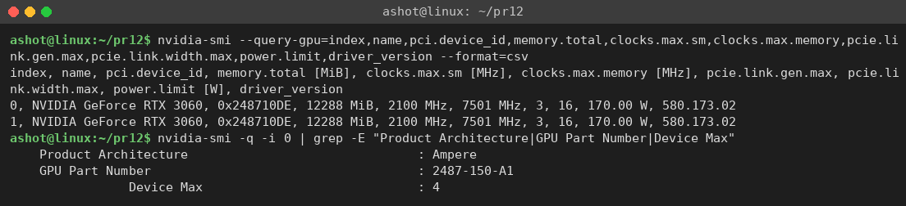

Идентификатор устройства 0x2487 и номер 2487-150-A1 означают, что это вариант RTX 3060 на кристалле GA104 (урезанный «старший» чип GA104-150), а не на «родном» GA106. Как и сказано в теории главы, в коммерческие модели часто ставят не эталонный чип, а его вариант с отключёнными блоками; число активных блоков у обоих исполнений одинаковое. Архитектура — Ampere. Основной вычислительный модуль — потоковый мультипроцессор SM, в котором находятся CUDA-ядра, тензорные ядра, RT-ядро, текстурные блоки, файл регистров, кэш L1 / разделяемая память и планировщики варпов. Сводка характеристик приведена в табл. 2.

Таблица 2 – Характеристики RTX 3060 (Ampere)

| Параметр | Значение |
|---|---|
| Кристалл | GA104-150-A1 (Samsung 8 нм) |
| Потоковые мультипроцессоры SM | 28 |
| CUDA-ядра | 3584 (128 на SM) |
| Тензорные ядра (3-е поколение) | 112 (4 на SM) |
| RT-ядра (2-е поколение) | 28 (1 на SM) |
| Текстурные блоки TMU / ROP | 112 / 48 |
| Частота (boost / максимум по nvidia-smi) | 1777 / 2100 МГц |
| Пиковая производительность FP32 | 3584 · 2 · 1,78 ГГц ≈ 12,7 TFLOPS |
| Память | 12 ГБ GDDR6, шина 192 бит, 15 Гбит/с на контакт |
| Пропускная способность памяти | 192 / 8 · 15 = 360 ГБ/с |
| Интерфейс | PCIe 4.0 x16 (в этой системе работает как PCIe 3.0 x16) |
| Мощность (power limit) | 170 Вт |

Здесь хорошо видно главное отличие GPU от CPU, о котором говорится в теории: у процессора 14 ядер, а у видеокарты 3584 простых вычислительных ядра, объединённых в 28 SM. Потоки исполняются группами по 32 (варп) по модели SIMT: все потоки варпа выполняют одну и ту же команду, каждый над своими данными. Задача, в которой каждый пиксель считается независимо от других, — например, генерация фрактала — идеально ложится на такую архитектуру. Отмечу также, что материнская плата с Xeon E5 v3 поддерживает только PCIe 3.0, поэтому карта работает на скорости PCIe 3.0 x16 (около 15,8 ГБ/с). Это пригодится при анализе времени передачи данных.

## 2 Подготовка стенда

Листинги 12.1 и 12.2 я перенёс из текста методички в файлы `src/index.html` и `src/start_server.py`. При копировании из PDF в текст попадают номера страниц и строки «Продолжение листинга 12.1», а длинные строки кода оказываются разорваны. Такие разрывы опасны. Например, строки `'GPU-` / `результат'` или текст ошибки WebGPU, разорванный внутри кавычек, дают синтаксическую ошибку JavaScript. А разрыв `return` / `rgba(...)` в demo-коде изменил бы смысл программы: после `return` JavaScript сам поставил бы точку с запятой. Чтобы ничего не пропустить, очистку я сделал небольшим скриптом `src/fix_listing.py`. Он убирает номера страниц и заголовки продолжения и склеивает строки, начинающиеся с первой колонки (признак переноса); после этого `src/reindent.py` восстанавливает отступы. Восстановленный без изменений файл сохранён как `src/index_original.html`. В рабочий `index.html` добавлена только одна строка — подключение файла `variant14.js` с кодом варианта.

В `start_server.py` добавлены необязательные аргументы: номер порта и ключ `--no-browser`, чтобы сервер можно было запустить в фоне без автоматического открытия браузера. Сервер запускался командой `python3 start_server.py 8112 --no-browser`.

Сначала стенд был открыт в обычном окне Chromium без дополнительных флагов. Страница загрузилась без ошибок, но выдала сообщение «navigator.gpu есть, но получить GPUAdapter не удалось»: на Linux WebGPU в Chrome по умолчанию не включён. Поэтому дальше использовался Google Chrome 156 с флагами:

`google-chrome --enable-unsafe-webgpu --enable-features=Vulkan --use-angle=vulkan --ignore-gpu-blocklist --headless=new --remote-debugging-port=9333`

С ними WebGPU получает настоящий аппаратный адаптер. `adapter.info` сообщает vendor = nvidia, architecture = ampere, а графический backend Chrome — «ANGLE (NVIDIA, Vulkan 1.4.312 (NVIDIA GeForce RTX 3060 (0x00002487)))». Таким образом, шейдер WGSL транслируется в SPIR-V и выполняется драйвером Vulkan на RTX 3060; программный адаптер (SwiftShader) не понадобился. Браузер запускался без окна (headless). Страницей управлял мой скрипт `src/bench.py` через протокол DevTools (`src/cdp.py`): он нажимал кнопки, читал метрики и снимал скриншоты. Так замеры можно повторять много раз в одинаковых условиях.

## 3 Реализация варианта

Для всех процедурных режимов стенд передаёт в код пикселя нормированные координаты по формуле (12.1): cₓ = 2u − 1, cᵧ = 2v − 1, где u = x / (W − 1), v = y / (H − 1). Чтобы при соотношении сторон 16:9 фрактал не растягивался, абсцисса умножается на W/H, а ось Im направлена вверх:

$$ z₀ = cₓ · (W/H) / zoom + offsetX + i·(−cᵧ / zoom + offsetY) $$

Далее выполняется итерация (12.3) zₙ₊₁ = zₙ² + k. В действительных числах при z = x + iy:

$$ x' = x² − y² + kₓ,   y' = 2xy + kᵧ $$

Итерации идут, пока |z|² ≤ 4 и n < maxIter. Точки, не ушедшие за 300 итераций, считаются принадлежащими множеству и закрашиваются чёрным. Для остальных используется гладкая окраска: вместо целого числа итераций берётся дробное значение

$$ μ = n + 1 − log₂(log₂|z|) $$

которое убирает ступенчатые «полосы» на изображении. Затем значение s = ln(μ + 1) / ln(maxIter + 1) из диапазона [0; 1] переводится в цвет встроенной функцией стенда `palette(s)`; фон затемняется через `smoothstep(0; 0,5; s)`.

Параметры варианта заданы в одном месте — в объекте `VARIANT` файла `src/variant14.js` (листинг 1). Функции `makeCpuCode` и `makeGpuCode` подставляют эти числа в текст ядер для обоих редакторов. Кнопка «Загрузить вариант 14», которую этот файл добавляет на страницу, выставляет разрешение и заполняет редакторы. Чтобы перейти на другие параметры, достаточно изменить объект `VARIANT`.

Листинг 1 – Параметры варианта (variant14.js)

```javascript
const VARIANT = {
  number: 14,
  mode: 'Julia set (smooth coloring)',
  width: 1920,          // разрешение по варианту
  height: 1080,
  kRe: -0.8,            // комплексная константа k = kRe + i*kIm
  kIm: 0.156,
  zoom: 1.0,            // масштаб: видимая полуширина по Im равна 1/zoom
  offsetX: 0.0,         // смещение центра кадра (Re)
  offsetY: 0.0,         // смещение центра кадра (Im)
  maxIter: 300,         // предел итераций
  bailout: 4.0,         // условие ухода |z|^2 > 4
};
```

Сгенерированный код CPU-ядра (тело функции, которую стенд вызывает для каждого пикселя) приведён в листинге 2, код GPU-ядра на WGSL — в листинге 3. Стенд вставляет WGSL-код в функцию `studentKernel(x, y)`, где уже объявлены `uvx`, `uvy`, `cx`, `cy`, и запускает вычислительный шейдер с рабочими группами 16×16, по одному потоку на пиксель. Алгоритмы в обоих ядрах совпадают построчно; различаются только типы: в JavaScript все числа 64-битные (double), а в WGSL тип `f32` 32-битный.

Листинг 2 – Код CPU-канала (JavaScript)

```javascript
// Вариант 14: множество Жюлиа, k = -0.8 + 0.156i
const K_RE = -0.8, K_IM = 0.156;
const ZOOM = 1, OFF_X = 0, OFF_Y = 0;
const MAX_ITER = 300, BAILOUT = 4;
const aspect = width / height;
// пиксель -> комплексная плоскость (ось Im направлена вверх)
let zx = cx * aspect / ZOOM + OFF_X;
let zy = -cy / ZOOM + OFF_Y;
let r2 = zx * zx + zy * zy;
let i = 0;
while (i < MAX_ITER && r2 <= BAILOUT) {   // z = z^2 + k
  const t = zx * zx - zy * zy + K_RE;
  zy = 2.0 * zx * zy + K_IM;
  zx = t;
  r2 = zx * zx + zy * zy;
  i++;
}
if (i >= MAX_ITER) return rgba(0.0, 0.0, 0.0, 1.0);   // точка множества
// гладкая окраска: дробное число итераций
const mu = i + 1.0 - Math.log2(0.5 * Math.log2(r2));
const s = Math.log(mu + 1.0) / Math.log(MAX_ITER + 1.0);
const col = palette(s);
const v = smoothstep(0.0, 0.5, s);
return rgba(col[0] * v, col[1] * v, col[2] * v, 1.0);
```

Листинг 3 – Код GPU-канала (WGSL)

```wgsl
// Вариант 14: множество Жюлиа, k = -0.8 + 0.156i
let K = vec2<f32>(-0.8, 0.156);
let ZOOM = 1.0;
let OFF = vec2<f32>(0.0, 0.0);
let MAX_ITER = 300i;
let BAILOUT = 4.0;
let aspect = f32(params.width) / f32(params.height);
var zx = cx * aspect / ZOOM + OFF.x;
var zy = -cy / ZOOM + OFF.y;
var r2 = zx * zx + zy * zy;
var i = 0i;
loop {                                   // z = z^2 + k
  if (i >= MAX_ITER || r2 > BAILOUT) { break; }
  let t = zx * zx - zy * zy + K.x;
  zy = 2.0 * zx * zy + K.y;
  zx = t;
  r2 = zx * zx + zy * zy;
  i = i + 1i;
}
if (i >= MAX_ITER) { return rgba(0.0, 0.0, 0.0, 1.0); }
let mu = f32(i) + 1.0 - log2(0.5 * log2(r2));
let s = log(mu + 1.0) / log(f32(MAX_ITER) + 1.0);
let col = palette(s);
let v = smoothstep1(0.0, 0.5, s);
return rgba(col.x * v, col.y * v, col.z * v, 1.0);
```

Здесь 0,5·log₂(r2) = log₂|z|, поэтому формула для μ совпадает с приведённой выше, но не требует лишнего извлечения корня.

## 4 Результаты для разрешения варианта

Результат расчёта при 1920×1080 показан на рис. 2: CPU и GPU построили одинаковое изображение множества Жюлиа. Время CPU — 944 мс, GPU — 30 мс, ускорение 31×, Mean diff = 0,657, Max diff = 255. На рис. 3 показан тот же расчёт при 3840×2160 (CPU 3816 мс, GPU 106 мс, ускорение 36×).

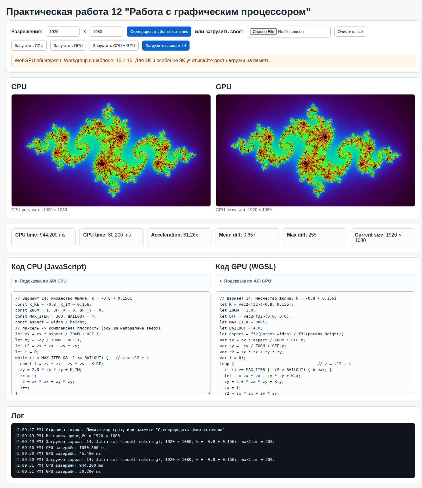


Стенд измеряет время для двух каналов по-разному. Для CPU это время всего цикла по пикселям, включая вызов функции-ядра и упаковку цвета. Для GPU — промежуток от `queue.submit()` до получения результата в JavaScript после `mapAsync`. В него входят загрузка входного буфера в видеопамять, выполнение шейдера, копирование результата обратно и синхронизация. Компиляция шейдера в замер GPU не входит.

## 5 Влияние разрешения

Для этого исследования скрипт `bench.py` для каждого разрешения от 640×360 до 7680×4320 несколько раз нажимал «Запустить CPU + GPU». Первый прогон считался прогревом: JIT-компилятор JavaScript в этот момент ещё не оптимизировал код, а драйвер видеокарты ещё готовит конвейер. Например, при 640×360 первый прогон дал CPU 175 мс и GPU 35,5 мс, а последующие — 110 мс и 5 мс. В таблицу вошли медианы остальных прогонов. Полный лог запуска показан на рис. 4, сводка — на рис. 5 и в табл. 3, графики — на рис. 6.

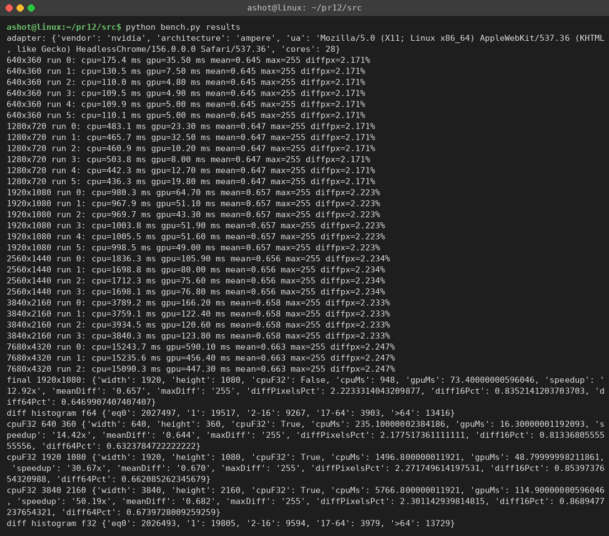

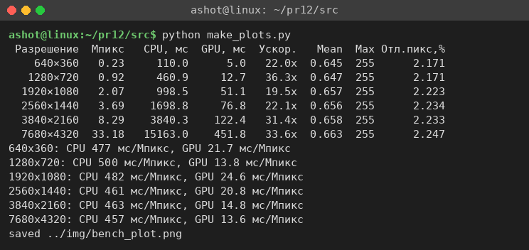

Таблица 3 – Время расчёта и ускорение (медиана, вариант 14)

| Разрешение | Мпикс | CPU, мс | GPU, мс | Ускорение | Mean diff | Max diff | Отличающихся пикселей, % |
|---|---|---|---|---|---|---|---|
| 640×360 | 0,23 | 110,0 | 5,0 | 22× | 0,645 | 255 | 2,17 |
| 1280×720 | 0,92 | 460,9 | 12,7 | 36× | 0,647 | 255 | 2,17 |
| 1920×1080 | 2,07 | 998,5 | 51,1 | 20× | 0,657 | 255 | 2,22 |
| 2560×1440 | 3,69 | 1698,8 | 76,8 | 22× | 0,656 | 255 | 2,23 |
| 3840×2160 | 8,29 | 3840,3 | 122,4 | 31× | 0,658 | 255 | 2,23 |
| 7680×4320 | 33,18 | 15163,0 | 451,8 | 34× | 0,663 | 255 | 2,25 |

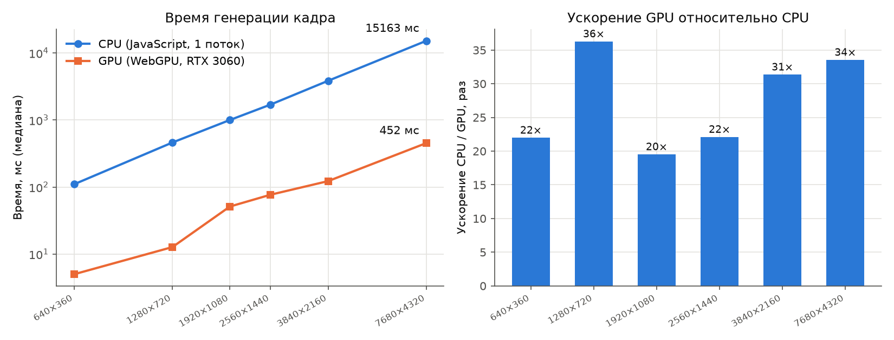

Время CPU растёт строго пропорционально числу пикселей: на всех разрешениях получается 460–500 мс на мегапиксель. Это ожидаемо. JavaScript в стенде считает пиксели один за другим в одном потоке, а средняя работа на пиксель с разрешением не меняется: кадр просто становится детальнее, а доля «тяжёлых» точек у границы множества остаётся прежней. Кадр 8K CPU считал больше 15 секунд.

Время GPU тоже растёт с разрешением, но заметно неравномерно, поэтому ускорение колеблется от 20 до 36 раз без явного тренда. Чтобы понять причину, я сделал дополнительный замер (`src/bench_gpu.py`). GPU-канал запускался 15 раз подряд без пауз на CPU-расчёт, и для сравнения так же замерялось «пустое» ядро `return rgba(0.0, 0.0, 0.0, 1.0);`. Оно ничего не вычисляет, но передаёт те же буферы (рис. 7, табл. 4).

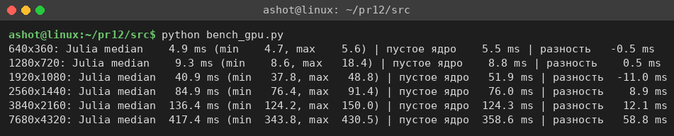

Таблица 4 – Время GPU-канала: ядро варианта и пустое ядро (медиана 12 запусков)

| Разрешение | Ядро Жюлиа, мс | Пустое ядро, мс | Разность, мс |
|---|---|---|---|
| 640×360 | 4,9 | 5,5 | −0,5 |
| 1280×720 | 9,3 | 8,8 | 0,5 |
| 1920×1080 | 40,9 | 51,9 | −11,0 |
| 2560×1440 | 84,9 | 76,0 | 8,9 |
| 3840×2160 | 136,4 | 124,3 | 12,1 |
| 7680×4320 | 417,4 | 358,6 | 58,8 |

Оказалось, что почти всё время GPU-канала занимают не вычисления, а передача данных и синхронизация. Пустое ядро работает практически столько же, сколько настоящее, а разность лежит в пределах разброса. Это подтверждает и оценка. В кадре 1920×1080 в среднем 32 итерации на пиксель (`src/warp_stats.py`), то есть всего около 67 млн итераций по 6–8 операций — порядка 0,5 GFLOP. Для GPU с пиковой производительностью 12,7 TFLOPS это доли миллисекунды даже с учётом расхождения ветвей в варпах. Зато на каждый кадр стенд передаёт в видеопамять входной буфер и забирает обратно результат по 4 байта на пиксель: 8,3 МБ при 1080p и 133 МБ при 8K. Потом результат ещё распаковывается в JavaScript. Эти данные проходят через шину PCIe и межпроцессное взаимодействие браузера (WebGPU в Chrome работает в отдельном GPU-процессе), и их передача занимает десятки и сотни миллисекунд. Скачок времени пустого ядра между 1280×720 и 1920×1080 тоже говорит о том, что дело в механизме передачи буферов, а не в вычислениях.

Отсюда главный вывод по разрешению: ускорение, которое показывает стенд, ограничено не вычислительной мощностью видеокарты, а пересылкой данных между CPU и GPU. В настоящих приложениях (игры, рендеринг) результат остаётся в видеопамяти и сразу выводится на экран, поэтому реальный выигрыш от GPU в такой задаче был бы на порядки больше. С ростом разрешения доля постоянных накладных расходов (запуск команды, ожидание, вызовы API) уменьшается, поэтому на 4K и 8K ускорение выше (31–34×), чем на малых кадрах.

## 6 Расхождения результатов CPU и GPU

На всех разрешениях Mean diff ≈ 0,65 и Max diff = 255. Mean diff в стенде — это средний модуль разности байтов (R, G, B, A) по всему кадру в единицах 0…255, а Max diff — наибольшая такая разность. Значение 255 означает, что есть пиксели, которые на одном канале чёрные (точка множества), а на другом ярко окрашены. Таких пикселей немного: различаются примерно 2,2 % пикселей, а сильно (больше чем на 64 единицы) — 0,65 %. Карта различий при 1920×1080 (рис. 8; тёмные точки — отличающиеся пиксели) показывает, что все они лежат вдоль границы множества Жюлиа, а гладкие области фона совпадают полностью.

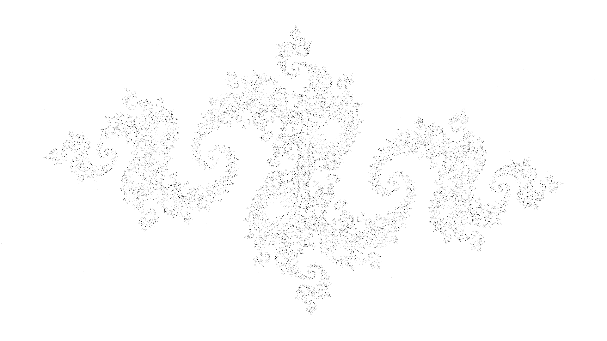

Причина — разная точность и разный порядок округлений. В JavaScript все вычисления выполняются в 64-битном double (53 бита мантиссы, около 16 значащих цифр), а в WGSL используется `f32` (24 бита мантиссы, около 7 цифр). Около границы множества итерация z ← z² + k хаотична: малая ошибка в младшем разряде на каждом шаге примерно удваивается и через несколько десятков итераций становится сравнимой с самой величиной. Поэтому одна и та же точка на CPU может уйти, например, за 87 итераций, а на GPU — за 91 или не уйти вовсе. От этого меняется цвет, а пиксель может даже стать чёрным. Вдали от границы точка уходит за несколько итераций, ошибка не успевает вырасти, и цвета совпадают с точностью до округления.

Чтобы проверить это объяснение, я сделал два опыта. Первый — CPU-ядро с эмуляцией одинарной точности: каждая операция обёрнута в `Math.fround` (`makeCpuCode(VARIANT, true)`). Неожиданно различие с GPU не уменьшилось: Mean diff 0,670, отличающихся пикселей 2,27 %. Значит, дело не только в разрядности: GPU округляет иначе, чем «честная» пооперационная одинарная точность. Второй опыт — скрипт `src/fp_check.py`. Он на numpy повторяет расчёт в нескольких арифметических моделях и сравнивает маску множества (чёрные пиксели) с реальными кадрами (рис. 9).

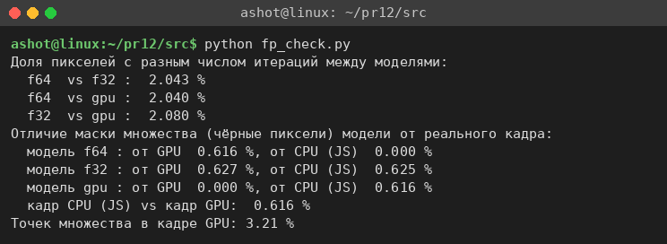

Модель f64 совпала с кадром CPU на 100 %. Наивная модель f32 отличается от GPU так же, как и f64 (0,63 %). Третья модель учитывает две оптимизации:

1. деление x / (W − 1) заменено умножением на обратную величину x · (1/(W − 1));
2. выражения вида a·b + c вычисляются одной операцией FMA (fused multiply-add) с одним округлением вместо двух: x' = fma(x, x, −y²) + kₓ, y' = fma(2x, y, kᵧ).

Эта модель совпала с кадром GPU на всех 2 073 600 пикселях. Именно так компилятор шейдеров NVIDIA и оптимизирует код: на GPU FMA — основная арифметическая инструкция CUDA-ядра, а точное деление дорогое, и стандарт WGSL допускает для деления погрешность до 2,5 ULP. Получается, что у расхождений CPU и GPU три причины: разрядность (float64 против float32), слияние операций в FMA и приближённое деление. В хаотической задаче любая из них приводит к заметной разнице на границе фрактала.

При этом ни один из результатов нельзя назвать «неправильным». Изображения визуально неотличимы (рис. 2), а различаются только пиксели, для которых ответ в принципе неустойчив к точности вычислений. Если бы требовалось побитовое совпадение, пришлось бы считать на GPU в двойной точности или отказаться от FMA. Но в WGSL типа f64 нет, а у GeForce RTX 3060 скорость FP64 в 64 раза ниже, чем FP32.

## 7 Модель SIMT-исполнения в Logisim

Чтобы показать, как GPU выполняет одну команду сразу для многих пикселей, я построил в Logisim 2.7.1 схему `src/logisim/pr12.circ`; её генерирует скрипт `gen_pr12.py`. Вещественные числа в схеме заменены фиксированной точкой Q4.12: 16-битное число в дополнительном коде с 12 дробными битами (шаг 1/4096, диапазон [−8; 8)). Формат выбран под стандартные блоки Logisim. Умножитель в Logisim 2.7.1 беззнаковый, но если расширить операнды знаком до 32 бит, младшие 32 бита произведения совпадут со знаковым произведением. Так получается, например, zx·zx в формате Q8.24.

Подсхема `julia_lane` — одна «линия», аналог CUDA-ядра с его регистрами (рис. 10). В ней есть регистры zx и zy, три умножителя (zx², zy², zx·zy), сумматор |z|² и компаратор |z|² > 4,0 (константа 0x04000000 в Q8.24). Обратно в Q4.12 результат переводится разветвителем: он берёт биты 27…12 разности zx² − zy², а для 2·zx·zy — биты 26…11 (умножение на 2 — это сдвиг на один разряд). Затем прибавляются kₓ и kᵧ. Если |z|² > 4, сигнал ESC = 1 запрещает запись в регистры, и линия «замораживается». Так GPU обрабатывает расхождение ветвей в варпе: поток, вышедший из цикла, маскируется, а остальные продолжают работу. Счётчик N считает выполненные итерации.

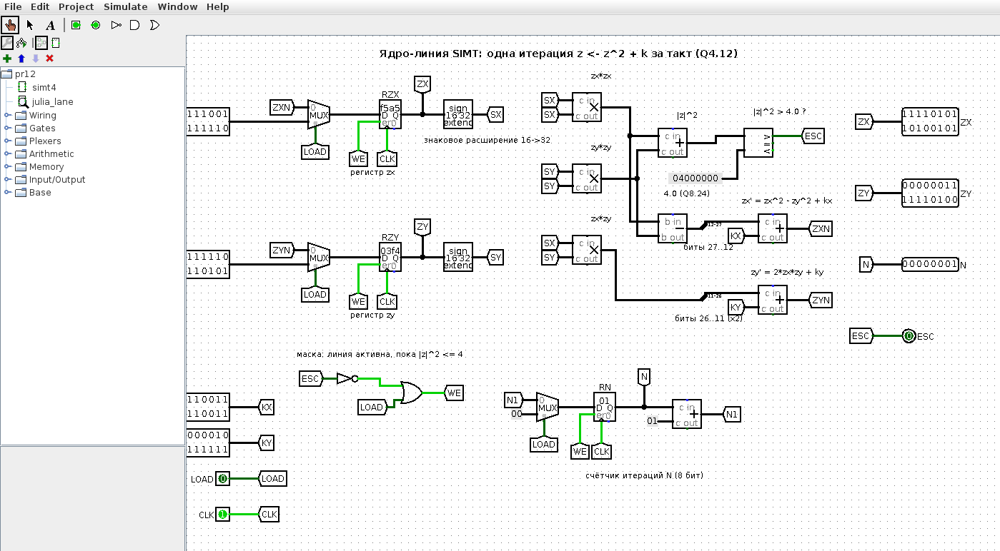

Главная схема `simt4` (рис. 11) содержит четыре одинаковые линии. Тактовый сигнал, команда LOAD/ITER и операнды kₓ, kᵧ у них общие и подаются на все линии сразу — это и есть «одна команда для многих данных». У каждой линии своё начальное значение z₀ — координаты одного из четырёх пикселей строки y = 600 кадра 1920×1080. Слева расположено устройство управления: D-триггер START формирует LOAD на первом такте, счётчик шагов STEP, сигнал halt (все линии ушли или STEP = 32) и 4-битная маска ушедших линий ESCMASK.

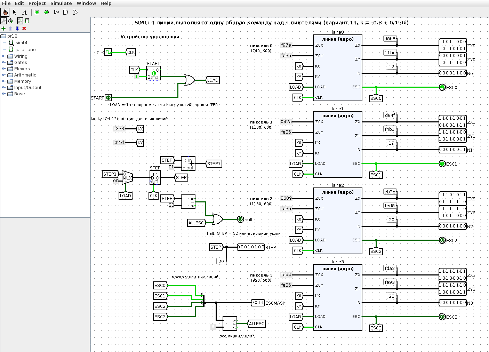

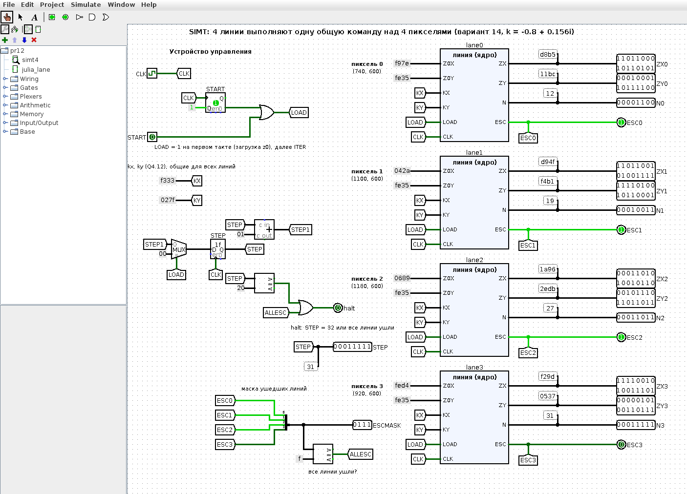

Для проверки я написал эталонную модель той же арифметики на Python (`fixed.py`) и скрипт `verify.py`. Скрипт прогоняет схему в движке Logisim по тактам и сравнивает все выходы с моделью. Затем он запускает штатный консольный режим `java -jar logisim.jar pr12.circ -tty table`, который тактирует схему до сигнала halt. Все 33 такта совпали с моделью (рис. 13, табл. 5).

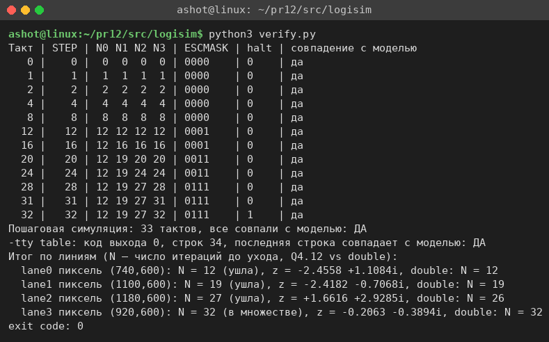

Таблица 5 – Результат работы четырёх линий

| Линия | Пиксель | Итераций в Q4.12 | Итераций в double | Итог |
|---|---|---|---|---|
| lane0 | (740, 600) | 12 | 12 | ушла |
| lane1 | (1100, 600) | 19 | 19 | ушла |
| lane2 | (1180, 600) | 27 | 26 | ушла |
| lane3 | (920, 600) | 32 (предел) | 32 (предел) | в множестве |

Схема наглядно показывает обе особенности, найденные на стенде. Во-первых, линии простаивают: после 12-го такта lane0 уже ничего не делает, но общая команда выполняется, пока не закончит самая «долгая» линия. Для настоящего кадра я оценил это скриптом `warp_stats.py`. Если считать варпом 32 соседних пикселя рабочей группы 16×16, то в среднем активны только 47 % потоков варпа. Во-вторых, линия lane2 в фиксированной точке ушла на 27-й итерации, а в double — на 26-й: точка лежит близко к границе, и 12 дробных бит не хватает, чтобы повторить результат двойной точности. Это тот же эффект, что и расхождение float32 и float64 на стенде, только в меньшем масштабе.

# ВЫВОДЫ

В работе восстановлен и запущен стенд WebGPU из методички. Для варианта 14 (множество Жюлиа, k = −0,8 + 0,156i, 1920×1080, maxIter = 300) написаны одинаковые по алгоритму ядра на JavaScript и WGSL с гладкой окраской. Параметры варианта задаются в одном объекте и подставляются в оба ядра. Расчёт на GPU выполнялся на реальной видеокарте RTX 3060 (Ampere, 28 SM, 3584 CUDA-ядра) через Vulkan-backend Chrome. Без флага `--enable-unsafe-webgpu` браузер на Linux адаптер WebGPU не выдаёт.

Время CPU растёт линейно с числом пикселей: около 0,48 с на мегапиксель, от 0,11 с для 640×360 до 15,2 с для 8K. GPU оказался быстрее в 20–36 раз: кадр варианта он считает за 30–50 мс против примерно 1 с на CPU. Однако опыт с пустым ядром показал, что время GPU на стенде почти целиком уходит на передачу буферов между CPU и видеопамятью и на синхронизацию, а сами вычисления занимают доли миллисекунды. Значит, ускорение в такой постановке ограничено пересылкой данных, и выгода от GPU тем больше, чем больше вычислений приходится на каждый переданный байт.

Изображения CPU и GPU визуально совпадают, но Mean diff ≈ 0,66 и Max diff = 255: около 2 % пикселей на границе фрактала окрашены по-разному. Причина в том, что хаотическая итерация усиливает ошибки округления. С помощью numpy удалось с точностью до пикселя воспроизвести кадр GPU: он получается при вычислениях в float32, если заменить деление умножением на обратную величину и слить a·b + c в FMA. Простой перевод CPU-расчёта на float32 (`Math.fround`) расхождение не убирает.

Модель в Logisim из четырёх линий, выполняющих общую команду z ← z² + k в фиксированной точке Q4.12, проверена на всех тактах против модели на Python. Она наглядно показывает принцип SIMT: общий поток команд, свои данные у каждой линии, маскирование ушедших потоков и простой линий при расхождении ветвей.
