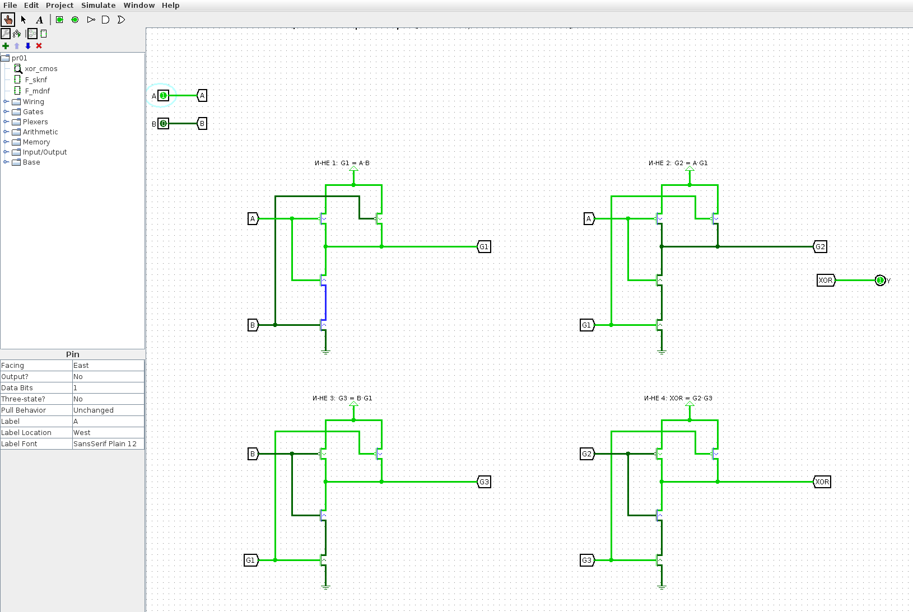
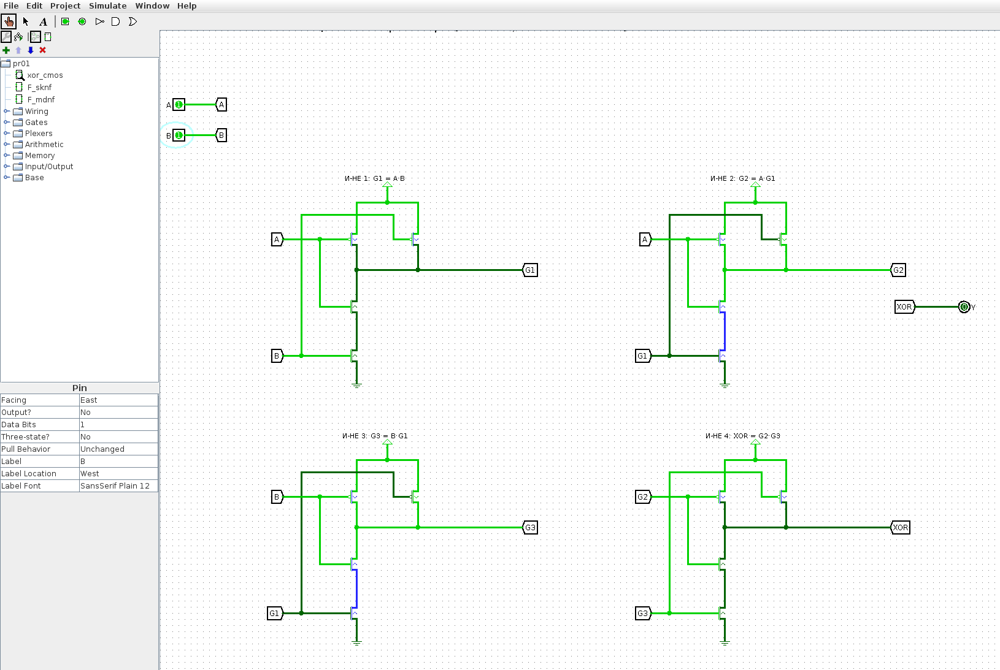
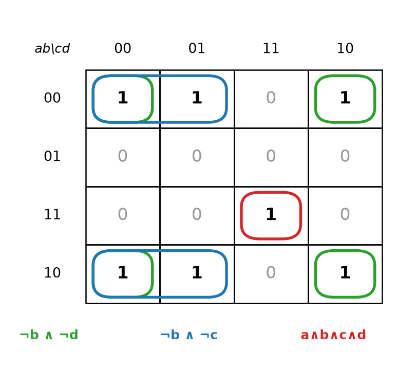
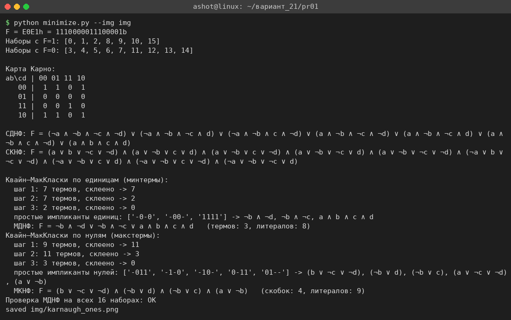
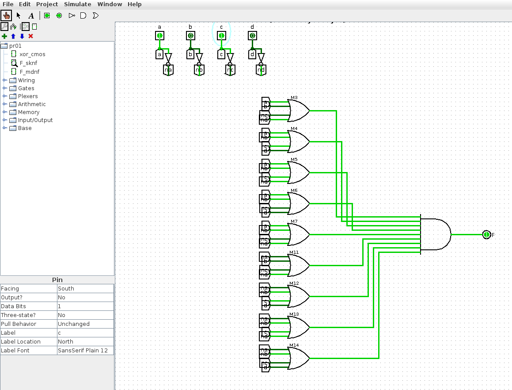
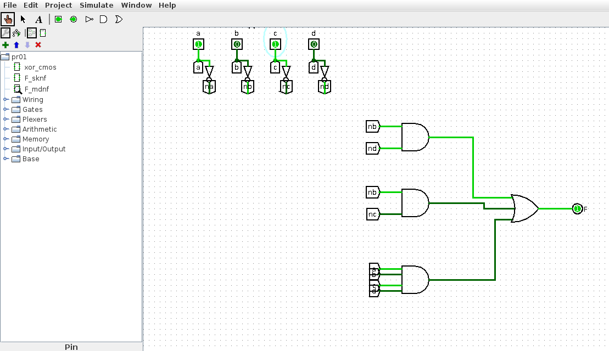
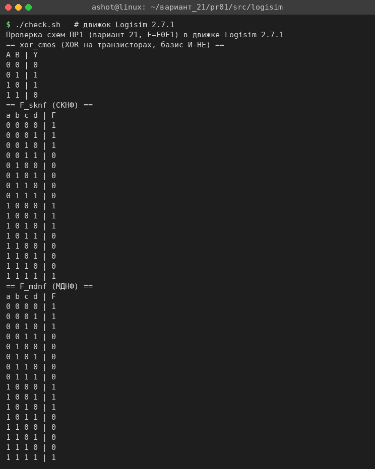

<!-- num: 1; title: Логические элементы, их построение на транзисторе. Синтез цифровых схем -->

# ЦЕЛЬ РАБОТЫ

Изучить принцип работы n- и p-канальных МОП-транзисторов и построение на них логических элементов по КМОП-технологии; освоить синтез логической функции по таблице истинности: построение совершенных нормальных форм (СДНФ, СКНФ) и минимизацию функции картами Карно и методом Квайна–МакКласки; собрать и проверить полученные схемы в среде Logisim.

# ЗАДАНИЕ

Вариант 21.

1. Построить элемент «Исключающее ИЛИ» на транзисторах.
2. Построить СКНФ и МДНФ функции, заданной шестнадцатеричным вектором F=E0E1.
3. Продемонстрировать результат (схемы в Logisim).

# ХОД РАБОТЫ

## 1 Элемент «Исключающее ИЛИ» на КМОП-транзисторах

МОП-транзистор можно рассматривать как ключ, управляемый напряжением на затворе. n-канальный транзистор открыт, когда на затворе логическая «1», p-канальный — наоборот, когда на затворе «0». В КМОП-элементе каждый вход подаётся одновременно на затворы одного p- и одного n-транзистора, поэтому при любом наборе входов открыта только одна из двух цепей: либо выход подтянут к питанию через p-транзисторы (верхнее плечо), либо к земле через n-транзисторы (нижнее плечо). Сквозного тока между питанием и землёй в статике нет.

Базовым КМОП-элементом является «И-НЕ»: в верхнем плече два p-МОП транзистора с затворами A и B включены параллельно между питанием и выходом (достаточно одного нуля на входе, чтобы выход получил «1»), а в нижнем плече два n-МОП транзистора включены последовательно между выходом и землёй (выход соединяется с землёй, только когда открыты оба, то есть A=B=1). Такой элемент реализует функцию Y = ¬(A ∧ B).

Функция «Исключающее ИЛИ» не является базовой КМОП-функцией (она не инвертирующая), поэтому её, как и в пособии (рис. 1.7а), строят в базисе «И-НЕ» из четырёх элементов И-НЕ:

$$ A ⊕ B = (A ⊼ (A ⊼ B)) ⊼ (B ⊼ (A ⊼ B)) $$

где ⊼ — операция «И-НЕ». Обозначив G1 = A ⊼ B, получаем G2 = A ⊼ G1, G3 = B ⊼ G1 и выход XOR = G2 ⊼ G3. Таблица 1 показывает, что эта схема действительно реализует «Исключающее ИЛИ».

Таблица 1 – Работа XOR в базисе И-НЕ

| A | B | G1=¬(A·B) | G2=¬(A·G1) | G3=¬(B·G1) | XOR=¬(G2·G3) |
|---|---|---|---|---|---|
| 0 | 0 | 1 | 1 | 1 | 0 |
| 0 | 1 | 1 | 1 | 0 | 1 |
| 1 | 0 | 1 | 0 | 1 | 1 |
| 1 | 1 | 0 | 1 | 1 | 0 |

Схема собрана в Logisim 2.7.1 (файл `src/logisim/pr01.circ`, схема `xor_cmos`): каждый из четырёх элементов И-НЕ набран из компонентов библиотеки Wiring — Transistor (p или n), Power и Ground, — а элементы соединены между собой именованными цепями (туннелями) G1, G2, G3. На рис. 1 показан режим A=1, B=0: на выходе XOR=1 (сигнал «1» выделен светло-зелёным). На рис. 2 — режим A=1, B=1: выход XOR=0.

## 2 Таблица истинности функции F=E0E1

Функция четырёх переменных a, b, c, d задана 16-разрядным вектором значений. Как и в примере пособия (табл. 1.7, F=ADEF), каждая шестнадцатеричная цифра даёт значения функции на четырёх наборах подряд, а старший бит вектора соответствует набору 0000:

$$ F = E0E1₁₆ = 1110\ 0000\ 1110\ 0001₂ $$

Цифра E (1110) задаёт наборы 0000–0011 и 1000–1011, цифра 0 (0000) — наборы 0100–0111, цифра 1 (0001) — наборы 1100–1111. Получившаяся таблица истинности — табл. 2.

Таблица 2 – Таблица истинности функции F=E0E1

| № | a | b | c | d | F | Цифра вектора |
|---|---|---|---|---|---|---|
| 0 | 0 | 0 | 0 | 0 | 1 | E |
| 1 | 0 | 0 | 0 | 1 | 1 | E |
| 2 | 0 | 0 | 1 | 0 | 1 | E |
| 3 | 0 | 0 | 1 | 1 | 0 | E |
| 4 | 0 | 1 | 0 | 0 | 0 | 0 |
| 5 | 0 | 1 | 0 | 1 | 0 | 0 |
| 6 | 0 | 1 | 1 | 0 | 0 | 0 |
| 7 | 0 | 1 | 1 | 1 | 0 | 0 |
| 8 | 1 | 0 | 0 | 0 | 1 | E |
| 9 | 1 | 0 | 0 | 1 | 1 | E |
| 10 | 1 | 0 | 1 | 0 | 1 | E |
| 11 | 1 | 0 | 1 | 1 | 0 | E |
| 12 | 1 | 1 | 0 | 0 | 0 | 1 |
| 13 | 1 | 1 | 0 | 1 | 0 | 1 |
| 14 | 1 | 1 | 1 | 0 | 0 | 1 |
| 15 | 1 | 1 | 1 | 1 | 1 | 1 |

Функция равна 1 на наборах 0, 1, 2, 8, 9, 10, 15 и равна 0 на остальных девяти наборах. Уже по таблице видно, что единицы сосредоточены там, где b=0 (наборы 0–2, 8–10), и дополнительно в одной точке 1111.

## 3 Построение СКНФ

По заданию варианта 21 строится СКНФ (совершенная конъюнктивная нормальная форма). Она составляется по строкам, где F=0: каждой такой строке соответствует дизъюнкция (конституента нуля), в которую входят все четыре переменные; переменная, равная в наборе 1, берётся с отрицанием, равная 0 — без отрицания. Конъюнкция девяти конституент нуля даёт СКНФ:

$$ F(СКНФ) = (a∨b∨¬c∨¬d)(a∨¬b∨c∨d)(a∨¬b∨c∨¬d)(a∨¬b∨¬c∨d)(a∨¬b∨¬c∨¬d)(¬a∨b∨¬c∨¬d)(¬a∨¬b∨c∨d)(¬a∨¬b∨c∨¬d)(¬a∨¬b∨¬c∨d) $$

Для сравнения по единицам выпишем также СДНФ (по строкам, где F=1; переменная, равная 1, берётся без отрицания, равная 0 — с отрицанием):

$$ F(СДНФ) = ¬a¬b¬c¬d ∨ ¬a¬b¬cd ∨ ¬a¬bc¬d ∨ a¬b¬c¬d ∨ a¬b¬cd ∨ a¬bc¬d ∨ abcd $$

## 4 Минимизация по единицам: карта Карно и МДНФ

Перенесём таблицу истинности на карту Карно 4×4 (табл. 3). Строки карты соответствуют переменным ab, столбцы — cd; и строки, и столбцы идут в порядке кода Грея 00, 01, 11, 10, чтобы соседние клетки отличались значением ровно одной переменной (крайние строки и столбцы тоже соседние — карта «сворачивается» в тор).

Таблица 3 – Карта Карно функции F=E0E1

| ab \ cd | 00 | 01 | 11 | 10 |
|---|---|---|---|---|
| 00 | 1 | 1 | 0 | 1 |
| 01 | 0 | 0 | 0 | 0 |
| 11 | 0 | 0 | 1 | 0 |
| 10 | 1 | 1 | 0 | 1 |

Для МДНФ объединяем в прямоугольные группы из 2ᵏ клеток единицы функции (рис. 3):

- группа 1 — четыре единицы в углах карты (строки ab=00, 10 и столбцы cd=00, 10). И строки 00/10, и столбцы 00/10 соседние через границу карты, поэтому это один прямоугольник 2×2. Внутри группы неизменны b=0 и d=0, а a и c меняются. Переменная, равная 0, входит в конъюнкцию с отрицанием: получаем терм ¬b ∧ ¬d;
- группа 2 — четыре единицы в строках ab=00, 10 и столбцах cd=00, 01. Неизменны b=0 и c=0, поэтому терм ¬b ∧ ¬c;
- группа 3 — одиночная единица в клетке ab=11, cd=11 (набор 1111). Её нельзя объединить ни с одной соседней единицей, поэтому она даёт полный терм a ∧ b ∧ c ∧ d.

Группы 1 и 2 максимальны (расширить их, не захватив ноль, нельзя) и существенны; одиночная единица 1111 покрывается только своим термом. Вместе они покрывают все семь единиц, поэтому

$$ F(МДНФ) = ¬b ∧ ¬d ∨ ¬b ∧ ¬c ∨ a ∧ b ∧ c ∧ d $$

Минимальность результата проверена программно скриптом `src/minimize.py`. Скрипт строит таблицу истинности по вектору, выписывает СДНФ и СКНФ, методом Квайна–МакКласки находит все простые импликанты для единиц функции и полным перебором подмножеств простых импликант выбирает покрытие с наименьшим числом термов, а при равенстве — литералов. Склеивание по единицам даёт три простые импликанты: 0-0- → ¬b∧¬d, 0-0- … точнее -0-0 → ¬b∧¬d, -00- → ¬b∧¬c и 1111 → a∧b∧c∧d (одиночная единица не склеивается). Результат скрипта (рис. 4) совпадает с картой Карно: МДНФ содержит 3 терма и 8 литералов.

Таблица истинности, формулы СКНФ и МДНФ и карты Карно оформлены также в файле `pr01/Практика_1_вариант_21.xlsx` (таблица истинности со значениями вектора, формулы, карта значений и карта Карно с цветовой группировкой единиц для МДНФ, а также разложение шестнадцатеричного вектора E0E1 по тетрадам). Строки, где F=1, в таблице подсвечены зелёным, столбец F — песочным, а группы единиц в карте Карно — разными цветами.

## 5 Схемы функции в Logisim и проверка

По полученным формулам в том же файле `src/logisim/pr01.circ` собраны две схемы.

Подсхема `F_sknf` (рис. 5) реализует СКНФ: от каждого входа идут две шины — прямая и инвертированная (через элемент НЕ); девять четырёхвходовых элементов ИЛИ формируют конституенты нуля, а девятивходовый элемент И объединяет их в произведение. На рисунке подан набор 1010 (№ 10): все скобки дают «1», и F=1.

Подсхема `F_mdnf` (рис. 6) реализует МДНФ: два двухвходовых элемента И формируют конъюнкции ¬b∧¬d и ¬b∧¬c, один четырёхвходовый элемент И — конъюнкцию a∧b∧c∧d, а трёхвходовый элемент ИЛИ объединяет их. На том же наборе 1010 активна первая конъюнкция ¬b∧¬d, и F=1.

Схема по МДНФ состоит всего из 11 элементов против 14 элементов (4 НЕ, 9 ИЛИ на 4 входа, 1 И на 9 входов) в схеме по СКНФ, что наглядно показывает смысл минимизации.

Корректность всех трёх схем проверена в симуляторе Logisim. Режим `-tty table` в версии 2.7.1 не перебирает входные наборы, поэтому для перебора написан скрипт `src/logisim/logitool.js`. Он выполняется в Nashorn (`jjs` из JDK 8) с `logisim.jar` в classpath: загружает .circ-файл средствами Logisim, для каждого набора выставляет значения на входных контактах, запускает распространение сигналов и читает выходы. Скрипт строит таблицы для `xor_cmos`, `F_sknf`, `F_mdnf` и сравнивает столбцы F с вектором E0E1 (рис. 7). Таблица XOR совпала с табл. 1, а таблицы обеих схем функции — с табл. 2 (вектор E0E1).

Схемы в файле сгенерированы скриптом `src/logisim/gen_pr01.py` (модуль `circgen.py` расставляет компоненты на сетке и соединяет их проводами и туннелями); файл открывается в Logisim 2.7.1 и редактируется в нём обычным образом.

# ВЫВОДЫ

В работе построен элемент «Исключающее ИЛИ» на КМОП-транзисторах в базисе «И-НЕ»: четыре элемента И-НЕ, каждый из четырёх МОП-транзисторов (два p-канальных в верхнем плече, два n-канальных в нижнем), реализуют тождество A⊕B = (A⊼(A⊼B))⊼(B⊼(A⊼B)). Таблица работы схемы и моделирование в Logisim подтвердили правильность функции.

Для функции F=E0E1 по таблице истинности построена СКНФ (9 конституент нуля). Минимизация по единицам картой Карно дала МДНФ F = ¬b¬d ∨ ¬b¬c ∨ abcd (3 терма, 8 литералов), её минимальность подтверждена методом Квайна–МакКласки с полным перебором покрытий. Схемы по СКНФ и МДНФ собраны в Logisim; их таблицы истинности, полученные в симуляторе, совпадают с заданным вектором, а схема по МДНФ содержит заметно меньше элементов.
