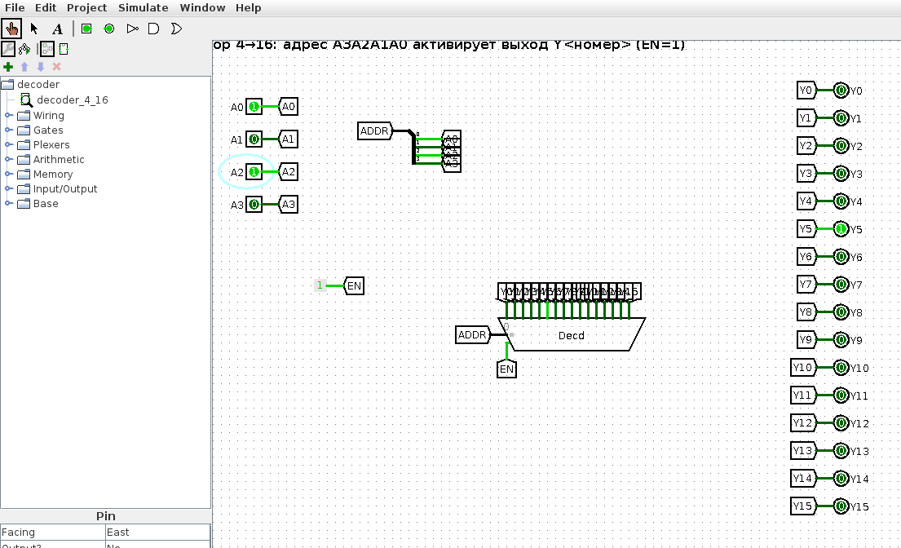
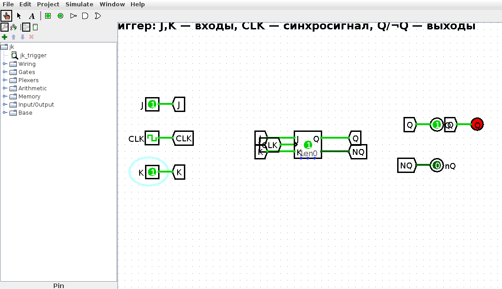
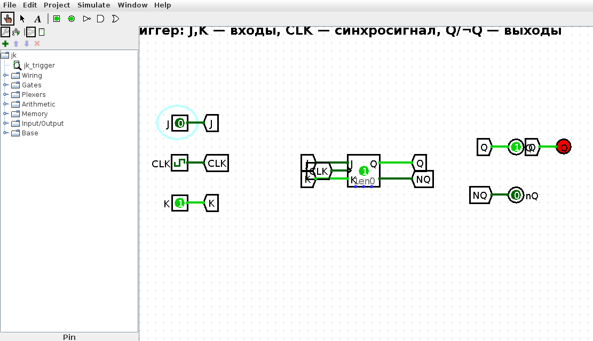
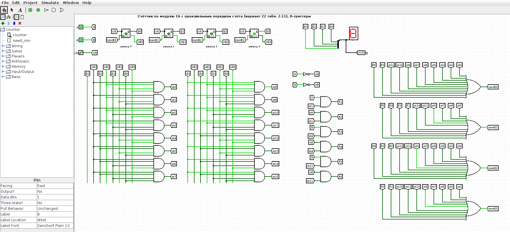
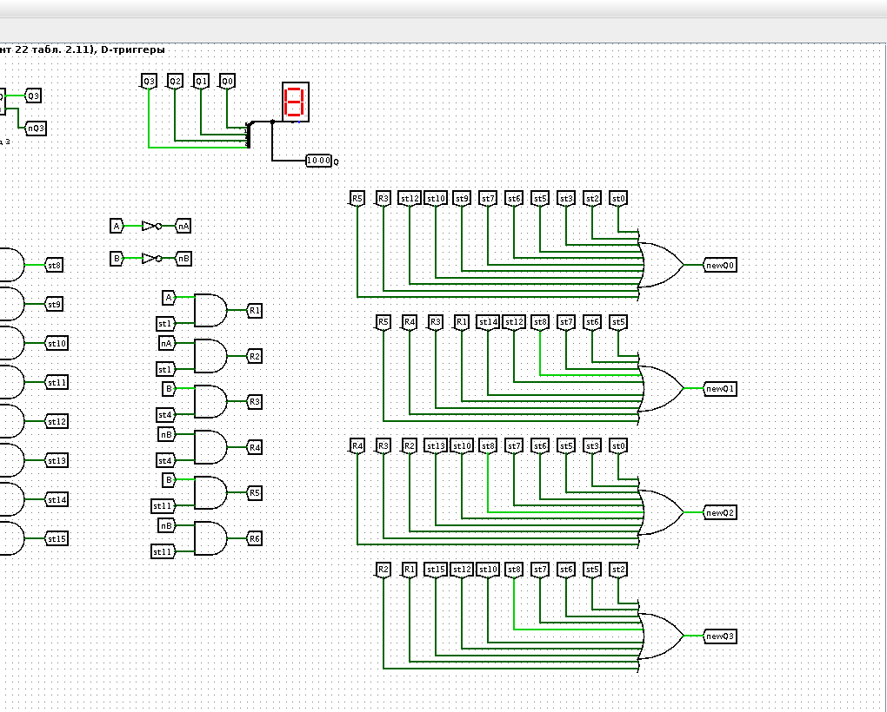
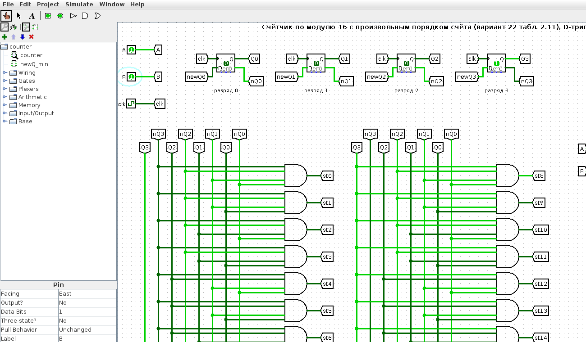
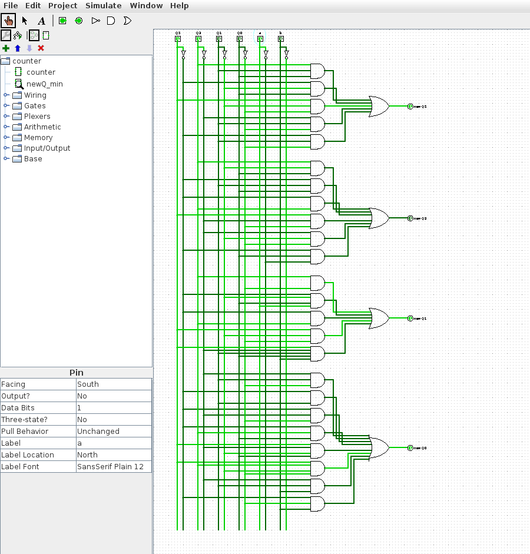
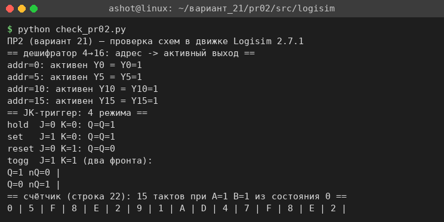
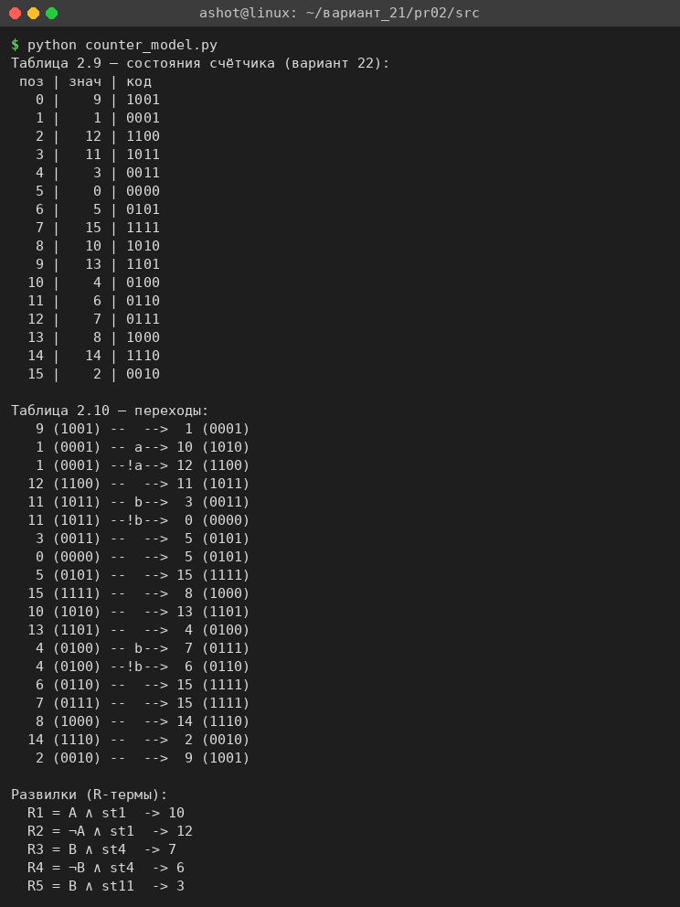

<!-- num: 2; title: Комбинационные схемы, элементы памяти, счётчики -->

# ЦЕЛЬ РАБОТЫ

Изучить устройство и работу комбинационных схем (на примере дешифратора) и элементов памяти (на примере JK-триггера), научиться синтезировать счётчик с произвольным порядком счёта по графу переходов: составлять таблицы состояний и переходов, получать функции возбуждения триггеров newQ и реализовывать счётчик на D-триггерах в среде Logisim.

# ЗАДАНИЕ

Вариант 21.

1. Разобрать дешифратор с 4 входными сигналами и JK-триггер, составить таблицы истинности.
2. Реализовать счётчик согласно варианту 22 табл. 2.11 (последовательность состояний 9 1 12 11 3 0 5 15 10 13 4 6 7 8 14 2, подставляемая в шаблон графа рис. 2.14).

Все схемы собраны в Logisim 2.7.1 (файлы в каталоге `src/logisim`).

# ХОД РАБОТЫ

## 1 Дешифратор с 4 входными сигналами (4→16)

Дешифратор — комбинационная схема, преобразующая n-разрядный двоичный код на входе в сигнал на одном из 2ⁿ выходов: активным (равным 1) становится ровно тот выход, номер которого равен поданному коду. Дешифратор «с 4 входными сигналами» имеет 4 адресных входа A3 A2 A1 A0 и 16 выходов Y0…Y15. При наличии входа разрешения EN=1 активируется один выход, при EN=0 все выходы равны 0.

Логически каждый выход — это конъюнкция всех четырёх входов в прямом или инверсном виде: например, Y0 = ¬A3·¬A2·¬A1·¬A0, Y5 = ¬A3·A2·¬A1·A0, Y15 = A3·A2·A1·A0. Таблица истинности (при EN=1) приведена в табл. 1: в каждой строке активен один выход.

Таблица 1 – Таблица истинности дешифратора 4→16 (EN=1)

| A3 | A2 | A1 | A0 | Активный выход |
|---|---|---|---|---|
| 0 | 0 | 0 | 0 | Y0 |
| 0 | 0 | 0 | 1 | Y1 |
| 0 | 0 | 1 | 0 | Y2 |
| … | … | … | … | … |
| 0 | 1 | 0 | 1 | Y5 |
| … | … | … | … | … |
| 1 | 0 | 1 | 0 | Y10 |
| … | … | … | … | … |
| 1 | 1 | 1 | 1 | Y15 |

Полная таблица на 16 строк приведена в файле `pr02/Практика_2_вариант_21.xlsx` (лист «Дешифратор 4-16»). Схема (`decoder.circ`, подсхема `decoder_4_16`) собрана на компоненте Decoder библиотеки Plexers: четыре отдельных входных сигнала A0…A3 объединяются разветвителем в 4-разрядную шину адреса, которая подаётся на вход выбора дешифратора; вход EN подключён к константе 1. На рис. 1 подан адрес 0101₂ = 5 — активен (горит светодиод) только выход Y5.

## 2 JK-триггер

JK-триггер — универсальный синхронный элемент памяти. По входам J и K и фронту синхросигнала C он выполняет одну из четырёх операций (табл. 2): при J=K=0 хранит состояние, при J=1 K=0 устанавливается в 1, при J=0 K=1 сбрасывается в 0, а при J=K=1 переключается в противоположное состояние (режим счёта). В отличие от RS-триггера, комбинация J=K=1 разрешена и используется для построения счётчиков.

Таблица 2 – Характеристическая таблица JK-триггера

| J | K | Q(n+1) | Режим |
|---|---|---|---|
| 0 | 0 | Q(n) | хранение |
| 0 | 1 | 0 | сброс |
| 1 | 0 | 1 | установка |
| 1 | 1 | ¬Q(n) | счёт (переключение) |

Характеристическое уравнение JK-триггера: Q(n+1) = J·¬Q ∨ ¬K·Q. Обратная задача (какими должны быть J и K для заданного перехода Q(n)→Q(n+1)) описывается таблицей возбуждения (табл. 3), где x — безразличное значение.

Таблица 3 – Таблица возбуждения JK-триггера

| Q(n) | Q(n+1) | J | K |
|---|---|---|---|
| 0 | 0 | 0 | x |
| 0 | 1 | 1 | x |
| 1 | 0 | x | 1 |
| 1 | 1 | x | 0 |

Схема (`jk.circ`, подсхема `jk_trigger`) собрана на компоненте J-K Flip-Flop библиотеки Memory с входами J, K и синхрогенератором. На рис. 2 показан режим счёта J=K=1 после фронта синхросигнала — выход Q переключился в 1 (светодиод горит); на рис. 3 — режим сброса J=0, K=1: после фронта Q=0. Все четыре режима проверены в движке Logisim (см. п. 4).

## 3 Счётчик с произвольным порядком счёта (вариант 22)

Счётчик строится по шаблонному графу переходов рис. 2.14: в его 16 позиций подставляются значения из строки 22 табл. 2.11. Последовательность счёта (значения по позициям 0…15): 9, 1, 12, 11, 3, 0, 5, 15, 10, 13, 4, 6, 7, 8, 14, 2, после чего цикл замыкается (из 2 обратно в 9). В трёх позициях граф разветвляется по внешним входам A и B: позиция со значением 1 — по A, позиция со значением 4 — по B, позиция со значением 11 — по B. Таблица состояний и таблица переходов построены скриптом `src/counter_model.py` (рис. 7) и приведены в файле `pr02/Практика_2_вариант_21.xlsx` (лист «Счётчик»).

Таблица 4 – Переходы в точках ветвления (развилки R1…R6)

| Разветвление | Условие | Из состояния | В состояние |
|---|---|---|---|
| R1 | A | 1 | 10 |
| R2 | ¬A | 1 | 12 |
| R3 | B | 4 | 7 |
| R4 | ¬B | 4 | 6 |
| R5 | B | 11 | 3 |
| R6 | ¬B | 11 | 0 |

Счётчик реализован на четырёх D-триггерах (по методу пособия для готового счётчика варианта 1). Функция возбуждения каждого D-триггера newQ<i> — это логическая сумма сигналов тех состояний, из которых счётчик переходит в состояние с единицей в i-м разряде, плюс соответствующие развилочные термы R:

$$ newQ3 = st2 ∨ st5 ∨ st6 ∨ st7 ∨ st8 ∨ st10 ∨ st12 ∨ st15 ∨ R1 ∨ R2 $$
$$ newQ2 = st0 ∨ st3 ∨ st5 ∨ st6 ∨ st7 ∨ st8 ∨ st10 ∨ st13 ∨ R2 ∨ R3 ∨ R4 $$
$$ newQ1 = st5 ∨ st6 ∨ st7 ∨ st8 ∨ st12 ∨ st14 ∨ R1 ∨ R3 ∨ R4 ∨ R5 $$
$$ newQ0 = st0 ∨ st2 ∨ st3 ∨ st5 ∨ st6 ∨ st7 ∨ st9 ∨ st10 ∨ st12 ∨ R3 ∨ R5 $$

где st<s> — сигнал текущего состояния s, снимаемый с дешифратора состояний (16 элементов И по разрядам Q3 Q2 Q1 Q0), а R<k> — развилочные термы из табл. 4 (например, R1 = A ∧ st1). Схема содержит входы A и B, тактовый генератор, четыре D-триггера, дешифратор состояний st0…st15, формирователи развилок R1…R6 и четыре элемента ИЛИ, собирающие newQ0…newQ3 (рис. 4–6). Текущее состояние выводится на шестнадцатеричный индикатор.

Параллельно те же функции возбуждения минимизированы методом Квайна–МакКласки от шести переменных Q3 Q2 Q1 Q0 a b (скрипт `counter_model.py`) и собраны в проверочную подсхему `newQ_min` (рис. 6 файла). Минимальные формы:

- newQ3 = Q2Q1Q0 ∨ ¬Q3¬Q1Q0 ∨ Q3¬Q1¬Q0 ∨ ¬Q2Q1¬Q0 ∨ ¬Q3Q1¬Q0;
- newQ2 = Q2¬Q1Q0 ∨ ¬Q3Q1Q0 ∨ ¬Q3Q2 ∨ Q3¬Q2¬Q0 ∨ ¬Q2¬Q1¬Q0 ∨ ¬Q3Q0¬a;
- newQ1 = Q2¬Q0 ∨ ¬Q3¬Q1Q0a ∨ ¬Q3Q2 ∨ Q3¬Q1¬Q0 ∨ Q3¬Q2Q1Q0b;
- newQ0 = ¬Q2Q1¬Q0 ∨ ¬Q3Q1 ∨ ¬Q3¬Q2¬Q0 ∨ ¬Q3Q2Q0 ∨ Q3¬Q2¬Q1Q0 ∨ Q3Q2¬Q1¬Q0 ∨ ¬Q2Q1b ∨ ¬Q3¬Q0b.

## 4 Проверка

Схемы проверены в движке Logisim 2.7.1 (`logitool.js` / `lsim.js`). Для дешифратора на всех 16 адресах активен ровно нужный выход; для JK-триггера подтверждены все четыре режима (хранение, сброс, установка, счёт); для счётчика прогон из состояния 0 при постоянных A и B даёт ту же последовательность, что и модель `counter_model.py` (рис. 8). Проверочная подсхема newQ_min на всех 64 наборах (Q3 Q2 Q1 Q0 a b) совпала с графом переходов.

# ВЫВОДЫ

В работе разобраны дешифратор с 4 входными сигналами (4→16), для которого составлена таблица истинности и собрана схема в Logisim (адрес активирует один из 16 выходов), и JK-триггер, для которого выписаны характеристическая таблица и таблица возбуждения и показаны все четыре режима работы.

По строке 22 табл. 2.11 синтезирован счётчик с произвольным порядком счёта: построены таблицы состояний и переходов, получены функции возбуждения newQ0…newQ3 в форме пособия, выполнена их минимизация методом Квайна–МакКласки. Счётчик собран на D-триггерах в Logisim; моделирование подтвердило, что он проходит заданную последовательность состояний, а развилки по входам A и B работают согласно графу переходов.
