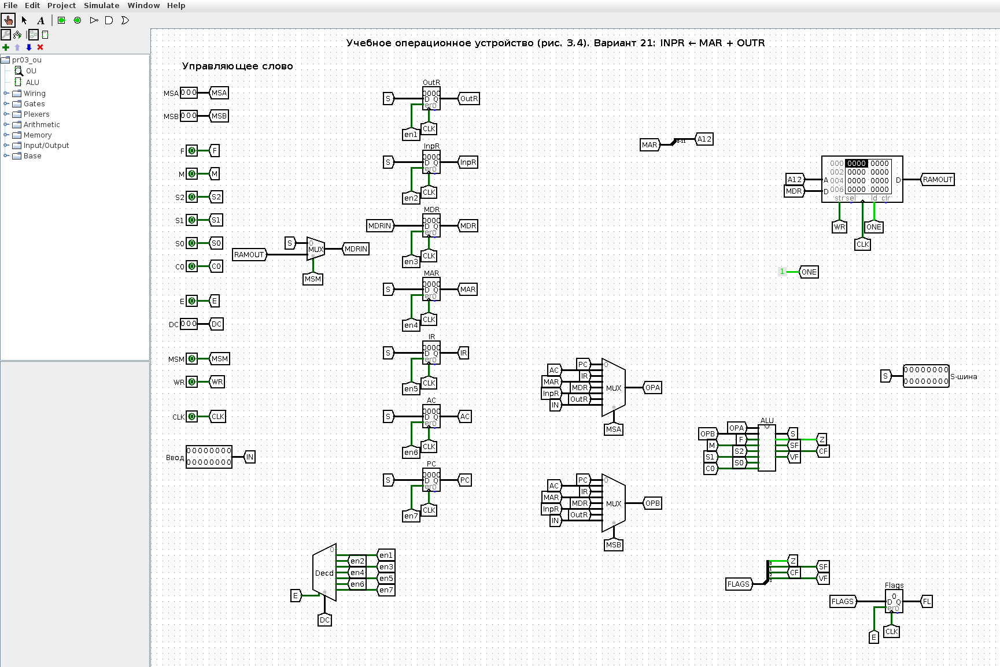
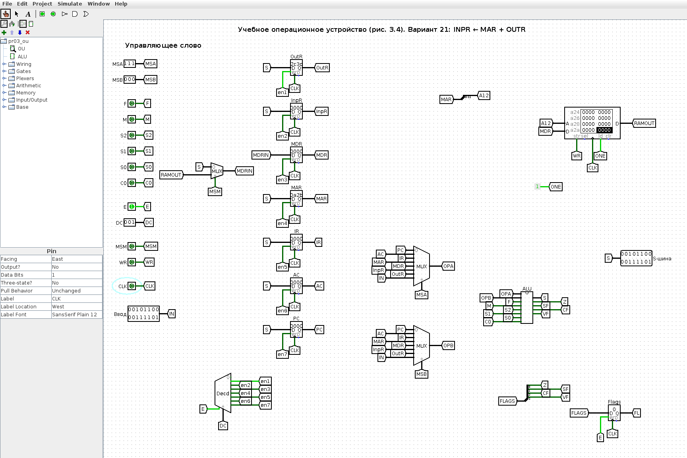
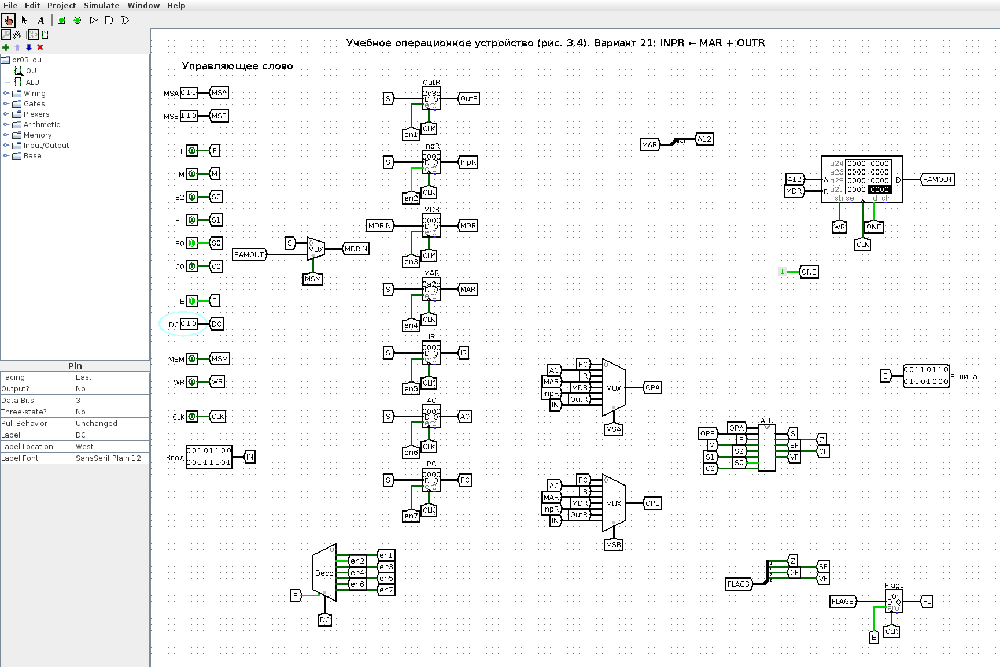
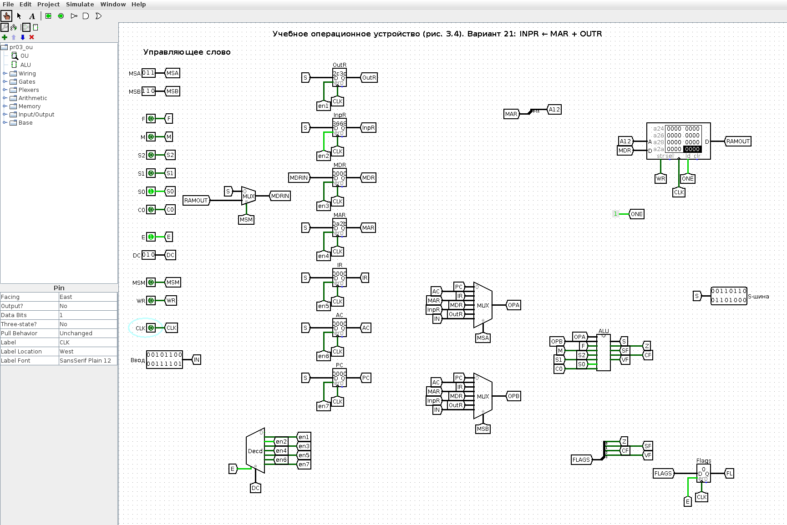
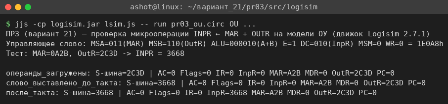

<!-- num: 3; title: Операционное устройство ЦП -->

# ЦЕЛЬ РАБОТЫ

Изучить устройство учебного операционного устройства (ОУ) центрального процессора: назначение регистров PC, IR, AC, MAR, MDR, InpR, OutR, работу арифметико-логического устройства и системы флагов, управление потоками данных с помощью мультиплексоров и дешифратора. Научиться записывать 18-разрядное управляющее слово ОУ для заданной микрооперации и проверить его на модели ОУ в Logisim.

# ЗАДАНИЕ

Вариант 21. Записать управляющее слово учебного ОУ (табл. 3.2) для микрооперации

$$ INPR ← MAR + OUTR $$

и продемонстрировать её выполнение.

# ХОД РАБОТЫ

## 1 Смысл микрооперации

Микрооперация INPR ← MAR + OUTR означает: содержимое регистра адреса памяти MAR и регистра вывода OutR подаётся на входы АЛУ, над ними выполняется арифметическое сложение, результат по S-шине записывается в регистр ввода InpR. Значения MAR и OutR при этом не меняются, обращения к памяти нет. Для формирования управляющего слова нужно определить пять полей (табл. 3.2): MS(A), MS(B), ALU, DC, MS(M) и WR.

## 2 Коды источников и приёмников

По схеме учебного ОУ (рис. 3.4 пособия) выходы регистров подключены к информационным входам мультиплексоров MS A и MS B, а выходы дешифратора DC — к входам разрешения записи регистров. Коды, снятые со схемы, сведены в табл. 1.

Таблица 1 – Коды входов мультиплексоров MS A / MS B и выходов дешифратора DC (рис. 3.4)

| Код | Вход MS A / MS B | Выход DC (запись в регистр) |
|---|---|---|
| 000 | PC | — (не используется) |
| 001 | AC | OutR |
| 010 | IR | InpR |
| 011 | MAR | MDR |
| 100 | MDR | MAR |
| 101 | InpR | IR |
| 110 | OutR | AC |
| 111 | Ввод | PC |

Для варианта 21: операнд A — MAR, MS(A) = 011; операнд B — OutR, MS(B) = 110; приёмник — InpR, DC: E = 1, x2 x1 x0 = 010.

## 3 Код операции АЛУ

Поле ALU состоит из битов F M S2 S1 S0 C (табл. 3.1). При F = 0 (арифметика и стандартные логические операции) и M = 0 (обычные операции над регистрами A/B) код S2 S1 S0 задаёт операцию внутри группы, а C — входной перенос. Арифметические операции (S2 = 0) идут в порядке возрастания кода, что подтверждается примером табл. 3.3, где «Сумма» A + B имеет код 000010. Соответствующие коды приведены в табл. 2.

Таблица 2 – Коды микроопераций АЛУ группы F = 0, M = 0 (табл. 3.1)

| F M S2 S1 S0 C | Микрооперация | Наименование |
|---|---|---|
| 0 0 0 0 0 0 | A | Передача A |
| 0 0 0 0 0 1 | A + 1 | Инкремент A |
| **0 0 0 0 1 0** | **A + B** | **Сумма** |
| 0 0 0 0 1 1 | A + B + 1 | Сумма с переносом |
| 0 0 0 1 0 0 | A − B − 1 | Разность с заёмом |
| 0 0 0 1 0 1 | A − B | Разность |
| 0 0 0 1 1 0 | A − 1 | Декремент A |

Для сложения MAR + OUTR: ALU = 0 0 0 0 1 0 (операция «Сумма», входной перенос C = 0).

## 4 Поля MS(M) и WR

Мультиплексор MS(M) выбирает лишь то, что записывается в MDR (0 — результат АЛУ с S-шины, 1 — данные из ОЗУ), и на запись в InpR не влияет; в записи слова принимаем MS(M) = 0. Запись в память не выполняется: WR = 0.

## 5 Управляющее слово

Таблица 3 – Машинное слово ОУ для микрооперации INPR ← MAR + OUTR (поля: MS A — a2 a1 a0, MS B — a2 a1 a0, ALU — F M S2 S1 S0 C, DC — E x2 x1 x0, MS M — a0, WR — wr)

| a2 | a1 | a0 | a2 | a1 | a0 | F | M | S2 | S1 | S0 | C | E | x2 | x1 | x0 | a0 | wr |
|---|---|---|---|---|---|---|---|---|---|---|---|---|---|---|---|---|---|
| 0 | 1 | 1 | 1 | 1 | 0 | 0 | 0 | 0 | 0 | 1 | 0 | 1 | 0 | 1 | 0 | 0 | 0 |

Итоговое слово: 011 | 110 | 000010 | 1010 | 0 | 0, то есть 011110000010101000₂ = 1E0A8₁₆. Таблица также приведена в файле `pr03/Практика_3_вариант_21.xlsx`.

## 6 Проверка на модели ОУ в Logisim

Для проверки по схеме рис. 3.4 используется 16-разрядная модель учебного ОУ в Logisim (`pr03/src/logisim/pr03_ou.circ`, схема генерируется скриптом `gen_pr03.py`). Модель содержит:

- регистры OutR, InpR, MDR, MAR, IR, AC, PC (запись по фронту CLK при разрешении от DC);
- мультиплексоры MS A и MS B (8 входов, коды по табл. 1, вход 7 — внешний «Ввод»);
- подсхему ALU — полное 16-разрядное АЛУ по табл. 3.1 (сумматор по схеме Мано A + Y + C, логический блок, сдвигатели, мультиплексоры выбора результата, флаги Z, S, C, V);
- дешифратор DC с входом разрешения E, мультиплексор MS M, ОЗУ 4K × 16 с адресом из MAR и регистр флагов.

Поля управляющего слова задаются входными пинами слева, в том же порядке, что и в табл. 3. Общий вид модели в начальном состоянии показан на рис. 1, подсхема АЛУ — на рис. 2.

Чтобы микрооперации было над чем работать, сначала в MAR и OutR заносятся произвольные значения через вход «Ввод» (две вспомогательные микрооперации MAR ← Ввод и OutR ← Ввод: MS(A) = 111, ALU = 000000 «передача A», DC = 1100 и 1001). В MAR записано 0A2B₁₆, в OutR — 2C3D₁₆ (рис. 3).

Затем на пины выставляется управляющее слово варианта: MSA = 011, MSB = 110, F M S2 S1 S0 C = 000010, E = 1, DC = 010, MSM = 0, WR = 0. До тактового фронта результат уже присутствует на S-шине (3668₁₆), дешифратор открывает только выход записи в InpR (рис. 4).

После фронта CLK (0 → 1 → 0) в InpR записывается 3668₁₆, остальные регистры не изменились (рис. 5).

Проверка вручную приведена в табл. 4.

Таблица 4 – Проверка результата

| Регистр | HEX | Двоичный код |
|---|---|---|
| MAR | 0A2B | 0000 1010 0010 1011 |
| OutR | 2C3D | 0010 1100 0011 1101 |
| MAR + OutR | 3668 | 0011 0110 0110 1000 |

Та же последовательность была прогнана в движке Logisim из командной строки (скрипт `tools/logisim/lsim.js`), результаты совпадают с GUI (рис. 6).

## 7 Как показать преподавателю

1. Открыть `pr03/src/logisim/pr03_ou.circ`, схема OU, инструмент «Палец» (Poke).
2. Ввод = 0A2B, MSA = 111, E = 1, DC = 100, щёлкнуть CLK дважды (0 → 1 → 0) — MAR = 0A2B. Ввод = 2C3D, DC = 001, ещё такт — OutR = 2C3D.
3. Выставить слово варианта: MSA = 011, MSB = 110, S0 = 1 (остальные биты АЛУ 0), DC = 010, MSM = 0, WR = 0 — на S-шине 3668.
4. Такт CLK — в InpR записывается 3668, MAR и OutR не меняются.

# ВЫВОДЫ

В ходе работы изучено учебное операционное устройство ЦП: регистры, мультиплексоры выбора операндов, дешифратор выбора приёмника, АЛУ с флагами. Для микрооперации INPR ← MAR + OUTR составлено управляющее слово 011 | 110 | 000010 | 1010 | 0 | 0 (1E0A8₁₆): операнд A — MAR (011), операнд B — OutR (110), операция АЛУ «сумма» A + B (F = 0, M = 0, S2 S1 S0 = 001, C = 0), запись в InpR (E = 1, 010), источник для MDR не используется (MS(M) = 0), запись в память отсутствует (WR = 0).

Слово проверено на 16-разрядной модели ОУ в Logisim, построенной по рис. 3.4: при MAR = 0A2B и OutR = 2C3D после такта в InpR получено 3668, что совпадает с ручным расчётом. Модель показывает главное свойство микропрограммного управления: одно и то же «железо» выполняет разные микрооперации только за счёт разных управляющих слов.
