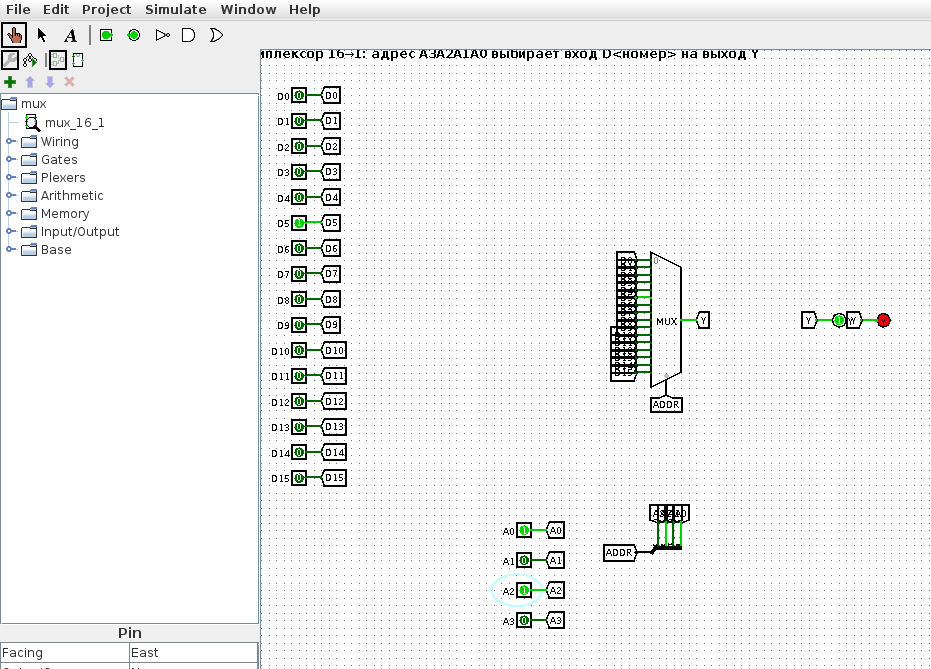
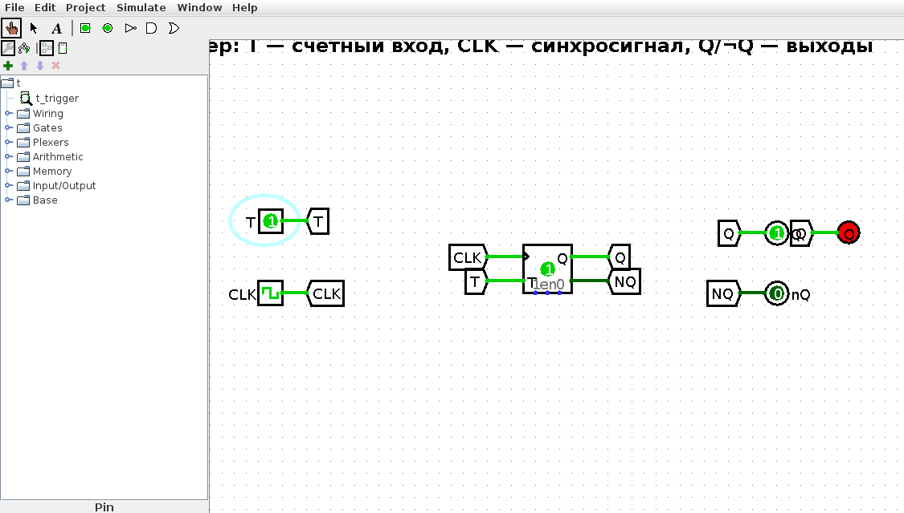
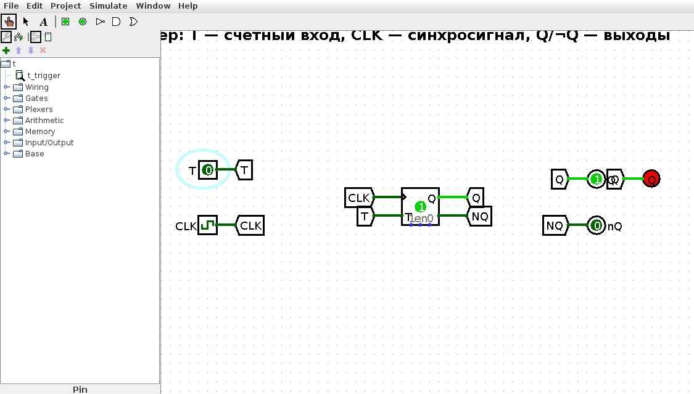
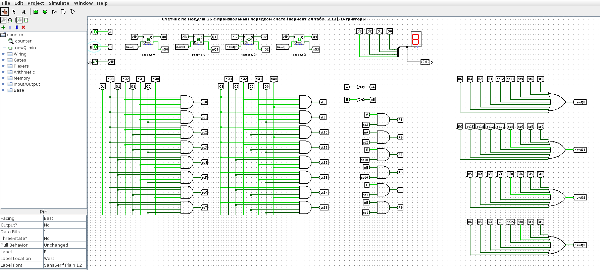
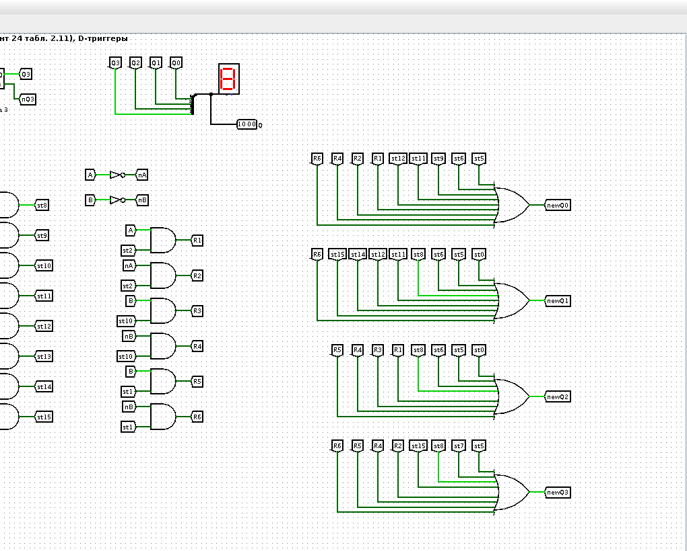
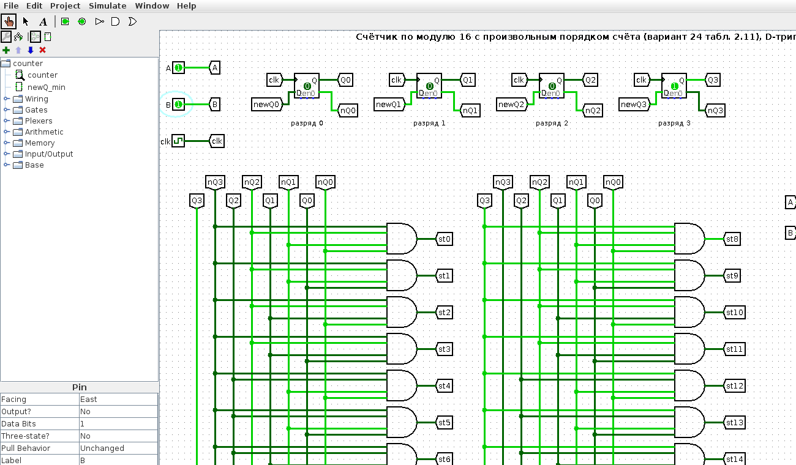
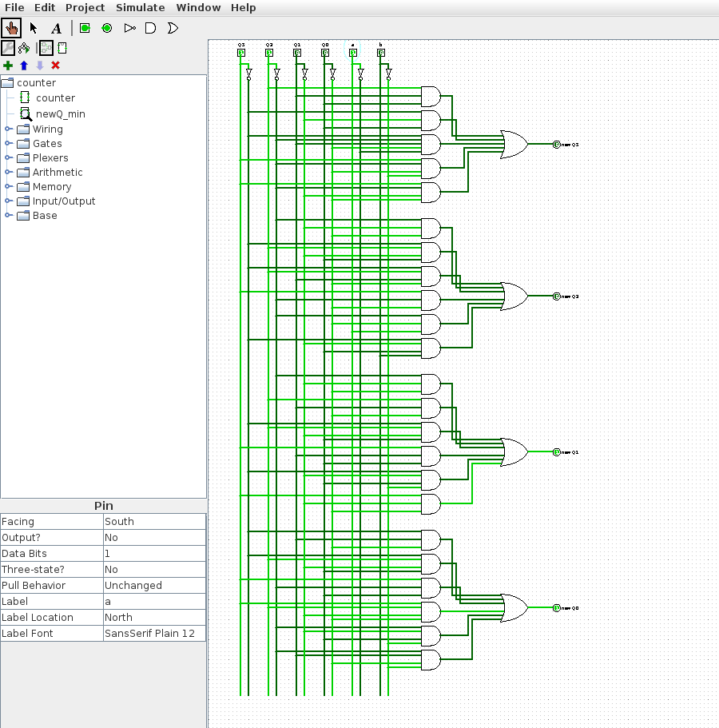
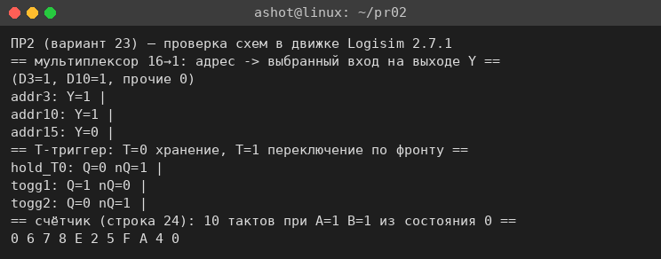
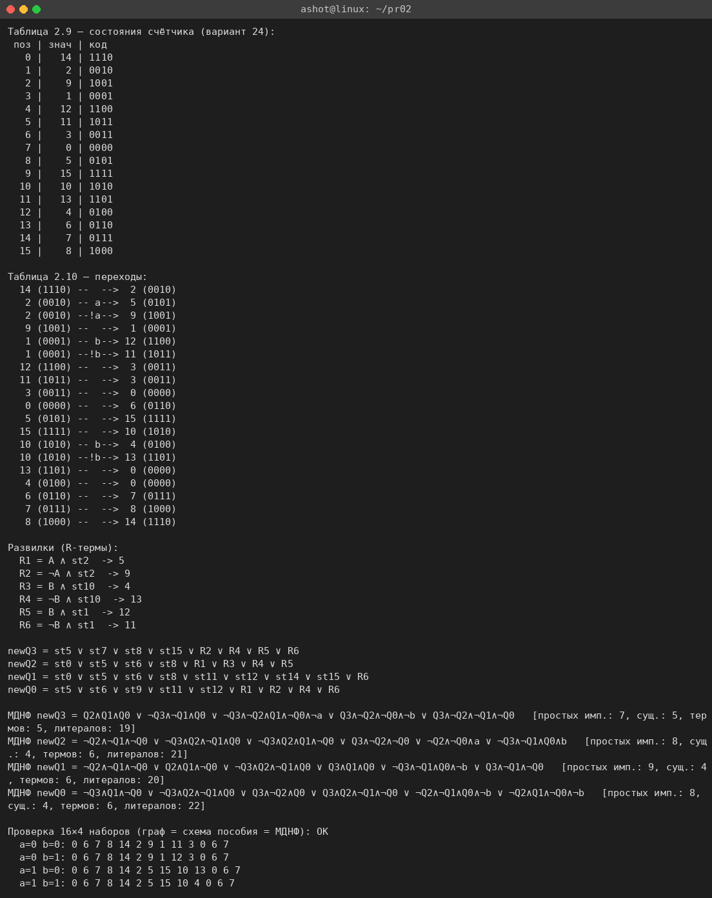

<!-- num: 2; title: Комбинационные схемы, элементы памяти, счётчики -->

# ЦЕЛЬ РАБОТЫ

Изучить устройство и работу комбинационных схем (на примере мультиплексора) и элементов памяти (на примере T-триггера), научиться синтезировать счётчик с произвольным порядком счёта по графу переходов: составлять таблицы состояний и переходов, получать функции возбуждения триггеров newQ и реализовывать счётчик на D-триггерах в среде Logisim.

# ЗАДАНИЕ

Вариант 23.

1. Разобрать мультиплексор с 4 адресными входными сигналами и T-триггер, составить таблицы истинности.
2. Реализовать счётчик согласно варианту 24 табл. 2.11 (последовательность состояний 14 2 9 1 12 11 3 0 5 15 10 13 4 6 7 8, подставляемая в шаблон графа рис. 2.14).

Все схемы собраны в Logisim 2.7.1 (файлы в каталоге `src/logisim`).

# ХОД РАБОТЫ

## 1 Мультиплексор с 4 адресными входами (16→1)

Мультиплексор — комбинационная схема, которая по n-разрядному адресному коду подключает к единственному выходу один из 2ⁿ информационных входов. Мультиплексор «с 4 адресными сигналами» имеет 4 адресных входа A3 A2 A1 A0, 16 информационных входов D0…D15 и один выход Y. На выход передаётся тот вход, номер которого равен поданному адресу: Y = D_(A3A2A1A0).

Логически выход есть дизъюнкция всех входов, разрешённых своим адресом: Y = Σ (Dk · mk), где mk — минтерм адреса (k = 0…15), например m5 = ¬A3·A2·¬A1·A0. Таблица истинности по адресу (какой вход попадает на выход) приведена в табл. 1.

Таблица 1 – Таблица истинности мультиплексора 16→1 (выбор входа по адресу)

| A3 | A2 | A1 | A0 | Выход Y |
|---|---|---|---|---|
| 0 | 0 | 0 | 0 | Y = D0 |
| 0 | 0 | 0 | 1 | Y = D1 |
| 0 | 0 | 1 | 0 | Y = D2 |
| … | … | … | … | … |
| 0 | 1 | 0 | 1 | Y = D5 |
| … | … | … | … | … |
| 1 | 0 | 1 | 0 | Y = D10 |
| … | … | … | … | … |
| 1 | 1 | 1 | 1 | Y = D15 |

Полная таблица на 16 строк приведена в файле `pr02/Практика_2_вариант_23.xlsx` (лист «Мультиплексор 16-1»). Схема (`mux.circ`, подсхема `mux_16_1`) собрана на компоненте Multiplexer библиотеки Plexers (select = 4): четыре отдельных адресных сигнала A0…A3 объединяются разветвителем в 4-разрядную шину адреса, которая подаётся на вход выбора. На рис. 1 на вход D5 подана 1, остальные входы — 0, адрес A3A2A1A0 = 0101 = 5 — на выходе Y горит светодиод (Y = D5 = 1).

## 2 T-триггер

T-триггер (счётный триггер) — синхронный элемент памяти с одним информационным входом T. По фронту синхросигнала C он либо сохраняет состояние (при T = 0), либо переключается в противоположное (при T = 1). Благодаря режиму переключения T-триггер — базовый элемент двоичных счётчиков (каждый разряд делит частоту вдвое). Характеристическая таблица приведена в табл. 2.

Таблица 2 – Характеристическая таблица T-триггера

| T | Q(n) | Q(n+1) | Режим |
|---|---|---|---|
| 0 | 0 | 0 | хранение |
| 0 | 1 | 1 | хранение |
| 1 | 0 | 1 | переключение |
| 1 | 1 | 0 | переключение |

Характеристическое уравнение T-триггера: Q(n+1) = T ⊕ Q = T·¬Q ∨ ¬T·Q. Обратная задача (каким должен быть T для заданного перехода Q(n)→Q(n+1)) описывается таблицей возбуждения (табл. 3): T = Q(n) ⊕ Q(n+1).

Таблица 3 – Таблица возбуждения T-триггера

| Q(n) | Q(n+1) | T |
|---|---|---|
| 0 | 0 | 0 |
| 0 | 1 | 1 |
| 1 | 0 | 1 |
| 1 | 1 | 0 |

Схема (`t.circ`, подсхема `t_trigger`) собрана на компоненте T Flip-Flop библиотеки Memory с входом T и синхрогенератором. На рис. 2 показан режим переключения T = 1 после фронта синхросигнала — выход Q перешёл в 1 (светодиод горит); на рис. 3 — режим хранения T = 0: после фронта Q сохранил прежнее значение 1. Все режимы проверены в движке Logisim (см. п. 4).

## 3 Счётчик с произвольным порядком счёта (вариант 24)

Счётчик строится по шаблонному графу переходов рис. 2.14: в его 16 позиций подставляются значения из строки 24 табл. 2.11. Последовательность счёта (значения по позициям 0…15): 14, 2, 9, 1, 12, 11, 3, 0, 5, 15, 10, 13, 4, 6, 7, 8, после чего цикл замыкается (из 8 обратно в 14). В трёх позициях граф разветвляется по внешним входам A и B: позиция со значением 2 — по A, позиция со значением 1 — по B, позиция со значением 10 — по B. Таблица состояний и таблица переходов построены скриптом `src/counter_model.py` (рис. 9) и приведены в файле `pr02/Практика_2_вариант_23.xlsx` (лист «Счётчик»).

Таблица 4 – Переходы в точках ветвления (развилки R1…R6)

| Разветвление | Условие | Из состояния | В состояние |
|---|---|---|---|
| R1 | A | 2 | 5 |
| R2 | ¬A | 2 | 9 |
| R3 | B | 10 | 4 |
| R4 | ¬B | 10 | 13 |
| R5 | B | 1 | 12 |
| R6 | ¬B | 1 | 11 |

Счётчик реализован на четырёх D-триггерах (по методу пособия для готового счётчика варианта 1). Функция возбуждения каждого D-триггера newQ<i> — это логическая сумма сигналов тех состояний, из которых счётчик переходит в состояние с единицей в i-м разряде, плюс соответствующие развилочные термы R:

$$ newQ3 = st5 ∨ st7 ∨ st8 ∨ st15 ∨ R2 ∨ R4 ∨ R5 ∨ R6 $$
$$ newQ2 = st0 ∨ st5 ∨ st6 ∨ st8 ∨ R1 ∨ R3 ∨ R4 ∨ R5 $$
$$ newQ1 = st0 ∨ st5 ∨ st6 ∨ st8 ∨ st11 ∨ st12 ∨ st14 ∨ st15 ∨ R6 $$
$$ newQ0 = st5 ∨ st6 ∨ st9 ∨ st11 ∨ st12 ∨ R1 ∨ R2 ∨ R4 ∨ R6 $$

где st<s> — сигнал текущего состояния s, снимаемый с дешифратора состояний (16 элементов И по разрядам Q3 Q2 Q1 Q0), а R<k> — развилочные термы из табл. 4 (например, R1 = A ∧ st2). Схема содержит входы A и B, тактовый генератор, четыре D-триггера, дешифратор состояний st0…st15, формирователи развилок R1…R6 и четыре элемента ИЛИ, собирающие newQ0…newQ3 (рис. 4–6). Текущее состояние выводится на шестнадцатеричный индикатор.

Параллельно те же функции возбуждения минимизированы методом Квайна–МакКласки от шести переменных Q3 Q2 Q1 Q0 a b (скрипт `counter_model.py`) и собраны в проверочную подсхему `newQ_min` (рис. 7). Минимальные формы:

- newQ3 = Q2Q1Q0 ∨ ¬Q3¬Q1Q0 ∨ ¬Q3¬Q2Q1¬Q0¬a ∨ Q3¬Q2¬Q0¬b ∨ Q3¬Q2¬Q1¬Q0;
- newQ2 = ¬Q2¬Q1¬Q0 ∨ ¬Q3Q2¬Q1Q0 ∨ ¬Q3Q2Q1¬Q0 ∨ Q3¬Q2¬Q0 ∨ ¬Q2¬Q0a ∨ ¬Q3¬Q1Q0b;
- newQ1 = ¬Q2¬Q1¬Q0 ∨ Q2Q1¬Q0 ∨ ¬Q3Q2¬Q1Q0 ∨ Q3Q1Q0 ∨ ¬Q3¬Q1Q0¬b ∨ Q3¬Q1¬Q0;
- newQ0 = ¬Q3Q1¬Q0 ∨ ¬Q3Q2¬Q1Q0 ∨ Q3¬Q2Q0 ∨ Q3Q2¬Q1¬Q0 ∨ ¬Q2¬Q1Q0¬b ∨ ¬Q2Q1¬Q0¬b.

## 4 Проверка

Схемы проверены в движке Logisim 2.7.1 (`logitool.js` / `lsim.js`). Для мультиплексора при любом адресе на выход попадает ровно выбранный вход; для T-триггера подтверждены оба режима (хранение при T = 0 и переключение при T = 1); для счётчика прогон из состояния 0 при постоянных A и B даёт ту же последовательность, что и модель `counter_model.py` (рис. 8). Проверочная подсхема newQ_min на всех 64 наборах (Q3 Q2 Q1 Q0 a b) совпала с графом переходов.

# ВЫВОДЫ

В работе разобраны мультиплексор с 4 адресными входными сигналами (16→1), для которого составлена таблица истинности и собрана схема в Logisim (адрес подключает к выходу один из 16 входов), и T-триггер, для которого выписаны характеристическая таблица и таблица возбуждения и показаны оба режима работы (хранение и переключение).

По строке 24 табл. 2.11 синтезирован счётчик с произвольным порядком счёта: построены таблицы состояний и переходов, получены функции возбуждения newQ0…newQ3 в форме пособия, выполнена их минимизация методом Квайна–МакКласки. Счётчик собран на D-триггерах в Logisim; моделирование подтвердило, что он проходит заданную последовательность состояний, а развилки по входам A и B работают согласно графу переходов.
