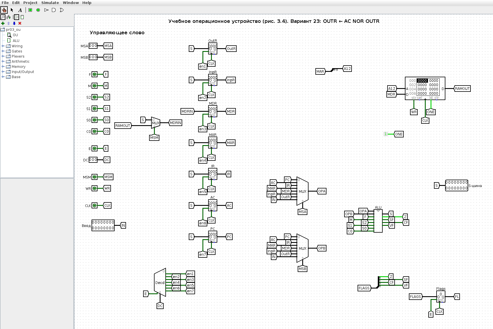
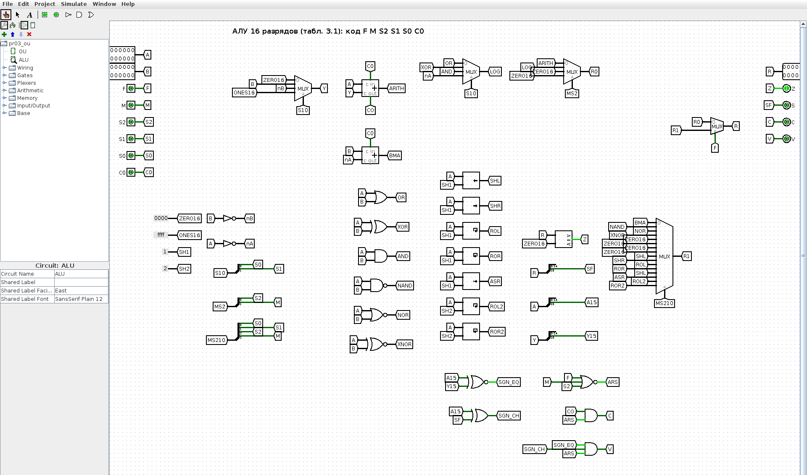
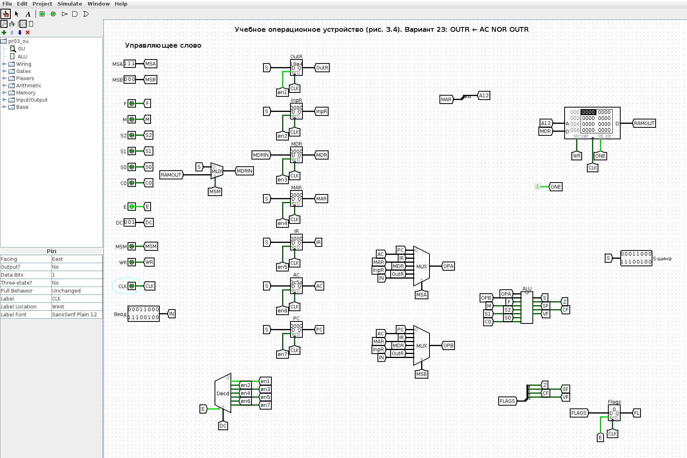
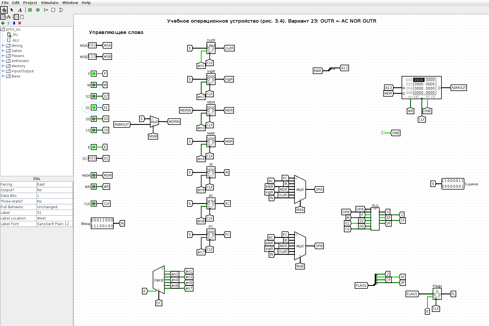
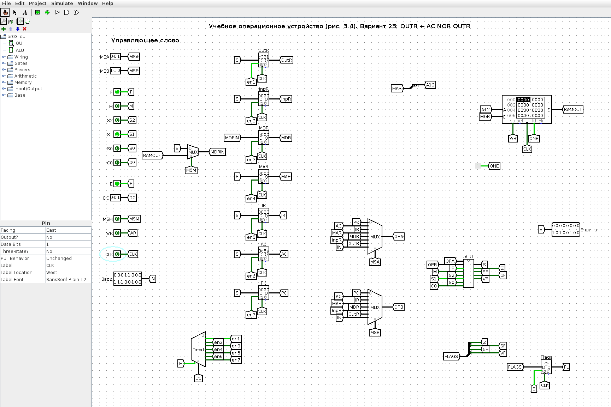
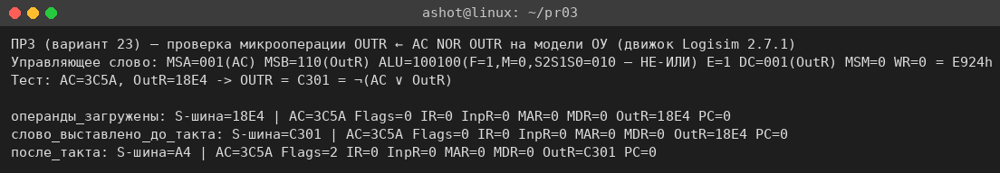

<!-- num: 3; title: Операционное устройство ЦП -->

# ЦЕЛЬ РАБОТЫ

Изучить устройство учебного операционного устройства (ОУ) центрального процессора: назначение регистров PC, IR, AC, MAR, MDR, InpR, OutR, работу арифметико-логического устройства и системы флагов, управление потоками данных с помощью мультиплексоров и дешифратора. Научиться записывать 18-разрядное управляющее слово ОУ для заданной микрооперации и проверить его на модели ОУ в Logisim.

# ЗАДАНИЕ

Вариант 23. Записать управляющее слово учебного ОУ (табл. 3.2) для микрооперации

$$ OUTR ← AC NOR OUTR $$

и продемонстрировать её выполнение.

# ХОД РАБОТЫ

## 1 Смысл микрооперации

Микрооперация OUTR ← AC NOR OUTR означает: содержимое аккумулятора AC и регистра вывода OutR подаётся на входы АЛУ, над ними поразрядно выполняется операция «ИЛИ-НЕ» (NOR, A ⊽ B = ¬(A ∨ B)), результат по S-шине записывается обратно в регистр вывода OutR. Значение AC при этом не меняется; OutR одновременно является и операндом, и приёмником — он читается на вход MS B, а новое значение фиксируется в нём по фронту синхросигнала (чтение и запись регистра разнесены во времени, гонки нет). Обращения к памяти нет. Для формирования управляющего слова нужно определить пять полей (табл. 3.2): MS(A), MS(B), ALU, DC, MS(M) и WR.

## 2 Коды источников и приёмников

По схеме учебного ОУ (рис. 3.4 пособия) выходы регистров подключены к информационным входам мультиплексоров MS A и MS B, а выходы дешифратора DC — к входам разрешения записи регистров. Коды, снятые со схемы, сведены в табл. 1.

Таблица 1 – Коды входов мультиплексоров MS A / MS B и выходов дешифратора DC (рис. 3.4)

| Код | Вход MS A / MS B | Выход DC (запись в регистр) |
|---|---|---|
| 000 | PC | — (не используется) |
| 001 | AC | OutR |
| 010 | IR | InpR |
| 011 | MAR | MDR |
| 100 | MDR | MAR |
| 101 | InpR | IR |
| 110 | OutR | AC |
| 111 | Ввод | PC |

Для варианта 23: операнд A — AC, MS(A) = 001; операнд B — OutR, MS(B) = 110; приёмник — OutR, DC: E = 1, x2 x1 x0 = 001.

## 3 Код операции АЛУ

Поле ALU состоит из битов F M S2 S1 S0 C (табл. 3.1). Бит F выбирает группу операций: при F = 0 — арифметика и стандартные логические операции (∨, ⊕, ∧, ¬A), при F = 1 — расширенные логические и сдвиговые операции. Операция «ИЛИ-НЕ» (NOR) относится к расширенной логической группе, поэтому F = 1. Внутри этой группы при M = 0 код S2 S1 S0 задаёт логическую операцию; соответствующие коды, реализованные в модели ОУ по табл. 3.1, приведены в табл. 2.

Таблица 2 – Коды расширенных логических микроопераций АЛУ (группа F = 1, M = 0; табл. 3.1)

| F M S2 S1 S0 C | Микрооперация | Наименование |
|---|---|---|
| 1 0 0 0 0 x | B − A | Разность B − A |
| 1 0 0 0 1 x | A ⊼ B | Логическое НЕ-И (NAND) |
| **1 0 0 1 0 x** | **A ⊽ B** | **Логическое НЕ-ИЛИ (NOR)** |
| 1 0 0 1 1 x | A ⊙ B | Исключающее ИЛИ-НЕ (XNOR) |

Для операции «ИЛИ-НЕ»: ALU = 1 0 0 1 0 x. Бит входного переноса C на логические операции не влияет; в записи слова принимаем C = 0.

## 4 Поля MS(M) и WR

Мультиплексор MS(M) выбирает лишь то, что записывается в MDR (0 — результат АЛУ с S-шины, 1 — данные из ОЗУ), и на запись в OutR не влияет; в записи слова принимаем MS(M) = 0. Запись в память не выполняется: WR = 0.

## 5 Управляющее слово

Таблица 3 – Машинное слово ОУ для микрооперации OUTR ← AC NOR OUTR. Верхняя строка шапки показывает, к какому полю относится каждый столбец: MS A — a2 a1 a0; MS B — a2 a1 a0; ALU — F M S2 S1 S0 C; DC — E x2 x1 x0; MS M — a0; WR — wr.

| MS A | < | < | MS B | < | < | ALU | < | < | < | < | < | DC | < | < | < | MS M | WR |
|---|---|---|---|---|---|---|---|---|---|---|---|---|---|---|---|---|---|
| a2 | a1 | a0 | a2 | a1 | a0 | F | M | S2 | S1 | S0 | C | E | x2 | x1 | x0 | a0 | wr |
| 0 | 0 | 1 | 1 | 1 | 0 | 1 | 0 | 0 | 1 | 0 | 0 | 1 | 0 | 0 | 1 | 0 | 0 |

Итоговое слово: 001 | 110 | 100100 | 1001 | 0 | 0, то есть 001110100100100100₂ = E924₁₆. Таблица также приведена в файле `pr03/Практика_3_вариант_23.xlsx`.

## 6 Проверка на модели ОУ в Logisim

Для проверки по схеме рис. 3.4 используется 16-разрядная модель учебного ОУ в Logisim (`pr03/src/logisim/pr03_ou.circ`, схема генерируется скриптом `gen_pr03.py`). Модель содержит:

- регистры OutR, InpR, MDR, MAR, IR, AC, PC (запись по фронту CLK при разрешении от DC);
- мультиплексоры MS A и MS B (8 входов, коды по табл. 1, вход 7 — внешний «Ввод»);
- подсхему ALU — полное 16-разрядное АЛУ по табл. 3.1 (сумматор по схеме Мано A + Y + C, логический блок с элементами ИЛИ, Исключающее ИЛИ, И, НЕ-И, НЕ-ИЛИ, искл. ИЛИ-НЕ, сдвигатели, мультиплексоры выбора результата, флаги Z, S, C, V);
- дешифратор DC с входом разрешения E, мультиплексор MS M, ОЗУ 4K × 16 с адресом из MAR и регистр флагов.

Поля управляющего слова задаются входными пинами слева, в том же порядке, что и в табл. 3. Общий вид модели в начальном состоянии показан на рис. 1, подсхема АЛУ — на рис. 2.

Чтобы микрооперации было над чем работать, сначала в AC и OutR заносятся произвольные значения через вход «Ввод» (две вспомогательные микрооперации AC ← Ввод и OutR ← Ввод: MS(A) = 111, ALU = 000000 «передача A», DC = 1110 и 1001). В AC записано 3C5A₁₆, в OutR — 18E4₁₆ (рис. 3).

Затем на пины выставляется управляющее слово варианта: MSA = 001, MSB = 110, F M S2 S1 S0 C = 100100, E = 1, DC = 001, MSM = 0, WR = 0. До тактового фронта результат уже присутствует на S-шине (C301₁₆), дешифратор открывает только выход записи в OutR (рис. 4).

После фронта CLK (0 → 1 → 0) в OutR записывается C301₁₆, остальные регистры не изменились (рис. 5).

Проверка вручную приведена в табл. 4.

Таблица 4 – Проверка результата

| Величина | HEX | Двоичный код |
|---|---|---|
| AC | 3C5A | 0011 1100 0101 1010 |
| OutR (старое) | 18E4 | 0001 1000 1110 0100 |
| AC ∨ OutR | 3CFE | 0011 1100 1111 1110 |
| ¬(AC ∨ OutR) → OutR | C301 | 1100 0011 0000 0001 |

Та же последовательность была прогнана в движке Logisim из командной строки (скрипт `tools/logisim/lsim.js`), результаты совпадают с GUI (рис. 6).

## 7 Как показать преподавателю

1. Открыть `pr03/src/logisim/pr03_ou.circ`, схема OU, инструмент «Палец» (Poke).
2. Ввод = 3C5A, MSA = 111, E = 1, DC = 110, щёлкнуть CLK дважды (0 → 1 → 0) — AC = 3C5A. Ввод = 18E4, DC = 001, ещё такт — OutR = 18E4.
3. Выставить слово варианта: MSA = 001, MSB = 110, F = 1, S1 = 1 (остальные биты АЛУ 0), DC = 001, MSM = 0, WR = 0 — на S-шине C301.
4. Такт CLK — в OutR записывается C301, AC не меняется.

# ВЫВОДЫ

В ходе работы изучено учебное операционное устройство ЦП: регистры, мультиплексоры выбора операндов, дешифратор выбора приёмника, АЛУ с флагами. Для микрооперации OUTR ← AC NOR OUTR составлено управляющее слово 001 | 110 | 100100 | 1001 | 0 | 0 (E924₁₆): операнд A — AC (001), операнд B — OutR (110), операция АЛУ «ИЛИ-НЕ» (F = 1, M = 0, S2 S1 S0 = 010, C = 0), запись в OutR (E = 1, 001), источник для MDR не используется (MS(M) = 0), запись в память отсутствует (WR = 0).

Слово проверено на 16-разрядной модели ОУ в Logisim, построенной по рис. 3.4: при AC = 3C5A и OutR = 18E4 после такта в OutR получено C301 = ¬(AC ∨ OutR), что совпадает с ручным расчётом. Модель показывает главное свойство микропрограммного управления: одно и то же «железо» выполняет разные микрооперации только за счёт разных управляющих слов.
