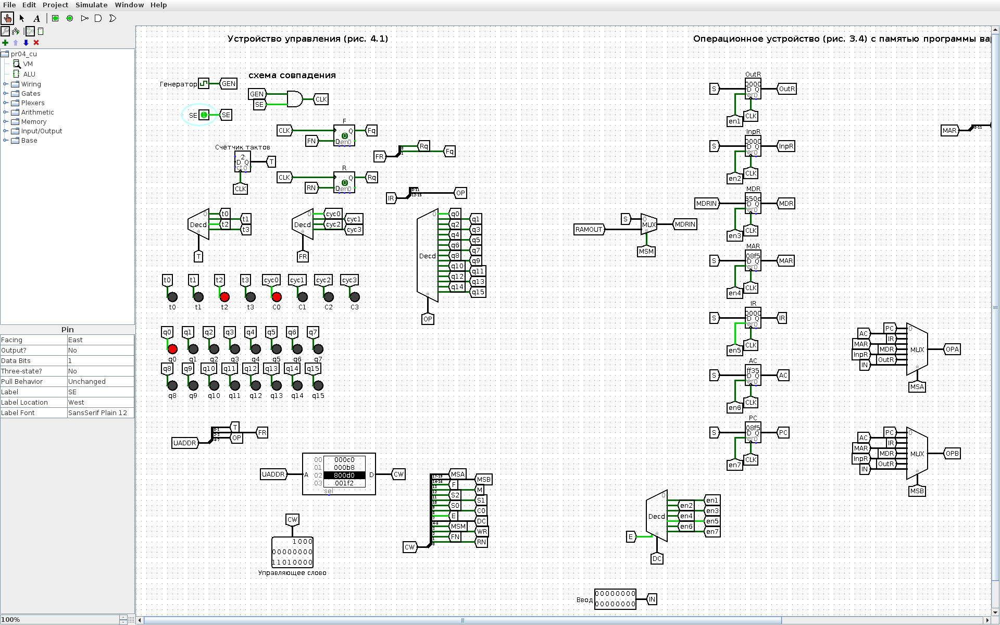
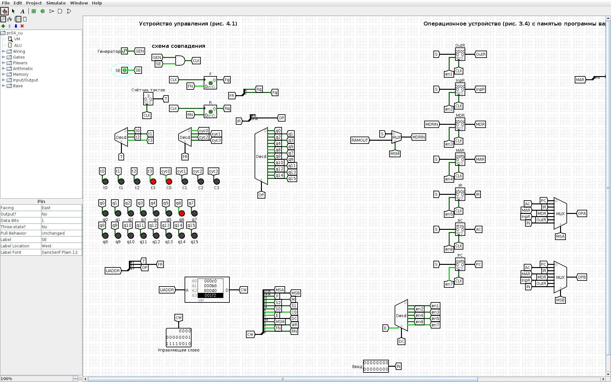
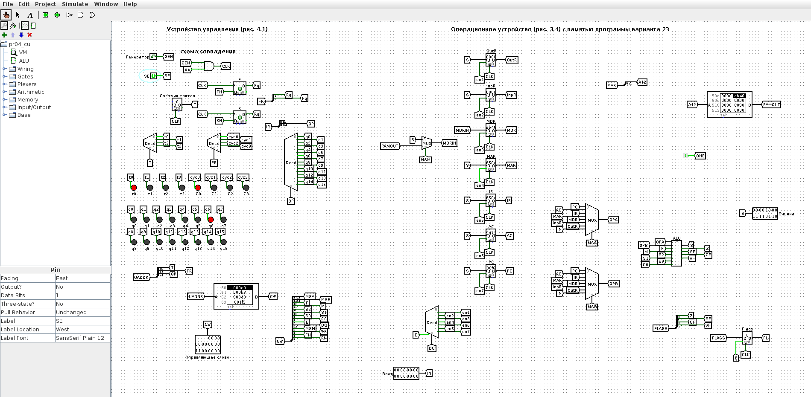

<!-- num: 4; title: Устройство управления ЦП учебного ОУ -->

# ЦЕЛЬ РАБОТЫ

Изучить микропрограммное устройство управления (УУ) учебной вычислительной машины: формирование управляющих слов, циклы выборки, дешифрации, выполнения и завершения, роль счётчика тактов и триггеров циклов F, R. Записать микропрограмму выполнения команды по персональному варианту, заполнить таблицы «Управляющее слово» (табл. 4.9) и «Состояние регистров» (табл. 4.10) и проверить их на модели ВМ в Logisim.

# ЗАДАНИЕ

Вариант 23. Записать микрооперации цикла выборки и выполнения команды XOR. По адресу 8F5 записана команда XOR с адресом 50D. По этому адресу записан операнд AB46. В регистре-аккумуляторе — операнд FF35. Определить информацию, которая будет записана в регистрах PC, MAR, MDR, IR, AC после выполнения этой команды. Показать процесс выполнения команды.

# ХОД РАБОТЫ

## 1 Исходные данные и формат команды

Команда XOR (q6 в табл. 4.1) — побитовое исключающее ИЛИ аккумулятора и содержимого памяти: AC ← AC ⊕ M[AD]. Она берёт один операнд из аккумулятора, второй — из памяти по адресу AD, выполняет поразрядное сложение по модулю 2 и записывает результат обратно в AC. Код операции q6 = 0110₂ = 6₁₆, поэтому машинное слово команды по адресу 8F5 — 650D₁₆ (4 бита КОП + 12 бит адреса: 0110 · 50D). По адресу операнда 50D записано число AB46.

Исходное состояние: PC = 8F5, AC = FF35; значения MAR, IR, MDR, INPR, OUTR не заданы. В отличие от унарных команд, XOR использует оба операнда — и аккумулятор (FF35), и ячейку памяти (AB46).

## 2 Коды полей управляющего слова

Управляющее слово УУ состоит из полей MS(A), MS(B), ALU, DC, MS(M), WR и FR. Коды входов мультиплексоров и выходов дешифратора берутся по схеме ОУ (рис. 3.4) так же, как в табл. 4.7 пособия: MS(A)/MS(B): PC = 000, AC = 001, IR = 010, MDR = 100; DC (E x2 x1 x0): MDR = 1011, MAR = 1100, IR = 1101, AC = 1110, PC = 1111, запрет записи — 0xxx. Коды АЛУ (F M S2 S1 S0 C, табл. 3.1): передача A — 000000, инкремент A — 000001, исключающее ИЛИ A ⊕ B — 001010. Поле MS(M) = 1 подаёт в MDR данные из памяти. FR — значения триггеров циклов F, R для следующего такта (табл. 4.2): 00 — C0 (выборка), 10 — C2 (выполнение).

Поскольку в учебной ВМ используется прямая адресация, цикл дешифрации C1 пропускается: на такте C0t3 устанавливается F, R ← 1, 0 и управление сразу переходит к циклу выполнения C2 (п. 4.3 пособия). Шаблоны табл. 4.9 и 4.10 содержат именно циклы C0 и C2.

## 3 Микропрограмма команды XOR

Цикл выборки (одинаков для всех команд, табл. 4.3): C0t0 — MAR ← PC; C0t1 — MDR ← M[MAR]; C0t2 — IR ← MDR; C0t3 — PC ← PC + 1, F, R ← 1, 0. Цикл выполнения XOR: C2t0 — MAR ← IR (в MAR переносится адресная часть команды); C2t1 — MDR ← M[AD] (чтение второго операнда); C2t2 — AC ← AC ⊕ MDR (исключающее ИЛИ); C2t3 — NOP, F, R ← 0, 0 (возврат к выборке следующей команды).

Таблица 1 – Управляющее слово (табл. 4.9) для команды XOR

| К,Ц,Т | Микрокоманда | MS(A) | MS(B) | АЛУ | DC | MS(M) | WR | FR |
|---|---|---|---|---|---|---|---|---|
| q6C0t0 | MAR ← PC | 000 | xxx | 000000 | 1100 | x | 0 | 00 |
| q6C0t1 | MDR ← M[MAR] | xxx | xxx | xxxxxx | 1011 | 1 | 0 | 00 |
| q6C0t2 | IR ← MDR | 100 | xxx | 000000 | 1101 | x | 0 | 00 |
| q6C0t3 | PC ← PC + 1; F,R ← 1,0 | 000 | xxx | 000001 | 1111 | x | 0 | 10 |
| q6C2t0 | MAR ← IR (адрес AD = 50D) | 010 | xxx | 000000 | 1100 | x | 0 | 10 |
| q6C2t1 | MDR ← M[AD] | xxx | xxx | xxxxxx | 1011 | 1 | 0 | 10 |
| q6C2t2 | AC ← AC ⊕ MDR | 001 | 100 | 001010 | 1110 | x | 0 | 10 |
| q6C2t3 | NOP; F,R ← 0,0 | xxx | xxx | xxxxxx | 0xxx | x | 0 | 00 |

Каждая строка таблицы 4.10 показывает состояние регистров после выполнения соответствующей микрокоманды; если регистр на такте не записывается, его значение повторяется, «—» означает, что значение не задано. В модели регистр MAR 16-разрядный, поэтому на такте C2t0 в него копируется всё слово команды 650D; к памяти обращение идёт по младшим 12 битам, то есть по адресу AD = 50D.

Таблица 2 – Состояние регистров (табл. 4.10) при выполнении XOR

| К,Ц,Т | Микрокоманда | PC | MAR | IR | MDR | AC | INPR | OUTR |
|---|---|---|---|---|---|---|---|---|
| Исходное состояние | — | 8F5 | — | — | — | FF35 | — | — |
| q6C0t0 | MAR ← PC | 8F5 | 8F5 | — | — | FF35 | — | — |
| q6C0t1 | MDR ← M[MAR] | 8F5 | 8F5 | — | 650D | FF35 | — | — |
| q6C0t2 | IR ← MDR | 8F5 | 8F5 | 650D | 650D | FF35 | — | — |
| q6C0t3 | PC ← PC + 1; F,R ← 1,0 | 8F6 | 8F5 | 650D | 650D | FF35 | — | — |
| q6C2t0 | MAR ← IR | 8F6 | 650D | 650D | 650D | FF35 | — | — |
| q6C2t1 | MDR ← M[AD] | 8F6 | 650D | 650D | AB46 | FF35 | — | — |
| q6C2t2 | AC ← AC ⊕ MDR | 8F6 | 650D | 650D | AB46 | 5473 | — | — |
| q6C2t3 | NOP; F,R ← 0,0 | 8F6 | 650D | 650D | AB46 | 5473 | — | — |

Вычисление в АЛУ: AC ⊕ M[50D] = FF35₁₆ ⊕ AB46₁₆. Поразрядно: 1111 1111 0011 0101 ⊕ 1010 1011 0100 0110 = 0101 0100 0111 0011 = 5473₁₆.

Ответ: после выполнения команды PC = 8F6, MAR = 650D (младшие 12 бит — адрес операнда 50D), IR = 650D, MDR = AB46, AC = 5473; INPR и OUTR не изменились.

## 4 Модель ВМ в Logisim

Для демонстрации собрана модель учебной ВМ (`pr04/src/logisim/pr04_cu.circ`, генерируется скриптом `gen_pr04.py`): устройство управления по рис. 4.1 подключено к модели ОУ из практической работы 3. УУ содержит:

- генератор тактовых импульсов и схему совпадения с сигналом SE (при SE = 0 импульсы не проходят и ВМ стоит);
- двухразрядный счётчик тактов t и дешифратор тактов t0–t3;
- триггеры циклов F и R с дешифратором циклов C0–C3;
- дешифратор команд по старшим четырём разрядам IR (q0–q15);
- ПЗУ микрокоманд 256 × 20: адрес = КОП (4 бита) · F R (2 бита) · t (2 бита), слово = MS(A) MS(B) АЛУ DC MS(M) WR FR — ровно поля табл. 4.9; выходы ПЗУ разводятся на управляющие входы ОУ, а поле FR подаётся на D-входы триггеров F и R.

В ПЗУ записан цикл выборки для всех кодов операций и циклы выполнения команд табл. 4.1 (для варианта важна q6 — XOR). Память команд и данных ОУ в модели — ПЗУ с программой варианта: 8F5: 650D (XOR 50D), 8F6: B8F6 (JMP 8F6 — «останов» на месте), 50D: AB46.

Перед запуском в регистры PC и AC инструментом Poke введены исходные значения 8F5 и FF35, затем SE = 1 (рис. 1). Каждый такт ВМ — полный период генератора (два нажатия Ctrl+T).


![Рисунок 2 – После C0t0: MAR = 8F5; на ПЗУ слово C0t1 (MDR ← M[MAR])](img/logisim_vm_C0t0.png)






Значения регистров на всех рисунках совпадают с табл. 2. Общий вид модели (УУ слева, ОУ справа) — на рис. 9.



Та же последовательность тактов была прогнана в движке Logisim из командной строки; протокол приведён в листинге 1.

Листинг 1 – Протокол моделирования (lsim.js, по одному такту ВМ на строку)

```
исх:  Управляющее слово=C0     | AC=FF35 IR=0    MAR=0   MDR=0    PC=8F5
C0t0: Управляющее слово=B8     | AC=FF35 IR=0    MAR=8F5 MDR=0    PC=8F5
C0t1: Управляющее слово=800D0  | AC=FF35 IR=0    MAR=8F5 MDR=650D PC=8F5
C0t2: Управляющее слово=1F2    | AC=FF35 IR=650D MAR=8F5 MDR=650D PC=8F5
C0t3: Управляющее слово=400C2  | AC=FF35 IR=650D MAR=8F5 MDR=650D PC=8F6
C2t0: Управляющее слово=BA     | AC=FF35 IR=650D MAR=650D MDR=650D PC=8F6
C2t1: Управляющее слово=30AE2  | AC=FF35 IR=650D MAR=650D MDR=AB46 PC=8F6
C2t2: Управляющее слово=0      | AC=5473 IR=650D MAR=650D MDR=AB46 PC=8F6
C2t3: Управляющее слово=C0     | AC=5473 IR=650D MAR=650D MDR=AB46 PC=8F6
```

В каждой строке показано слово, которое ПЗУ выдаёт на следующий такт (например, 30AE2 = 001 100 001010 1110 0 0 10 — слово C2t2 «AC ← AC ⊕ MDR»).

## 5 Как показать преподавателю

1. Открыть `pr04/Практика_4_вариант_23.xlsx` — табл. 4.9 и 4.10.
2. Открыть `pr04/src/logisim/pr04_cu.circ`, схема VM. Инструментом Poke щёлкнуть по регистру PC и набрать 8F5, по регистру AC — FF35. Установить SE = 1.
3. Нажимать Ctrl+T по два раза (один такт) и сверять регистры со строками табл. 4.10; на выходе ПЗУ видно управляющее слово очередной строки табл. 4.9, на индикаторах — текущие t и C, после C0t2 загорается q6.

# ВЫВОДЫ

Изучена работа микропрограммного устройства управления учебной ВМ: УУ по счётчику тактов, триггерам циклов F, R и коду операции из IR выбирает из ПЗУ управляющее слово, которое задаёт мультиплексоры, АЛУ, дешифратор записи и обращение к памяти. Составлены микропрограмма и управляющие слова (табл. 4.9) для команды XOR, заполнена таблица состояний регистров (табл. 4.10).

После выполнения команды XOR, записанной по адресу 8F5, регистры содержат: PC = 8F6 (адрес следующей команды), MAR = 650D и IR = 650D (слово команды: КОП 6 = q6, адрес 50D), MDR = AB46 (второй операнд из ячейки 50D), AC = 5473 (результат FF35 ⊕ AB46). Результат подтверждён пошаговым выполнением на модели ВМ (УУ + ОУ) в Logisim.
