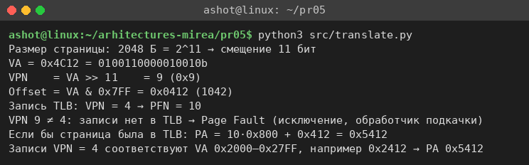
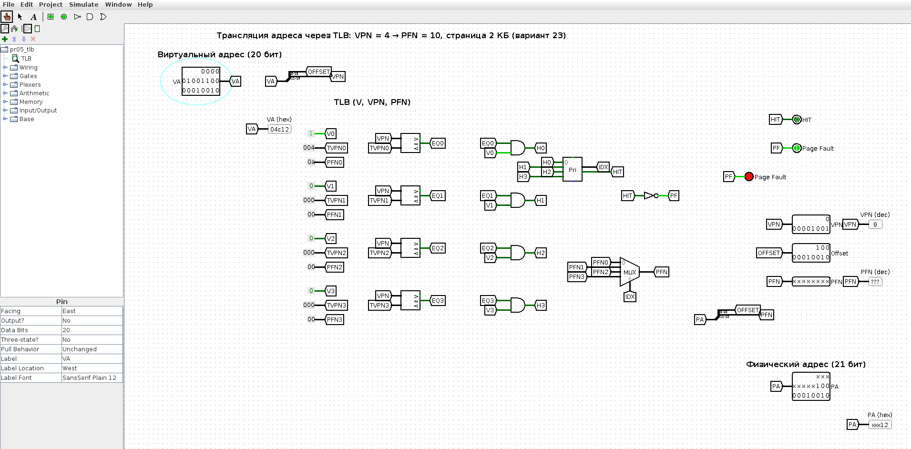
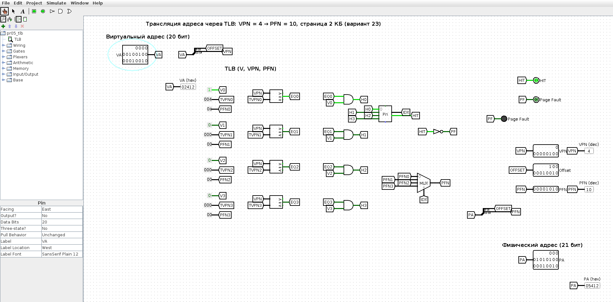

<!-- num: 5; title: ОЗУ. Виртуальная и физическая память -->

# ЦЕЛЬ РАБОТЫ

Изучить устройство оперативной памяти и взаимосвязь программной и аппаратной частей её работы: страничную организацию виртуальной памяти, структуру виртуального адреса (номер страницы и смещение), роль буфера ассоциативной трансляции TLB и ситуацию отсутствия страницы (Page Fault). Научиться вычислять физический адрес по виртуальному и проверить расчёт на аппаратной модели трансляции в Logisim.

# ЗАДАНИЕ

Вариант 23. VPN = 4 → PFN = 10, размер страницы 2 КБ, виртуальный адрес 0x4C12. Вычислить физический адрес и указать, возможна ли такая трансляция или произойдёт Page Fault и будет вызвано прерывание.

# ХОД РАБОТЫ

## 1 Структура виртуального адреса

При страничной организации виртуальный адрес делится на две части: старшие биты — номер виртуальной страницы VPN, младшие — смещение внутри страницы Offset. Размер страницы 2 КБ = 2048 Б = 2¹¹ Б, поэтому на смещение отводится 11 младших бит, а номер страницы — все остальные старшие биты:

$$ VPN = VA div 2¹¹,   Offset = VA mod 2¹¹ = VA ∧ 0x7FF $$

## 2 Разбиение адреса 0x4C12

Двоичная запись адреса: 0x4C12 = 0100 1100 0001 0010₂ (16 бит). Отделяем 11 младших бит:

Таблица 1 – Разбиение виртуального адреса 0x4C12 при странице 2 КБ

| Часть | Биты | Двоичный код | Значение |
|---|---|---|---|
| VPN | 15–11 | 01001 | 9 |
| Offset | 10–0 | 100 0001 0010 | 0x0412 = 1042 |

Проверка делением: 0x4C12 = 19474; 19474 div 2048 = 9 (9 · 2048 = 18432 = 0x4800); смещение 19474 − 18432 = 1042 = 0x0412.

Следует обратить внимание, что при странице 4 КБ (смещение 12 бит) номер страницы адреса был бы 4 и совпал бы с записью TLB, но у страницы 2 КБ смещение занимает 11 бит, и VPN адреса равен 9, а не 4.

## 3 Поиск в TLB

В TLB есть только одна запись: VPN = 4 → PFN = 10. Номер страницы адреса VPN = 9 ≠ 4, совпадения нет. Следовательно, трансляция через TLB невозможна: процессор фиксирует промах, страница отсутствует в таблице — возникает **Page Fault**, вызывается исключение (прерывание) и управление передаётся обработчику ОС, который должен найти или подгрузить страницу и обновить таблицы.

Если бы страница находилась в TLB (запись для VPN = 9 с тем же PFN = 10), физический адрес вычислялся бы по формуле (5.1):

$$ PA = PFN × PageSize + Offset = 10 × 0x800 + 0x0412 = 0x5000 + 0x0412 = 0x5412 $$

Для сравнения: записи VPN = 4 соответствуют виртуальные адреса 0x2000–0x27FF; например, адрес 0x2412 (то же смещение 0x0412) транслируется успешно в PA = 0x5412.

Расчёт продублирован небольшой программой `pr05/src/translate.py` (рис. 1).



## 4 Аппаратная модель трансляции в Logisim

В Logisim собрана модель блока трансляции адреса с TLB (`pr05/src/logisim/pr05_tlb.circ`, генератор `gen_pr05.py`):

- виртуальный адрес 20 бит (вход VA) разделяется расщепителем на Offset (биты 10–0) и VPN (биты 19–11, 9 бит);
- TLB на 4 записи (V — признак действительности, VPN, PFN) задан константами: запись 0 — V = 1, VPN = 4 (0x04), PFN = 10 (0x0A), остальные записи недействительны;
- для каждой записи компаратор сравнивает VPN адреса с VPN записи, элемент И учитывает бит V — так работает ассоциативный (параллельный) поиск;
- приоритетный шифратор формирует номер сработавшей записи и сигнал HIT; при HIT = 0 загорается индикатор Page Fault;
- мультиплексор выбирает PFN сработавшей записи, физический адрес собирается как PFN · 2¹¹ + Offset (19 бит).

При VA = 0x4C12 (адрес варианта) компараторы не срабатывают, HIT = 0, горит Page Fault, VPN = 9, Offset = 0x0412, PFN и PA не определены (рис. 2).



При VA = 0x2412 (страница VPN = 4) срабатывает запись 0, HIT = 1, PFN = 10, PA = 0x5412 (рис. 3).



Протокол проверки модели в движке Logisim приведён в листинге 1.

Листинг 1 – Проверка модели TLB (lsim.js)

```
VA=0x04C12: HIT=0 Offset=412 PFN=xxxx xxxx Page Fault=1 VPN=9
VA=0x02412: HIT=1 Offset=412 PA=5412 PFN=A Page Fault=0 VPN=4
```

## 5 Как показать преподавателю

1. Показать разбиение адреса (табл. 1) и вывод `python3 src/translate.py`.
2. Открыть `pr05/src/logisim/pr05_tlb.circ`, на входе VA выставить 04C12 — загорается Page Fault, VPN = 9.
3. Выставить 02412 — HIT = 1, PA = 05412.

# ВЫВОДЫ

Для варианта 23 (страница 2 КБ, запись TLB VPN = 4 → PFN = 10, VA = 0x4C12) смещение занимает 11 младших бит: Offset = 0x0412, VPN = 9. Запись для VPN = 9 в TLB отсутствует, поэтому трансляция невозможна — происходит Page Fault и вызывается обработчик исключения. Если бы страница была отображена на фрейм PFN = 10, физический адрес составил бы 0x5412.

Работа показала, что номер страницы определяется не «на глаз» по старшим шестнадцатеричным цифрам, а размером страницы: при 2 КБ адрес 0x4C12 лежит на странице 9. Модель в Logisim демонстрирует, как TLB аппаратно выполняет ассоциативный поиск за один такт и как физический адрес получается простой склейкой номера фрейма и смещения.
