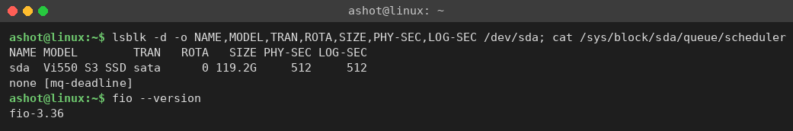
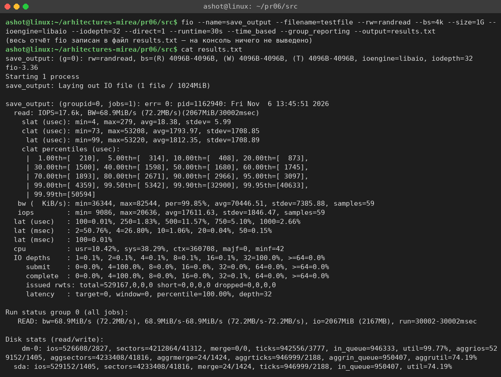
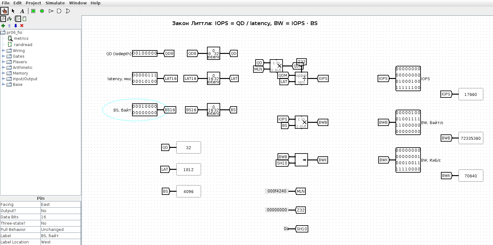
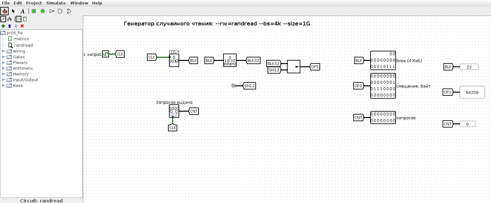
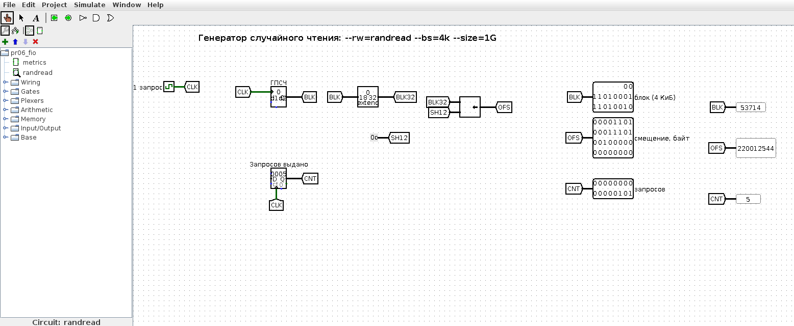

<!-- num: 6; title: Внешняя память -->

# ЦЕЛЬ РАБОТЫ

Изучить устройство и характеристики внешних запоминающих устройств (HDD, SSD), показатели их производительности (IOPS, пропускная способность, задержка) и способы их измерения. Провести безопасный тест FIO по персональному варианту, проанализировать результаты и сделать выводы о производительности накопителя.

# ЗАДАНИЕ

Вариант 23. «Сохранение результата в файл»:

```
fio.exe --name=save_output --filename=testfile --rw=randread --bs=4k --size=1G
    --ioengine=windowsaio --iodepth=32 --direct=1 --runtime=30s --time_based
    --group_reporting --output=results.txt
```

Выполнить тестирование, на основании результатов сделать выводы о производительности диска, расписать полученные результаты.

# ХОД РАБОТЫ

## 1 Тестовый стенд

Тест выполнялся на компьютере под Ubuntu 24.04. Накопитель — SATA SSD Verbatim Vi550 S3 объёмом 128 ГБ (119,2 ГиБ), на нём через LVM размещена корневая файловая система; размер логического и физического сектора 512 Б, планировщик ввода-вывода mq-deadline (рис. 1). Утилита fio версии 3.36.



Команда варианта написана для Windows (`fio.exe`, `--ioengine=windowsaio`). В Linux вместо механизма асинхронного ввода-вывода Windows используется его аналог `libaio` (Linux Asynchronous I/O); остальные параметры, включая ключ `--output=results.txt`, оставлены без изменений:

Листинг 1 – Команда теста в Linux

```
fio --name=save_output --filename=testfile --rw=randread --bs=4k --size=1G --ioengine=libaio
    --iodepth=32 --direct=1 --runtime=30s --time_based --group_reporting --output=results.txt
```

Таблица 1 – Параметры теста варианта 23

| Параметр | Значение | Смысл |
|---|---|---|
| --rw=randread | случайное чтение | чтение из случайных мест файла |
| --bs=4k | 4 КиБ | размер блока — типичный блок файловой системы |
| --size=1G | 1 ГиБ | тестовый файл testfile (262 144 блока по 4 КиБ) |
| --iodepth=32 | 32 | до 32 запросов одновременно в очереди |
| --direct=1 | O_DIRECT | в обход кэша ОС — измеряется сам диск |
| --output=results.txt | — | полный отчёт fio сохраняется в файл, а не выводится на консоль |
| --runtime=30s, --time_based | 30 с | тест идёт ровно 30 секунд |

Особенность варианта — ключ `--output=results.txt`: fio пишет весь отчёт не в терминал, а в файл `results.txt` (на экране при этом ничего не появляется). Это удобно для автоматизации (запуск по расписанию, сбор логов, сравнение прогонов). Тест безопасен: fio создаёт и читает только собственный файл testfile, после теста он был удалён.

## 2 Результаты теста

Содержимое сохранённого файла `results.txt` приведено на рис. 2.



Таблица 2 – Основные результаты

| Показатель | Значение |
|---|---|
| IOPS (среднее) | 17,6 тыс. операций/с (17 611) |
| Пропускная способность BW | 68,9 МиБ/с (72,2 МБ/с) |
| Прочитано за 30 с | 2067 МиБ, 529 167 операций |
| slat — задержка постановки в очередь | 18,4 мкс (среднее) |
| clat — время выполнения запроса | 1794 мкс (среднее), медиана 1680 мкс |
| lat — полная задержка | 1812 мкс (среднее), min 99 мкс, max 53 мс |
| Перцентили clat 90 / 99 / 99,9 % | 2,97 / 4,36 / 32,9 мс |
| Загрузка CPU | usr 10,4 %, sys 38,3 %, 361 тыс. переключений контекста |
| Глубина очереди | 32 — 100 % времени |
| Загрузка устройства | sda 74,2 %, dm-0 (LVM) 99,8 % |

## 3 Анализ результатов

**IOPS.** Диск выполнил около 17,6 тыс. операций случайного чтения блоками 4 КБ в секунду. По ориентирам пособия (HDD — 100–200 IOPS, SATA SSD — десятки тысяч для блоков 4 КБ, NVMe — сотни тысяч) результат на порядки выше любого HDD и соответствует бюджетному SATA SSD: блок 4 КБ совпадает со страницей трансляции контроллера, поэтому на одну операцию приходится ровно одна «полезная» единица работы. На показатель влияют заполненность системного диска (97 %), слой LVM и фоновая нагрузка во время замера.

**Пропускная способность.** BW = IOPS × размер блока = 17 611 × 4 КиБ ≈ 68,9 МиБ/с (72,2 МБ/с). Для случайного доступа мелкими блоками это хороший результат; на последовательном чтении крупными блоками тот же накопитель дал бы в несколько раз больше, но там работает упреждающее чтение, которого при случайном доступе нет.

**Задержка и закон Литтла.** Средняя задержка 1,8 мс определяется глубиной очереди. По закону Литтла число запросов в системе равно произведению интенсивности на время пребывания: QD = IOPS × latency, откуда

$$ IOPS = QD / latency = 32 / 1,812 мс ≈ 17 660 операций/с $$

что совпадает с измеренным значением. То есть каждый запрос около 1,8 мс находится в очереди из 32 запросов, а «чистое» время обслуживания одного запроса диском около 1 / 17 611 с ≈ 57 мкс; минимальная задержка 99 мкс близка ко времени одиночного чтения SSD без очереди.

**Разброс задержек.** Медиана 1,68 мс, 99 % запросов укладываются в 4,36 мс, но 99,9-й перцентиль — 32,9 мс, а максимум — 53 мс. Такие «хвосты» характерны для бюджетного SSD при фоновых операциях контроллера (сборка мусора, перенос данных), усиливающихся при почти заполненном диске.

**Нагрузка на процессор.** Ядро ОС заметно загружено (sys 38,3 %): обслуживание 17,6 тыс. асинхронных запросов и их завершений в секунду требует множества системных вызовов и переключений контекста.

## 4 Модель в Logisim

Для наглядности в Logisim построены две схемы (`pr06/src/logisim/pr06_fio.circ`, генератор `gen_pr06.py`).

Схема «metrics» проверяет результаты теста законом Литтла: по входам QD = 32, средней задержке 1812 мкс и размеру блока 4096 Б умножитель и делитель вычисляют IOPS = QD · 10⁶ / latency = 17 660, BW = IOPS · BS = 72 335 360 Б/с и BW = 70 640 КиБ/с (≈ 68,9 МиБ/с) — те же величины, что выдал fio (рис. 3).



Схема «randread» моделирует генератор нагрузки теста `--rw=randread --bs=4k --size=1G`: на каждый такт генератор псевдослучайных чисел выдаёт номер блока в пределах файла 1 ГиБ (18 бит, 262 144 блока), сдвигатель вычисляет смещение в байтах блок · 4096, счётчик считает выданные запросы (рис. 4, 5).





## 5 Как показать преподавателю

1. Показать команду с ключом `--output=results.txt` и содержимое сохранённого файла (рис. 2), назвать IOPS ≈ 17,6 тыс., BW ≈ 68,9 МиБ/с, среднюю задержку ≈ 1,8 мс.
2. Открыть `pr06/src/logisim/pr06_fio.circ`, схема metrics: QD = 32, latency = 1812, BS = 4096 — на пробниках 17660 и 70640.
3. Схема randread: Ctrl+T — появляются новые случайные номера блоков и смещения, кратные 4096.

# ВЫВОДЫ

Тест случайного чтения блоков по 4 КБ с глубиной очереди 32 и сохранением отчёта в файл (`--output=results.txt`) на SATA SSD Verbatim Vi550 S3 показал около 17,6 тыс. IOPS, пропускную способность 68,9 МиБ/с и среднюю задержку 1,8 мс. Ключ `--output` направил весь отчёт fio в файл `results.txt`, что удобно для автоматического сбора и сравнения результатов.

Для случайного доступа мелкими блоками определяющий показатель — IOPS; задержка определяется длиной очереди (закон Литтла: 32 / 1,8 мс ≈ 17,6 тыс. IOPS). Накопитель на порядки быстрее жёсткого диска на случайном доступе и соответствует бюджетному SATA SSD; «хвосты» задержки до десятков миллисекунд объясняются фоновой работой контроллера и заполненностью системного диска на 97 %.
