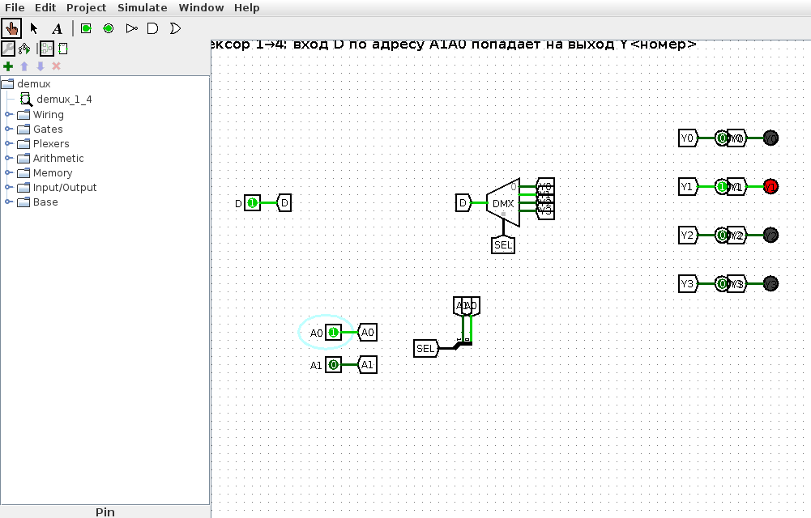
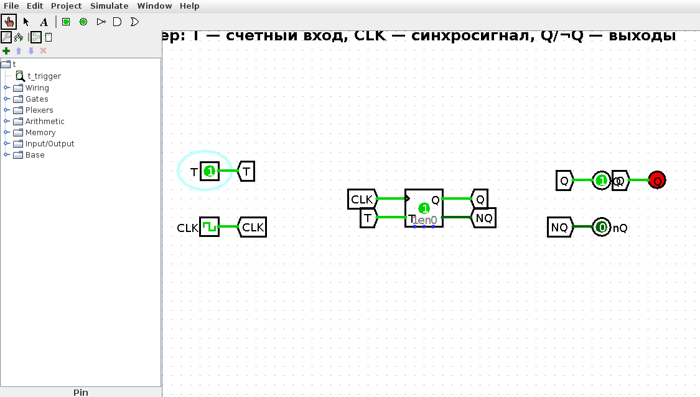
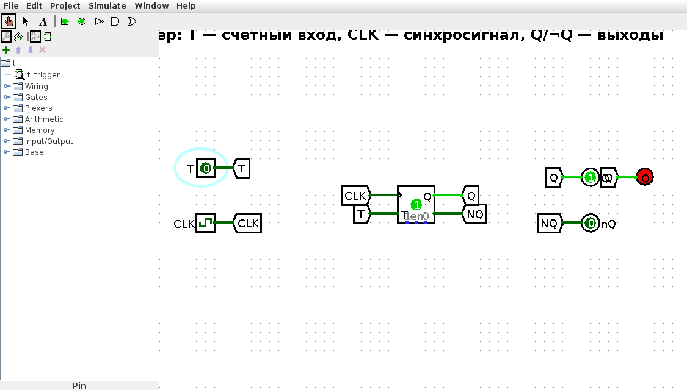
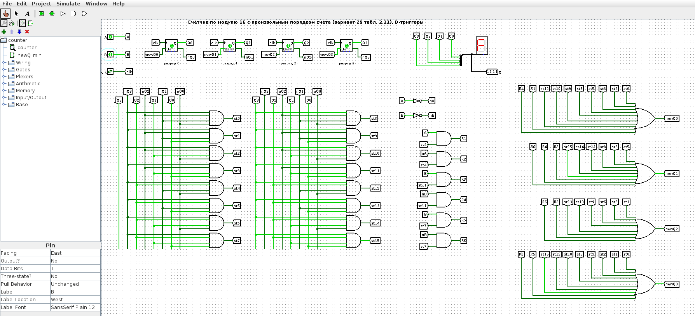
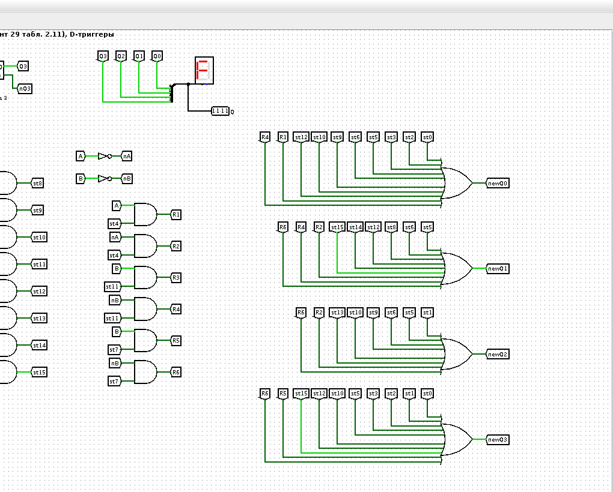
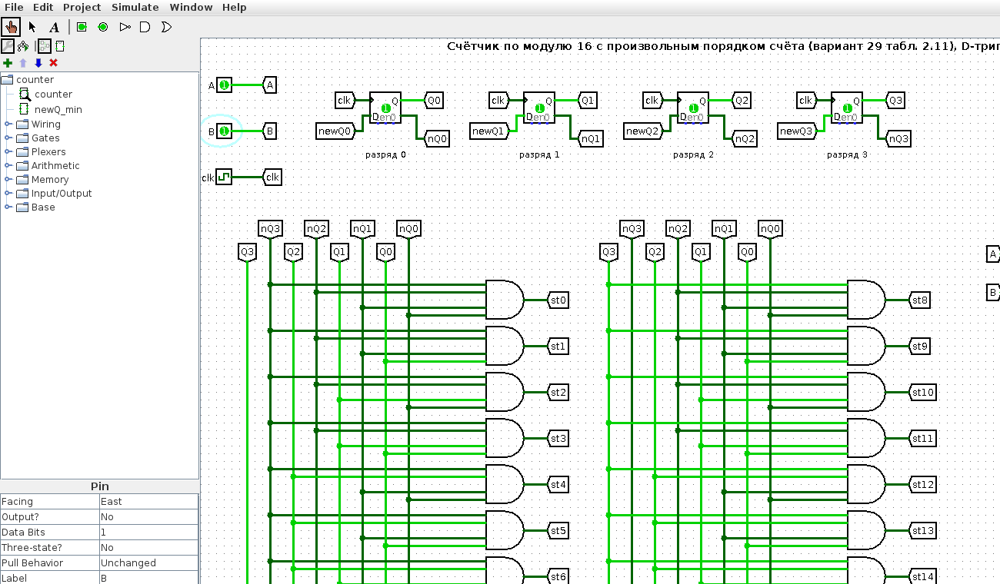
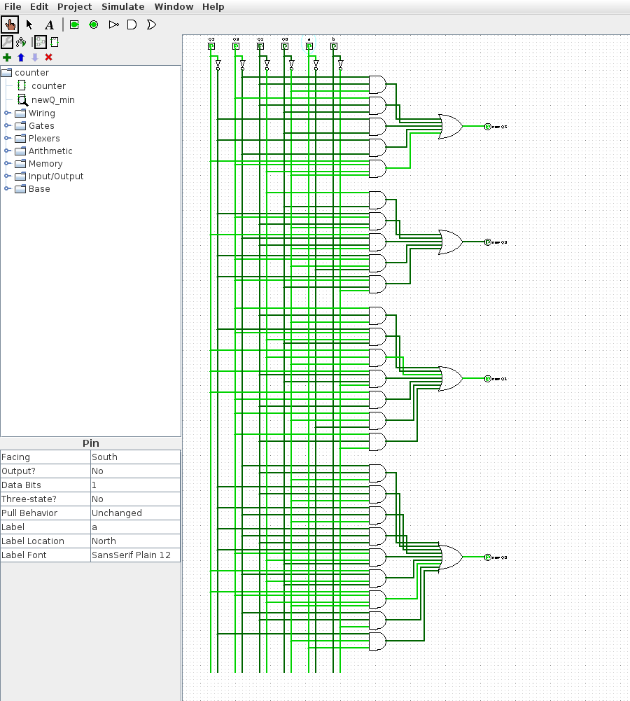
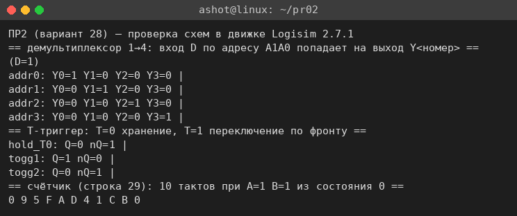
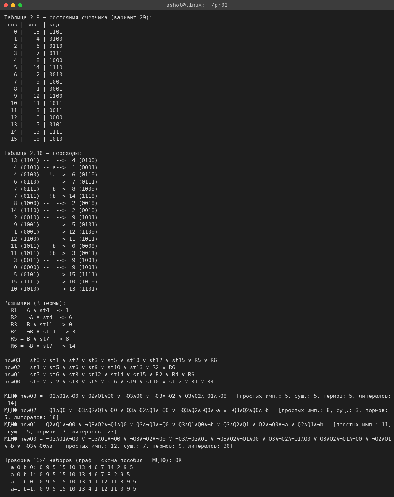

<!-- num: 2; title: Комбинационные схемы, элементы памяти, счётчики -->

# ЦЕЛЬ РАБОТЫ

Изучить устройство и работу комбинационных схем (на примере демультиплексора) и элементов памяти (на примере T-триггера), научиться синтезировать счётчик с произвольным порядком счёта по графу переходов: составлять таблицы состояний и переходов, получать функции возбуждения триггеров newQ и реализовывать счётчик на D-триггерах в среде Logisim.

# ЗАДАНИЕ

Вариант 28.

1. Разобрать демультиплексор с 2 адресными входными сигналами и T-триггер, составить таблицы истинности.
2. Реализовать счётчик согласно варианту 29 табл. 2.11 (последовательность состояний 13 4 6 7 8 14 2 9 1 12 11 3 0 5 15 10, подставляемая в шаблон графа рис. 2.14).

Все схемы собраны в Logisim 2.7.1 (файлы в каталоге `src/logisim`).

# ХОД РАБОТЫ

## 1 Демультиплексор с 2 адресными входами (1→4)

Демультиплексор — комбинационная схема, обратная мультиплексору: она направляет единственный информационный вход D на один из 2ⁿ выходов, номер которого задаётся n-разрядным адресом. Демультиплексор «с 2 адресными сигналами» имеет 1 вход D, 2 адресных входа A1 A0 и 4 выхода Y0…Y3. На выход с номером, равным адресу, передаётся значение D; все остальные выходы равны 0.

Логически каждый выход — это конъюнкция входа D с минтермом адреса: Yk = D · mk, например Y0 = D·¬A1·¬A0, Y1 = D·¬A1·A0, Y2 = D·A1·¬A0, Y3 = D·A1·A0. Таблица истинности (распределение входа по выходам) приведена в табл. 1.

Таблица 1 – Таблица истинности демультиплексора 1→4

| A1 | A0 | Y0 | Y1 | Y2 | Y3 |
|---|---|---|---|---|---|
| 0 | 0 | D | 0 | 0 | 0 |
| 0 | 1 | 0 | D | 0 | 0 |
| 1 | 0 | 0 | 0 | D | 0 |
| 1 | 1 | 0 | 0 | 0 | D |

Таблица также приведена в файле `pr02/Практика_2_вариант_28.xlsx` (лист «Демультиплексор 1-4»). Схема (`demux.circ`, подсхема `demux_1_4`) собрана на компоненте Demultiplexer библиотеки Plexers (select = 2): два отдельных адресных сигнала A0, A1 объединяются разветвителем в 2-разрядную шину адреса, которая подаётся на вход выбора. На рис. 1 на вход D подана 1, адрес A1A0 = 01 = 1 — активен (горит светодиод) только выход Y1 (Y1 = D = 1), остальные выходы погашены.

## 2 T-триггер

T-триггер (счётный триггер) — синхронный элемент памяти с одним информационным входом T. По фронту синхросигнала C он либо сохраняет состояние (при T = 0), либо переключается в противоположное (при T = 1). Благодаря режиму переключения T-триггер — базовый элемент двоичных счётчиков (каждый разряд делит частоту вдвое). Характеристическая таблица приведена в табл. 2.

Таблица 2 – Характеристическая таблица T-триггера

| T | Q(n) | Q(n+1) | Режим |
|---|---|---|---|
| 0 | 0 | 0 | хранение |
| 0 | 1 | 1 | хранение |
| 1 | 0 | 1 | переключение |
| 1 | 1 | 0 | переключение |

Характеристическое уравнение T-триггера: Q(n+1) = T ⊕ Q = T·¬Q ∨ ¬T·Q. Обратная задача (каким должен быть T для заданного перехода Q(n)→Q(n+1)) описывается таблицей возбуждения (табл. 3): T = Q(n) ⊕ Q(n+1).

Таблица 3 – Таблица возбуждения T-триггера

| Q(n) | Q(n+1) | T |
|---|---|---|
| 0 | 0 | 0 |
| 0 | 1 | 1 |
| 1 | 0 | 1 |
| 1 | 1 | 0 |

Схема (`t.circ`, подсхема `t_trigger`) собрана на компоненте T Flip-Flop библиотеки Memory с входом T и синхрогенератором. На рис. 2 показан режим переключения T = 1 после фронта синхросигнала — выход Q перешёл в 1 (светодиод горит); на рис. 3 — режим хранения T = 0: после фронта Q сохранил прежнее значение 1. Все режимы проверены в движке Logisim (см. п. 4).

## 3 Счётчик с произвольным порядком счёта (вариант 29)

Счётчик строится по шаблонному графу переходов рис. 2.14: в его 16 позиций подставляются значения из строки 29 табл. 2.11. Последовательность счёта (значения по позициям 0…15): 13, 4, 6, 7, 8, 14, 2, 9, 1, 12, 11, 3, 0, 5, 15, 10, после чего цикл замыкается (из 10 обратно в 13). В трёх позициях граф разветвляется по внешним входам A и B: позиция со значением 4 — по A, позиция со значением 7 — по B, позиция со значением 11 — по B. Таблица состояний и таблица переходов построены скриптом `src/counter_model.py` (рис. 9) и приведены в файле `pr02/Практика_2_вариант_28.xlsx` (лист «Счётчик»).

Таблица 4 – Переходы в точках ветвления (развилки R1…R6)

| Разветвление | Условие | Из состояния | В состояние |
|---|---|---|---|
| R1 | A | 4 | 1 |
| R2 | ¬A | 4 | 6 |
| R3 | B | 11 | 0 |
| R4 | ¬B | 11 | 3 |
| R5 | B | 7 | 8 |
| R6 | ¬B | 7 | 14 |

Счётчик реализован на четырёх D-триггерах (по методу пособия для готового счётчика варианта 1). Функция возбуждения каждого D-триггера newQ<i> — это логическая сумма сигналов тех состояний, из которых счётчик переходит в состояние с единицей в i-м разряде, плюс соответствующие развилочные термы R:

$$ newQ3 = st0 ∨ st1 ∨ st2 ∨ st3 ∨ st5 ∨ st10 ∨ st12 ∨ st15 ∨ R5 ∨ R6 $$
$$ newQ2 = st1 ∨ st5 ∨ st6 ∨ st9 ∨ st10 ∨ st13 ∨ R2 ∨ R6 $$
$$ newQ1 = st5 ∨ st6 ∨ st8 ∨ st12 ∨ st14 ∨ st15 ∨ R2 ∨ R4 ∨ R6 $$
$$ newQ0 = st0 ∨ st2 ∨ st3 ∨ st5 ∨ st6 ∨ st9 ∨ st10 ∨ st12 ∨ R1 ∨ R4 $$

где st<s> — сигнал текущего состояния s, снимаемый с дешифратора состояний (16 элементов И по разрядам Q3 Q2 Q1 Q0), а R<k> — развилочные термы из табл. 4 (например, R1 = A ∧ st4). Схема содержит входы A и B, тактовый генератор, четыре D-триггера, дешифратор состояний st0…st15, формирователи развилок R1…R6 и четыре элемента ИЛИ, собирающие newQ0…newQ3 (рис. 4–6). Текущее состояние выводится на шестнадцатеричный индикатор.

Параллельно те же функции возбуждения минимизированы методом Квайна–МакКласки от шести переменных Q3 Q2 Q1 Q0 a b (скрипт `counter_model.py`) и собраны в проверочную подсхему `newQ_min` (рис. 7). Минимальные формы:

- newQ3 = ¬Q2Q1¬Q0 ∨ Q2Q1Q0 ∨ ¬Q3Q0 ∨ ¬Q3¬Q2 ∨ Q3Q2¬Q1¬Q0;
- newQ2 = ¬Q1Q0 ∨ ¬Q3Q2Q1¬Q0 ∨ Q3¬Q2Q1¬Q0 ∨ ¬Q3Q2¬Q0¬a ∨ ¬Q3Q2Q0¬b;
- newQ1 = Q2Q1¬Q0 ∨ ¬Q3Q2¬Q1Q0 ∨ Q3¬Q1¬Q0 ∨ Q3Q1Q0¬b ∨ Q3Q2Q1 ∨ Q2¬Q0¬a ∨ Q2Q1¬b;
- newQ0 = ¬Q2Q1¬Q0 ∨ ¬Q3Q1¬Q0 ∨ ¬Q3¬Q2¬Q0 ∨ ¬Q3¬Q2Q1 ∨ ¬Q3Q2¬Q1Q0 ∨ Q3¬Q2¬Q1Q0 ∨ Q3Q2¬Q1¬Q0 ∨ ¬Q2Q1¬b ∨ ¬Q3¬Q0a.

## 4 Проверка

Схемы проверены в движке Logisim 2.7.1 (`logitool.js` / `lsim.js`). Для демультиплексора при любом адресе вход D попадает ровно на выход с этим номером, остальные выходы нулевые; для T-триггера подтверждены оба режима (хранение при T = 0 и переключение при T = 1); для счётчика прогон из состояния 0 при постоянных A и B даёт ту же последовательность, что и модель `counter_model.py` (рис. 8). Проверочная подсхема newQ_min на всех 64 наборах (Q3 Q2 Q1 Q0 a b) совпала с графом переходов.

# ВЫВОДЫ

В работе разобраны демультиплексор с 2 адресными входными сигналами (1→4), для которого составлена таблица истинности и собрана схема в Logisim (вход D направляется на один из 4 выходов по адресу), и T-триггер, для которого выписаны характеристическая таблица и таблица возбуждения и показаны оба режима работы (хранение и переключение).

По строке 29 табл. 2.11 синтезирован счётчик с произвольным порядком счёта: построены таблицы состояний и переходов, получены функции возбуждения newQ0…newQ3 в форме пособия, выполнена их минимизация методом Квайна–МакКласки. Счётчик собран на D-триггерах в Logisim; моделирование подтвердило, что он проходит заданную последовательность состояний, а развилки по входам A и B работают согласно графу переходов.
