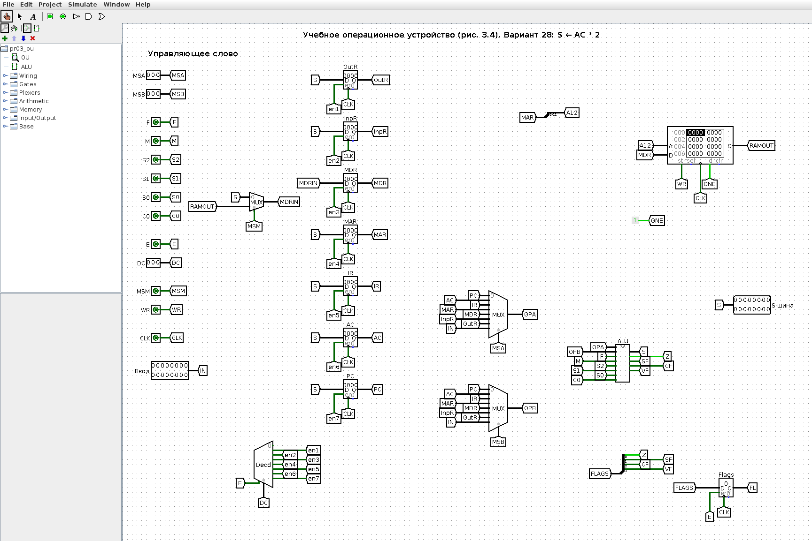
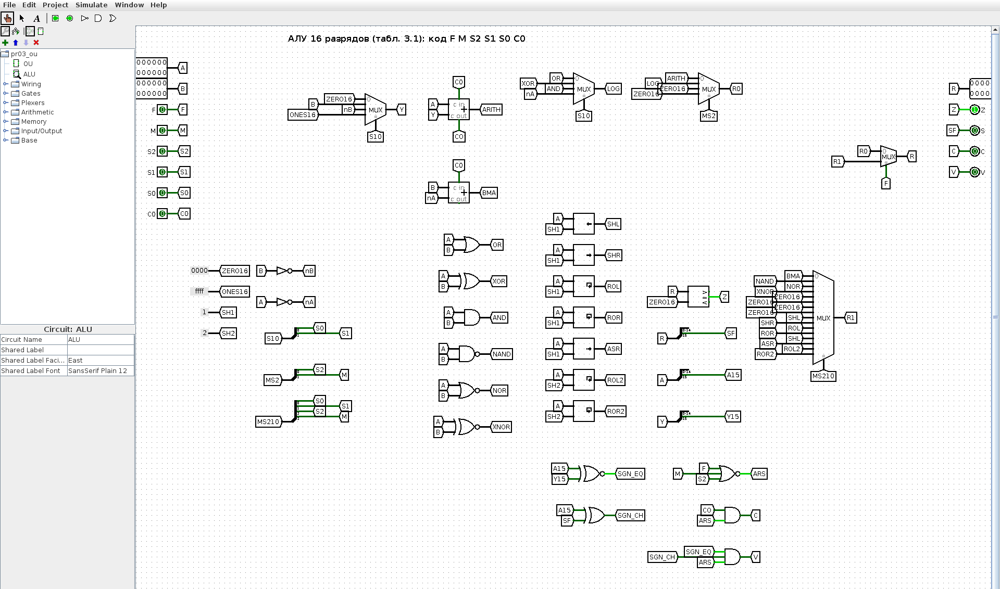
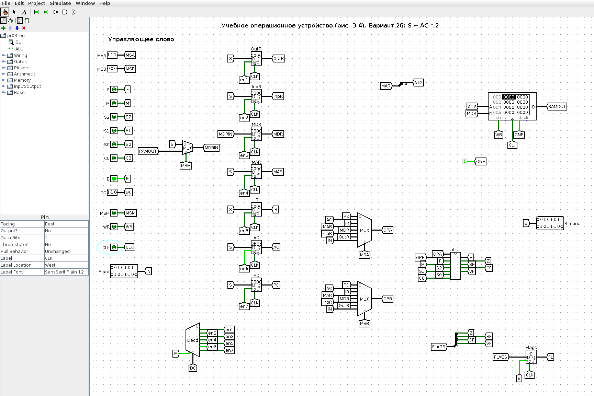
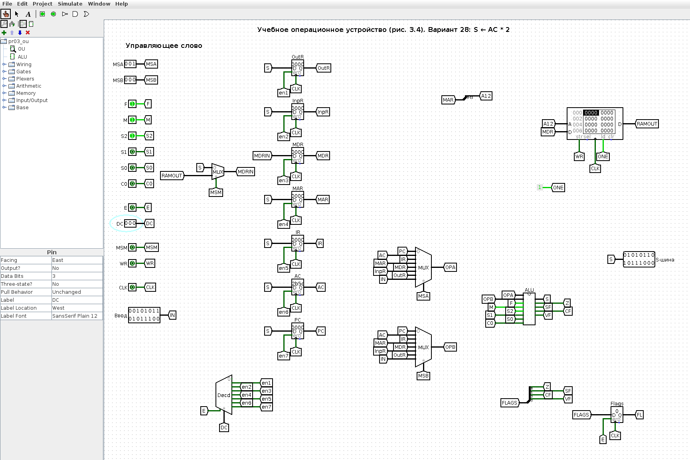
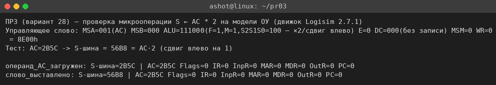

<!-- num: 3; title: Операционное устройство ЦП -->

# ЦЕЛЬ РАБОТЫ

Изучить устройство учебного операционного устройства (ОУ) центрального процессора: назначение регистров PC, IR, AC, MAR, MDR, InpR, OutR, работу арифметико-логического устройства и системы флагов, управление потоками данных с помощью мультиплексоров и дешифратора. Научиться записывать 18-разрядное управляющее слово ОУ для заданной микрооперации и проверить его на модели ОУ в Logisim.

# ЗАДАНИЕ

Вариант 28. Записать управляющее слово учебного ОУ (табл. 3.2) для микрооперации

$$ S ← AC * 2 $$

и продемонстрировать её выполнение.

# ХОД РАБОТЫ

## 1 Смысл микрооперации

Микрооперация S ← AC * 2 означает: содержимое аккумулятора AC подаётся на вход A АЛУ, над ним выполняется операция «умножение на 2», а результат появляется на выходной шине S (S-шина). Умножение двоичного числа на 2 — это сдвиг всех разрядов на одну позицию влево с занесением нуля в младший разряд (A · 2 = A << 1). Операция унарная — второй операнд (вход B) не нужен. Приёмником является S-шина, а не регистр, поэтому запись в какой-либо регистр не производится (поле DC отключено, E = 0); результат лишь выставляется на шину. Для формирования управляющего слова нужно определить поля (табл. 3.2): MS(A), MS(B), ALU, DC, MS(M) и WR.

## 2 Коды источников и приёмников

По схеме учебного ОУ (рис. 3.4 пособия) выходы регистров подключены к информационным входам мультиплексоров MS A и MS B, а выходы дешифратора DC — к входам разрешения записи регистров. Коды, снятые со схемы, сведены в табл. 1.

Таблица 1 – Коды входов мультиплексоров MS A / MS B и выходов дешифратора DC (рис. 3.4)

| Код | Вход MS A / MS B | Выход DC (запись в регистр) |
|---|---|---|
| 000 | PC | — (не используется) |
| 001 | AC | OutR |
| 010 | IR | InpR |
| 011 | MAR | MDR |
| 100 | MDR | MAR |
| 101 | InpR | IR |
| 110 | OutR | AC |
| 111 | Ввод | PC |

Для варианта 28: операнд A — AC, MS(A) = 001; операнд B не используется, MS(B) = 000; приёмник — S-шина (не регистр), поэтому запись отключена: E = 0, поле DC = 0000.

## 3 Код операции АЛУ

Поле ALU состоит из битов F M S2 S1 S0 C (табл. 3.1). Бит F выбирает группу операций: при F = 0 — арифметика и стандартные логические операции, при F = 1 — расширенные логические и сдвиговые операции. Сдвиги задаются при F = 1, M = 1; код S2 S1 S0 выбирает конкретный сдвиг (табл. 2). Умножение на 2 — это сдвиг влево на один разряд, ему соответствует код S2 S1 S0 = 100.

Таблица 2 – Коды сдвиговых микроопераций АЛУ (группа F = 1, M = 1; табл. 3.1)

| F M S2 S1 S0 C | Микрооперация | Наименование |
|---|---|---|
| 1 1 0 0 0 x | A << 1 | Сдвиг влево |
| 1 1 0 0 1 x | A >> 1 | Сдвиг вправо |
| 1 1 0 1 0 x | A цикл.← | Циклический сдвиг влево |
| 1 1 0 1 1 x | A цикл.→ | Циклический сдвиг вправо |
| **1 1 1 0 0 x** | **A · 2** | **Умножение на 2 (сдвиг влево)** |
| 1 1 1 0 1 x | A / 2 | Деление на 2 (арифм. сдвиг вправо) |
| 1 1 1 1 0 x | A цикл.←2 | Циклический сдвиг влево на 2 |
| 1 1 1 1 1 x | A цикл.→2 | Циклический сдвиг вправо на 2 |

Для умножения на 2: ALU = 1 1 1 0 0 x. Бит входного переноса C на сдвиг не влияет; в записи слова принимаем C = 0.

## 4 Поля MS(M) и WR

Мультиплексор MS(M) выбирает лишь то, что записывается в MDR, и на результат на S-шине не влияет; в записи слова принимаем MS(M) = 0. Запись в память не выполняется: WR = 0.

## 5 Управляющее слово

Таблица 3 – Машинное слово ОУ для микрооперации S ← AC * 2. Верхняя строка шапки показывает, к какому полю относится каждый столбец: MS A — a2 a1 a0; MS B — a2 a1 a0; ALU — F M S2 S1 S0 C; DC — E x2 x1 x0; MS M — a0; WR — wr.

| MS A | < | < | MS B | < | < | ALU | < | < | < | < | < | DC | < | < | < | MS M | WR |
|---|---|---|---|---|---|---|---|---|---|---|---|---|---|---|---|---|---|
| a2 | a1 | a0 | a2 | a1 | a0 | F | M | S2 | S1 | S0 | C | E | x2 | x1 | x0 | a0 | wr |
| 0 | 0 | 1 | 0 | 0 | 0 | 1 | 1 | 1 | 0 | 0 | 0 | 0 | 0 | 0 | 0 | 0 | 0 |

Итоговое слово: 001 | 000 | 111000 | 0000 | 0 | 0, то есть 001000111000000000₂ = 8E00₁₆. Таблица также приведена в файле `pr03/Практика_3_вариант_28.xlsx`.

## 6 Проверка на модели ОУ в Logisim

Для проверки по схеме рис. 3.4 используется 16-разрядная модель учебного ОУ в Logisim (`pr03/src/logisim/pr03_ou.circ`, схема генерируется скриптом `gen_pr03.py`). Модель содержит:

- регистры OutR, InpR, MDR, MAR, IR, AC, PC (запись по фронту CLK при разрешении от DC);
- мультиплексоры MS A и MS B (8 входов, коды по табл. 1, вход 7 — внешний «Ввод»);
- подсхему ALU — полное 16-разрядное АЛУ по табл. 3.1 (сумматор по схеме Мано A + Y + C, логический блок, сдвигатели — в том числе умножение на 2, мультиплексоры выбора результата, флаги Z, S, C, V);
- дешифратор DC с входом разрешения E, мультиплексор MS M, ОЗУ 4K × 16 с адресом из MAR и регистр флагов.

Поля управляющего слова задаются входными пинами слева, в том же порядке, что и в табл. 3. Общий вид модели в начальном состоянии показан на рис. 1, подсхема АЛУ — на рис. 2.

Чтобы микрооперации было над чем работать, сначала в AC заносится произвольное значение через вход «Ввод» (вспомогательная микрооперация AC ← Ввод: MS(A) = 111, ALU = 000000 «передача A», DC = 1110). В AC записано 2B5C₁₆ (рис. 3).

Затем на пины выставляется управляющее слово варианта: MSA = 001, F M S2 S1 S0 C = 111000, E = 0 (запись отключена), MSM = 0, WR = 0. На S-шине появляется результат 56B8₁₆ = AC · 2; поскольку приёмник — шина, а не регистр, тактовый фронт для фиксации результата не нужен, значения регистров не меняются (рис. 4).

Проверка вручную приведена в табл. 4.

Таблица 4 – Проверка результата

| Величина | HEX | Двоичный код |
|---|---|---|
| AC | 2B5C | 0010 1011 0101 1100 |
| AC · 2 (S-шина) | 56B8 | 0101 0110 1011 1000 |

Та же микрооперация была прогнана в движке Logisim из командной строки (скрипт `tools/logisim/lsim.js`), результат совпадает с GUI (рис. 5): после загрузки AC = 2B5C и выставления слова на S-шине получено 56B8.

## 7 Как показать преподавателю

1. Открыть `pr03/src/logisim/pr03_ou.circ`, схема OU, инструмент «Палец» (Poke).
2. Ввод = 2B5C, MSA = 111, E = 1, DC = 110, щёлкнуть CLK дважды (0 → 1 → 0) — AC = 2B5C.
3. Выставить слово варианта: MSA = 001, F = 1, M = 1, S2 = 1 (остальные биты АЛУ 0), E = 0, MSM = 0, WR = 0 — на S-шине 56B8.
4. Убедиться, что на S-шине 56B8 = AC · 2, а регистры не изменились (запись отключена, E = 0).

# ВЫВОДЫ

В ходе работы изучено учебное операционное устройство ЦП: регистры, мультиплексоры выбора операндов, дешифратор выбора приёмника, АЛУ с флагами и сдвигателями. Для микрооперации S ← AC * 2 составлено управляющее слово 001 | 000 | 111000 | 0000 | 0 | 0 (8E00₁₆): операнд A — AC (001), операнд B не используется, операция АЛУ «умножение на 2» (F = 1, M = 1, S2 S1 S0 = 100, сдвиг влево), приёмник — S-шина (E = 0, запись в регистр отключена), источник для MDR не используется (MS(M) = 0), запись в память отсутствует (WR = 0).

Слово проверено на 16-разрядной модели ОУ в Logisim, построенной по рис. 3.4: при AC = 2B5C на S-шине получено 56B8 = AC · 2, что совпадает с ручным расчётом (сдвиг влево на один разряд). Так как приёмник — шина, а не регистр, фиксация результата по фронту синхросигнала не требуется. Модель показывает, что умножение на степень двойки в АЛУ реализуется простым сдвигом, без отдельной схемы умножителя.
