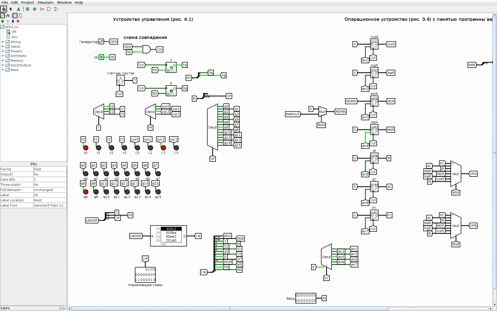
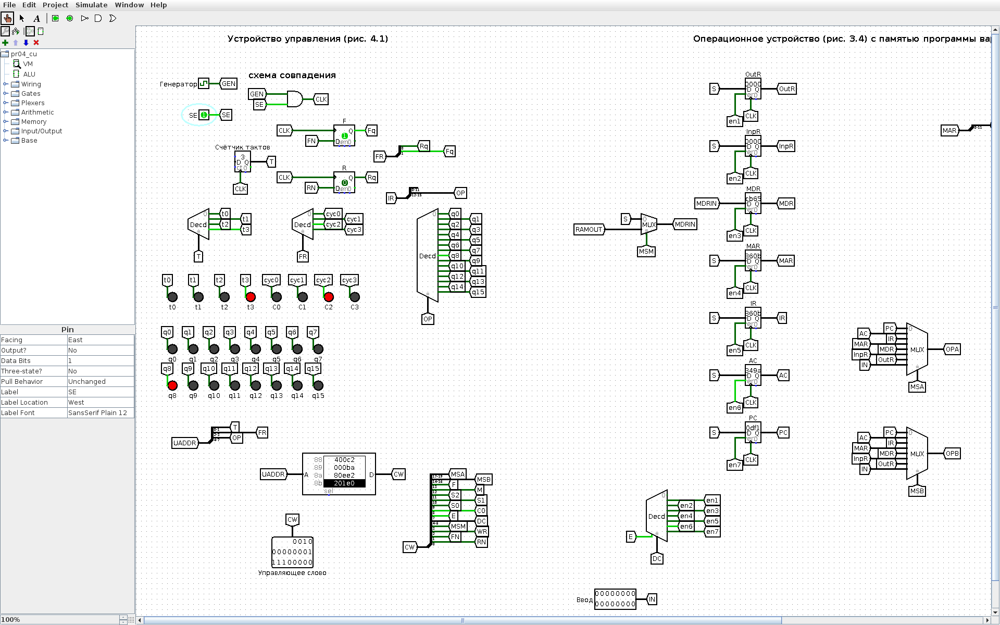
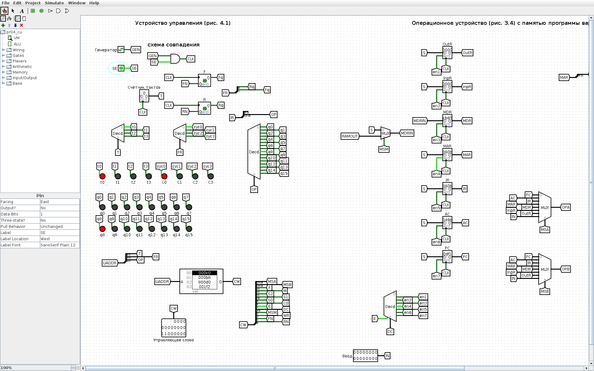
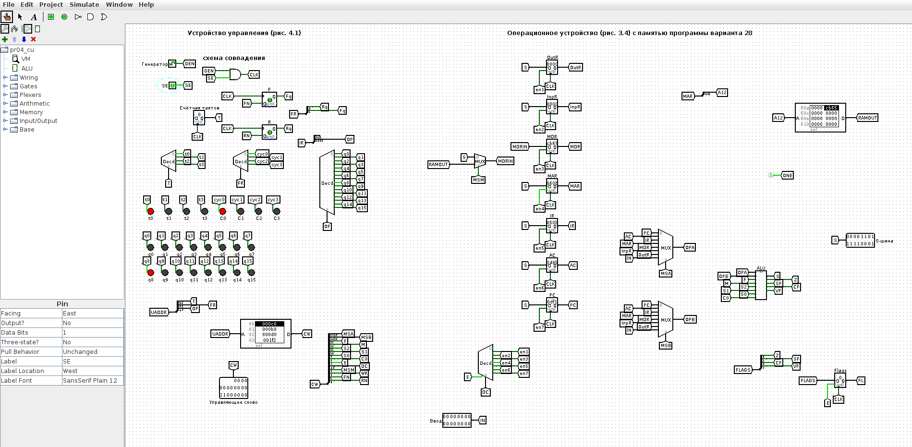

<!-- num: 4; title: Устройство управления ЦП учебного ОУ -->

# ЦЕЛЬ РАБОТЫ

Изучить микропрограммное устройство управления (УУ) учебной вычислительной машины: формирование управляющих слов, циклы выборки, дешифрации, выполнения и завершения, роль счётчика тактов и триггеров циклов F, R. Записать микропрограмму выполнения команды по персональному варианту, заполнить таблицы «Управляющее слово» (табл. 4.9) и «Состояние регистров» (табл. 4.10) и проверить их на модели ВМ в Logisim.

# ЗАДАНИЕ

Вариант 28. Записать микрооперации цикла выборки и выполнения команды NEG. По адресу DF0 записана команда NEG с адресом 60B. По этому адресу записан операнд CB65. В регистре-аккумуляторе — операнд CCAA. Определить информацию, которая будет записана в регистрах PC, MAR, MDR, IR, AC после выполнения этой команды. Показать процесс выполнения команды.

# ХОД РАБОТЫ

## 1 Исходные данные и формат команды

Команда NEG (q8 в табл. 4.1) — формирование дополнительного кода (отрицание числа): AC ← ¬M[AD] + 1. Она берёт операнд из памяти по адресу AD, инвертирует его (обратный код) и прибавляет единицу, получая дополнительный код, то есть арифметическое отрицание операнда. Код операции q8 = 1000₂ = 8₁₆, поэтому машинное слово команды по адресу DF0 — 860B₁₆ (4 бита КОП + 12 бит адреса: 1000 · 60B). По адресу операнда 60B записано число CB65.

Исходное состояние: PC = DF0, AC = CCAA; значения MAR, IR, MDR, INPR, OUTR не заданы. Важно: команда NEG отрицает операнд из памяти M[AD], а не исходное содержимое аккумулятора, поэтому начальное значение AC = CCAA в вычислении не участвует и будет перезаписано результатом.

## 2 Коды полей управляющего слова

Управляющее слово УУ состоит из полей MS(A), MS(B), ALU, DC, MS(M), WR и FR. Коды входов мультиплексоров и выходов дешифратора берутся по схеме ОУ (рис. 3.4) так же, как в табл. 4.7 пособия: MS(A)/MS(B): PC = 000, AC = 001, IR = 010, MDR = 100; DC (E x2 x1 x0): MDR = 1011, MAR = 1100, IR = 1101, AC = 1110, PC = 1111, запрет записи — 0xxx. Коды АЛУ (F M S2 S1 S0 C, табл. 3.1): передача A — 000000, инкремент A — 000001, инверсия A (¬A) — 001110. Поле MS(M) = 1 подаёт в MDR данные из памяти. FR — значения триггеров циклов F, R для следующего такта (табл. 4.2): 00 — C0 (выборка), 10 — C2 (выполнение).

Поскольку в учебной ВМ используется прямая адресация, цикл дешифрации C1 пропускается: на такте C0t3 устанавливается F, R ← 1, 0 и управление сразу переходит к циклу выполнения C2 (п. 4.3 пособия). Шаблоны табл. 4.9 и 4.10 содержат именно циклы C0 и C2.

## 3 Микропрограмма команды NEG

Цикл выборки (одинаков для всех команд, табл. 4.3): C0t0 — MAR ← PC; C0t1 — MDR ← M[MAR]; C0t2 — IR ← MDR; C0t3 — PC ← PC + 1, F, R ← 1, 0. Цикл выполнения NEG: C2t0 — MAR ← IR (в MAR переносится адресная часть команды); C2t1 — MDR ← M[AD] (чтение операнда); C2t2 — AC ← ¬MDR (обратный код); C2t3 — AC ← AC + 1 (прибавление единицы → дополнительный код), F, R ← 0, 0.

Таблица 1 – Управляющее слово (табл. 4.9) для команды NEG

| К,Ц,Т | Микрокоманда | MS(A) | MS(B) | АЛУ | DC | MS(M) | WR | FR |
|---|---|---|---|---|---|---|---|---|
| q8C0t0 | MAR ← PC | 000 | xxx | 000000 | 1100 | x | 0 | 00 |
| q8C0t1 | MDR ← M[MAR] | xxx | xxx | xxxxxx | 1011 | 1 | 0 | 00 |
| q8C0t2 | IR ← MDR | 100 | xxx | 000000 | 1101 | x | 0 | 00 |
| q8C0t3 | PC ← PC + 1; F,R ← 1,0 | 000 | xxx | 000001 | 1111 | x | 0 | 10 |
| q8C2t0 | MAR ← IR (адрес AD = 60B) | 010 | xxx | 000000 | 1100 | x | 0 | 10 |
| q8C2t1 | MDR ← M[AD] | xxx | xxx | xxxxxx | 1011 | 1 | 0 | 10 |
| q8C2t2 | AC ← ¬MDR | 100 | xxx | 001110 | 1110 | x | 0 | 10 |
| q8C2t3 | AC ← AC + 1; F,R ← 0,0 | 001 | xxx | 000001 | 1110 | x | 0 | 00 |

Каждая строка таблицы 4.10 показывает состояние регистров после выполнения соответствующей микрокоманды; если регистр на такте не записывается, его значение повторяется, «—» означает, что значение не задано. В модели регистр MAR 16-разрядный, поэтому на такте C2t0 в него копируется всё слово команды 860B; к памяти обращение идёт по младшим 12 битам, то есть по адресу AD = 60B.

Таблица 2 – Состояние регистров (табл. 4.10) при выполнении NEG

| К,Ц,Т | Микрокоманда | PC | MAR | IR | MDR | AC | INPR | OUTR |
|---|---|---|---|---|---|---|---|---|
| Исходное состояние | — | DF0 | — | — | — | CCAA | — | — |
| q8C0t0 | MAR ← PC | DF0 | DF0 | — | — | CCAA | — | — |
| q8C0t1 | MDR ← M[MAR] | DF0 | DF0 | — | 860B | CCAA | — | — |
| q8C0t2 | IR ← MDR | DF0 | DF0 | 860B | 860B | CCAA | — | — |
| q8C0t3 | PC ← PC + 1; F,R ← 1,0 | DF1 | DF0 | 860B | 860B | CCAA | — | — |
| q8C2t0 | MAR ← IR | DF1 | 860B | 860B | 860B | CCAA | — | — |
| q8C2t1 | MDR ← M[AD] | DF1 | 860B | 860B | CB65 | CCAA | — | — |
| q8C2t2 | AC ← ¬MDR | DF1 | 860B | 860B | CB65 | 349A | — | — |
| q8C2t3 | AC ← AC + 1; F,R ← 0,0 | DF1 | 860B | 860B | CB65 | 349B | — | — |

Вычисление в АЛУ: операнд M[60B] = CB65₁₆ = 1100 1011 0110 0101₂; обратный код ¬CB65 = 349A₁₆; дополнительный код ¬CB65 + 1 = 349B₁₆. Это и есть −CB65 в 16-разрядном дополнительном коде.

Ответ: после выполнения команды PC = DF1, MAR = 860B (младшие 12 бит — адрес операнда 60B), IR = 860B, MDR = CB65, AC = 349B; INPR и OUTR не изменились. Исходное значение AC = CCAA перезаписано, так как NEG отрицает операнд из памяти, а не содержимое аккумулятора.

## 4 Модель ВМ в Logisim

Для демонстрации собрана модель учебной ВМ (`pr04/src/logisim/pr04_cu.circ`, генерируется скриптом `gen_pr04.py`): устройство управления по рис. 4.1 подключено к модели ОУ из практической работы 3. УУ содержит:

- генератор тактовых импульсов и схему совпадения с сигналом SE (при SE = 0 импульсы не проходят и ВМ стоит);
- двухразрядный счётчик тактов t и дешифратор тактов t0–t3;
- триггеры циклов F и R с дешифратором циклов C0–C3;
- дешифратор команд по старшим четырём разрядам IR (q0–q15);
- ПЗУ микрокоманд 256 × 20: адрес = КОП (4 бита) · F R (2 бита) · t (2 бита), слово = MS(A) MS(B) АЛУ DC MS(M) WR FR — ровно поля табл. 4.9; выходы ПЗУ разводятся на управляющие входы ОУ, а поле FR подаётся на D-входы триггеров F и R.

В ПЗУ записан цикл выборки для всех кодов операций и циклы выполнения команд табл. 4.1 (для варианта важна q8 — NEG). Память команд и данных ОУ в модели — ПЗУ с программой варианта: DF0: 860B (NEG 60B), DF1: BDF1 (JMP DF1 — «останов» на месте), 60B: CB65.

Перед запуском в регистры PC и AC инструментом Poke введены исходные значения DF0 и CCAA, затем SE = 1 (рис. 1). Каждый такт ВМ — полный период генератора (два нажатия Ctrl+T).


![Рисунок 2 – После C0t0: MAR = DF0; на ПЗУ слово C0t1 (MDR ← M[MAR])](img/logisim_vm_C0t0.png)









Значения регистров на всех рисунках совпадают с табл. 2. Общий вид модели (УУ слева, ОУ справа) — на рис. 9.



Та же последовательность тактов была прогнана в движке Logisim из командной строки; протокол приведён в листинге 1.

Листинг 1 – Протокол моделирования (lsim.js, по одному такту ВМ на строку)

```
исх:  Управляющее слово=C0     | AC=CCAA IR=0    MAR=0   MDR=0    PC=DF0
C0t0: Управляющее слово=B8     | AC=CCAA IR=0    MAR=DF0 MDR=0    PC=DF0
C0t1: Управляющее слово=800D0  | AC=CCAA IR=0    MAR=DF0 MDR=860B PC=DF0
C0t2: Управляющее слово=1F2    | AC=CCAA IR=860B MAR=DF0 MDR=860B PC=DF0
C0t3: Управляющее слово=400C2  | AC=CCAA IR=860B MAR=DF0 MDR=860B PC=DF1
C2t0: Управляющее слово=BA     | AC=CCAA IR=860B MAR=860B MDR=860B PC=DF1
C2t1: Управляющее слово=80EE2  | AC=CCAA IR=860B MAR=860B MDR=CB65 PC=DF1
C2t2: Управляющее слово=201E0  | AC=349A IR=860B MAR=860B MDR=CB65 PC=DF1
C2t3: Управляющее слово=C0     | AC=349B IR=860B MAR=860B MDR=CB65 PC=DF1
```

В каждой строке показано слово, которое ПЗУ выдаёт на следующий такт (например, 80EE2 = 100 000 001110 1110 0 0 10 — слово C2t2 «AC ← ¬MDR»).

## 5 Как показать преподавателю

1. Открыть `pr04/Практика_4_вариант_28.xlsx` — табл. 4.9 и 4.10.
2. Открыть `pr04/src/logisim/pr04_cu.circ`, схема VM. Инструментом Poke щёлкнуть по регистру PC и набрать DF0, по регистру AC — CCAA. Установить SE = 1.
3. Нажимать Ctrl+T по два раза (один такт) и сверять регистры со строками табл. 4.10; на выходе ПЗУ видно управляющее слово очередной строки табл. 4.9, на индикаторах — текущие t и C, после C0t2 загорается q8.

# ВЫВОДЫ

Изучена работа микропрограммного устройства управления учебной ВМ: УУ по счётчику тактов, триггерам циклов F, R и коду операции из IR выбирает из ПЗУ управляющее слово, которое задаёт мультиплексоры, АЛУ, дешифратор записи и обращение к памяти. Составлены микропрограмма и управляющие слова (табл. 4.9) для команды NEG, заполнена таблица состояний регистров (табл. 4.10).

После выполнения команды NEG, записанной по адресу DF0, регистры содержат: PC = DF1 (адрес следующей команды), MAR = 860B и IR = 860B (слово команды: КОП 8 = q8, адрес 60B), MDR = CB65 (операнд из ячейки 60B), AC = 349B (дополнительный код операнда, −CB65). Исходное значение AC = CCAA перезаписано, так как NEG отрицает операнд из памяти. Результат подтверждён пошаговым выполнением на модели ВМ (УУ + ОУ) в Logisim.
