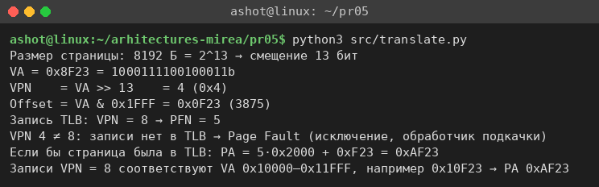
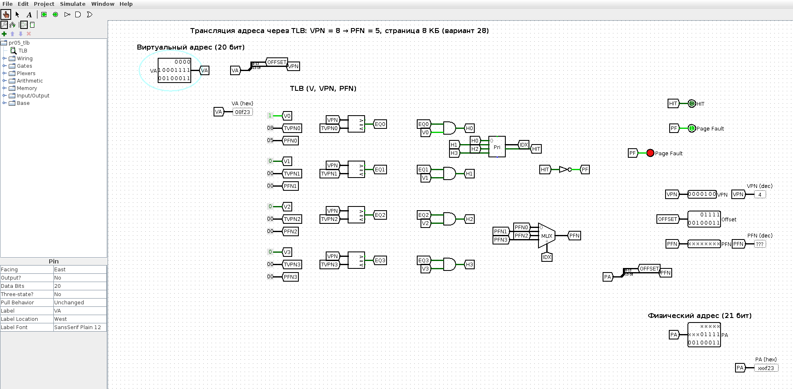
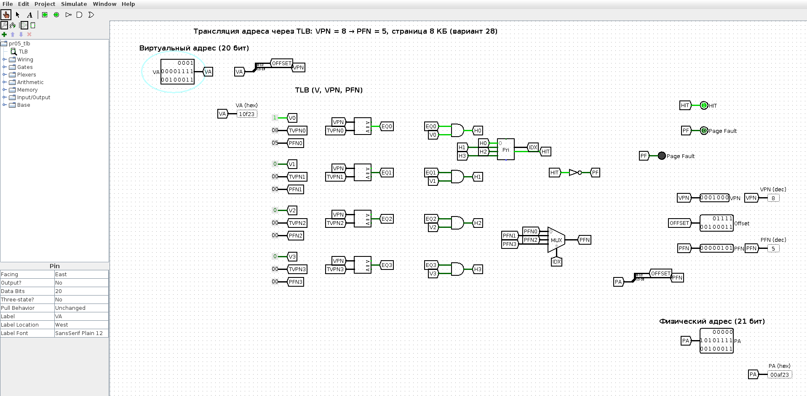

<!-- num: 5; title: ОЗУ. Виртуальная и физическая память -->

# ЦЕЛЬ РАБОТЫ

Изучить устройство оперативной памяти и взаимосвязь программной и аппаратной частей её работы: страничную организацию виртуальной памяти, структуру виртуального адреса (номер страницы и смещение), роль буфера ассоциативной трансляции TLB и ситуацию отсутствия страницы (Page Fault). Научиться вычислять физический адрес по виртуальному и проверить расчёт на аппаратной модели трансляции в Logisim.

# ЗАДАНИЕ

Вариант 28. VPN = 8 → PFN = 5, размер страницы 8 КБ, виртуальный адрес 0x8F23. Вычислить физический адрес и указать, возможна ли такая трансляция или произойдёт Page Fault и будет вызвано прерывание.

# ХОД РАБОТЫ

## 1 Структура виртуального адреса

При страничной организации виртуальный адрес делится на две части: старшие биты — номер виртуальной страницы VPN, младшие — смещение внутри страницы Offset. Размер страницы 8 КБ = 8192 Б = 2¹³ Б, поэтому на смещение отводится 13 младших бит, а номер страницы — все остальные старшие биты:

$$ VPN = VA div 2¹³,   Offset = VA mod 2¹³ = VA ∧ 0x1FFF $$

## 2 Разбиение адреса 0x8F23

Двоичная запись адреса: 0x8F23 = 1000 1111 0010 0011₂ (16 бит). Отделяем 13 младших бит:

Таблица 1 – Разбиение виртуального адреса 0x8F23 при странице 8 КБ

| Часть | Биты | Двоичный код | Значение |
|---|---|---|---|
| VPN | 15–13 | 100 | 4 |
| Offset | 12–0 | 0 1111 0010 0011 | 0x0F23 = 3875 |

Проверка делением: 0x8F23 = 36643; 36643 div 8192 = 4 (4 · 8192 = 32768 = 0x8000); смещение 36643 − 32768 = 3875 = 0x0F23.

Следует обратить внимание, что при странице 4 КБ старшая цифра 8 действительно была бы номером страницы, но у страницы 8 КБ смещение занимает 13 бит, и VPN адреса равен 4, а не 8.

## 3 Поиск в TLB

В TLB есть только одна запись: VPN = 8 → PFN = 5. Номер страницы адреса VPN = 4 ≠ 8, совпадения нет. Следовательно, трансляция через TLB невозможна: процессор фиксирует промах, страница отсутствует в таблице — возникает **Page Fault**, вызывается исключение (прерывание) и управление передаётся обработчику ОС, который должен найти или подгрузить страницу и обновить таблицы.

Если бы страница находилась в TLB (запись для VPN = 4 с тем же PFN = 5), физический адрес вычислялся бы по формуле (5.1):

$$ PA = PFN × PageSize + Offset = 5 × 0x2000 + 0x0F23 = 0xA000 + 0x0F23 = 0xAF23 $$

Для сравнения: записи VPN = 8 соответствуют виртуальные адреса 0x10000–0x11FFF; например, адрес 0x10F23 (то же смещение 0x0F23) транслируется успешно в PA = 0xAF23.

Расчёт продублирован небольшой программой `pr05/src/translate.py` (рис. 1).



## 4 Аппаратная модель трансляции в Logisim

В Logisim собрана модель блока трансляции адреса с TLB (`pr05/src/logisim/pr05_tlb.circ`, генератор `gen_pr05.py`):

- виртуальный адрес 20 бит (вход VA) разделяется расщепителем на Offset (биты 12–0) и VPN (биты 19–13, 7 бит);
- TLB на 4 записи (V — признак действительности, VPN, PFN) задан константами: запись 0 — V = 1, VPN = 8 (0x08), PFN = 5 (0x05), остальные записи недействительны;
- для каждой записи компаратор сравнивает VPN адреса с VPN записи, элемент И учитывает бит V — так работает ассоциативный (параллельный) поиск;
- приоритетный шифратор формирует номер сработавшей записи и сигнал HIT; при HIT = 0 загорается индикатор Page Fault;
- мультиплексор выбирает PFN сработавшей записи, физический адрес собирается как PFN · 2¹³ + Offset (21 бит).

При VA = 0x8F23 (адрес варианта) компараторы не срабатывают, HIT = 0, горит Page Fault, VPN = 4, Offset = 0x0F23, PFN и PA не определены (рис. 2).



При VA = 0x10F23 (страница VPN = 8) срабатывает запись 0, HIT = 1, PFN = 5, PA = 0xAF23 (рис. 3).



Протокол проверки модели в движке Logisim приведён в листинге 1.

Листинг 1 – Проверка модели TLB (lsim.js)

```
VA=0x08F23: HIT=0 Offset=F23 PFN=xxxx xxxx Page Fault=1 VPN=4
VA=0x10F23: HIT=1 Offset=F23 PA=AF23 PFN=5 Page Fault=0 VPN=8
```

## 5 Как показать преподавателю

1. Показать разбиение адреса (табл. 1) и вывод `python3 src/translate.py`.
2. Открыть `pr05/src/logisim/pr05_tlb.circ`, на входе VA выставить 08F23 — загорается Page Fault, VPN = 4.
3. Выставить 10F23 — HIT = 1, PA = 0AF23.

# ВЫВОДЫ

Для варианта 28 (страница 8 КБ, запись TLB VPN = 8 → PFN = 5, VA = 0x8F23) смещение занимает 13 младших бит: Offset = 0x0F23, VPN = 4. Запись для VPN = 4 в TLB отсутствует, поэтому трансляция невозможна — происходит Page Fault и вызывается обработчик исключения. Если бы страница была отображена на фрейм PFN = 5, физический адрес составил бы 0xAF23.

Работа показала, что номер страницы определяется не «на глаз» по старшей шестнадцатеричной цифре, а размером страницы: при 8 КБ адрес 0x8F23 лежит на странице 4. Модель в Logisim демонстрирует, как TLB аппаратно выполняет ассоциативный поиск за один такт и как физический адрес получается простой склейкой номера фрейма и смещения.
