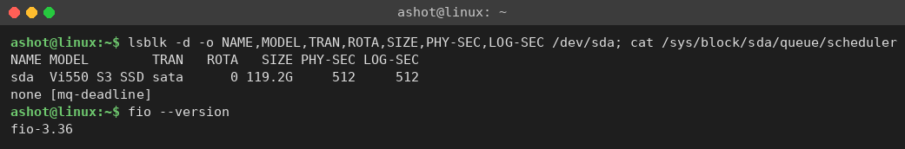
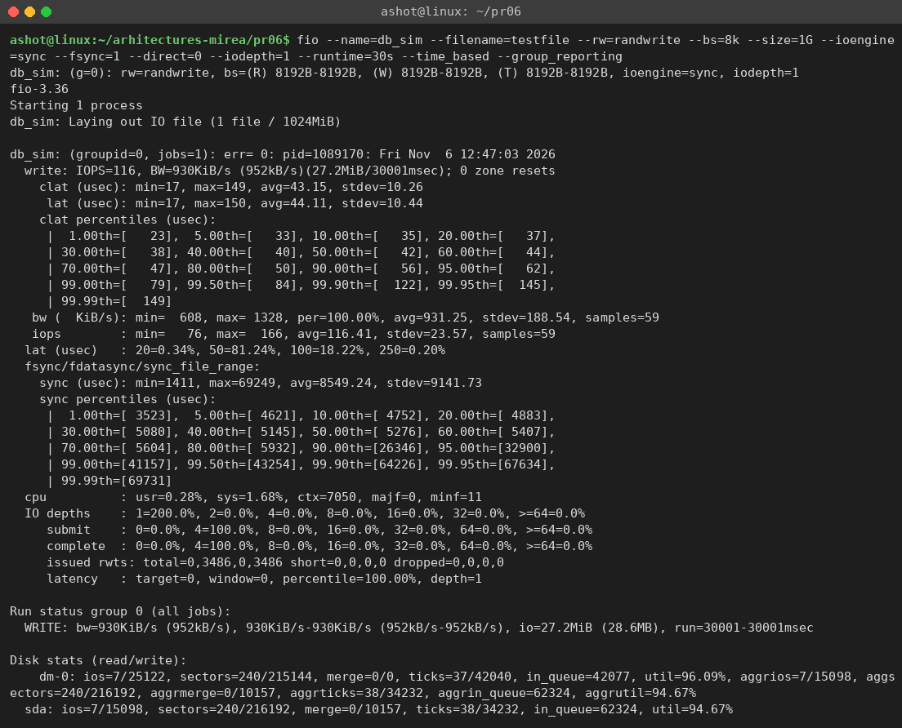
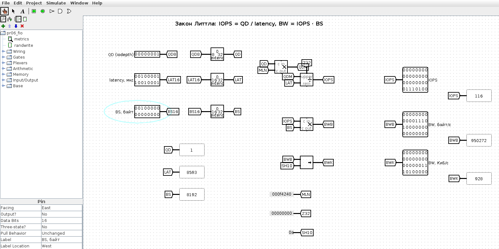
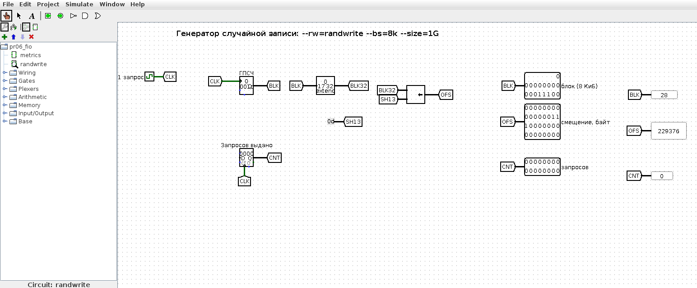
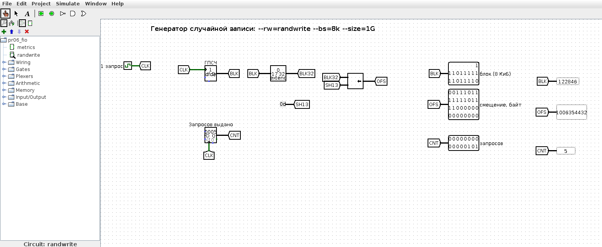

<!-- num: 6; title: Внешняя память -->

# ЦЕЛЬ РАБОТЫ

Изучить устройство и характеристики внешних запоминающих устройств (HDD, SSD), показатели их производительности (IOPS, пропускная способность, задержка) и способы их измерения. Провести безопасный тест FIO по персональному варианту, проанализировать результаты и сделать выводы о производительности накопителя.

# ЗАДАНИЕ

Вариант 28. «Симуляция базы данных»:

```
fio.exe --name=db_sim --filename=testfile --rw=randwrite --bs=8k --size=1G
    --ioengine=sync --fsync=1 --direct=0 --iodepth=1 --runtime=30s --time_based --group_reporting
```

Выполнить тестирование, на основании результатов сделать выводы о производительности диска, расписать полученные результаты.

# ХОД РАБОТЫ

## 1 Тестовый стенд

Тест выполнялся на компьютере под Ubuntu 24.04. Накопитель — SATA SSD Verbatim Vi550 S3 объёмом 128 ГБ (119,2 ГиБ), на нём через LVM размещена корневая файловая система; размер логического и физического сектора 512 Б, планировщик ввода-вывода mq-deadline (рис. 1). Утилита fio версии 3.36.



Команда варианта написана для Windows (`fio.exe`), но использует кроссплатформенный механизм ввода-вывода `--ioengine=sync` (обычные системные вызовы read/write), поэтому в Linux она запускается без изменений — отличается только имя исполняемого файла (`fio`) и путь к тестовому файлу:

Листинг 1 – Команда теста в Linux

```
fio --name=db_sim --filename=testfile --rw=randwrite --bs=8k --size=1G --ioengine=sync
    --fsync=1 --direct=0 --iodepth=1 --runtime=30s --time_based --group_reporting
```

Таблица 1 – Параметры теста варианта 28

| Параметр | Значение | Смысл |
|---|---|---|
| --rw=randwrite | случайная запись | запись в случайные места файла |
| --bs=8k | 8 КиБ | размер блока — типичная страница БД |
| --size=1G | 1 ГиБ | тестовый файл testfile (131 072 блока по 8 КиБ) |
| --ioengine=sync | синхронный в/в | обычные системные вызовы write |
| --fsync=1 | fsync после каждой записи | данные принудительно сбрасываются на диск |
| --direct=0 | через кэш ОС | как работает СУБД: запись в кэш + fsync |
| --iodepth=1 | 1 | один запрос за раз (без очереди) |
| --runtime=30s, --time_based | 30 с | тест идёт ровно 30 секунд |

Тест безопасен: fio создаёт и записывает только собственный файл testfile, после теста файл был удалён. Этот профиль моделирует нагрузку транзакционной базы данных, где каждая запись должна быть гарантированно сохранена на носителе (fsync) перед подтверждением транзакции.

## 2 Результаты теста

Полный вывод fio приведён на рис. 2.



Таблица 2 – Основные результаты

| Показатель | Значение |
|---|---|
| IOPS (среднее) | 116 операций/с |
| Пропускная способность BW | 930 КиБ/с (952 кБ/с) |
| Записано за 30 с | 27,2 МиБ, 3 486 операций записи |
| clat — время системного вызова write | 43,2 мкс (среднее), min 17, max 149 мкс |
| lat — полная задержка write | 44,1 мкс (среднее) |
| sync — задержка fsync | 8 549 мкс (среднее), min 1 411, max 69 249 мкс |
| Перцентили fsync 50 / 90 / 99 % | 5,3 / 26,3 / 41,2 мс |
| Загрузка CPU | usr 0,28 %, sys 1,68 %, 7 050 переключений контекста |
| Глубина очереди | 1 |
| Загрузка устройства | sda 94,7 %, dm-0 (LVM) 96,1 % |

## 3 Анализ результатов

**Две разные задержки.** В этом тесте каждый цикл состоит из двух операций: сам системный вызов write и следующий за ним fsync. Запись в файл идёт через кэш ОС (`--direct=0`) и выполняется очень быстро — в среднем 44 мкс, потому что данные лишь копируются в страничный кэш. А вот fsync заставляет ОС и накопитель физически сохранить данные на флеш-память, и это занимает в среднем 8,5 мс — почти в 200 раз дольше самой записи. Именно fsync, а не запись, определяет скорость теста.

**IOPS.** Диск выполнил всего около 116 операций «запись + fsync» в секунду. Это на первый взгляд очень мало для SSD (бюджетный SATA SSD без fsync выдаёт десятки тысяч IOPS на блоках 4–8 КБ), но закономерно для данного профиля: durability через fsync — самая дорогая операция для потребительского накопителя, у которого нет защищённого от потери питания кэша записи (PLP). Каждый fsync вынужден дожидаться сброса внутреннего буфера контроллера на NAND.

**Пропускная способность.** BW = IOPS × размер блока = 116 × 8 КиБ ≈ 930 КиБ/с. Здесь низкая скорость в КиБ/с объясняется не размером блока (8 КиБ — не мелкий), а тем, что между блоками стоит дорогой fsync; устройство простаивает бóльшую часть времени цикла, ожидая подтверждения сохранности.

**Задержка и закон Литтла.** Поскольку очередь единичная (`--iodepth=1`) и движок синхронный, в каждый момент в системе находится ровно один запрос, а операции строго последовательны. Полная задержка одного цикла ≈ время write + время fsync ≈ 44 мкс + 8 549 мкс ≈ 8 593 мкс. По закону Литтла QD = IOPS × latency, откуда

$$ IOPS = QD / latency = 1 / 8,593 мс ≈ 116 операций/с $$

что в точности совпадает с измеренным значением.

**Разброс задержек fsync.** Медиана fsync 5,3 мс, но 90-й перцентиль — 26 мс, 99-й — 41 мс, максимум — 69 мс. Такие большие «хвосты» характерны для бюджетного SSD при сбросе кэша: контроллер периодически выполняет фоновые операции (сборку мусора, перенос из SLC-кэша), которые усиливаются на системном диске, заполненном на 97 %. Для СУБД это означает, что отдельные транзакции могут подтверждаться в десятки раз дольше средней.

**Нагрузка на процессор.** Загрузка CPU крайне низкая (sys 1,68 %): процесс почти всё время не вычисляет, а ждёт завершения fsync. Это типичный признак нагрузки, упирающейся в задержку устройства (latency-bound), а не в процессор или пропускную способность.

## 4 Модель в Logisim

Для наглядности в Logisim построены две схемы (`pr06/src/logisim/pr06_fio.circ`, генератор `gen_pr06.py`).

Схема «metrics» проверяет результаты теста законом Литтла: по входам QD = 1, полной задержке цикла 8593 мкс и размеру блока 8192 Б умножитель и делитель вычисляют IOPS = QD · 10⁶ / latency = 116, BW = IOPS · BS = 950 272 Б/с и BW = 928 КиБ/с (≈ 930 КиБ/с) — те же величины, что выдал fio (рис. 3).



Схема «randwrite» моделирует генератор нагрузки теста `--rw=randwrite --bs=8k --size=1G`: на каждый такт генератор псевдослучайных чисел выдаёт номер блока в пределах файла 1 ГиБ (17 бит, 131 072 блока), сдвигатель вычисляет смещение в байтах блок · 8192, счётчик считает выданные запросы (рис. 4, 5).





## 5 Как показать преподавателю

1. Показать команду и вывод fio (рис. 2), назвать IOPS ≈ 116, BW ≈ 930 КиБ/с, среднюю задержку fsync ≈ 8,5 мс при времени самой записи ≈ 44 мкс.
2. Открыть `pr06/src/logisim/pr06_fio.circ`, схема metrics: QD = 1, latency = 8593, BS = 8192 — на пробниках 116 и 928.
3. Схема randwrite: Ctrl+T — появляются новые случайные номера блоков и смещения, кратные 8192.

# ВЫВОДЫ

Тест «симуляция базы данных» (случайная запись блоками 8 КиБ с fsync после каждой записи, глубина очереди 1) на SATA SSD Verbatim Vi550 S3 показал около 116 IOPS, пропускную способность 930 КиБ/с и задержку fsync в среднем 8,5 мс при времени самой записи всего 44 мкс. Главный вывод: в нагрузке с гарантированной сохранностью (fsync) производительность определяется не скоростью записи, а задержкой принудительного сброса данных на носитель.

Закон Литтла подтверждает результат: при единичной очереди и последовательных операциях IOPS = 1 / 8,6 мс ≈ 116. Бюджетный потребительский SSD без защищённого кэша записи плохо подходит для транзакционных баз данных: каждый fsync дорог, а «хвосты» задержки достигают десятков миллисекунд, что усугубляется заполненностью системного диска на 97 %. Для таких задач применяют накопители корпоративного класса с защитой питания кэша (PLP), группировку транзакций (batch commit) и запас свободного места на SSD.
