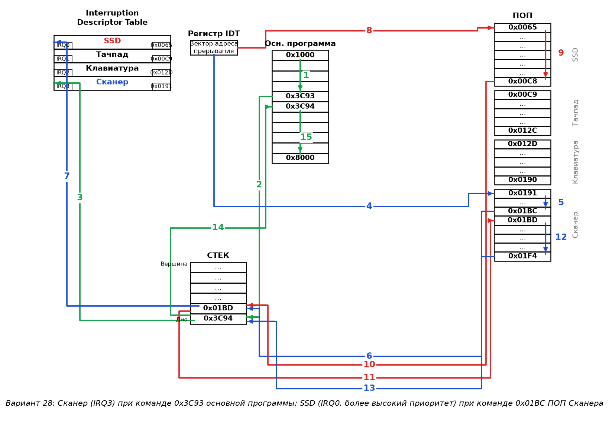
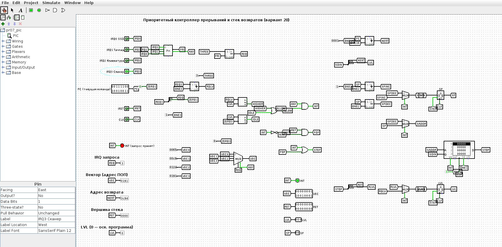
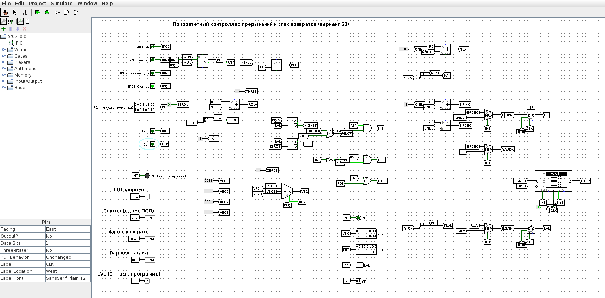
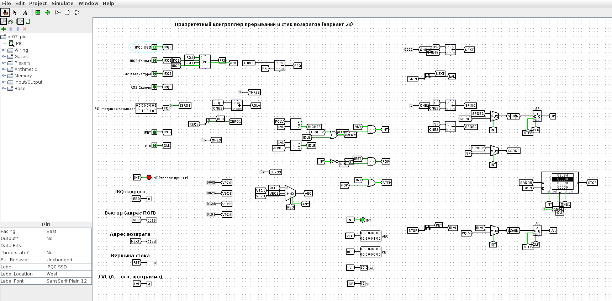
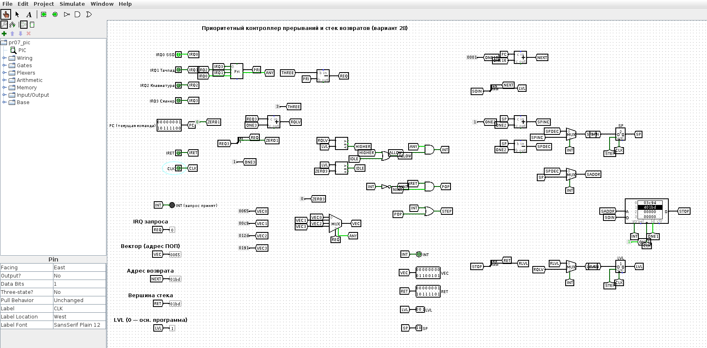
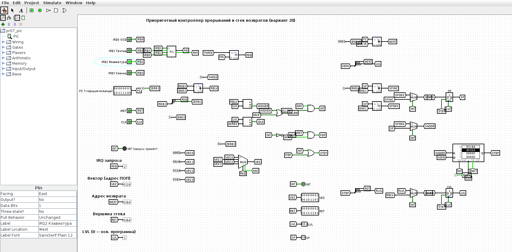
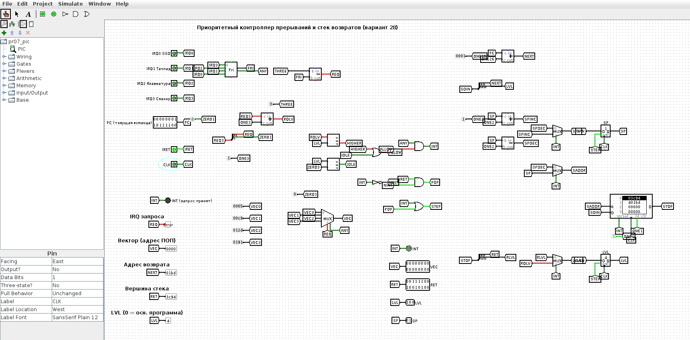

<!-- num: 7; title: Общая организация прерываний -->

# ЦЕЛЬ РАБОТЫ

Изучить механизм прерываний: виды прерываний (аппаратные, программные, исключения), роль контроллера прерываний и таблицы векторов IDT, порядок сохранения и восстановления контекста через стек, обработку вложенных прерываний с учётом приоритетов. Изобразить ход вычислительного процесса при обработке прерываний по персональному варианту и смоделировать работу приоритетного контроллера прерываний в Logisim.

# ЗАДАНИЕ

Вариант 28. Периферийные устройства: SSD; Тачпад; Клавиатура; Сканер. При выполнении команды 0x3C93 прикладной программы пришло прерывание от Сканера. Далее, при выполнении команды 0x01BC ПОП Сканера пришло прерывание от SSD. Используя шаблон схемы (рис. 7.1), изобразить на рисунке ход выполнения вычислительного процесса.

# ХОД РАБОТЫ

## 1 Распределение линий IRQ, приоритетов и памяти

По аналогии с примером п. 7.6 устройствам назначены линии IRQ в порядке их перечисления в варианте; чем меньше номер линии, тем выше приоритет. Программы обработки прерываний (ПОП) находятся в служебной области ОЗУ 0x0065–0x01F4, по 100 ячеек на устройство, основная программа — в области 0x1000–0x8000.

Таблица 1 – Линии прерываний и адреса ПОП (вариант 28)

| Линия | Устройство | Приоритет | Область ПОП | Вектор в IDT |
|---|---|---|---|---|
| IRQ0 | SSD | 0 (высший) | 0x0065–0x00C8 | 0x0065 |
| IRQ1 | Тачпад | 1 | 0x00C9–0x012C | 0x00C9 |
| IRQ2 | Клавиатура | 2 | 0x012D–0x0190 | 0x012D |
| IRQ3 | Сканер | 3 (низший) | 0x0191–0x01F4 | 0x0191 |

## 2 Последовательность обработки

Порядок действий при каждом прерывании (п. 7.5): завершить текущую команду, вычислить адрес следующей команды и сохранить контекст в стек, получить из IDT через регистр IDT вектор — адрес ПОП, выполнить ПОП, восстановить контекст из стека и продолжить прерванную программу. По условию состояние регистров не учитывается, в стеке отражаются только адреса возврата.

Таблица 2 – Ход вычислительного процесса (номера соответствуют стрелкам на рис. 1)

| № | Действие | Стек (дно → вершина) |
|---|---|---|
| 1 | Основная программа выполняется с 0x1000 до команды 0x3C93 | пуст |
| 2 | Приходит запрос Сканера; команда 0x3C93 завершается, адрес следующей команды 0x3C94 заносится в стек | 0x3C94 |
| 3 | Запрос IRQ3 поступает на контроллер, выбирается строка IDT «Сканер» | 0x3C94 |
| 4 | В регистре IDT сформирован вектор 0x0191 — переход в ПОП Сканера | 0x3C94 |
| 5 | ПОП Сканера выполняется с 0x0191 до команды 0x01BC | 0x3C94 |
| 6 | Приходит запрос SSD; его приоритет (0) выше обслуживаемого (3), поэтому прерывание принимается: команда 0x01BC завершается, адрес 0x01BD заносится в стек | 0x3C94, 0x01BD |
| 7 | Запрос IRQ0 поступает на контроллер, выбирается строка IDT «SSD» | 0x3C94, 0x01BD |
| 8 | Вектор 0x0065 — переход в ПОП SSD | 0x3C94, 0x01BD |
| 9 | ПОП SSD выполняется полностью, 0x0065–0x00C8 | 0x3C94, 0x01BD |
| 10 | Возврат из прерывания: из вершины стека извлекается адрес 0x01BD | 0x3C94 |
| 11 | Переход по адресу 0x01BD | 0x3C94 |
| 12 | ПОП Сканера выполняется до конца, 0x01BD–0x01F4 | 0x3C94 |
| 13 | Возврат из прерывания: из стека извлекается 0x3C94 | пуст |
| 14 | Переход по адресу 0x3C94 | пуст |
| 15 | Основная программа выполняется с 0x3C94 до 0x8000 | пуст |

Схема хода вычислительного процесса, выполненная по шаблону рис. 7.1, приведена на рис. 1. Зелёным показаны действия, связанные с прерыванием основной программы, синим — с ПОП Сканера, красным — с вложенным прерыванием от SSD.



Поскольку Сканер имеет низший приоритет, его ПОП может прервать любое из трёх других устройств; в данном сценарии это делает SSD (высший приоритет). Наоборот, если бы во время выполнения ПОП SSD пришёл запрос от любого устройства с меньшим приоритетом (Тачпад, Клавиатура или Сканер), контроллер не прервал бы обработчик: запрос ждал бы завершения ПОП SSD и был бы обслужен после возврата.

## 3 Модель контроллера прерываний в Logisim

В Logisim построена модель приоритетного контроллера прерываний со стеком возвратов (`pr07/src/logisim/pr07_pic.circ`, генератор `gen_pr07.py`). Её узлы:

- входы IRQ0–IRQ3 (SSD, Тачпад, Клавиатура, Сканер), адрес текущей команды PC, сигнал возврата IRET и тактовый вход CLK;
- приоритетный шифратор выбирает запрос с наименьшим номером линии (линии поданы в обратном порядке, т. к. шифратор Logisim отдаёт старший вход);
- регистр LVL хранит уровень обслуживаемого прерывания (0 — основная программа, k + 1 — выполняется ПОП IRQk); компараторы разрешают прерывание (INT = 1), только если LVL = 0 или уровень запроса выше текущего — так реализуется маскирование по приоритету;
- таблица векторов IDT — мультиплексор с константами 0x0065, 0x00C9, 0x012D, 0x0191;
- стек возвратов — ОЗУ 4 × 19 бит и указатель стека SP; по фронту CLK при INT = 1 в стек записывается {LVL, PC + 1}, LVL принимает уровень запроса; при IRET = 1 из вершины стека восстанавливаются адрес возврата и прежний уровень.

Сценарий варианта воспроизведён в GUI Logisim (рис. 2–8).














Протокол прогона того же сценария в движке Logisim приведён в листинге 1 (RET — вершина стека, LVL — уровень обслуживания, SP — указатель стека).

Листинг 1 – Проверка модели контроллера прерываний (lsim.js)

```
start:                               INT=0 LVL=0 RET=0    SP=0 VEC=0
IRQ3 (Сканер) при 0x3C93:            INT=1 LVL=0 RET=0    SP=0 VEC=191
вход в ПОП Сканера:                  INT=0 LVL=4 RET=3C94 SP=1 VEC=191
IRQ0 (SSD) при 0x01BC:               INT=1 LVL=4 RET=0    SP=1 VEC=65
вход в ПОП SSD:                      INT=0 LVL=1 RET=1BD  SP=2 VEC=65
IRQ2 (Клавиатура) при ПОП SSD (нет): INT=0 LVL=1 RET=1BD  SP=2 VEC=12D
возврат из ПОП SSD:                  INT=0 LVL=4 RET=3C94 SP=1 VEC=0
возврат из ПОП Сканера:              INT=0 LVL=0 RET=0    SP=0 VEC=0
```

## 4 Как показать преподавателю

1. Показать рис. 1 и пройти стрелки 1–15 по табл. 2.
2. Открыть `pr07/src/logisim/pr07_pic.circ`: PC = 3C93, IRQ3 = 1, такт CLK (0 → 1 → 0) — LVL = 4, в стеке 3C94.
3. IRQ3 = 0, PC = 01BC, IRQ0 = 1, такт — LVL = 1, в стеке 01BD; IRQ0 = 0, IRQ2 = 1 — INT не загорается (низкий приоритет для текущего уровня).
4. IRQ2 = 0, IRET = 1, два такта — возврат в ПОП Сканера, затем в основную программу.

# ВЫВОДЫ

Для варианта 28 построена схема хода вычислительного процесса при вложенных прерываниях: прерывание Сканера (IRQ3) на команде 0x3C93 сохраняет в стек адрес 0x3C94 и передаёт управление ПОП по вектору 0x0191; прерывание SSD (IRQ0) имеет более высокий приоритет, поэтому прерывает ПОП Сканера на команде 0x01BC — в стек заносится 0x01BD, выполняется ПОП SSD (0x0065–0x00C8). Возвраты идут в обратном порядке по принципу стека: сначала к 0x01BD (дозавершение ПОП Сканера до 0x01F4), затем к 0x3C94 (основная программа до 0x8000).

Модель контроллера в Logisim показала аппаратную сторону механизма: приоритетный выбор запроса, маскирование запросов не выше текущего уровня, выдачу вектора из IDT и стек адресов возврата. Работа модели совпала со схемой рис. 1.
