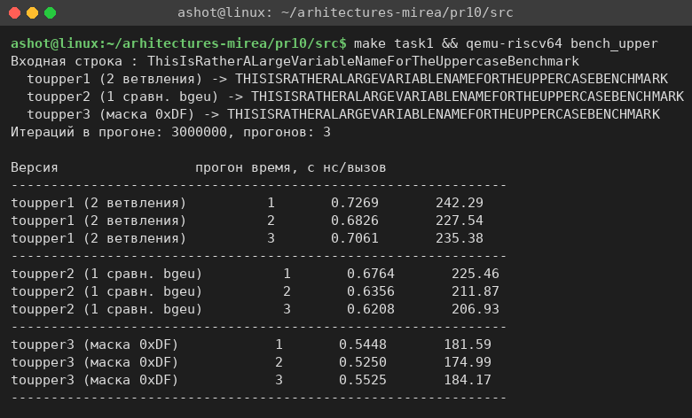
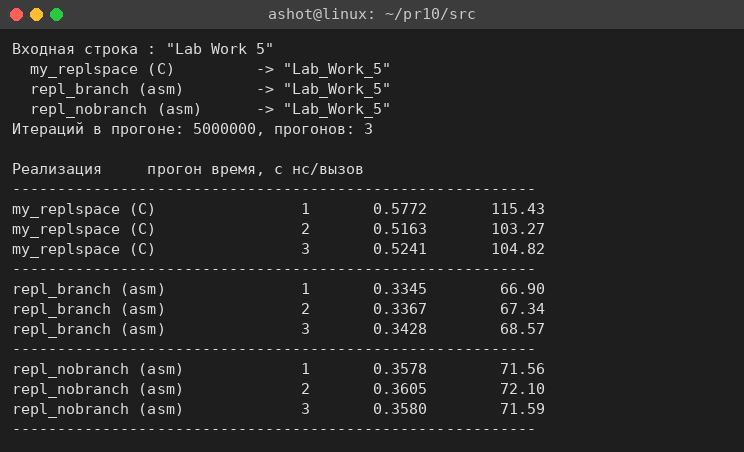
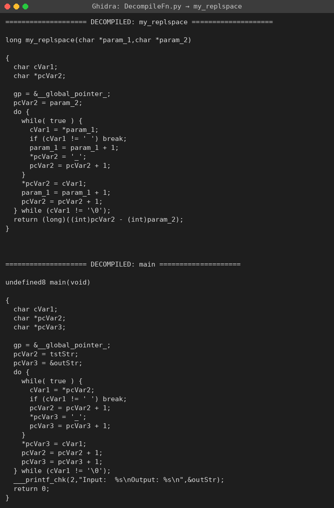
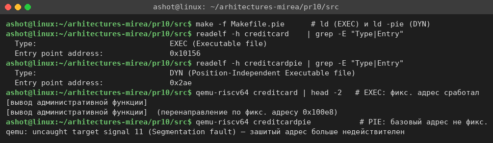
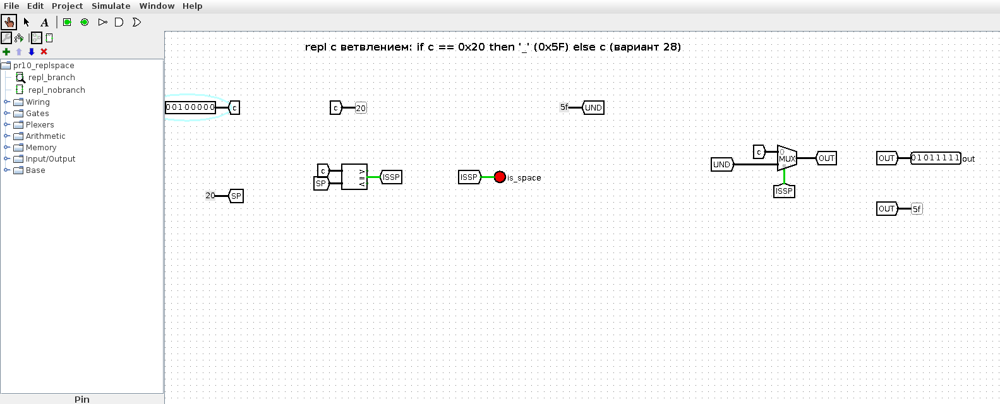
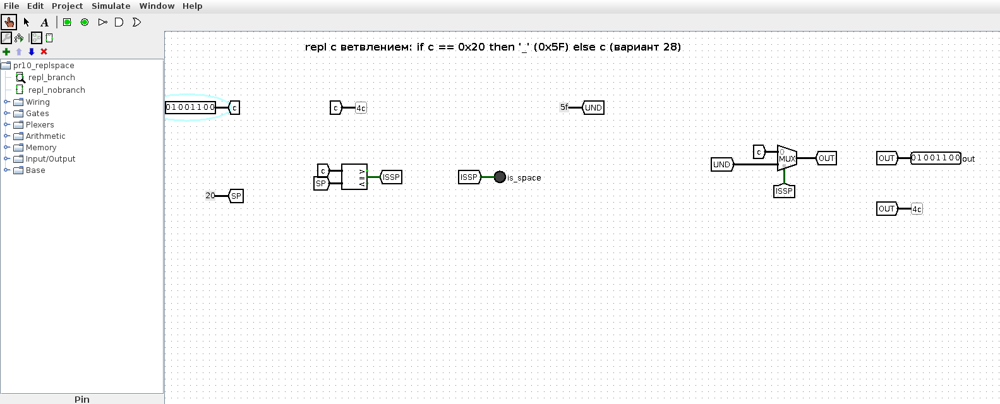
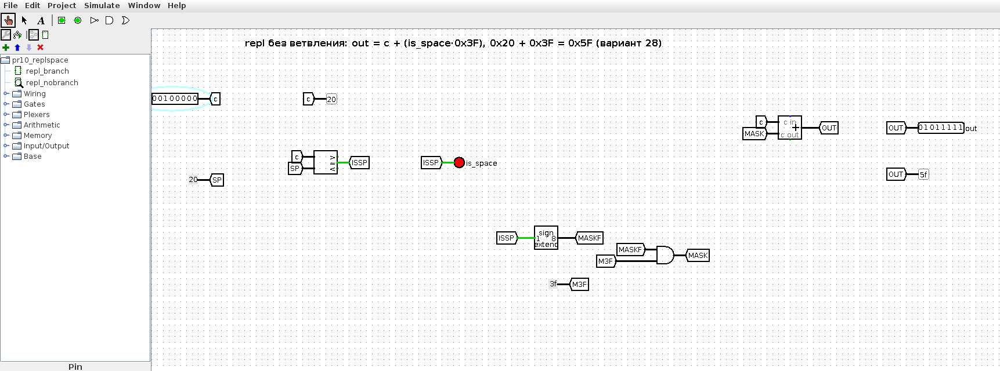
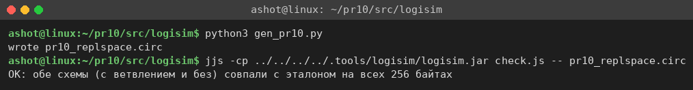

<!-- num: 10; title: Ассемблирование и дизассемблирование, оптимизация и уязвимости -->

# ЦЕЛЬ РАБОТЫ

Освоить приёмы оптимизации ассемблерного кода (сокращение числа ветвлений, побитовые операции), ассемблирование и дизассемблирование программ (objdump), восстановление исходного кода декомпилятором (Ghidra), а также основные уязвимости низкоуровневого ПО (переполнение буфера) и механизмы защиты (PIE, NX, стековые канарейки). Выполнить задания практической работы по персональному варианту.

# ЗАДАНИЕ

Вариант 28. По табл. 10.1 в таблице 12 вариантов, поэтому берётся вариант 28 − 12 − 12 = 4: входная строка "Lab Work 5", задача — заменить все пробелы на символ '_'.

- №1. Собрать и запустить программы из листингов 10.1–10.7 в одном цикле, сравнить время работы разных версий перевода в верхний регистр.
- №2. Реализовать функцию варианта на C, проанализировать её ассемблерное представление (objdump), сравнить со своей реализацией на ассемблере.
- №3. Восстановить исходный код из скомпилированной программы с помощью Ghidra, сравнить с оригиналом.
- №4. Собрать программу из листингов 10.13–10.14, включить режим PIE, проверить корректность, сделать выводы.

Работа выполнялась на Ubuntu 24.04 x86_64 кросс-компилятором `riscv64-linux-gnu-gcc` с запуском через `qemu-riscv64` (user-mode), дизассемблер `riscv64-linux-gnu-objdump`.

# ХОД РАБОТЫ

## 1 Задание №1. Сравнение версий uppercase

Реализованы три версии перевода строки в верхний регистр (по листингам 10.1–10.7):

- `toupper1` — базовая, с двумя ветвлениями (`bgt` по 'z' и `blt` по 'a');
- `toupper2` — с одной проверкой диапазона беззнаковым сравнением (сдвиг `c − 'a'` и `bgeu`);
- `toupper3` — без ветвлений, сбросом бита маской `andi 0xDF` (корректно только для букв).

Все три дают одинаковый результат; время измерено службой `gettimeofday` по 3 000 000 вызовов, 3 прогона (рис. 1).



Таблица 1 – Среднее время одного вызова

| Версия | нс/вызов | Относительно базовой |
|---|---|---|
| toupper1 (2 ветвления) | ≈ 235 | 1,00 |
| toupper2 (1 сравнение bgeu) | ≈ 215 | 0,91 |
| toupper3 (маска 0xDF) | ≈ 180 | 0,77 |

Устранение ветвлений ускоряет функцию: отказ от одного условного перехода даёт ≈ 9 %, переход к чистой битовой операции без ветвлений — ≈ 23 %. Выигрыш объясняется тем, что ветвления нарушают конвейер процессора (ошибки предсказания переходов), а побитовая операция выполняется за один такт без переходов.

## 2 Задание №2. Функция варианта на C и ассемблере

Функция варианта — замена всех пробелов на символ '_' — реализована на C (`replspace.c`): для каждого символа при условии c == ' ' (0x20) записывается '_' (0x5F), прочие символы копируются без изменений. Входная строка варианта «Lab Work 5» после обработки даёт «Lab_Work_5». Компиляция `-O2` и анализ `objdump -d` показали, что для сравнения с одной константой оптимизатор GCC оставил ветвление (`beq`), заранее загрузив обе константы в регистры:

Листинг 1 – Ключевой фрагмент my_replspace при -O2 (objdump)

```
my_replspace:
    li    a3,32          # ' '  (0x20)
    li    a2,95          # '_'  (0x5F)
    lbu   a5,0(a0)       # загрузить символ
    beq   a5,a3,.L_sp    # если c == ' ' -> записать '_'
    sb    a5,0(a4)       # иначе символ без изменений
    addi  a0,a0,1
    addi  a4,a4,1
    bnez  a5,...         # до завершающего нуля
```

В отличие от задачи «перевод в верхний регистр», где компилятор свёл проверку диапазона к одному беззнаковому сравнению без перехода, здесь сравнение с единственным значением естественно выражается ветвлением `beq`.

Для сравнения написаны две версии на ассемблере RISC-V (`replspace_asm.S`): `repl_branch` — прямая с ветвлением (`bne` по пробелу), `repl_nobranch` — без ветвления в теле: признак пробела `is_space = (c == 0x20)` разворачивается в маску 0x3F и прибавляется к символу (0x20 + 0x3F = 0x5F), прочие символы получают прибавку 0. Замеры по 5 000 000 вызовов (рис. 2).



Таблица 2 – Среднее время одного вызова (вариант 28)

| Реализация | нс/вызов |
|---|---|
| my_replspace (C, -O2) | ≈ 103 |
| repl_branch (asm, с ветвлением) | ≈ 67 |
| repl_nobranch (asm, без ветвлений) | ≈ 72 |

Рукописный ассемблер быстрее C-версии (в C-функции есть накладные расходы ABI). Интересно, что здесь версия с ветвлением оказалась немного быстрее безветочной (≈ 67 против ≈ 72 нс), в отличие от задачи с переводом регистра. Причина — в данных: в строке почти нет пробелов, поэтому ветвление `bne` почти всегда предсказывается верно и не ломает конвейер, а безветочная версия на каждый символ безусловно выполняет лишние пять операций (xori, seqz, neg, andi, add). Это показывает, что безветочный код выгоден не всегда — выигрыш зависит от предсказуемости перехода. Результат на тестовой строке «Lab Work 5» у всех реализаций одинаков: «Lab_Work_5».

## 3 Задание №3. Восстановление кода в Ghidra

Программа `replspace_O2` (та же функция, статически слинкованная) загружена в Ghidra 11 (headless-режим, скрипт декомпиляции `DecompileFn.py`; Ghidra и JDK 21 установлены локально в `.tools/`). Результат декомпиляции функции (рис. 3):



Ghidra корректно восстановила логику: вложенный цикл с внутренним `while (true) { ...; if (cVar1 != ' ') break; ...; *pcVar2 = '_'; }` — это ровно та же проверка «символ равен пробелу» и замена на '_', что и в исходнике, записанная через ранний выход из внутреннего цикла. Отличия от оригинала косметические: декомпилятор не знает имён переменных (param_1, pcVar2), показывает служебную инициализацию `gp` и иначе сгруппировал циклы. Восстановленный код (`ghidra_restored.c`) после возврата понятных имён скомпилирован и запущен — результат совпал с оригиналом («Lab_Work_5», len = 11).

## 4 Задание №4. Переполнение буфера и режим PIE

Собрана учебная программа из листингов 10.13–10.14 (`creditcard.S`, `upper.S`) — демонстрация уязвимости переполнения буфера на примере из методички: функция `toupper` не проверяет длину выходного буфера, из-за чего при длинной входной строке перезаписывается сохранённый в стеке адрес возврата `ra`. По методичке строка в секции `.data` подобрана так, что `ra` заменяется адресом служебной подпрограммы `DownloadCreditCardNumbers`, которая явно не вызывается, но получает управление — это демонстрирует последствия отсутствия проверки длины входных данных.

Программа собрана в двух вариантах (листинг 10.18): обычный (`ld`) и с позиционно-независимым кодом (`ld -pie`). Сравнение показано на рис. 4.



Таблица 3 – Влияние PIE

| Свойство | Обычная сборка | PIE-сборка |
|---|---|---|
| Тип ELF (readelf -h) | EXEC (Executable file) | DYN (Position-Independent Executable) |
| Точка входа | фиксированный адрес 0x100xx | малое смещение 0x2ae (определяется при загрузке) |
| Жёстко зашитый адрес в .data | действителен — перенаправление срабатывает | недействителен при изменении базы загрузки |

Выводы по защите:

- **PIE** превращает исполняемый файл в DYN-объект: все адреса в нём относительны, а базовый адрес назначается при загрузке (ASLR). Жёстко зашитый в эксплойте абсолютный адрес `DownloadCreditCardNumbers` при этом перестаёт соответствовать реальному расположению функции, поэтому атака с фиксированным адресом теряет надёжность (в учебной программе PIE-версия под qemu аварийно завершается — зашитый адрес больше не ведёт в нужную функцию).
- **NX-бит** (неисполняемый стек) не даёт выполнять код, помещённый в стек — Linux по умолчанию помечает стек как неисполняемый, что обесценивает классические эксплойты с кодом в стеке.
- **Стековые канарейки** (`-fstack-protector`, листинги 10.19–10.20) вставляют контрольное значение между локальными данными и адресом возврата и проверяют его в эпилоге; при перезаписи буфером программа аварийно завершается («stack smashing detected») до возврата по подменённому адресу.

Главная причина уязвимости — отсутствие проверки длины входных данных; перечисленные механизмы снижают риск, но не заменяют корректной проверки границ буфера.

## 5 Аппаратная модель функции в Logisim

Логика функции варианта (замена пробела на '_') реализована аппаратно в Logisim (`pr10/src/logisim/pr10_replspace.circ`, генератор `gen_pr10.py`) в двух вариантах — тех же, что в ассемблере:

- `repl_branch` — «с ветвлением»: компаратор проверяет равенство c == 0x20, результат `is_space` управляет мультиплексором, который выбирает '_' (0x5F) либо исходный символ c;
- `repl_nobranch` — «без ветвления»: `out = c + (is_space · 0x3F)` — признак пробела знаково расширяется в 0xFF, маскируется до 0x3F и прибавляется к символу (0x20 + 0x3F = 0x5F), как в оптимизированном ассемблере.

При c = ' ' (0x20) обе схемы дают '_' (0x5F), индикатор is_space = 1 (рис. 5); при c = 'L' (0x4C) пробел не распознаётся, выход равен входу (рис. 6). Устройство без ветвления показано на рис. 7.







Эквивалентность обеих схем эталону проверена на всех 256 значениях байта (рис. 8).



# ВЫВОДЫ

В работе выполнены все четыре задания варианта 28. В задании №1 показано, что устранение ветвлений ускоряет перевод в верхний регистр: безветочная версия с маской быстрее базовой на ≈ 23 %. В задании №2 функция варианта (замена пробела на '_') реализована на C и в двух версиях на ассемблере; анализ `objdump` показал, что для сравнения с одной константой компилятор оставляет ветвление `beq`, а замеры выявили, что безветочная версия не всегда быстрее — на данных без пробелов хорошо предсказываемое ветвление оказалось быстрее безусловно выполняемых дополнительных операций.

В задании №3 декомпилятор Ghidra по статически слинкованному бинарнику восстановил логику функции (проверка на пробел и замена на '_'); восстановленный код после косметических правок собрался и дал тот же результат «Lab_Work_5». В задании №4 на учебном примере показано переполнение буфера с перезаписью адреса возврата и рассмотрены механизмы защиты: PIE/ASLR (адреса становятся относительными, фиксированный адрес эксплойта теряет силу), неисполняемый стек и стековые канарейки; подчёркнуто, что они не заменяют проверки границ буфера. Аппаратная модель в Logisim подтвердила эквивалентность версий «с ветвлением» и «без ветвления» на всех 256 байтах.
